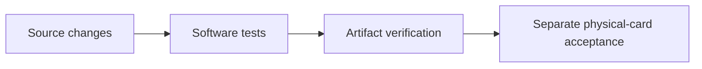

# Changelog

## Unreleased

- Add `scripts/send/board.mjs`: settle confirmed onchain boarding UTXOs into a
  card-owned Arkade VTXO. Dry run is GET-only and prints the boarding UTXOs,
  the operator-fee plan and the exact approval requests; `--execute` needs
  `NURI_SEND_CONFIRM=board-<sats>`. One passkey assertion, then card MuSig2 for
  the proof, the batch tree and the boarding input. Software-card tests cover
  the nested tree share end to end.

## v1.2.0 — Fast MuSig2 PIN signer

- Add `scripts/build-musig2-aid3.sh`: package `4E5552494D554733`, applet
  `4E5552494D55473301`, built from the current MuSig2 sources in a temporary
  tree. The builder normalizes CAP ZIP metadata; release build, manifest,
  component verification and source inventory include AID3.
- Repository package and lockfile version: `1.2.0`; Chrome stays `0.2.0`.
- Regression disclosure: `00ce5b2` replaced inherited scalar multiplication
  with the MIT clean-room fixed-iteration software loop. Its hardware latency
  was not timed during that integration; simulator correctness did not establish
  acceptable physical-card performance. The software path later measured 75.7 s.
- Independently authored MIT RSA-square acceleration: `2ab=(a+b)^2-a^2-b^2`,
  768-bit RSA NOPAD exponent two, fixed folding reduction modulo n and p.
  Unsupported providers fail installation closed. No GPL arithmetic was read or copied.
- On card `87E5470B`, OMNIKEY 5422: five verified BIP340 signatures;
  FINALIZE 5164.75 / 5194.75 / 5195.32 ms min/median/max (previously 75.7 s).
  **The <3 s target is not reached.** GET_NONCES 290–293 ms.
  Blinding, double computation, PIN/session/nonce protections remain unchanged.
- New AID3 only; no existing instance deleted. SSH checks passed before/after
  each card-write step; one wrong PIN returned 63C4, correct PIN restored five tries.
  Full signatures and timings: [AID3 proof](docs/proofs/real-card-87E5470B-musig2-aid3-fast.json).

## v1.1.0 — 2026-10-22 — Real-card PIN signers — Hermes Agent

Applets (CAPs in `dist/`, sha256 in `dist/SHA256SUMS`, reproducible via
`npm run card:release:verify`):

| Applet | Package / applet AID | Version | CAP sha256 |
|---|---|---|---|
| ETH signer v2 (PIN) | `4E55524945544832` / `4E5552494554483201` | 2.1.0 | `158088eec670eab578fc81d4621087c3752e4001f7afcf288e8ff48b01f9261e` |
| MuSig2 PIN2, AID2 | `4E5552494D554732` / `4E5552494D55473201` | v1.15 build, protocol pin-1.14 | `bb28841d923b4a709ac1c688d3c0926753b5abd46aefe8678e9d986dd6f81f8b` |

- Real card `87E5470B` (OMNIKEY 5422), additive installs, no DELETE; FIDO2
  `A0000006472F0001` and SSH access preserved (`ssh -o BatchMode=yes` checked
  before/after every step).
- ETH2: SET_PIN, VERIFY, on-card KEYGEN; SIGN without VERIFY returns `6982`;
  native host `sign_hash` returns `PIN_REQUIRED` without PIN.
  Receipt `docs/proofs/real-card-87E5470B-eth2-pin.json`.
- MuSig2 AID2: `scripts/build-musig2-aid2.sh` (now part of the release build);
  host scripts select it via `NURI_MUSIG2_AID=4E5552494D55473201`.
  `REAL_CARD_COSIGN_FLOW_OK`, both partials and BIP340 signature verified;
  KEYGEN/GET_NONCES without VERIFY return `6982`. Not broadcast, not funded.
  Receipt `docs/proofs/real-card-87E5470B-musig2-aid2-cosign.json`.
- Connect WebAuthn+PRF via native host on the real card (`8a8ebbc`).
- Fix: `scripts/package-chrome.py` now ships `host/webauthn_bridge.py`, which
  `host/install-macos.sh` requires.
- README audited claim by claim against code; per-feature evidence moved to
  `docs/feature-status.md`.
- Open: live connect.nuri.com browser E2E, on-chain spend from the new MuSig2
  key, CA attestation (`verified=false`).

## 1.0.2 launch-branch notes

### 2026-10-20 — Readable Nuri side panel — Hermes Agent

Version: 1.0.2 unreleased; Chrome extension 0.2.0.

- `ab6a413`: native side panel, 17px body/30px title, official production-app
  icons and collapsed technical/attestation details. Simulator remains labelled.
- `ab6a413`: preserve OKX's existing injected provider; 34 extension tests pass.
  Signing inside OKX is not implemented; PIN on/off is deferred, without card changes.
- `ab6a413`: register the simulator host in the isolated Chromium user-data
  profile; preserve signature-match DOM nodes when appending test logs.
  Local Chromium verifies a live SIDE_PANEL context, layout and three recovered
  signatures. Host suite: 86 tests run, one intentional skip. No physical card,
  installed host, personal browser profile or production changes.

### 2026-10-20 — Chrome installation package — Hermes Agent

Version: 1.0.2 unreleased; Chrome extension 0.2.0.

- `3639a7c`: create a clean folder with root `manifest.json`, ZIP, START HERE
  instructions and minimal host installer; refuse to overwrite existing paths.
- Add actual Chromium UI and Python native-messaging acceptance in explicit
  simulator mode, repeated three times in cloud CI with downloadable evidence.
  Physical-card signing, PIN, broadcast and release qualification remain separate.
- Existing working card, SSH keys, installed host and production remain unchanged.

### 2026-10-19 — ETH1 acceptance hardening — Hermes Agent

Version: 1.0.2 (unreleased launch changes). Updated: 2026-10-19 CEST.

- `7b394bcb914aa89bd0ad9757822cdb445d8a4470`: malformed, mismatched and
  unrecoverable ETH1 signatures close the connection and exit non-zero, preventing
  a false downstream card-acceptance success.
- `e7c98280b59a337d8c9e1f7c8919a6c10689b8c7`: fake-reader regressions exercise
  the actual script process and expose acceptance of invalid zero/order scalars.
- `7fb9cf83d715b36cd67b0c39a2d8d2c88e4889ea`: reject out-of-range ECDSA
  scalars and invalid secp256k1 recovery points before recovery arithmetic.
  [Cloud CI](https://github.com/nuri-com/nuri-passkey-prf-smartcard/actions/runs/39173633215)
  passed `node-tests`, `card-release` and `virtual-card`; 47 PC/SC fake tests and
  79 Node tests passed. No physical-card access, merge or deployment in this change.

- Minimal public documentation: consolidated user guides; deleted stale session,
  planning, incident and vendor-email/PDF material. Historical proof records are
  isolated under `docs/proofs/` and are not fresh launch acceptance.
- MuSig2 nonce lifetime and PC/SC transport handling are documented in
  [nonce handling](docs/musig2-nonce-lifetime-fix.md) and [readers](docs/reader-compatibility.md).
- ETH v2 is a separate applet with simulator coverage and optional PIN protection;
  fresh physical-card acceptance is UNVERIFIED. [ETH v2](docs/eth-applet-v2.md).
- TOTP has software HMAC-SHA1 fallback and PIN-protected secret replacement;
  code calculation remains ungated. [TOTP](docs/totp-applet.md).
- Local helper guards and extension/native-host trust boundaries are documented
  without claiming fresh browser or hardware acceptance. [Helpers](docs/helper-servers-security.md),
  [extension](docs/chrome-extension.md).

## 1.0.2 — public-core reproduction entrypoint

- Source, virtual tests and artifact comparison entrypoint:
  [scripts/reproduce-v1.sh:7–22](scripts/reproduce-v1.sh#L7-L22).
- Mobile verification still requires separate private design-system access;
  use `REPRODUCE_EXPO=NO` for the public-core path.
- Reproducibility is not hardware qualification. See [release](docs/release.md)
  and [acceptance](docs/acceptance.md).
