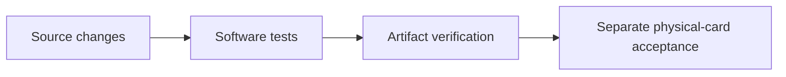

# Changelog

## Unreleased — launch branch

- Minimal public documentation: consolidated user guides; deleted stale session,
  planning, incident and vendor-email/PDF material. Historical proof records are
  isolated under `docs/proofs/` and are not fresh launch acceptance.
- MuSig2 nonce lifetime and PC/SC transport handling are documented in
  [nonce handling](docs/musig2-nonce-lifetime-fix.md) and [readers](docs/reader-compatibility.md).
- ETH v2 is a separate applet with simulator coverage and optional PIN protection;
  fresh physical-card acceptance is UNVERIFIED. [ETH v2](docs/eth-applet-v2.md).
- TOTP has software HMAC-SHA1 fallback and PIN-protected secret replacement;
  code calculation remains ungated. [TOTP](docs/totp-applet.md).
- Local helper guards and extension/native-host trust boundaries are documented
  without claiming fresh browser or hardware acceptance. [Helpers](docs/helper-servers-security.md),
  [extension](docs/chrome-extension.md).

## 1.0.2 — public-core reproduction entrypoint

- Source, virtual tests and artifact comparison entrypoint:
  [scripts/reproduce-v1.sh:7–22](scripts/reproduce-v1.sh#L7-L22).
- Mobile verification still requires separate private design-system access;
  use `REPRODUCE_EXPO=NO` for the public-core path.
- Reproducibility is not hardware qualification. See [release](docs/release.md)
  and [acceptance](docs/acceptance.md).
