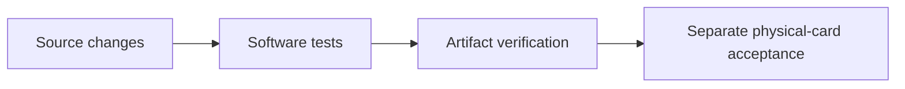

# Changelog

## Unreleased — 2026-10-30 — Chrome 0.3.0: Bitcoin account in the extension — Hermes Agent

- Side panel is now a Nuri account view: one Bitcoin total over Arkade VTXOs,
  boarding and the onchain MuSig2+CSV rail (each with its full address), then the
  unchanged Ethereum balance.
- **Proven on the real card** (demo card `87E5470B`, AID3 v1.17, OMNIKEY 5422 top
  slot) through the installed host exactly as Chrome calls it: `info`,
  `bitcoin_info`, `bitcoin_balance` all ok, total 10,465 sats = Arkade 4,458 +
  boarding 0 + onchain 6,007, username `arkade`, addresses equal the README money
  table.
- Addresses from the live `nuri_client_recovery_v1` contract (`deriveAddresses`,
  the same derivation `scripts/send` spends from), never the SDK default contract.
  Regression test on the live public values fails on the previous code.
- Fixed: host module loaded twice when run as a script, so every `bitcoin_*` call
  failed `INFO_REQUIRED` after a good `info` (`sys.modules` alias).
- Installer: Bitcoin settings in `~/.nuri-card-host/bitcoin.env`
  (template `host/bitcoin.env.example`), pinned npm dependencies via `npm ci
  --omit=dev`, card drivers on the host venv Python instead of Chrome's bare `PATH`.
- Receive: ark address, boarding address and a Lightning invoice (invoice not yet
  run live).
- Send from the panel is fail-closed (`SEND_UNSUPPORTED`) until it uses the
  proven `scripts/send` script-path signing; use `scripts/send/cli.mjs` to send.
- host: `bitcoin_info`, `bitcoin_balance`, `bitcoin_invoice`, `bitcoin_preview`,
  `bitcoin_sign_partial`, `bitcoin_cancel` (`host/bitcoin_commands.py`).
- Tests: host 86 (1 skipped), bitcoin host 13, webauthn 10, extension 58, bridge 9,
  `npm test` 131.

## Unreleased — 2026-10-30 — DIY card admin-key change, real-card proven — Hermes Agent

- `879eb79` card_lock: SCP02/DES3 keysets, exact dual-slot reader selection, CI step.
- `db5aea1` rotation via `--lock`; gp 24.10.15 NPEs on `--lock-enc/mac/dek` (GPTool.java L801).
- `09d66ff` `scripts/diy-key.sh`: one-command wizard, pinned gp.jar, reader picker, deny-list, encrypted escrow.
- `f842fab` docs/diy-key.md exact how-to + README section + LLM agent runbook.
- `f6807d1` real-card E2E on `57274221` (JCOP 2.4.1, SCP02 DES3): two lock/undo cycles through the wizard,
  `CARD_LOCK_VERIFIED` + `CARD_DEFAULT_KEYS_RESTORED_VERIFIED` both times, final default-key `gp -l` lists
  ISD + 8 applets. Fixed wizard escrow-path display (prompt-prefixed line). Reusing an existing escrow
  path refuses before any rotation. Receipt: `docs/proofs/real-card-57274221-gp-lock.json`.
  Not merged, not released. Card-specific GP retry limits stay UNVERIFIED.

## v1.2.0 — 2026-10-29 — Card-signed Bitcoin on mainnet, fast MuSig2 — Hermes Agent

Before: `v1.1.0` co-signed MuSig2 on the card only in an unfunded test, on the
software scalar path, which later measured 75.7 s per FINALIZE on hardware. Now: card
`87E5470B` co-signed a live mainnet Arkade send through the new AID3 applet 1.17,
and the operator reports about 2.0 s per FINALIZE. The 1 s target is not reached.

Applets (CAPs in `dist/`, sha256 in `dist/SHA256SUMS`, reproducible via
`npm run card:release:verify`), new or changed since `v1.1.0`:

| Applet | Package / applet AID | Version | CAP sha256 |
|---|---|---|---|
| MuSig2 AID3 (new) | `4E5552494D554733` / `4E5552494D55473301` | 1.17 | `d6f1cef2886166630132c6cc65b73580315686038e331bf3229f5058833ff7a9` |
| MuSig2 AID2 | `4E5552494D554732` / `4E5552494D55473201` | 1.17 | `972848969e3e58dc72d30b511247b7f4eb01f7b0350f58f78b5ee6c2c2ee889b` |
| MuSig2 original | `4E5552494D5547` / `4E5552494D554701` | 1.17 | `2eb4c417274c20bcc36cd0be6a5a61dc33c7b7bb7c22dc399d650ea72cee8741` |
| ETH signer v2 (PIN) | `4E55524945544832` / `4E5552494554483201` | 2.1.0 | `f1e7eef017a36a9218d095cabcb195b8283534c34081bd36828dc92aef5d8403` |
| ETH signer v1 (demo) | `4E555249455448` / `4E55524945544801` | 1.5 | `627649805d0fd7042ebefe08f5f2e50da8556bd109752904116ec1f86e07e470` |

FIDO2, FIDO2-up, OATH TOTP, vault and the PKCS#11 module are
byte-identical to `v1.1.0`. CI job `card-release` rebuilt every CAP from main
`f95d77ce9cffd776c866002a8b0fad3c2350fe3d` with identical components
(`CARD_V1_RELEASE_VERIFIED`, [run 40795980738](https://github.com/nuri-com/nuri-passkey-prf-smartcard/actions/runs/40795980738)).
ETH v1 1.5 (d4dbdd9, below) came after that run; the `card-release` job of
#42 rebuilt it with identical components.

Card and signing:

- AID3: `scripts/build-musig2-aid3.sh` builds package `4E5552494D554733`, applet
  `4E5552494D55473301` from the current MuSig2 sources in a temporary tree and
  normalizes CAP ZIP metadata. Release build, manifest, component verification
  and source inventory include it. Additive install; no existing instance deleted.
- Independently authored MIT RSA-square multiply: `2ab=(a+b)^2-a^2-b^2`,
  768-bit RSA NOPAD exponent two, fixed folding reduction modulo n and p.
  Unsupported providers fail installation closed. No GPL arithmetic was read or
  copied (a287784, ed73ea7).
- Applet 1.17: the full-width known-answer tests moved from INSTALL, where they
  returned `6985` on the real card, to the first multiply. A failure throws
  `6F31` and they run again on the next call; install still probes 3^2 = 9. The
  test buffer is transient (407691b, da94f7a).
- Regression disclosure: `00ce5b2` replaced inherited scalar multiplication
  with the MIT clean-room fixed-iteration software loop. Its hardware latency
  was not timed during that integration; simulator correctness did not establish
  acceptable physical-card performance. The software path later measured 75.7 s.
- Timing history on card `87E5470B`, OMNIKEY 5422. v1.16: five verified BIP340
  signatures, FINALIZE 5164.75 / 5194.75 / 5195.32 ms min/median/max, GET_NONCES
  290–294 ms; SSH checks passed before/after each card-write step; one wrong PIN
  returned 63C4, the correct PIN restored five tries
  ([receipt](docs/proofs/real-card-87E5470B-musig2-aid3-fast.json)). v1.17: about
  2.0 s, operator-reported, no timing receipt. Blinding, double computation and
  PIN/session/nonce protections are unchanged.
- ETH2: tear-safe transactional SET/CHANGE/UNBLOCK for PIN and PUK with
  simulator tests (#26). Version bytes stay 2.1.0; the CAP hash changes. The
  `v1.1.0` ETH2 hardware receipt covers the previous CAP.
- ETH1 1.5: set the secp256k1 cofactor (`setK(1)`) on both EC keys. On NXP
  JCOP 2.4.1 card `57274221` (CPLC fabricator `4790`, ATR `JCOPv241`), ETH1 1.4
  answered `6F00` to KEYGEN and then to GET_PUBKEY. KEYGEN marks the key as born
  before the EC operation, so that instance stays unusable: delete package
  `4E555249455448` and install 1.5. On the same card 1.5 returned KEYGEN `9000`,
  one-shot guard `6989` and two EIP-191 signatures, each recovered by
  python-ecdsa and ethers to `0xe08bDE52Fa83C6a7b96cbd8dE1437aF1036cC500`
  ([receipt](docs/proofs/real-card-57274221-eth1-cofactor.json), d4dbdd9;
  source comment 470c985, same CAP).
  ETH2 and MuSig2 already set the cofactor. The Infineon demo card (fabricator
  `4090`) has not run 1.5.

Bitcoin and Arkade:

- Live mainnet end-to-end receipt, 2026-10-28 19:12:58 UTC, card `87E5470B`:
  passkey + PRF, Nuri auth, card and Nuri MuSig2 partials, operator finalization.
  546-sat Arkade self-send, fee 0, 4/4 steps verified, transaction
  `13eba05423df9915bea4d13b1d6b488c9de7cf1ee24ac3defa24c23687b9a8a8`
  ([receipt](docs/proofs/e2e-proof.json), bbd291e). The receipt does not record
  the applet version or the installed CAP hash.
- Arkade bridge with public-only PRF proof; reusable card send CLI
  `npm run arkade:send` and guarded end-to-end proof `npm run arkade:proof`
  (e93fa31, bd1f85f, ecd051e). Receipt and log paths are repo-relative; dry runs
  write under `_launch/out/e2e-proof` and never overwrite the committed hardware
  receipt (0dafcc5).
- Add `scripts/send/board.mjs`: settle confirmed onchain boarding UTXOs into a
  card-owned Arkade VTXO. Dry run is GET-only and prints the boarding UTXOs,
  the operator-fee plan and the exact approval requests; `--execute` needs
  `NURI_SEND_CONFIRM=board-<sats>`. One passkey assertion, then card MuSig2 for
  the proof, the batch tree and the boarding input. Software-card tests cover
  the nested tree share end to end. Live mainnet fixes: two-round tree signing,
  per-input sighash, `/v4` paths, one reader reconnect for pubkey/nonces, never
  for FINALIZE (#39).
- Zero-funds live Arkade 2-of-2 harness with a pluggable card signer (#32).
- Android NFC demo: card MuSig2 PIN signature and a card wallet with derived
  onchain balance (#30).

Docs and CI:

- README and site: product-first README, comparisons, HSM + PKCS#11 guide,
  capability reference, live money table checked 2026-10-29 00:07 UTC
  (#33–#36, e49a811, b89a1f8).
- MuSig2 CAP triplet imported from a pinned cloud CI build and refreshed after
  the transient KAT buffer fix ([import record](dist/README.md)); CI retains
  rebuilt release artifacts and parses README and proof Mermaid diagrams
  (2f48a1c, 1037186, e0b72a5, 5e61e55).
- Repository package and lockfile version: `1.2.0`; Chrome stays `0.2.0`.

Open: the 1 s FINALIZE target, a v1.17 timing receipt, the installed CAP hash on
the card, the KAT pass-flag tear window (`card/musig2/RsaMultiply.java:23,104-111`),
hardware tear tests for ETH2, physical fault/side-channel qualification. Not
externally audited; not a certified hardware wallet.

## v1.1.0 — 2026-10-22 — Real-card PIN signers — Hermes Agent

Applets (CAPs in `dist/`, sha256 in `dist/SHA256SUMS`, reproducible via
`npm run card:release:verify`):

| Applet | Package / applet AID | Version | CAP sha256 |
|---|---|---|---|
| ETH signer v2 (PIN) | `4E55524945544832` / `4E5552494554483201` | 2.1.0 | `158088eec670eab578fc81d4621087c3752e4001f7afcf288e8ff48b01f9261e` |
| MuSig2 PIN2, AID2 | `4E5552494D554732` / `4E5552494D55473201` | v1.15 build, protocol pin-1.14 | `bb28841d923b4a709ac1c688d3c0926753b5abd46aefe8678e9d986dd6f81f8b` |

- Real card `87E5470B` (OMNIKEY 5422), additive installs, no DELETE; FIDO2
  `A0000006472F0001` and SSH access preserved (`ssh -o BatchMode=yes` checked
  before/after every step).
- ETH2: SET_PIN, VERIFY, on-card KEYGEN; SIGN without VERIFY returns `6982`;
  native host `sign_hash` returns `PIN_REQUIRED` without PIN.
  Receipt `docs/proofs/real-card-87E5470B-eth2-pin.json`.
- MuSig2 AID2: `scripts/build-musig2-aid2.sh` (now part of the release build);
  host scripts select it via `NURI_MUSIG2_AID=4E5552494D55473201`.
  `REAL_CARD_COSIGN_FLOW_OK`, both partials and BIP340 signature verified;
  KEYGEN/GET_NONCES without VERIFY return `6982`. Not broadcast, not funded.
  Receipt `docs/proofs/real-card-87E5470B-musig2-aid2-cosign.json`.
- Connect WebAuthn+PRF via native host on the real card (`8a8ebbc`).
- Fix: `scripts/package-chrome.py` now ships `host/webauthn_bridge.py`, which
  `host/install-macos.sh` requires.
- README audited claim by claim against code; per-feature evidence moved to
  `docs/feature-status.md`.
- Open: live connect.nuri.com browser E2E, on-chain spend from the new MuSig2
  key, CA attestation (`verified=false`).

## 1.0.2 launch-branch notes

### 2026-10-20 — Readable Nuri side panel — Hermes Agent

Version: 1.0.2 unreleased; Chrome extension 0.2.0.

- `ab6a413`: native side panel, 17px body/30px title, official production-app
  icons and collapsed technical/attestation details. Simulator remains labelled.
- `ab6a413`: preserve OKX's existing injected provider; 34 extension tests pass.
  Signing inside OKX is not implemented; PIN on/off is deferred, without card changes.
- `ab6a413`: register the simulator host in the isolated Chromium user-data
  profile; preserve signature-match DOM nodes when appending test logs.
  Local Chromium verifies a live SIDE_PANEL context, layout and three recovered
  signatures. Host suite: 86 tests run, one intentional skip. No physical card,
  installed host, personal browser profile or production changes.

### 2026-10-20 — Chrome installation package — Hermes Agent

Version: 1.0.2 unreleased; Chrome extension 0.2.0.

- `3639a7c`: create a clean folder with root `manifest.json`, ZIP, START HERE
  instructions and minimal host installer; refuse to overwrite existing paths.
- Add actual Chromium UI and Python native-messaging acceptance in explicit
  simulator mode, repeated three times in cloud CI with downloadable evidence.
  Physical-card signing, PIN, broadcast and release qualification remain separate.
- Existing working card, SSH keys, installed host and production remain unchanged.

### 2026-10-19 — ETH1 acceptance hardening — Hermes Agent

Version: 1.0.2 (unreleased launch changes). Updated: 2026-10-19 CEST.

- `7b394bcb914aa89bd0ad9757822cdb445d8a4470`: malformed, mismatched and
  unrecoverable ETH1 signatures close the connection and exit non-zero, preventing
  a false downstream card-acceptance success.
- `e7c98280b59a337d8c9e1f7c8919a6c10689b8c7`: fake-reader regressions exercise
  the actual script process and expose acceptance of invalid zero/order scalars.
- `7fb9cf83d715b36cd67b0c39a2d8d2c88e4889ea`: reject out-of-range ECDSA
  scalars and invalid secp256k1 recovery points before recovery arithmetic.
  [Cloud CI](https://github.com/nuri-com/nuri-passkey-prf-smartcard/actions/runs/39173633215)
  passed `node-tests`, `card-release` and `virtual-card`; 47 PC/SC fake tests and
  79 Node tests passed. No physical-card access, merge or deployment in this change.

- Minimal public documentation: consolidated user guides; deleted stale session,
  planning, incident and vendor-email/PDF material. Historical proof records are
  isolated under `docs/proofs/` and are not fresh launch acceptance.
- MuSig2 nonce lifetime and PC/SC transport handling are documented in
  [nonce handling](docs/musig2-nonce-lifetime-fix.md) and [readers](docs/reader-compatibility.md).
- ETH v2 is a separate applet with simulator coverage and optional PIN protection;
  fresh physical-card acceptance is UNVERIFIED. [ETH v2](docs/eth-applet-v2.md).
- TOTP has software HMAC-SHA1 fallback and PIN-protected secret replacement;
  code calculation remains ungated. [TOTP](docs/totp-applet.md).
- Local helper guards and extension/native-host trust boundaries are documented
  without claiming fresh browser or hardware acceptance. [Helpers](docs/helper-servers-security.md),
  [extension](docs/chrome-extension.md).

## 1.0.2 — public-core reproduction entrypoint

- Source, virtual tests and artifact comparison entrypoint:
  [scripts/reproduce-v1.sh:7–22](scripts/reproduce-v1.sh#L7-L22).
- Mobile verification still requires separate private design-system access;
  use `REPRODUCE_EXPO=NO` for the public-core path.
- Reproducibility is not hardware qualification. See [release](docs/release.md)
  and [acceptance](docs/acceptance.md).
