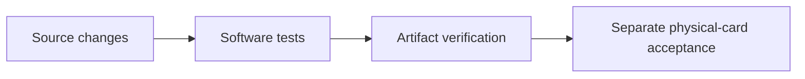

# Changelog

## Unreleased — launch branch

### 2026-10-19 — ETH1 acceptance hardening — Hermes Agent

Version: 1.0.2 (unreleased launch changes). Updated: 2026-10-19 CEST.

- `7b394bcb914aa89bd0ad9757822cdb445d8a4470`: malformed, mismatched and
  unrecoverable ETH1 signatures close the connection and exit non-zero, preventing
  a false downstream card-acceptance success.
- `e7c98280b59a337d8c9e1f7c8919a6c10689b8c7`: fake-reader regressions exercise
  the actual script process and expose acceptance of invalid zero/order scalars.
- `7fb9cf83d715b36cd67b0c39a2d8d2c88e4889ea`: reject out-of-range ECDSA
  scalars and invalid secp256k1 recovery points before recovery arithmetic.
  [Cloud CI](https://github.com/nuri-com/nuri-passkey-prf-smartcard/actions/runs/39173633215)
  passed `node-tests`, `card-release` and `virtual-card`; 47 PC/SC fake tests and
  79 Node tests passed. No physical-card access, merge or deployment in this change.

- Minimal public documentation: consolidated user guides; deleted stale session,
  planning, incident and vendor-email/PDF material. Historical proof records are
  isolated under `docs/proofs/` and are not fresh launch acceptance.
- MuSig2 nonce lifetime and PC/SC transport handling are documented in
  [nonce handling](docs/musig2-nonce-lifetime-fix.md) and [readers](docs/reader-compatibility.md).
- ETH v2 is a separate applet with simulator coverage and optional PIN protection;
  fresh physical-card acceptance is UNVERIFIED. [ETH v2](docs/eth-applet-v2.md).
- TOTP has software HMAC-SHA1 fallback and PIN-protected secret replacement;
  code calculation remains ungated. [TOTP](docs/totp-applet.md).
- Local helper guards and extension/native-host trust boundaries are documented
  without claiming fresh browser or hardware acceptance. [Helpers](docs/helper-servers-security.md),
  [extension](docs/chrome-extension.md).

## 1.0.2 — public-core reproduction entrypoint

- Source, virtual tests and artifact comparison entrypoint:
  [scripts/reproduce-v1.sh:7–22](scripts/reproduce-v1.sh#L7-L22).
- Mobile verification still requires separate private design-system access;
  use `REPRODUCE_EXPO=NO` for the public-core path.
- Reproducibility is not hardware qualification. See [release](docs/release.md)
  and [acceptance](docs/acceptance.md).
