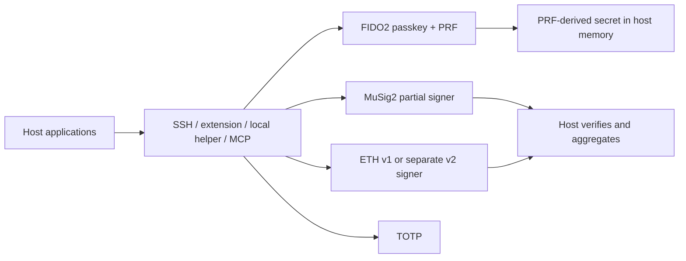

# Nuri Card — open smartcard signing

Java Card applets for FIDO2 passkeys and PRF, Bitcoin MuSig2, Ethereum ECDSA and
TOTP, with SSH, browser-wallet and agent bridges. This is a demonstrator, not a
certified hardware wallet. Card-held signing keys and host-visible derived
secrets have different security boundaries: [signing architecture](docs/signing-architecture.md).



The applet interfaces and host boundaries are mapped to source in
[capabilities](docs/card-capability-summary.md) and [security model](docs/security-model.md).

## Status — implementation is not hardware acceptance

“Historical” means a retained run record, not a fresh test of this revision.
A simulator, fake reader or browser mock cannot establish physical-card behavior.

| Function | Software / simulator evidence | Physical-card evidence | Phone / browser boundary |
|---|---|---|---|
| FIDO2 passkey + PRF | [`fido2:test-prf`](package.json#L31), [baseline](docs/fido2-prf-baseline.md) | Fresh launch acceptance UNVERIFIED | Browser must expose a supported transport and PRF; PC/SC alone is not WebAuthn. [UP/PRF guide](docs/fido2-user-presence.md) |
| Bitcoin MuSig2 | [`card:musig2:test:sim`](package.json#L70), [`npm test`](package.json#L11) | [Historical Signet record](docs/proofs/real-card-signet-proof.md) | Native NFC and PC/SC are separate paths. [Architecture](docs/signing-architecture.md) |
| PRF + MuSig2 wallet | [`cosign:demo`](package.json#L18) | [Historical wallet record](docs/proofs/nuri-card-wallet-proof-report.md) | Local helper, not a browser-native card transport |
| ETH v1 | [Source and protocol](docs/eth-signing-spec.md) | Fresh launch acceptance UNVERIFIED | Host-side hashing and approval; no v1 PIN gate |
| ETH v2 | [`card:eth2:test:sim`](package.json#L67) | New applet installation and signing UNVERIFIED | Optional applet PIN; native host cannot unlock it. [Protocol](docs/eth-applet-v2.md) |
| SSH | [Provider/helper source](docs/ssh-smartcard.md) | Fresh launch login UNVERIFIED | Card in reader; not fresh-touch authorization |
| PKCS#11 | [Simulator instructions](docs/hsm.md) | UNVERIFIED | Host library is not a certification claim |
| TOTP | [`card:totp:test:sim`](package.json#L74), RFC 6238 vectors | New fallback/PIN revision UNVERIFIED | Admin PIN protects replacement, not reading codes. [Guide](docs/totp-applet.md) |
| MCP signer | [`card:mcp:selftest`](package.json#L76) | Fresh launch card-backed run UNVERIFIED | Agent policy is host-side. [Helper boundaries](docs/helper-servers-security.md) |
| Arkade / Lightning | [Local client-signer proof](docs/proofs/arkade-card-signer-proof.md) | Historical signing is not fresh settlement proof | [Integration limits](docs/arkade-lightning.md); merchant settlement UNVERIFIED |
| Fingerprint unlock | Not integrated into these public applets | UNVERIFIED | No biometric authorization claim |

## Quickstart

### 1. Exercise the software without a card

Requires Node.js/npm. Java Card simulator and CAP builds additionally need the
Java/Python toolchains described in [reproduction](docs/reproducing.md).

```sh
git clone https://github.com/nuri-com/nuri-passkey-prf-smartcard.git
cd nuri-passkey-prf-smartcard
npm ci
npm test
npm run cosign:demo
```

These commands use software paths. Never fund simulator/demo keys.
To include applet simulation and release rebuilding:

```sh
npm run test:virtual
npm run card:release:verify
```

The script names above are the names in the current [package manifest](package.json),
not proposed replacement names.

### 2. Select and provision a blank development card

Read [hardware requirements](docs/hardware.md), [reader compatibility](docs/reader-compatibility.md)
and the [acceptance runbook](docs/acceptance.md) first. A model listing is not
qualification; exact algorithms, OS and install rights matter. No current price
or universal reader compatibility is claimed.

```sh
# Rebuild and verify artifacts before any card write.
npm run card:release:verify
# Choose your reader and obtain transport keys securely before invoking this.
CARD_PROVISION_CONFIRM=YES GP_READER="$CARD_READER" GP_KEY="$CARD_TRANSPORT_KEY" \
  npm run card:provision:v1
```

Provisioning writes a physical card. Use a blank development card, never an
existing wallet or your only SSH key. The bundle installer installs ETH **v1**;
ETH v2 has a separate installation flow. [Source: scripts/provision-card-v1.sh:48–67](scripts/provision-card-v1.sh#L48-L67).

### 3. SSH and passkeys

Follow the complete [SSH setup](docs/ssh-smartcard.md) before modifying your server's
authorized keys. Authorize a second independently enrolled card as backup; do not
assume a non-exportable credential can be cloned.

For a browser-visible FIDO2 card, set the FIDO2 PIN interactively and register it
on your chosen WebAuthn site:

```sh
npm run card:pin:set
```

No browser PRF support is promised by a successful passkey login; test the
actual browser/transport combination using [the PRF guide](docs/fido2-user-presence.md).
FIDO2 PIN settings do not protect other applets.

### 4. Browser wallet and extension

```sh
# Software wallet helper; inspect its printed URL/token, not a public tunnel.
npm run cosign:web
```

See [helper authentication](docs/helper-servers-security.md) before connecting a
page or choosing the real-card backend. The separate Chrome extension uses a
native host: [installation and software checks](docs/chrome-extension.md).
Its approval window is host-side, not an on-card transaction display.

The [Expo NFC app](mobile/expo-nfc-prf-probe/README.md) is source reference:
its private design-system dependency requires separate access. A public clone
alone is not sufficient to build it. No complete Lightning settlement is claimed.

## Security model — what we cannot claim

- **Presence is not consent.** FIDO2 UP signaling is not a fresh physical check.
  MuSig2 and ETH v1 have no PIN/UP gate. Remove the card when it should not be
  usable. [Applet-specific boundaries](docs/signing-architecture.md#authorization-is-applet-specific).
- **Secrets can reach the host.** PRF output and derived wallet client keys are
  host-visible secrets. TOTP seeds are supplied by the provisioning host.
  No “all keys always stay inside” claim applies to these paths.
- **ETH v2 PIN is optional until configured**, and the current native host does
  not implement its PIN verification. TOTP's admin PIN does not gate CALC.
  See [ETH v2](docs/eth-applet-v2.md) and [TOTP](docs/totp-applet.md).
- **Blind signing remains.** Card applets do not show the recipient, amount or
  chain. A compromised host can submit signing requests while access is available.
- **No independent security audit, constant-time software bignum proof,
  EAL/FIPS/FIDO product certification or physical tamper-resistance qualification
  is established by this repository.** Such claims are UNVERIFIED.
- A same-card PRF + MuSig2 wallet is not independent two-device custody.
  Recovery is path-specific, not a promise that every lost card can be recovered.
  [Security model](docs/security-model.md).

| Failure | Boundary / action |
|---|---|
| Card lost or applet deleted | Non-exportable keys may be unrecoverable; provision independent SSH backup before depending on one card |
| Card left connected to a compromised host | Do not assume fresh-touch consent; disconnect it |
| Host compromised during PRF derivation | Host-visible PRF/client secrets can be captured |
| Reader returns `61xx` / `6Cxx` or transport fails | Use the shared PC/SC handling; [reader guide](docs/reader-compatibility.md) |
| Local helper token or browser origin rejected | Do not expose the service publicly or disable guards; [helper guide](docs/helper-servers-security.md) |
| Payment broadcast succeeds | Do not infer merchant settlement; verify completion separately |

## Comparison — research pending

No competitor capability, current price or superiority claim is made here.
“Pending” is deliberately not a negative feature assertion.

| Criterion | Nuri Card | Tangem | Satochip | Keycard |
|---|---|---|---|---|
| Form factor | Java Card applets; qualify exact card | Pending | Pending | Pending |
| Public implementation | This repository; mixed licensing below | Pending | Pending | Pending |
| Signing / passkey / SSH support | Scoped evidence table above | Pending | Pending | Pending |
| Certification / price | UNVERIFIED / not quoted | Pending | Pending | Pending |

## Repository map

- `card/`: MuSig2, ETH v1/v2 and TOTP applets; `third_party/` and `patches/`: FIDO2 source/build inputs.
- `src/`, `scripts/`, `test/`: host integrations, simulators and tests.
- `host/`, `extension/`: native messaging and Chrome extension.
- `web/`: local browser tools and service-specific demonstrations; not an independent custody service.
- `mobile/`: native NFC source reference with restricted build dependency.
- `dist/`, `tools/`: applet artifacts and pinned build tooling; verify rather than trusting filenames.
- `docs/`: maintained guides; `docs/proofs/`: explicitly historical evidence, not deployment assertions.

## Documentation

[How it works](docs/how-it-works.md) · [Capabilities](docs/card-capability-summary.md) ·
[Security](docs/security-model.md) · [Signing architecture](docs/signing-architecture.md) ·
[SSH](docs/ssh-smartcard.md) · [ETH v1](docs/eth-signing-spec.md) · [ETH v2](docs/eth-applet-v2.md) ·
[MuSig2](docs/musig2-card-extension.md) · [TOTP](docs/totp-applet.md) ·
[FIDO2 baseline](docs/fido2-prf-baseline.md) · [User presence](docs/fido2-user-presence.md) ·
[Hardware](docs/hardware.md) · [Readers](docs/reader-compatibility.md) ·
[Release](docs/release.md) · [Acceptance](docs/acceptance.md) · [Reproduce](docs/reproducing.md) ·
[Chrome extension](docs/chrome-extension.md) · [PKCS#11 / secret handling](docs/hsm.md) ·
[Changes](CHANGELOG.md).

## Licence

The root [LICENSE](LICENSE) is MIT. **That does not make the entire repository or
all combined CAPs MIT.** Existing GPL-2.0-or-later bignum-derived components impose
additional distribution obligations. Consult [THIRD_PARTY_NOTICES.md](THIRD_PARTY_NOTICES.md)
and component licences before redistributing; an all-MIT relicence is not claimed.
