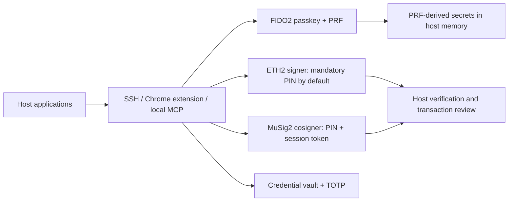
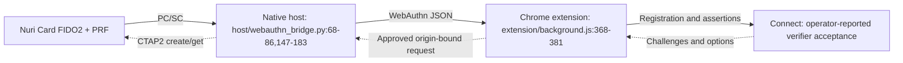

# Nuri Card



An open Java Card stack: FIDO2 passkeys with PRF, OpenSSH FIDO2 `sk` keys,
Ethereum digest signing, Bitcoin MuSig2 cosigning, credential storage and TOTP.
Host integrations include a Chrome extension wallet, local MCP tools for agents,
and a secp256k1 PKCS#11/OpenSSL signing adapter. New applets add CA-backed
attestation; GlobalPlatform management-key rotation has encrypted owner escrow.

**Research-grade: not externally audited, not a certified hardware wallet.**
The card has **no screen** and performs **blind signing**. It cannot independently
show or approve the recipient, amount or chain. Do not treat a public source
release as consumer-funds approval. See [SECURITY.md](SECURITY.md),
[security advisories](docs/security-advisories.md) and [security model](docs/security-model.md).

## Chrome prototype: clean install folder

Extension version **0.2.0**; repository package version **1.0.2**.

```sh
python3 scripts/package-chrome.py "$HOME/Downloads/Nuri Card"
```

Chrome → `chrome://extensions` → Developer mode → **Load unpacked** →
select **Downloads/Nuri Card**. `manifest.json` is directly inside that folder.
Do not select the repository root. A ZIP and `START HERE.txt` are also created.
The exporter refuses to overwrite an existing folder or ZIP.

The toolbar click opens a native side panel, with 17px text, bundled Nuri icon
assets and technical details collapsed. The Nuri provider does not replace an
existing `window.ethereum`; this is not tested signing integration inside OKX.
No applet, PIN policy or installed host is changed merely by exporting the package.

The local native host is a separate installation. The package includes
`Install Host.command` for macOS (copies `host/nuri_card_host.py`,
`host/webauthn_bridge.py`, `scripts/nuri_pcsc.py`, `scripts/nuri_attest.py`).
Exporting alone leaves an installed host unchanged; running an installer changes it.
[Host setup and test scope](docs/chrome-extension.md).
The Chromium CI job tests actual browser approvals and native IPC using the
explicit software simulator, not a physical card or a mainnet transfer.

## Feature status

Status is path-specific. A real-card result does not qualify every applet revision, client, reader or transaction flow. The 2026-10-22 observations below were supplied by the operator for card CPLC serial `87E5470B` on an HID Global OMNIKEY 5422 via PC/SC. Earlier observations are retained as dated operator reports.



The diagram shows the response flow and reverse requests. Native-host/card results and Connect verifier acceptance are real-card observations. Source implements the extension methods and approval path; a complete interactive Chrome session is not independently established by those native-host results alone.

1. **FIDO2 WebAuthn create/get with PRF. Layer: real card.** On 2026-10-22, origin `https://connect.nuri.com`, RP `nuri.com`, registration and two assertions succeeded through native-host `webauthn_create`/`webauthn_get`. PRF outputs matched, Connect verifiers accepted the registration/assertions, and `backupEligible=false`. Source: `host/webauthn_bridge.py:23-24,53-65,128-144,147-196`; reproducer: `test/card_webauthn_proof.py:41-79`. Extension exposes `nuri_webauthnCreate`/`nuri_webauthnGet`: `extension/background.js:368-381`. Open: interactive browser end-to-end on live `connect.nuri.com` is not done because the Connect code is not deployed. Verifier acceptance is not a deployed live-browser proof; do not infer all-browser compatibility.
2. **FIDO2 SSH bridge. Layer: real card.** Operator reports SSH still working after the October 22 additive ETH2 install; earlier reader runs are in `docs/reader-compatibility.md:68-70`. Bridge: `scripts/ssh-pcsc-sk-helper.py:83-111`. Open: the SSH bridge does not verify a PIN (`scripts/ssh-pcsc-sk-provider.c:248-262,289-296`); card presence is not fresh touch.
3. **ETH1 digest signing without PIN. Layer: real card, historical operator report.** October 17/18 report: `docs/reader-compatibility.md:68-70`. PIN-less implementation: `card/eth/NuriEcdsaSigner.java:151-160,204-212`. Open: demo-only; this does not prove a current ETH2 or Chrome transfer.
4. **ETH2 v2.1.0 PIN-gated digest signer. Layer: real card.** October 22 operator reports additive install beside ETH1, preservation of prior AIDs, SET_PIN, VERIFY, one-shot KEYGEN, independently verified 32-byte digest signing, and `6982` on SIGN without VERIFY in a new session. Package `4E55524945544832`, applet `4E5552494554483201`. Source: `card/eth2/NuriEthSignerV2.java:42,231-241,312-316,377-379,429-438`; installer: `scripts/install-eth2-card.sh:56-94`. Native host now reports `eth2` version `2.1.0`, `pin_set=true`; PIN-less `sign_hash` returns `PIN_REQUIRED`, and `verify_pin` plus signing succeeds. Receipt: `docs/proofs/real-card-87E5470B-eth2-pin.json` on the newer integration branch. Open: CA attestation remains `verified=false`; fault/tear/side-channel qualification, Chrome transactions and on-chain sends were not proved by this run.
5. **PKCS#11/OpenSSL signing through ETH1. Layer: real card, historical operator report.** October 18 report: `docs/hsm.md:88-96`; adapter: `scripts/pkcs11-nuri.c:811,884`. Open: ETH1 demo opt-in is required; ETH2 PKCS#11 signing remains unavailable without implemented PIN-session support (`scripts/pkcs11-nuri.c:685,802`; `scripts/pkcs11-helper.py:54`).
6. **PKCS#11 fail-closed defaults and ETH2 discovery preference. Layer: simulator.** Software/fake-helper coverage is reported in `docs/hsm.md:51,75-81`; enforcement: `scripts/pkcs11-nuri.c:623,685,802`. Open: discovery is not ETH2 signing acceptance.
7. **PRF-encrypted disk credential vault put/run/rm. Layer: real card, historical operator report.** October 18 report: `docs/card-secrets.md:19-26`; PRF/HKDF host path: `scripts/card-secrets.py:294-327`. Open: host memory contains PRF-derived material; this is distinct from the on-card vault applet.
8. **MuSig2 v1.15 PIN2, protocol pin-1.14, additive AID2 cosigning. Layer: real card.** October 22 operator reports install beside v1.10 under package `4E5552494D554732`, applet `4E5552494D55473201`; select with `NURI_MUSIG2_AID=4E5552494D55473201`. SET_PIN and on-card one-shot KEYGEN succeeded. `scripts/real-card-cosign-proof.py` returned `REAL_CARD_COSIGN_FLOW_OK` with `card_pin_verified=true`; both partials and final BIP340 signature verified. KEYGEN and GET_NONCES without VERIFY returned `6982`. Receipt: `docs/proofs/real-card-87E5470B-musig2-aid2-cosign.json` on the newer integration branch. Snapshot gates/session checks: `card/musig2/NuriMuSig2v019.java:277-285,319-321,554-585`; the new AID2 builder/artifact is parent-supplied evidence outside this snapshot. Open: no on-chain spend from the new key; proof was not broadcast or funded. No independent physical fault/side-channel qualification. A matching session token is not authenticated process identity.
9. **On-card credential vault PIN/HMAC/bearer storage. Layer: simulator.** Source: `card/vault/NuriVault.java:194-231,303-310,336-352`; software scope: `docs/card-vault-applet.md:185-213`. Open: hardware acceptance, remanence and power-loss behavior. HMAC credential slots cannot be revealed, but their values were imported from the host.
10. **TOTP calculation and software-HMAC fallback. Layer: simulator.** Software scope: `docs/totp-applet.md:30`; CALC/replacement boundaries: `card/totp/NuriOathTotp.java:142-156,183-190`. Open: real-card fallback qualification. PIN protects replacement, not calculation.
11. **Chrome Ethereum wallet approval binding, PIN flow and Base send. Layer: simulator.** Source: `extension/background.js:149-165,331-345`; browser harness: `extension/test/browser_e2e.py:32-38,79-116`. Open: interactive real-card ETH2 transaction and confirmed on-chain transfer. The separate WebAuthn proof does not establish this flow.
12. **MCP tools and paired loopback helper authorization. Layer: simulator, reported software scope.** Test scope: `docs/helper-servers-security.md:100-108`. Open: independent live helper/client acceptance and current deployment verification; no public exposure implied.
13. **CA-backed applet attestation and signing-key binding. Layer: simulator.** Host verification: `host/nuri_card_host.py:458-481`; declared limits: `docs/attestation.md:30-37`. Open: real-card CA personalization and challenge/binding verification. ETH2 digest signing does not establish attestation.
14. **GP management-key rotation with encrypted owner escrow. Layer: simulator.** Rotation/unlock: `scripts/card_lock.py:283-325`; fake-GP coverage: `docs/card-lock.md:203-206`. Open: reversible real-card lock/unlock acceptance. This is not lifecycle sealing, key backup or independent wallet recovery.
15. **OMNIKEY 5422 connection and additive ETH2 installation. Layer: real card.** October 22 operator reports `~/bin/gp` worked without `-r`, whereas Homebrew `gp` failed with `Specify reader`. Select a compatible executable with `GP_BIN="$HOME/bin/gp"`; installer interface: `scripts/install-eth2-card.sh:18,42-54`. Open: other GP versions and readers require separate qualification; PC/SC protocol fallback is a different layer.
16. **Fingerprint authorization and application secure messaging. Layer: planned.** No acceptance is claimed. Open: implementation and protocol-specific qualification. Existing FIDO2 PIN/PRF protection and GP management channels are not a general encrypted channel for application commands.
17. **Independent lost-card recovery. Layer: planned.** No universal recovery result is claimed. Open: enroll/test independent access and path-specific backups; same-card components do not establish independent recovery.

### Supported readers: observed combinations, not certification

| Reader | Proven connection |
|---|---|
| HID Global OMNIKEY 5422, contact slot | default |
| Realtek `0bda:0165`, ATR `3b119580` | T=0 fallback |
| ACS ACR39U ICC Reader | T=0 fallback |

The tested card reports CPLC fabricator `4090`, OS ID `86aa`, OS date `5134`
(2025-05-14). Exact commercial model and product certification are UNVERIFIED;
do not call it NXP JCOP4. [Hardware requirements](docs/hardware.md).

For the operator's OMNIKEY 5422, `~/bin/gp` auto-selected the card without `-r`;
the Homebrew executable failed with `Specify reader`. Use
`GP_BIN="$HOME/bin/gp"` or a GP release that selects the reader containing the
card. This October 22 observation does not qualify every GP release. PC/SC T=0
fallback is separate from GP reader selection.

## Quick start

### Without hardware

Requires Node.js/npm. Applet builds additionally need Java, Python and separately
installed tools: [reproduce](docs/reproducing.md). Python tools using union
type annotations require Python 3.10 or newer; the macOS host defaults to 3.13.

```sh
git clone https://github.com/nuri-com/nuri-passkey-prf-smartcard.git
cd nuri-passkey-prf-smartcard
npm ci
npm test
npm run cosign:demo
```

These are software paths. **Never fund simulator or public demo keys.**
The optional [mobile source reference](mobile/expo-nfc-prf-probe/README.md) needs
separate access to a restricted UI dependency; a public clone cannot build it alone.

### Blank development card

1. Read [hardware](docs/hardware.md), [acceptance](docs/acceptance.md) and
   [key handling](docs/real-card-key-handling.md). Select a blank, disposable card
   with supplier transport keys; never use an existing wallet or your only SSH key.
2. Build/verify before writing any card:

   ```sh
   npm run card:release:verify
   ```

3. The existing bundle installer is a **demo installer**, not consumer provisioning:
   it installs FIDO2, MuSig2, TOTP and **PIN-less ETH v1**, not ETH2 or the vault.
   Its existing-applet check covers four known AIDs, not every possible installed
   applet; it does not prove that an arbitrary target is blank.
   Only for that explicitly selected blank demo target:

   ```sh
   CARD_PROVISION_CONFIRM=YES GP_READER="$CARD_READER" GP_KEY="$CARD_TRANSPORT_KEY"      npm run card:provision:v1
   npm run card:pin:set
   ```

4. FIDO2 PIN does not protect other applets. For the newer PIN-gated stack follow
   [ETH2 enrollment and CA personalization](docs/attestation.md#blank-card-personalization),
   [MuSig2 PIN setup](docs/musig2-pin-and-hardening.md) and
   [vault setup](docs/card-vault-applet.md). The operator accepted additive ETH2
   PIN-gated key generation/signing and native-host signing on October 22. The
   separately installed MuSig2 v1.15 PIN2 AID2 also passed PIN-gate and cosigning
   proof, without broadcast or funding. This does not accept the complete CA
   personalization or vault flow. Do not deposit funds on the strength of these instructions.
5. Record exact CAP hashes and physical acceptance on your target, then review
   [GP escrow/lock](docs/card-lock.md). That lock is reversible management-key
   rotation, not irreversible lifecycle sealing or a wallet backup.

[SSH setup](docs/ssh-smartcard.md) · [Chrome extension setup](docs/chrome-extension.md) ·
[All documentation](docs/README.md) · [Release verification](docs/release.md).

## Consent, secrets and loss

- **Card presence is not user touch.** FIDO2 user presence is assumed true,
  not measured: the patch advertises `up:true`, CTAP2 signs UP according to
  request options and selection succeeds without a physical check. The U2F path
  hardcodes UP=1. A touch prompt is not evidence of fresh consent.
  [UP details](docs/fido2-user-presence.md). The current SSH bridge does not
  implement PIN verification; leaving the card inserted can allow its use.
- ETH2 and current MuSig2 have their **own** PIN policies. Session PIN validation
  is not a trusted per-transaction display or physical touch. ETH1 has no PIN.
  TOTP PIN protects replacement, not code calculation. Application commands do not
  add an end-to-end encrypted application channel. This does not describe GP
  management channels or negate FIDO2 PIN/PRF protocol protection.
- PRF output, derived client keys and bearer credentials reach trusted host memory.
  Among vault credential-slot kinds, HMAC slots have no reveal command; bearer
  use requires reveal. Both kinds are imported from the host, so no-reveal does
  not mean the HMAC key was never present in host memory.
  An agent must be restricted to allowlisted brokers, not arbitrary processes.
- **A lost card can mean lost money or access.** Same-card PRF + MuSig2 is not
  independent two-device custody. CSV expiry does not recreate the PRF/client key.
  Enroll and test independent SSH access and path-specific backups in advance.

| Failure | Consequence / action |
|---|---|
| Card lost, blocked, reset or applet deleted | Non-exportable keys may be unrecoverable; no universal recovery guarantee |
| Host compromised while card connected | Host can request exposed operations and capture host-visible secrets; disconnect card |
| Reader fails or returns `61xx` / `6Cxx` | Use the [shared transport](docs/reader-compatibility.md), not reset/key generation |
| Helper pairing/token rejected | Keep helpers loopback-only; do not disable guards or tunnel signing ports |
| Broadcast returns a transaction hash | Not a receipt, confirmation or merchant settlement |

## Licence

Nuri-authored source, current MuSig2 scalar arithmetic, FIDO2 and build-tool source
are MIT with retained third-party notices. **ETH v1 in `card/eth/` still contains
GPL-2.0-or-later arithmetic; its combined CAP is GPL-2.0-or-later.** This is not an
MIT-only distribution or an alternative MIT grant for GPL code. External tools,
libraries and card OS firmware retain their own terms.
[Licence map and obligations](THIRD_PARTY_NOTICES.md) · [MIT licence](LICENSE).
