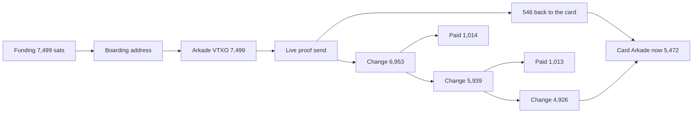
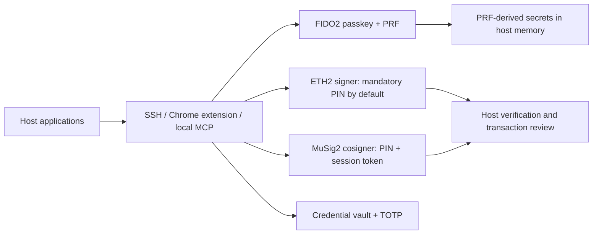
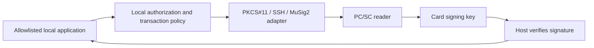
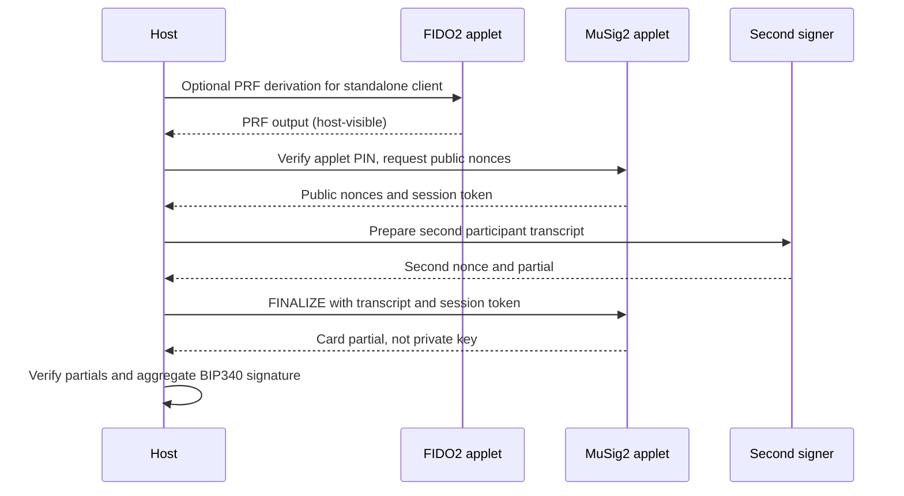
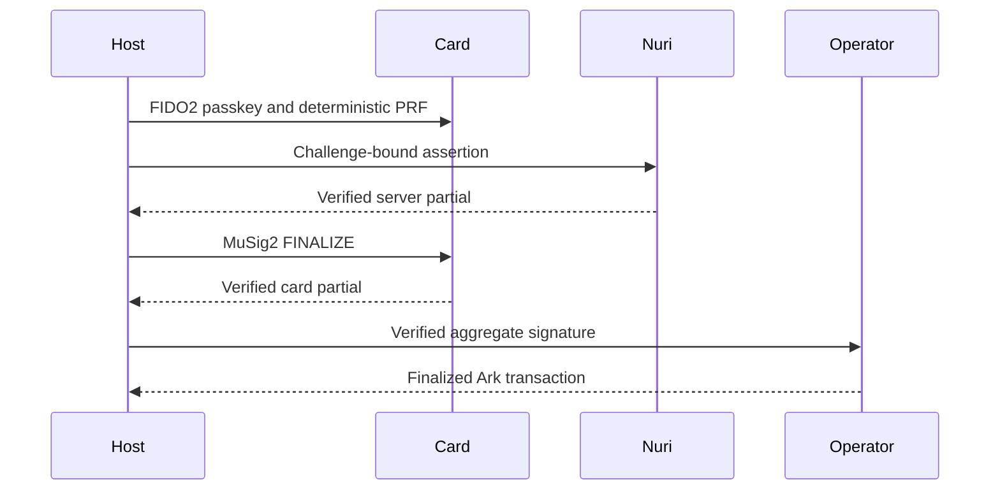

# Nuri Card

Your Bitcoin wallet, physical passkey and pocket HSM. One battery-free card.

[**Explore Nuri Card →**](https://nuri-com.github.io/nuri-passkey-prf-smartcard/)

**Free with a $1,000+ BTC deposit, otherwise $19.99**

## What it does

The Nuri Card release specification:

- **No battery.** Nothing to charge. Carry it in your wallet.
- **Mobile NFC.** Tap your phone, or use a USB smartcard reader on your computer.
- **PIN + phone biometrics.** Familiar phone approval, with separate card PIN protection.
- **HSM secure chip.** Bitcoin and Ethereum signing keys stay on the card.
- **Bitcoin MuSig2 2-of-2 with Nuri / Arkade.** On-chip partial signing, with a reported ~2 s fast path.
- **FIDO2 physical passkey.** Sign in to websites with the card.
- **OpenSSH keys.** Log in to servers with a hardware-backed security key.
- **PKCS#11 + OpenSSL.** Put a card-backed signing key behind a standard application interface.
- **Ethereum signing.** PIN-gated secp256k1 signatures for EVM applications.
- **On-card OATH TOTP.** Generate the rotating codes used for two-factor authentication.
- **Open source + updatable applets.** MIT Nuri applet code, with new features after purchase.

## Live today

- **Bitcoin send signed by the card on mainnet:** on 2026-10-28 19:13 UTC, card `87E5470B` co-signed a 546 sat Arkade send with Nuri. 4/4 steps verified, fee 0, transaction [13eba05423df9915bea4d13b1d6b488c9de7cf1ee24ac3defa24c23687b9a8a8](https://arkade.space/tx/13eba05423df9915bea4d13b1d6b488c9de7cf1ee24ac3defa24c23687b9a8a8). [receipt](docs/proofs/e2e-proof.json), [report](docs/e2e-proof.md).
- **A physical passkey for Nuri:** the card's FIDO2 passkey is registered with Nuri as username `arkade`, recorded in the same receipt.
- **Android NFC wallet:** the operator reports a Samsung S21 displaying the card wallet balance after a tap.
- **AID3 speed:** the operator reports about 2.0 s FINALIZE on applet v1.17, 5/5 BIP340 signatures verified. The target is about 1 s and is not reached.
- **OpenSSH login:** physical-card login recorded across [three USB readers](docs/reader-compatibility.md#hardware-runs-parent-physical-card).
- **Released:** [v1.2.0](https://github.com/nuri-com/nuri-passkey-prf-smartcard/releases/tag/v1.2.0) (2026-10-29) ships the AID3 v1.17 MuSig2 CAP. Earlier proofs, [PIN-gated Ethereum](docs/proofs/real-card-87E5470B-eth2-pin.json) and [MuSig2 AID2 cosigning](docs/proofs/real-card-87E5470B-musig2-aid2-cosign.json), shipped in [v1.1.0](https://github.com/nuri-com/nuri-passkey-prf-smartcard/releases/tag/v1.1.0).

### Where the sats are now

Checked live 2026-10-29 00:07 UTC against the Arkade indexer and mempool.space (block 973,614).

| Rail | Address | Sats | Status |
| --- | --- | ---: | --- |
| Arkade | [ark1qzpq904am6clw3pgqwyh4p02708fy4xs0hcpwt7rwfdttuxsjameepfv6ed2mgaw4k2tdts49m4wkk3zqyrjv44sr2gcgxrm47gy7sqnlyjr3x](https://arkade.space/address/ark1qzpq904am6clw3pgqwyh4p02708fy4xs0hcpwt7rwfdttuxsjameepfv6ed2mgaw4k2tdts49m4wkk3zqyrjv44sr2gcgxrm47gy7sqnlyjr3x) | 5,472 | Spendable: 4,926 + 546. Expires 2026-11-27 14:41 UTC. |
| Bitcoin, card + Nuri MuSig2 | [bc1pxa43e00wl6a2qqfd7wu8xgmuz8vczauvmn0nt45zff2kuq9u4klsfrz0f5](https://mempool.space/address/bc1pxa43e00wl6a2qqfd7wu8xgmuz8vczauvmn0nt45zff2kuq9u4klsfrz0f5) | 6,007 | Confirmed. CSV exit opens 2027-01-07. No spend tool yet. |
| Bitcoin boarding | [bc1p48tcgtk50havqnyq7pswx7hux8szpfjrrv3477z7r6sl4s0vyaxspfzzwu](https://mempool.space/address/bc1p48tcgtk50havqnyq7pswx7hux8szpfjrrv3477z7r6sl4s0vyaxspfzzwu) | 0 | [Funded 7,499](https://mempool.space/tx/fdbd415e6f1048fced5c2ddd79d22ded6cd261f8cc68f07772fd62b6e55bb1d8), [moved into Arkade](https://mempool.space/tx/617076f14362d8c27bcd2bef9b33a321ca01250cdd9d8d49723578f2e45da557). |
| **Total** | | **11,479** | |

Sent from the card:

| UTC | To | Sats | Transaction |
| --- | --- | ---: | --- |
| 2026-10-28 06:51 | @emino [ark1qzpq904am6clw3pgqwyh4p02708fy4xs0hcpwt7rwfdttuxsjameewtudvcndvek083e5ln2z7pdu5huts6gnu628pe5ezc3kce4qt7svqgg50](https://arkade.space/address/ark1qzpq904am6clw3pgqwyh4p02708fy4xs0hcpwt7rwfdttuxsjameewtudvcndvek083e5ln2z7pdu5huts6gnu628pe5ezc3kce4qt7svqgg50) | 7,118 | [903081350544f125a8e56b66782d8f14d35d1834effdd931b1086faa69eff8ca](https://arkade.space/tx/903081350544f125a8e56b66782d8f14d35d1834effdd931b1086faa69eff8ca) |
| 2026-10-28 19:13 | the card itself (live proof) | 546 | [13eba05423df9915bea4d13b1d6b488c9de7cf1ee24ac3defa24c23687b9a8a8](https://arkade.space/tx/13eba05423df9915bea4d13b1d6b488c9de7cf1ee24ac3defa24c23687b9a8a8) |
| 2026-10-28 20:13 | later payment | 1,014 | [a80114bef692a2c8b3db34df71bcfdb67caecc9683ab80bb1a99bd7bd08a7aeb](https://arkade.space/tx/a80114bef692a2c8b3db34df71bcfdb67caecc9683ab80bb1a99bd7bd08a7aeb) |
| 2026-10-28 20:35 | later payment | 1,013 | [7d762a0ac6e8f537df44f48708d34bc66b41970803e2e6d706ef962cf2af3fd1](https://arkade.space/tx/7d762a0ac6e8f537df44f48708d34bc66b41970803e2e6d706ef962cf2af3fd1) |



Only the Android balance and the AID3 speed are operator reports without receipts in this checkout.

## DIY: change your card's admin key

The card ships with the public GlobalPlatform default admin key. Anyone who holds the card can use it to delete or replace applets.
One command does the replacement and writes an encrypted escrow, so you can undo it.
Passkeys, wallet keys and PINs are untouched.

```sh
git clone https://github.com/nuri-com/nuri-passkey-prf-smartcard.git
cd nuri-passkey-prf-smartcard
bash scripts/diy-key.sh
```

Written for an NXP JCOP v2.4.1 card on an HID Global OMNIKEY 5422 reader; other key profiles are refused. [Exact how-to with every prompt, the undo step and troubleshooting](docs/diy-key.md).

### For LLM agents

1. Confirm which card and which reader with the human, and leave only that card on the reader.
2. Run `bash scripts/diy-key.sh --help` as a read-only check.
3. Run `bash scripts/diy-key.sh` and relay the printed prompts; the human types the passphrase.
4. Never put the passphrase in chat, argv, environment or logs.
5. Accept success only on the token `CARD_LOCK_VERIFIED`.
6. Anything else: stop, report state UNVERIFIED, keep every file.
7. Never retry with a guessed key, never edit the deny-list, never use the manual gp path.
8. On success, give the human the escrow path and say to copy it now.

Full agent runbook with STOP conditions: [docs/diy-key.md](docs/diy-key.md#12-for-llm-agents).

## DIY: build your own Nuri card

Buy the reference card, install every applet, use every feature, change the admin key.
The full guide names the exact card profile, the proven reader, the install order, every PIN path and the recovery boundaries. Read it before you buy anything.

[Build your own card](docs/diy-card.md), including where it differs from Tangem, YubiKey, Bitkey and YubiHSM.

## Why it beats YubiKey

- **A crypto wallet on the chip.** Bitcoin MuSig2 and native Ethereum signing alongside passkeys, OpenSSH and TOTP.
- **Open + updatable.** Inspect the applet source and add features. YubiKey firmware is closed and [cannot be updated](https://docs.yubico.com/hardware/yubikey/yk-tech-manual/yk5-firmware-overview.html).
- **About a third of the price.** $19.99 versus $58 for a YubiKey 5 NFC—or free with a $1,000+ BTC deposit.

## Compare the card

Nuri cells describe the release specification above. Competitor cells describe documented support, including host bridges. ✓ means supported; — means unverified; ✗ means no documented support for the named feature, not a claim about future integrations.

| Feature | Nuri Card | YubiKey 5 NFC | YubiHSM 2 | Ledger Nano X | Trezor Safe 3 | Bitkey original | Tangem |
|---|---|---|---|---|---|---|---|
| Price · USD | **$19.99 / free with $1,000+ BTC deposit** | $58 | $650¹ | $99 | $59 | $150 | $54.90 / 2 cards |
| No battery | ✓ | ✓ | ✓ | ✗ | ✓ | ✗ | ✓ |
| Mobile NFC | ✓ | ✓ | ✗ | ✗ | ✗ | ✓ | ✓ |
| Phone biometrics + card PIN/access code | ✓ | ✗ | ✗ | ✗ | ✗ | ✗ | ✓ |
| HSM / secure chip | ✓ | ✓ | ✓ | ✓ | ✓ | ✓ | ✓ |
| Bitcoin MuSig2 2-of-2 on the chip | ✓ | ✗ | ✗ | ✓ | ✗ | ✗ | ✗ |
| Arkade / Bitcoin wallet app with NFC tap | ✓ | ✗ | ✗ | ✗ | ✗ | ✗ | ✗ |
| Ethereum signing | ✓ native | ✗ native / ✓ bridge² | ✓ secp256k1 API² | ✓ | ✓ | ✗ | ✓ |
| FIDO2 passkey | ✓ | ✓ | ✗ | ✓ | ✓ | ✗ | ✗ |
| OpenSSH | ✓ | ✓ | ✓ PKCS#11 | ✓ | ✓ | ✗ | ✗ |
| PKCS#11 HSM interface | ✓ | ✓ | ✓ | ✓ OpenPGP/OpenSC | ✗ | ✗ | ✗ |
| OATH TOTP codes | ✓ | ✓ | ✓ HMAC + host³ | —³ | —³ | ✗ | ✗ |
| Open-source device applets / firmware | ✓ MIT⁴ | ✗ | ✗ | ✓ apps⁴ | ✓ firmware | ✓ firmware | ✗ |
| Updatable applets / device firmware | ✓ applets | ✗ | ✗ | ✓ | ✓ | ✓ | ✗ |

¹ YubiHSM 2: [Yubico's published $650 launch price](https://www.yubico.com/blog/yubihsm-2-providing-root-trust-servers-computing-devices/), not a current checkout quote. Other prices and the original feature cells follow the [product page's vendor-sourced comparison](site/index.html).

² YubiKey has no native Ethereum wallet app, but a third-party OpenPGP secp256k1 bridge exists. YubiHSM 2 exposes secp256k1 signing; that is not an Arkade or MuSig2 wallet integration. [YubiHSM specifications](https://www.yubico.com/product/yubihsm-2/).

³ HMAC-SHA1 plus a host-supplied counter/truncation enables TOTP with YubiHSM 2; it is not a dedicated OATH applet. Nuri also uses host time and truncation. — means support was not established for that specific model; historical Nano S OTP software does not prove Nano X support.

⁴ Nuri-authored applet code is MIT; the legacy ETH1 CAP contains GPL arithmetic. Ledger's open apps do not make its secure-element OS open. See [licences](#licence). Update support does not promise that replacing an applet preserves its keys.

## Use cases

Run commands from the repository root after `npm ci`, with Python 3.10+ for Python examples. Hardware examples assume an already provisioned card; software demos are explicitly labelled. Follow each linked setup guide before enrolling keys or changing host configuration.

### OpenSSH: log in with the card

Install the PC/SC security-key provider, enroll once, authorize the generated public key on your server, then log in. The installer creates a `nuri-card-host` configuration block: set its host/account before the final command. [Setup](docs/ssh-smartcard.md).

```sh
bash scripts/install-ssh-card-host.sh
ssh-keygen -t ecdsa-sk -w "$PWD/dist/nuri-pcsc-sk-provider.so" -f "$HOME/.ssh/id_nuri_pcsc_sk" -C nuri-card
# Add the .pub key to your server's authorized_keys and configure nuri-card-host.
ssh nuri-card-host
```

### Pocket HSM: PKCS#11 and OpenSSL

Build `pkcs11-nuri.so` and exercise OpenSSL signing plus independent verification. This example uses the **software simulator**, requires OpenSSL 3, OpenSC and Python `ecdsa`, and does not contact a card. [Hardware mode and setup](docs/hsm.md).

```sh
bash scripts/build-pkcs11.sh
NURI_PKCS11_MODE=sim python3 scripts/test-pkcs11-e2e.py
NURI_PKCS11_MODE=sim bash scripts/hsm-openssl-selftest.sh
```

**nginx TLS keys:** an integration target, not a working demo today. The adapter currently supports only secp256k1 `CKM_ECDSA`, not P-256/RSA or authenticated ETH2 sessions; ordinary nginx TLS is not established. [Exact HSM limits](docs/hsm.md#limits).

### OATH TOTP: rotating 2FA codes

For an already provisioned TOTP applet, inspect its status and read a code. The self-check is offline. [Provisioning and PIN policy](docs/totp-applet.md).

```sh
python3 scripts/card-totp.py --selfcheck
python3 scripts/card-totp.py status
python3 scripts/card-totp.py code
```

### FIDO2: a physical passkey for websites

Inspect the card and serve the local WebAuthn/PRF test page. Browser use requires the [native bridge](docs/chrome-extension.md); a PC/SC reader alone is not a browser transport.

```sh
npm run card:prf:info
npm run web:prf
```

### Bitcoin MuSig2 / Arkade: Android NFC

Prepare and verify the native app, then open the Android profile launcher. This requires the authorized UI dependency, an existing credential profile and configured endpoints. Tap the card on the phone. [Mobile setup](mobile/expo-nfc-prf-probe/README.md).

```sh
npm run mobile:prepare:v1
npm run mobile:verify:v1
npm run mobile:android
```

For an offline, no-hardware MuSig2 demo, run `npm run musig2:demo` or `npm run card:arkade:signer:sim`. A signature or displayed balance is not a settled payment.

### Ethereum: PIN-gated on-chip signatures

Run the **software-only ETH2** suite: PIN authorization, signing and independent signature verification. Requires the documented JDK/Python toolchain. Physical-card receipts are linked under [Live today](#live-today).

```sh
npm run card:eth2:test:sim
python3 -m unittest discover -s host -p 'test_host.py' -v
```

### PGP: a separate roadmap item

There is no OpenPGP/PIV applet or verified GnuPG-to-PKCS#11 path in this release. OpenPGP signing/decryption and nginx-compatible TLS mechanisms belong on the roadmap, not in a working-feature checklist.

## For developers

Release specification and hardware acceptance are different: the sections below retain the exact key boundaries, tested revisions and integration limits.

The card has **no screen** and performs **blind signing**; it is **not externally audited** and **not a certified hardware wallet**. See [SECURITY.md](SECURITY.md) and the [security model](docs/security-model.md).



### Wallet architecture reference

The original comparison is back, with product-specific tradeoffs rather than
blanket “best” claims. Competitor descriptions below link to vendor material;
models and firmware matter. This is not a certification or an independent audit.

| Device | Form / role | Signing and recovery model | What to compare with Nuri |
|---|---|---|---|
| **Nuri Card** | Java Card; PC/SC and NFC integration paths | Separate FIDO2 and MuSig2 keys; standalone PRF-client + card wallet or card-client + second signer | Open, programmable multi-applet stack; no trusted display; independent lost-card recovery not accepted |
| [Bitkey](https://bitkey.world) | Hardware + phone + server | Three-key wallet with assisted security/recovery | Integrated consumer recovery; current product has an approval screen, unlike this card |
| [Keycard](https://keycard.tech) | NFC/contact smartcard; optional Shell | Card wallet with mnemonic backup; Shell supplies QR signing interface | Open applets and hardware ecosystem; companion software and backup model differ |
| [Tangem](https://tangem.com) | NFC card / ring + phone | Backup cards hold the same wallet; encrypted card-to-card key transfer; optional seed mode | Backup is a deliberate feature, not identical to Nuri's non-exporting MuSig2 key interface |
| [Satochip](https://satochip.io) | Smartcard hardware-wallet family | Wallet-specific signing and backup depend on product | Distinguish Satochip wallet, Satodime bearer card and Seedkeeper secret storage |
| [Tapsigner](https://tapsigner.com) | NFC Bitcoin signer + companion wallet | BIP32 signer; encrypted XPRV backup plus separately preserved printed decryption key | Can participate in single-signature or multisig wallets; no screen, so host review still matters |
| [Boltcard](https://boltcard.org) | NFC Lightning payment card | Card authorizes a configured Lightning payment service | Tap-payment UX is not the same thing as an on-card Bitcoin MuSig2 signer |

### What is distinctive here

- **Authenticator and Bitcoin cosigner in one card, with separate keys.** The
  FIDO2 credential does not magically identify the MuSig2 wallet. A service must
  explicitly bind the credential and signer key; see [identity boundaries](docs/arkade-lightning.md).
- **MuSig2 key-path signing with host-side Taproot tweaks.** The host prepares
  the transcript and verifies both partials and the final BIP340 signature.
  [Signing/verification implementation](src/musig2/arkade-client-signer.js#L193-L256).
- **An extensible stack, not just a wallet applet:** passkeys/PRF, SSH, EVM digest
  signing, MuSig2, TOTP, vault and agent-facing tools coexist behind separate
  interfaces. Their authorization and acceptance levels are not interchangeable.
- **Fingerprint authorization and phone-optional payments remain goals.** No
  biometric or settled Lightning-payment claim follows from a signature proof.

## The card as a hardware security module

The useful idea from the original README remains: a card can protect a signing
key for a personal computer **or for a server**. Moving the reader does not change
where the signing key lives. But “HSM-like signing boundary” is not a claim of
enterprise-HSM equivalence, certification, extraction resistance or production readiness.

### What “hardware security module” means here

The relevant boundary has three parts:

1. **Generate the signing key on the card.** Current ETH2 and MuSig2 have
   key-generation paths, separate from host-derived PRF client keys.
2. **Expose signing, not a private-key export API.** Non-exporting interfaces
   reduce the host's ability to copy a signing key. They do not prove that every
   physical or side-channel attack is impossible.
3. **Perform the private-key operation on-card.** The host still chooses the
   digest/transcript. With no card display, key isolation is not transaction review.

Implementation and key locations:
[ETH2 keygen/sign](card/eth2/NuriEthSignerV2.java#L377-L450),
[MuSig2 signing](card/musig2/NuriMuSig2v019.java#L476-L585),
[host-derived client secret](scripts/card-arkade-identity.mjs#L32-L72).
Bearer vault secrets intentionally have a reveal path; do not generalize the
signing-key policy to every secret stored on the card.
[Vault reveal boundary](card/vault/NuriVault.java#L203-L218).

### Capability comparison: match the job, not the label

| Job | Nuri implementation | Comparison boundary |
|---|---|---|
| Bitcoin MuSig2 partial signing | Dedicated applet and host BIP340 verification | Do not infer MuSig2 support or its absence from another device's ECDSA curve list |
| Ethereum secp256k1 digest signing | ETH2 with PIN by default; legacy ETH1 is PIN-less | Wallet transaction parsing, chain policy and display are separate from ECDSA support |
| Passkeys / WebAuthn PRF | FIDO2 applet + native bridge | Compare RP/client compatibility and genuine user-presence enforcement |
| SSH hardware key | OpenSSH SecurityKeyProvider + PC/SC FIDO2 helper | Separate from PKCS#11; current bridge does not verify a PIN or fresh touch |
| TOTP | Dedicated applet; host supplies time counter | Replacement PIN is not a code-calculation PIN |
| PKCS#11 / OpenSSL | Limited secp256k1 adapter | Not the broad object, mechanism and session surface of YubiHSM 2 |
| Agent credential use | PRF-encrypted host vault and separate on-card vault | Host-visible secrets and allowlisted broker policy remain part of the boundary |
| Tap-to-pay | Target UX, not fresh payment acceptance | Boltcard's payment-service model and a MuSig2 signer prove different things |

Nuri evidence and exact status for each row: [feature status](docs/feature-status.md),
[signing architecture](docs/signing-architecture.md), [HSM adapter](docs/hsm.md).
No claim is made that no other device can combine these capabilities.

### Server-side HSM: a reader attached to a server



The server can relay signing requests without an API that exports the card key.
A compromised server may nevertheless request signatures while it can use the
card or an authorized session. A connected card is **not** protection against
all misuse of its signing oracle. Keep helpers loopback-only, authenticate calls,
restrict brokers, serialize access and preserve independent administrative access.
[Helper policy](docs/helper-servers-security.md), [security model](docs/security-model.md).

For a card + remote second-signer design, spending needs both participants under
that protocol. If the same compromised host can operate the card and the second
signer, writing “2-of-2” does not create independent custody. The standalone
PRF-client + card path also puts the derived client secret in host memory.
[Path-specific keys and authorization](docs/signing-architecture.md).

Existing host components (not a deployment or concurrency guarantee):

| Component | Purpose |
|---|---|
| [scripts/ssh-pcsc-sk-helper.py](scripts/ssh-pcsc-sk-helper.py) | PC/SC FIDO2 bridge for OpenSSH |
| [scripts/card-eth-test.py](scripts/card-eth-test.py) | Legacy ECDSA acceptance helper; not an ETH2 PIN-session implementation |
| [scripts/real-card-cosign-proof.py](scripts/real-card-cosign-proof.py) | MuSig2 proof with independent partial/final verification |
| [scripts/card-totp.py](scripts/card-totp.py) | TOTP provisioning/calculation and software self-check |
| [scripts/card-mcp-server.mjs](scripts/card-mcp-server.mjs) | Local agent tools guarded by helper authorization |
| [scripts/pkcs11-nuri.c](scripts/pkcs11-nuri.c) | Limited PKCS#11 consumer interface |

### PKCS#11: built and tested, with explicit limits

The module is a host adapter, **not a PKCS#11 applet installed on the card**.
It exposes secp256k1 `CKM_ECDSA`: a 32-byte digest in, 64-byte raw `r || s` out.
There is one slot and public/private EC object metadata, not a complete enterprise
keystore or drop-in support for arbitrary TLS/PKCS#11 consumers.
[Mechanism and function table](scripts/pkcs11-nuri.c#L802-L900).

| File | Role |
|---|---|
| [dist/pkcs11-nuri.so](dist/pkcs11-nuri.so) | Packaged native module; rebuild for the supported host environment |
| [scripts/pkcs11-nuri.c](scripts/pkcs11-nuri.c) | PKCS#11 entry points and helper transport |
| [scripts/pkcs11-helper.py](scripts/pkcs11-helper.py) | PC/SC dispatch or explicitly selected software simulator |
| [scripts/build-pkcs11.sh](scripts/build-pkcs11.sh) | Native build / artifact check |
| [scripts/test-pkcs11-e2e.py](scripts/test-pkcs11-e2e.py) | OpenSC integration test; missing `pkcs11-tool` means SKIP, not proof |
| [scripts/hsm-openssl-selftest.sh](scripts/hsm-openssl-selftest.sh) | OpenSSL 3 provider integration and independent verification |

The historical October 18 real-card OpenSSL result used **ETH1**, requiring
explicit `NURI_ALLOW_ETH1_DEMO=1`. ETH1 has no signing PIN. Current discovery
prefers ETH2 and fails closed on ambiguous transport failures, but **ETH2
PKCS#11 authenticated signing is not implemented**; login/signing refuse with
`CKR_USER_NOT_LOGGED_IN`. Do not confuse ETH2 discovery with signing acceptance.
[Helper dispatch](scripts/pkcs11-helper.py#L54-L148),
[module login](scripts/pkcs11-nuri.c#L685-L693), [dated HSM evidence](docs/hsm.md).

Software-only checks (no card needed; OpenSC/OpenSSL dependencies are separate):

```sh
bash scripts/build-pkcs11.sh
NURI_PKCS11_MODE=sim python3 scripts/test-pkcs11-e2e.py
NURI_PKCS11_MODE=sim NURI_OPENSSL=/path/to/openssl3 NURI_PKCS11_PYTHON=/path/to/python bash scripts/hsm-openssl-selftest.sh
```

Real-card mode is the default; `NURI_PKCS11_MODE=sim` is an explicit opt-in,
with a public software test key. OpenSSL uses a configured PKCS#11 provider and
private-object URI, **not** `-sign dist/pkcs11-nuri.so`.
[Complete setup and limits](docs/hsm.md).

### Bottom line

Nuri combines a programmable wallet signer and authentication/credential tools in
one card. That is useful without claiming it beats a certified server HSM or a
screen-equipped consumer wallet. Choose the device for its custody, review,
recovery, authentication and operational requirements—not a universal ranking.

## The vision

**A wallet where the card is enough to authenticate and authorize a payment.**
The original ambition remains: a pocketable card that works with a phone or
terminal, keeps the card signing key off the host, and avoids making self-custody
feel like managing a pile of devices and secrets.

The card can be both a passkey and a Bitcoin cosigner, but the FIDO credential,
PRF-derived client key and MuSig2 applet key are distinct. A payment integration
must verify the intended identity mapping and exact transaction authorization.
The host still supplies the transaction and sees PRF-derived secrets on the
compatibility/standalone paths. [Architecture](docs/signing-architecture.md).

Fingerprint authorization, a phone-optional terminal and independently tested
lost-card recovery remain goals. A CSV recovery leaf does not restore a lost PRF
credential or key. There is no “card alone, without a networked host” path: the
card has neither a transaction display nor a Bitcoin network connection.

## How it works

Two wallet models must not be collapsed into one:

| Path | Card role | Other key / host boundary |
|---|---|---|
| Standalone wallet | Separate MuSig2 cosigner key | PRF-derived client key is computed in host memory; host builds transaction and recovery policy |
| Card-client MuSig2 integration | Card is client signer; returns nonce and partial | Second signer is protocol-specific; local proofs use a software ASP, not a live remote operator |
| PRF compatibility | FIDO2 supplies derivation output | Host derives and returns the client signing key; not a non-exporting spend-signer path |



The card does not parse a Bitcoin payment or display its recipient. The host
prepares sighashes, session coefficients and Taproot tweaks. An aggregate
signature check validates the signing transcript, not merchant settlement.
[Source-backed key inventory](docs/signing-architecture.md),
[MuSig2 protocol](docs/musig2-pin-and-hardening.md).

### Same wallet as the Nuri app: identity is explicit

A successful card passkey assertion is not proof that a given MuSig2 public key
owns the same wallet as an app account. Read the physical signer key, select the
intended profile and verify the service mapping. Regenerating or reinstalling
one applet can change one identity without changing another. PRF compatibility
is a separate host-key path, not permission to substitute a remembered address.
[Current integration boundaries](docs/arkade-lightning.md).

## Proven on a real card and latest findings

The accepted `v1.1.0` release includes the reproducible **AID2 v1.15 PIN2**
MuSig2 CAP. On October 22, card `87E5470B` passed FIDO2 create/get + stable PRF,
ETH2 PIN-gated signing and AID2 MuSig2 partial/final verification. These are
path-specific proofs, not a new funded on-chain or merchant-payment acceptance.
[ETH2 receipt](docs/proofs/real-card-87E5470B-eth2-pin.json),
[AID2 receipt](docs/proofs/real-card-87E5470B-musig2-aid2-cosign.json),
[feature status](docs/feature-status.md).

**v1.2.0, the fast path:** AID3 v1.17 co-signed the live mainnet send on
2026-10-28, with [a receipt](docs/proofs/e2e-proof.json). `v1.2.0` ships its
reproducible CAP (`dist/nuri-musig2-v20-keygen-aid3.cap`, hash in
[SHA256SUMS](dist/SHA256SUMS)); the receipt does not record the installed CAP
hash. The about 2.0 s FINALIZE timing is operator-reported and the 1 s target is
not reached. The earlier [v1.16 timing
receipt](docs/proofs/real-card-87E5470B-musig2-aid3-fast.json) records 5.2 s
FINALIZE and stays as history.

**Second card model:** on 2026-10-29, NXP JCOP 2.4.1 card `57274221` ran the
`v1.2.0` applet set over the OMNIKEY 5422 contact slot. ETH v1 needed applet
1.5, which sets the secp256k1 cofactor; 1.4 answered `6F00` on that card.
Unfunded. [Receipt](docs/proofs/real-card-57274221-eth1-cofactor.json).

Historical confirmed Signet transactions and their exact limits are retained in
[the Signet proof](docs/proofs/real-card-signet-proof.md). They do not establish
current Lightning settlement. **Boltz/Lightning checkout is not the current
accepted payment path**; the old terminal walkthrough and settlement claims are
not installation instructions for this release. See [Arkade boundaries](docs/arkade-lightning.md).

## Roadmap to the vision

| Track | Where it stands | Next acceptance boundary |
|---|---|---|
| Card as independent Bitcoin cosigner | Standalone host wallet and historical Signet proof exist | Revalidate exact applet/client/recovery policy; same-card PRF is not independent recovery |
| MuSig2 authorization | Current applet has its own PIN and nonce-session token; AID2 real-card proof accepted | Qualify AID3 fast path separately, including fault/side-channel and nonce lifecycle behavior |
| Hardware-wallet recovery participant | Design direction, not shipped acceptance | Evaluate deterministic extra Taproot recovery leaf and independent key backup; do not call a third MuSig2 participant threshold recovery |
| Fingerprint authorization | Planned; no integrated match-on-card acceptance | Obtain supported hardware/API and prove enforcement in each custom signer |
| Card-client Arkade integration | Local untweaked/tweaked signature proofs | Live remote policy, explicit account mapping and receipt-backed transaction acceptance |
| Phone / terminal UX | NFC source reference and host adapters exist | Reproduce physical Android and iPhone flows for the current protocol; no inherited Lightning settlement claim |
| ETH2 PKCS#11 | Discovery/fail-closed adapter exists | Implement authenticated PIN-session signing before claiming ETH2 OpenSSL acceptance |
| Credential vault / TOTP / attestation / GP escrow | Software and simulator evidence, with separate dated hardware observations | Physical personalization, power-loss behavior, recovery and exact-target acceptance |
| Consumer release | Research-grade stack | Independent audit, trusted review/consent, provisioning, backups and supported-device qualification |

## Chrome prototype: clean install folder

Extension version **0.2.0**; repository package version **1.2.0** (release `v1.2.0`).

```sh
python3 scripts/package-chrome.py "$HOME/Downloads/Nuri Card"
```

Chrome → `chrome://extensions` → Developer mode → **Load unpacked** →
select **Downloads/Nuri Card**. `manifest.json` is directly inside that folder.
Do not select the repository root. A ZIP and `START HERE.txt` are also created.
The exporter refuses to overwrite an existing folder or ZIP.

The toolbar click opens a native side panel, with 17px text, bundled Nuri icon
assets and technical details collapsed. The Nuri provider does not replace an
existing `window.ethereum`; this is not tested signing integration inside OKX.
No applet, PIN policy or installed host is changed merely by exporting the package.

The local native host is a separate installation. The package includes
`Install Host.command` for macOS (copies `host/nuri_card_host.py`,
`host/webauthn_bridge.py`, `scripts/nuri_pcsc.py`, `scripts/nuri_attest.py`).
Exporting alone leaves an installed host unchanged; running an installer changes it.
[Host setup and test scope](docs/chrome-extension.md).
The Chromium CI job tests actual browser approvals and native IPC using the
explicit software simulator, not a physical card or a mainnet transfer.

## Feature status

Status is path-specific: a real-card result does not qualify every applet revision,
client, reader or transaction flow. Latest physical runs: 2026-10-28, card CPLC
`87E5470B`, OMNIKEY 5422. Evidence (file:line), receipts and open items per row:
[feature status](docs/feature-status.md).

| Feature / scope | Status |
|---|---|
| FIDO2 WebAuthn create/get with PRF | proven on a physical card |
| FIDO2 SSH bridge | proven on a physical card |
| ETH1 digest signing without PIN | proven on a physical card |
| ETH2 v2.1.0 PIN-gated digest signer | proven on a physical card |
| PKCS#11/OpenSSL signing through ETH1 | proven on a physical card |
| PKCS#11 fail-closed defaults and ETH2 discovery preference | simulator only |
| PRF-encrypted disk credential vault put/run/rm | proven on a physical card |
| MuSig2 v1.15 PIN2, protocol pin-1.14, additive AID2 cosigning | proven on a physical card |
| MuSig2 AID3 v1.16 (`4E5552494D55473301`), 5.2 s FINALIZE | proven on a physical card |
| MuSig2 AID3 v1.17, live mainnet Arkade cosign with Nuri | proven on a physical card |
| On-card credential vault PIN/HMAC/bearer storage | simulator only |
| TOTP calculation and software-HMAC fallback | simulator only |
| Chrome Ethereum wallet approval binding, PIN flow and Base send | simulator only |
| MCP tools and paired loopback helper authorization | simulator only |
| CA-backed applet attestation and signing-key binding | simulator only |
| GP management-key rotation with encrypted owner escrow | simulator only |
| OMNIKEY 5422 connection and additive ETH2 installation | proven on a physical card |
| Fingerprint authorization and application secure messaging | planned |
| Independent lost-card recovery | planned |

### Supported readers: observed combinations, not certification

| Reader | Proven connection |
|---|---|
| HID Global OMNIKEY 5422, contact slot | default |
| Realtek `0bda:0165`, ATR `3b119580` | T=0 fallback |
| ACS ACR39U ICC Reader | T=0 fallback |

The tested card reports CPLC fabricator `4090`, OS ID `86aa`, OS date `5134`
(2025-05-14). Exact commercial model and product certification are UNVERIFIED;
do not call it NXP JCOP4. [Hardware requirements](docs/hardware.md).

For the operator's OMNIKEY 5422, `~/bin/gp` auto-selected the card without `-r`;
the Homebrew executable failed with `Specify reader`. Use
`GP_BIN="$HOME/bin/gp"` or a GP release that selects the reader containing the
card. This October 22 observation does not qualify every GP release. PC/SC T=0
fallback is separate from GP reader selection.

## Quick start

### Without hardware

Requires Node.js/npm. Applet builds additionally need Java, Python and separately
installed tools: [reproduce](docs/reproducing.md). Python tools using union
type annotations require Python 3.10 or newer; the macOS host defaults to 3.13.

```sh
git clone https://github.com/nuri-com/nuri-passkey-prf-smartcard.git
cd nuri-passkey-prf-smartcard
npm ci
npm test
npm run cosign:demo
```

These are software paths. **Never fund simulator or public demo keys.**
The optional [mobile source reference](mobile/expo-nfc-prf-probe/README.md) needs
separate access to a restricted UI dependency; a public clone cannot build it alone.

### Blank development card

1. Read [hardware](docs/hardware.md), [acceptance](docs/acceptance.md) and
   [key handling](docs/real-card-key-handling.md). Select a blank, disposable card
   with supplier transport keys; never use an existing wallet or your only SSH key.
2. Build/verify before writing any card:

   ```sh
   npm run card:release:verify
   ```

3. The existing bundle installer is a **demo installer**, not consumer provisioning:
   it installs FIDO2, MuSig2, TOTP and **PIN-less ETH v1**, not ETH2 or the vault.
   Its existing-applet check covers four known AIDs, not every possible installed
   applet; it does not prove that an arbitrary target is blank.
   Only for that explicitly selected blank demo target:

   ```sh
   CARD_PROVISION_CONFIRM=YES GP_READER="$CARD_READER" GP_KEY="$CARD_TRANSPORT_KEY"      npm run card:provision:v1
   npm run card:pin:set
   ```

4. FIDO2 PIN does not protect other applets. For the newer PIN-gated stack follow
   [ETH2 enrollment and CA personalization](docs/attestation.md#blank-card-personalization),
   [MuSig2 PIN setup](docs/musig2-pin-and-hardening.md) and
   [vault setup](docs/card-vault-applet.md). The operator accepted additive ETH2
   PIN-gated key generation/signing and native-host signing on October 22. The
   separately installed MuSig2 v1.15 PIN2 AID2 also passed PIN-gate and cosigning
   proof, without broadcast or funding. This does not accept the complete CA
   personalization or vault flow. Do not deposit funds on the strength of these instructions.
5. Record exact CAP hashes and physical acceptance on your target, then review
   [GP escrow/lock](docs/card-lock.md). That lock is reversible management-key
   rotation, not irreversible lifecycle sealing or a wallet backup.

[SSH setup](docs/ssh-smartcard.md) · [Chrome extension setup](docs/chrome-extension.md) ·
[All documentation](docs/README.md) · [Release verification](docs/release.md).

## End-to-end proof

The portable [send tool](scripts/send/README.md) and [generated evidence report](docs/e2e-proof.md) cover the physical FIDO2 passkey PRF, Nuri authentication, verified MuSig2 co-signatures and Arkade finalization. Dry mode uses public GETs only and never opens a card. A dry receipt is not a hardware proof.

Last live run: 2026-10-28 19:13 UTC, 4/4 verified, fee 0, [13eba05423df9915bea4d13b1d6b488c9de7cf1ee24ac3defa24c23687b9a8a8](https://arkade.space/tx/13eba05423df9915bea4d13b1d6b488c9de7cf1ee24ac3defa24c23687b9a8a8).

```sh
node scripts/send/e2e-proof.mjs --dry-run
TO='ark1qzpq904am6clw3pgqwyh4p02708fy4xs0hcpwt7rwfdttuxsjameepfv6ed2mgaw4k2tdts49m4wkk3zqyrjv44sr2gcgxrm47gy7sqnlyjr3x'
NURI_SEND_CONFIRM="$TO-546" node scripts/send/e2e-proof.mjs --execute --to "$TO" --amount 546
```

Fund first, follow the PIN/environment setup in the tool README and use the dry-run operator floor if higher. Only the parent/operator runs hardware. The [JSON receipt](docs/proofs/e2e-proof.json) records exactly which stages ran, never PRF secrets or private keys.



## Consent, secrets and loss

- **Card presence is not user touch.** FIDO2 user presence is assumed true,
  not measured: the patch advertises `up:true`, CTAP2 signs UP according to
  request options and selection succeeds without a physical check. The U2F path
  hardcodes UP=1. A touch prompt is not evidence of fresh consent.
  [UP details](docs/fido2-user-presence.md). The current SSH bridge does not
  implement PIN verification; leaving the card inserted can allow its use.
- ETH2 and current MuSig2 have their **own** PIN policies. Session PIN validation
  is not a trusted per-transaction display or physical touch. ETH1 has no PIN.
  TOTP PIN protects replacement, not code calculation. Application commands do not
  add an end-to-end encrypted application channel. This does not describe GP
  management channels or negate FIDO2 PIN/PRF protocol protection.
- PRF output, derived client keys and bearer credentials reach trusted host memory.
  Among vault credential-slot kinds, HMAC slots have no reveal command; bearer
  use requires reveal. Both kinds are imported from the host, so no-reveal does
  not mean the HMAC key was never present in host memory.
  An agent must be restricted to allowlisted brokers, not arbitrary processes.
- **A lost card can mean lost money or access.** Same-card PRF + MuSig2 is not
  independent two-device custody. CSV expiry does not recreate the PRF/client key.
  Enroll and test independent SSH access and path-specific backups in advance.

| Failure | Consequence / action |
|---|---|
| Card lost, blocked, reset or applet deleted | Non-exportable keys may be unrecoverable; no universal recovery guarantee |
| Host compromised while card connected | Host can request exposed operations and capture host-visible secrets; disconnect card |
| Reader fails or returns `61xx` / `6Cxx` | Use the [shared transport](docs/reader-compatibility.md), not reset/key generation |
| Helper pairing/token rejected | Keep helpers loopback-only; do not disable guards or tunnel signing ports |
| Broadcast returns a transaction hash | Not a receipt, confirmation or merchant settlement |

## Capability reference

Commands below are grouped by boundary. The presence of a script does not mean
its hardware path or a remote integration has passed. Read the linked runbook
before any enrollment, provisioning, key generation or signing. No hardware
command was run as part of this README restoration.

### MuSig2: software and real-card paths

```sh
# Offline software checks
npm run musig2:demo
npm run cosign:demo
npm run server:cosigner:software
npm run server:cosigner:card-sim
npm run server:cosigner:apdu-sim
npm run card:arkade:signer:sim
```

For an already provisioned target, `npm run cosign:real-card` selects the existing
card key. AID2 selection is `NURI_MUSIG2_AID=4E5552494D55473201`.
`cosign:real-card:keygen` is **not** a read-only check: it requests key generation.
Do not run it to diagnose a reader. The real-card Arkade signer proof uses a
local simulated ASP; it is not a remote-payment test.
[Key handling](docs/real-card-key-handling.md), [MuSig2 setup](docs/musig2-pin-and-hardening.md).

### FIDO2 / WebAuthn PRF

| Command | Boundary |
|---|---|
| `npm run card:prf:info` | Inspect card authenticator information |
| `npm run card:prf:enroll` | Creates a credential profile; preserve the intended profile |
| `npm run card:prf:derive` | Derivation reaches host memory |
| `npm run card:prf:selftest` | Compare derivation behavior for the enrolled profile |
| `npm run card:test:pin` | Physical-card WebAuthn test with PIN/UV requirement |
| `npm run web:prf` | Browser test page; reader insertion alone does not make a PC/SC card visible to WebAuthn |

[PRF baseline](docs/fido2-prf-baseline.md),
[user-presence limits](docs/fido2-user-presence.md),
[native browser bridge](docs/chrome-extension.md).

### FIDO2 SSH security key

The OpenSSH provider translates security-key calls into PC/SC FIDO2 operations.
An SSH key-handle file identifies a credential; it is not an exported signing
key. Every client machine needs the provider/helper. The current bridge does
not enforce PIN verification or a fresh physical touch.

Setup is `bash scripts/install-ssh-card-host.sh`; this installs host components
and configuration, so inspect it first. Enroll an independent backup card/key
and authorize it separately before relying on one card. A second card is not
a clone of the first. [Complete SSH setup and backup guide](docs/ssh-smartcard.md).

### Ethereum / EVM signing

ETH2 is the PIN-gated signer, distinct from legacy PIN-less ETH1. The native host
can verify its PIN and request digest signing; this does not establish a Chrome
transaction or an on-chain transfer. The host constructs and reviews the
transaction, and must independently verify the signature/public key.
[ETH2 protocol](docs/eth-applet-v2.md), [signing specification](docs/eth-signing-spec.md).

### Vaults, TOTP and agent tools

| Interface | Use / limit | Guide |
|---|---|---|
| `npm run card:secrets:selftest` | Host-side credential-vault tests; distinct from on-card vault | [PRF-encrypted vault](docs/card-secrets.md) |
| `npm run card:vault:test:host` | Host adapter tests; not physical vault acceptance | [On-card vault](docs/card-vault-applet.md) |
| `python3 scripts/card-totp.py --selfcheck` | Software RFC vector check, no physical qualification | [TOTP applet](docs/totp-applet.md) |
| `npm run card:totp` | Physical-card TOTP use; host supplies time; admin PIN does not gate calculation | [TOTP policy](docs/totp-applet.md) |
| `npm run card:mcp` | Local MCP signer tools; not a public signing service | [Helper authorization](docs/helper-servers-security.md) |
| `npm run card:lock:test` | Fake-GP lock/unlock tests; management escrow is not wallet recovery | [GP management lock](docs/card-lock.md) |

### Virtual card and reproducible source

```sh
npm run source:audit
npm run test:pcsc
npm run test:virtual
npm run card:release:verify
```

The virtual suite needs its Java/Gradle/Python toolchain and operates on software
fixtures. Release verification rebuilds/checks packaged artifacts; it does not
install them. See [reproducing](docs/reproducing.md), [acceptance](docs/acceptance.md)
and [release](docs/release.md). The optional mobile reference also needs a
restricted UI dependency; an ordinary public clone cannot build it alone.

## From scratch: choose the path before installing

1. **Software only:** clone, `npm ci`, `npm test`, then the simulator commands
   above. Do not fund simulator keys.
2. **Host integration:** install only the adapter you need—Chrome native host,
   SSH provider or PKCS#11—following its runbook. Exporting a Chrome package
   does not install the native host or change the card.
3. **Blank disposable development card:** follow the blank-card quick start
   above, verify release artifacts, identify all installed applets and preserve
   existing credentials. The demo bundle is not the current PIN-gated stack.
4. **Current PIN-gated signer:** follow ETH2/MuSig2-specific enrollment; each
   applet has its own authorization policy. Preserve exact AID/version/CAP hash.
5. **Accept your target:** independently verify signatures, wrong-PIN behavior,
   reader compatibility and path-specific backup before any value-bearing use.
   A simulator pass, username claim or transaction hash is not a consumer-funds gate.

## Repo layout and references

| Path | Contents |
|---|---|
| `card/` | MuSig2, ETH1, ETH2, TOTP and vault applet sources |
| `third_party/` and `patches/` | Vendored FIDO2/build sources and recorded changes |
| `src/` | Host MuSig2/session implementation and simulators |
| `host/` and `extension/` | Native browser bridge and Chrome prototype |
| `scripts/` and `test/` | Builds, adapters, software tests and explicit hardware probes |
| `dist/` | Packaged CAPs/native artifacts and SHA256SUMS |
| `docs/` | [Documentation index](docs/README.md), evidence and bounded runbooks |
| `docs/diy-key.md` | [DIY admin-key change](docs/diy-key.md): exact prompts, success tokens, undo and the LLM agent runbook |
| `mobile/expo-nfc-prf-probe/` | Optional NFC mobile source reference |

## Licence

Nuri-authored source, current MuSig2 scalar arithmetic, FIDO2 and build-tool source
are MIT with retained third-party notices. **ETH v1 in `card/eth/` still contains
GPL-2.0-or-later arithmetic; its combined CAP is GPL-2.0-or-later.** This is not an
MIT-only distribution or an alternative MIT grant for GPL code. External tools,
libraries and card OS firmware retain their own terms.
[Licence map and obligations](THIRD_PARTY_NOTICES.md) · [MIT licence](LICENSE).
