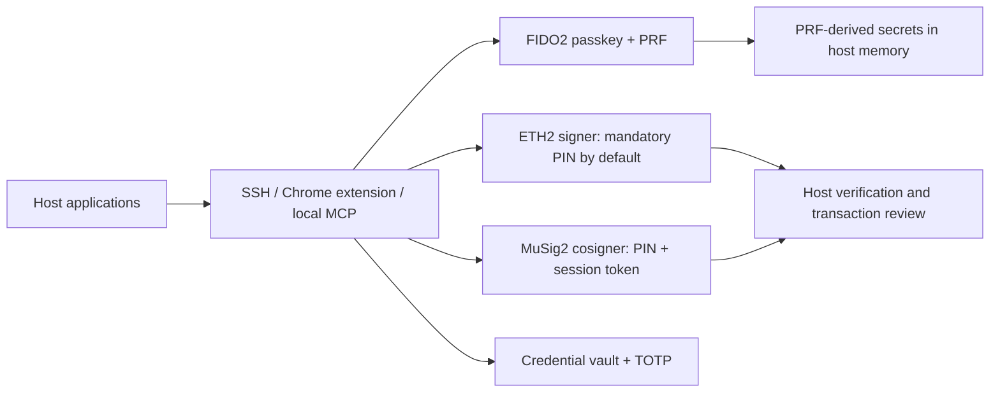

# Nuri Card



An open Java Card stack: FIDO2 passkeys with PRF, OpenSSH FIDO2 `sk` keys,
Ethereum digest signing, Bitcoin MuSig2 cosigning, credential storage and TOTP.
Host integrations include a Chrome extension wallet, local MCP tools for agents,
and a secp256k1 PKCS#11/OpenSSL signing adapter. New applets add CA-backed
attestation; GlobalPlatform management-key rotation has encrypted owner escrow.

**Research-grade: not externally audited, not a certified hardware wallet.**
The card has **no screen** and performs **blind signing**. It cannot independently
show or approve the recipient, amount or chain. Do not treat a public source
release as consumer-funds approval. See [SECURITY.md](SECURITY.md),
[security advisories](docs/security-advisories.md) and [security model](docs/security-model.md).

## Chrome prototype: clean install folder

Extension version **0.2.0**; repository version **1.0.2**, unreleased.
Updated 2026-10-20 by Hermes Agent; packaging `3639a7c`, side-panel UI `ab6a413`.

```sh
python3 scripts/package-chrome.py "$HOME/Downloads/Nuri Card"
```

Chrome → `chrome://extensions` → Developer mode → **Load unpacked** →
select **Downloads/Nuri Card**. `manifest.json` is directly inside that folder.
Do not select the repository root. A ZIP and `START HERE.txt` are also created.
The exporter refuses to overwrite an existing folder or ZIP.

The toolbar click opens a native side panel, with 17px text, the official
Nuri app icon and technical details collapsed. Chrome controls its left/right
placement. Nuri coexists with an existing OKX provider; using the card to sign
inside OKX itself is not implemented. PIN on/off remains deferred; no applet,
PIN policy or installed host is changed by this package.

The local native host is a separate installation. The package includes
`Install Host.command` for macOS; an already-installed host is left unchanged
until explicitly run. [Host setup and test scope](docs/chrome-extension.md).
The Chromium CI job tests actual browser approvals and native IPC using the
explicit software simulator, not a physical card or a mainnet transfer.

## Feature status

Status describes the exact scope in the first column, not all revisions or clients.
Physical evidence is from the operator's 2026-10-17/18 runs; older transaction
records do not qualify newly changed CAPs. New PIN, vault-applet, extension,
pairing, attestation and GP-lock work has **simulator only** status until separately
accepted on a physical card. Here that label also covers fake-host/browser tests.

| Feature / scope | Status |
|---|---|
| FIDO2 passkey + PRF via PC/SC (disk-vault unlock) | proven on a physical card |
| SSH login via FIDO2 `ecdsa-sk` bridge | proven on a physical card |
| ETH v1 demo digest signing, without PIN | proven on a physical card |
| PKCS#11 / OpenSSL secp256k1 signing via ETH v1 (demo opt-in `NURI_ALLOW_ETH1_DEMO=1`) | proven on a physical card |
| PKCS#11 fail-closed defaults: real card by default, labelled simulator only on request, ETH2 preferred | simulator only |
| PRF-encrypted disk credential vault: put/run/rm | proven on a physical card |
| ETH signer v2: mandatory PIN by default, attestation | simulator only |
| MuSig2 cosigner: PIN, session ownership and arithmetic hardening | simulator only |
| On-card credential vault applet: PIN, HMAC and bearer storage | simulator only |
| TOTP: RFC 6238 / software-HMAC fallback | simulator only |
| Chrome extension wallet: approval binding, PIN flow and Base send | simulator only |
| MCP agent tools and paired loopback helper authorization | simulator only |
| CA-backed applet attestation and signing-key binding | simulator only |
| GP management-key rotation and encrypted escrow (reversible lock) | simulator only |
| Fingerprint authorization, secure messaging, independent lost-card recovery | planned |

Evidence and reproducible checks:
- [Reader hardware runs](docs/reader-compatibility.md#hardware-runs-parent-physical-card):
  SSH, FIDO2 PIN status, ETH1 signatures, native-host info/sign_hash and disk vault.
- [OpenSSL physical-card run](docs/hsm.md#physical-card-run-2026-10-18) and
  [disk-vault physical-card run](docs/card-secrets.md#physical-card-run-2026-10-18).
- [ETH2](docs/eth-applet-v2.md), [MuSig2 hardening](docs/musig2-pin-and-hardening.md),
  [vault applet](docs/card-vault-applet.md), [TOTP](docs/totp-applet.md),
  [Chrome extension](docs/chrome-extension.md), [helpers/MCP](docs/helper-servers-security.md),
  [attestation](docs/attestation.md) and [GP lock](docs/card-lock.md) give software checks.

### Supported readers — observed combinations, not certification

| Reader | Proven connection |
|---|---|
| HID Global OMNIKEY 5422, contact slot | default |
| Realtek `0bda:0165`, ATR `3b119580` | T=0 fallback |
| ACS ACR39U ICC Reader | T=0 fallback |

The tested card reports CPLC fabricator `4090`, OS ID `86aa`, OS date `5134`
(2025-05-14). Exact commercial model and product certification are UNVERIFIED;
do not call it NXP JCOP4. [Hardware requirements](docs/hardware.md).

## Quick start

### Without hardware

Requires Node.js/npm. Applet builds additionally need Java, Python and separately
installed tools: [reproduce](docs/reproducing.md).

```sh
git clone https://github.com/nuri-com/nuri-passkey-prf-smartcard.git
cd nuri-passkey-prf-smartcard
npm ci
npm test
npm run cosign:demo
```

These are software paths. **Never fund simulator or public demo keys.**
The optional [mobile source reference](mobile/expo-nfc-prf-probe/README.md) needs
separate access to a restricted UI dependency; a public clone cannot build it alone.

### Blank development card

1. Read [hardware](docs/hardware.md), [acceptance](docs/acceptance.md) and
   [key handling](docs/real-card-key-handling.md). Select a blank, disposable card
   with supplier transport keys; never use an existing wallet or your only SSH key.
2. Build/verify before writing any card:

   ```sh
   npm run card:release:verify
   ```

3. The existing bundle installer is a **demo installer**, not consumer provisioning:
   it installs FIDO2, MuSig2, TOTP and **PIN-less ETH v1**, not ETH2 or the vault.
   Only for that explicitly selected blank demo target:

   ```sh
   CARD_PROVISION_CONFIRM=YES GP_READER="$CARD_READER" GP_KEY="$CARD_TRANSPORT_KEY"      npm run card:provision:v1
   npm run card:pin:set
   ```

4. FIDO2 PIN does not protect other applets. For the newer PIN-gated stack follow
   [ETH2 enrollment and CA personalization](docs/attestation.md#blank-card-personalization),
   [MuSig2 PIN setup](docs/musig2-pin-and-hardening.md) and
   [vault setup](docs/card-vault-applet.md). This flow is simulator-tested, **not**
   physical-card accepted. Do not deposit funds on the strength of these instructions.
5. Record exact CAP hashes and physical acceptance on your target, then review
   [GP escrow/lock](docs/card-lock.md). That lock is reversible management-key
   rotation, not irreversible lifecycle sealing or a wallet backup.

[SSH setup](docs/ssh-smartcard.md) · [Chrome extension setup](docs/chrome-extension.md) ·
[All documentation](docs/README.md) · [Release verification](docs/release.md).

## Consent, secrets and loss

- **Card presence is not user touch.** FIDO2 user presence is assumed true,
  not measured: the patch advertises `up:true`, CTAP2 signs UP according to
  request options and selection succeeds without a physical check. The U2F path
  hardcodes UP=1. A touch prompt is not evidence of fresh consent.
  [UP details](docs/fido2-user-presence.md). The current SSH bridge does not
  implement PIN verification; leaving the card inserted can allow its use.
- ETH2 and current MuSig2 have their **own** PIN policies. Session PIN validation
  is not a trusted per-transaction display or physical touch. ETH1 has no PIN.
  TOTP PIN protects replacement, not code calculation. APDUs have no secure channel.
- PRF output, derived client keys and bearer credentials reach trusted host memory.
  Only the vault's HMAC-kind key has no export command; bearer use requires reveal.
  An agent must be restricted to allowlisted brokers, not arbitrary processes.
- **A lost card can mean lost money or access.** Same-card PRF + MuSig2 is not
  independent two-device custody. CSV expiry does not recreate the PRF/client key.
  Enroll and test independent SSH access and path-specific backups in advance.

| Failure | Consequence / action |
|---|---|
| Card lost, blocked, reset or applet deleted | Non-exportable keys may be unrecoverable; no universal recovery guarantee |
| Host compromised while card connected | Host can request exposed operations and capture host-visible secrets; disconnect card |
| Reader fails or returns `61xx` / `6Cxx` | Use the [shared transport](docs/reader-compatibility.md), not reset/key generation |
| Helper pairing/token rejected | Keep helpers loopback-only; do not disable guards or tunnel signing ports |
| Broadcast returns a transaction hash | Not a receipt, confirmation or merchant settlement |

## Licence

Nuri-authored source, current MuSig2 scalar arithmetic, FIDO2 and build-tool source
are MIT with retained third-party notices. **ETH v1 in `card/eth/` still contains
GPL-2.0-or-later arithmetic; its combined CAP is GPL-2.0-or-later.** This is not an
MIT-only distribution or an alternative MIT grant for GPL code. External tools,
libraries and card OS firmware retain their own terms.
[Licence map and obligations](THIRD_PARTY_NOTICES.md) · [MIT licence](LICENSE).
