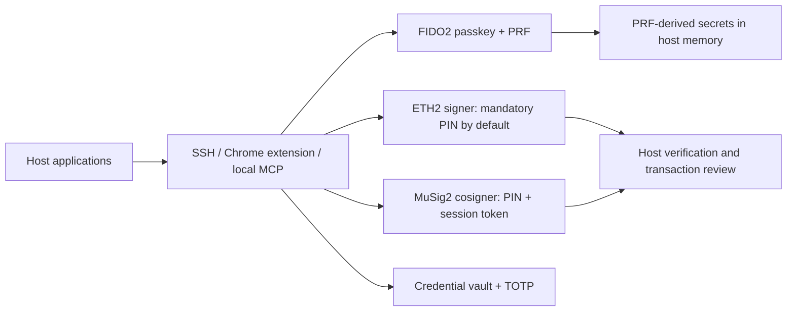

# Nuri Card



An open Java Card stack: FIDO2 passkeys with PRF, OpenSSH FIDO2 `sk` keys,
Ethereum digest signing, Bitcoin MuSig2 cosigning, credential storage and TOTP.
Host integrations include a Chrome extension wallet, local MCP tools for agents,
and a secp256k1 PKCS#11/OpenSSL signing adapter. New applets add CA-backed
attestation; GlobalPlatform management-key rotation has encrypted owner escrow.

**Research-grade: not externally audited, not a certified hardware wallet.**
The card has **no screen** and performs **blind signing**. It cannot independently
show or approve the recipient, amount or chain. Do not treat a public source
release as consumer-funds approval. See [SECURITY.md](SECURITY.md),
[security advisories](docs/security-advisories.md) and [security model](docs/security-model.md).

## Chrome prototype: clean install folder

Extension version **0.2.0**; repository package version **1.1.0** (release `v1.1.0`).

```sh
python3 scripts/package-chrome.py "$HOME/Downloads/Nuri Card"
```

Chrome → `chrome://extensions` → Developer mode → **Load unpacked** →
select **Downloads/Nuri Card**. `manifest.json` is directly inside that folder.
Do not select the repository root. A ZIP and `START HERE.txt` are also created.
The exporter refuses to overwrite an existing folder or ZIP.

The toolbar click opens a native side panel, with 17px text, bundled Nuri icon
assets and technical details collapsed. The Nuri provider does not replace an
existing `window.ethereum`; this is not tested signing integration inside OKX.
No applet, PIN policy or installed host is changed merely by exporting the package.

The local native host is a separate installation. The package includes
`Install Host.command` for macOS (copies `host/nuri_card_host.py`,
`host/webauthn_bridge.py`, `scripts/nuri_pcsc.py`, `scripts/nuri_attest.py`).
Exporting alone leaves an installed host unchanged; running an installer changes it.
[Host setup and test scope](docs/chrome-extension.md).
The Chromium CI job tests actual browser approvals and native IPC using the
explicit software simulator, not a physical card or a mainnet transfer.

## Feature status

Status is path-specific: a real-card result does not qualify every applet revision,
client, reader or transaction flow. Latest physical runs: 2026-10-22, card CPLC
`87E5470B`, OMNIKEY 5422. Evidence (file:line), receipts and open items per row:
[feature status](docs/feature-status.md).

| Feature / scope | Status |
|---|---|
| FIDO2 WebAuthn create/get with PRF | proven on a physical card |
| FIDO2 SSH bridge | proven on a physical card |
| ETH1 digest signing without PIN | proven on a physical card |
| ETH2 v2.1.0 PIN-gated digest signer | proven on a physical card |
| PKCS#11/OpenSSL signing through ETH1 | proven on a physical card |
| PKCS#11 fail-closed defaults and ETH2 discovery preference | simulator only |
| PRF-encrypted disk credential vault put/run/rm | proven on a physical card |
| MuSig2 v1.15 PIN2, protocol pin-1.14, additive AID2 cosigning | proven on a physical card |
| On-card credential vault PIN/HMAC/bearer storage | simulator only |
| TOTP calculation and software-HMAC fallback | simulator only |
| Chrome Ethereum wallet approval binding, PIN flow and Base send | simulator only |
| MCP tools and paired loopback helper authorization | simulator only |
| CA-backed applet attestation and signing-key binding | simulator only |
| GP management-key rotation with encrypted owner escrow | simulator only |
| OMNIKEY 5422 connection and additive ETH2 installation | proven on a physical card |
| Fingerprint authorization and application secure messaging | planned |
| Independent lost-card recovery | planned |

### Supported readers: observed combinations, not certification

| Reader | Proven connection |
|---|---|
| HID Global OMNIKEY 5422, contact slot | default |
| Realtek `0bda:0165`, ATR `3b119580` | T=0 fallback |
| ACS ACR39U ICC Reader | T=0 fallback |

The tested card reports CPLC fabricator `4090`, OS ID `86aa`, OS date `5134`
(2025-05-14). Exact commercial model and product certification are UNVERIFIED;
do not call it NXP JCOP4. [Hardware requirements](docs/hardware.md).

For the operator's OMNIKEY 5422, `~/bin/gp` auto-selected the card without `-r`;
the Homebrew executable failed with `Specify reader`. Use
`GP_BIN="$HOME/bin/gp"` or a GP release that selects the reader containing the
card. This October 22 observation does not qualify every GP release. PC/SC T=0
fallback is separate from GP reader selection.

## Quick start

### Without hardware

Requires Node.js/npm. Applet builds additionally need Java, Python and separately
installed tools: [reproduce](docs/reproducing.md). Python tools using union
type annotations require Python 3.10 or newer; the macOS host defaults to 3.13.

```sh
git clone https://github.com/nuri-com/nuri-passkey-prf-smartcard.git
cd nuri-passkey-prf-smartcard
npm ci
npm test
npm run cosign:demo
```

These are software paths. **Never fund simulator or public demo keys.**
The optional [mobile source reference](mobile/expo-nfc-prf-probe/README.md) needs
separate access to a restricted UI dependency; a public clone cannot build it alone.

### Blank development card

1. Read [hardware](docs/hardware.md), [acceptance](docs/acceptance.md) and
   [key handling](docs/real-card-key-handling.md). Select a blank, disposable card
   with supplier transport keys; never use an existing wallet or your only SSH key.
2. Build/verify before writing any card:

   ```sh
   npm run card:release:verify
   ```

3. The existing bundle installer is a **demo installer**, not consumer provisioning:
   it installs FIDO2, MuSig2, TOTP and **PIN-less ETH v1**, not ETH2 or the vault.
   Its existing-applet check covers four known AIDs, not every possible installed
   applet; it does not prove that an arbitrary target is blank.
   Only for that explicitly selected blank demo target:

   ```sh
   CARD_PROVISION_CONFIRM=YES GP_READER="$CARD_READER" GP_KEY="$CARD_TRANSPORT_KEY"      npm run card:provision:v1
   npm run card:pin:set
   ```

4. FIDO2 PIN does not protect other applets. For the newer PIN-gated stack follow
   [ETH2 enrollment and CA personalization](docs/attestation.md#blank-card-personalization),
   [MuSig2 PIN setup](docs/musig2-pin-and-hardening.md) and
   [vault setup](docs/card-vault-applet.md). The operator accepted additive ETH2
   PIN-gated key generation/signing and native-host signing on October 22. The
   separately installed MuSig2 v1.15 PIN2 AID2 also passed PIN-gate and cosigning
   proof, without broadcast or funding. This does not accept the complete CA
   personalization or vault flow. Do not deposit funds on the strength of these instructions.
5. Record exact CAP hashes and physical acceptance on your target, then review
   [GP escrow/lock](docs/card-lock.md). That lock is reversible management-key
   rotation, not irreversible lifecycle sealing or a wallet backup.

[SSH setup](docs/ssh-smartcard.md) · [Chrome extension setup](docs/chrome-extension.md) ·
[All documentation](docs/README.md) · [Release verification](docs/release.md).

## Consent, secrets and loss

- **Card presence is not user touch.** FIDO2 user presence is assumed true,
  not measured: the patch advertises `up:true`, CTAP2 signs UP according to
  request options and selection succeeds without a physical check. The U2F path
  hardcodes UP=1. A touch prompt is not evidence of fresh consent.
  [UP details](docs/fido2-user-presence.md). The current SSH bridge does not
  implement PIN verification; leaving the card inserted can allow its use.
- ETH2 and current MuSig2 have their **own** PIN policies. Session PIN validation
  is not a trusted per-transaction display or physical touch. ETH1 has no PIN.
  TOTP PIN protects replacement, not code calculation. Application commands do not
  add an end-to-end encrypted application channel. This does not describe GP
  management channels or negate FIDO2 PIN/PRF protocol protection.
- PRF output, derived client keys and bearer credentials reach trusted host memory.
  Among vault credential-slot kinds, HMAC slots have no reveal command; bearer
  use requires reveal. Both kinds are imported from the host, so no-reveal does
  not mean the HMAC key was never present in host memory.
  An agent must be restricted to allowlisted brokers, not arbitrary processes.
- **A lost card can mean lost money or access.** Same-card PRF + MuSig2 is not
  independent two-device custody. CSV expiry does not recreate the PRF/client key.
  Enroll and test independent SSH access and path-specific backups in advance.

| Failure | Consequence / action |
|---|---|
| Card lost, blocked, reset or applet deleted | Non-exportable keys may be unrecoverable; no universal recovery guarantee |
| Host compromised while card connected | Host can request exposed operations and capture host-visible secrets; disconnect card |
| Reader fails or returns `61xx` / `6Cxx` | Use the [shared transport](docs/reader-compatibility.md), not reset/key generation |
| Helper pairing/token rejected | Keep helpers loopback-only; do not disable guards or tunnel signing ports |
| Broadcast returns a transaction hash | Not a receipt, confirmation or merchant settlement |

## Licence

Nuri-authored source, current MuSig2 scalar arithmetic, FIDO2 and build-tool source
are MIT with retained third-party notices. **ETH v1 in `card/eth/` still contains
GPL-2.0-or-later arithmetic; its combined CAP is GPL-2.0-or-later.** This is not an
MIT-only distribution or an alternative MIT grant for GPL code. External tools,
libraries and card OS firmware retain their own terms.
[Licence map and obligations](THIRD_PARTY_NOTICES.md) · [MIT licence](LICENSE).
