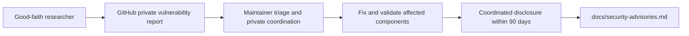

# Security policy

## Report a vulnerability privately

Use **GitHub private vulnerability reporting** for
[`nuri-com/nuri-passkey-prf-smartcard`](https://github.com/nuri-com/nuri-passkey-prf-smartcard/security/advisories/new).
Open the repository's **Security** tab and choose **Report a vulnerability**.
Do not put an unpatched vulnerability, private key, PIN, bearer token, recovery
material, or personal data in a public issue, discussion, or pull request.

If GitHub does not offer the private reporting form, the repository setting must
be enabled by a maintainer before submitting sensitive details. This policy does
not establish that the setting is enabled; no reporting email address is defined
here. Do not substitute a public issue for a private report.

Include:

- The affected component, full commit SHA or release, applet version, and relevant
  configuration (especially card versus simulator mode).
- Preconditions, expected versus actual behavior, impact, and minimal reproduction
  steps or a non-destructive proof of concept.
- Sanitized logs and tests, whether hardware or a simulator was used, and a suggested
  fix if available. Never send real secrets or another person's data.

## Supported versions

| Version or release line | Security support |
| --- | --- |
| `launch/v1` | Supported; use its latest fixes. |
| Later maintained release lines | Supported; use the latest security update for the line. |
| Revisions predating `launch/v1`, superseded snapshots, and unmaintained forks | Not supported; report relevant findings so maintained versions can be assessed. |

A source update is not a card update. Check the version of the installed applet
and update the affected host helper or extension as well as the applet when an
advisory requires it. Never erase or replace a card key as a diagnostic step.

## Scope and assurance

Reports are in scope for the Nuri-maintained **applets**, **host helpers**
(including native messaging, HTTP helper services, and PKCS#11 integration), and
**browser extension** in this repository. Authentication, authorization, nonce
lifetime, key lifecycle, request binding, simulator confusion, and build or update
integrity are relevant boundaries.

Third-party card firmware, card operating systems, reader firmware, browser
internals, and other upstream components are outside this project's remediation
scope. Report a Nuri integration defect here even if an upstream component is
involved; coordinate an upstream-only defect with its vendor. We cannot authorize
research against someone else's systems or firmware.

**This is research-grade hardware-wallet software. No independent external
security audit has been completed for this launch.** Source review, simulator
regressions, and individual physical-card checks are not an external audit or a
certification of resistance to physical, fault-injection, or side-channel attacks.
Do not treat a simulator's public test key as a protected card key. In particular,
the PKCS#11 launcher currently defaults to simulation unless
`NURI_PKCS11_MODE=card`; this remains outside the native-host simulator fix
([`scripts/pkcs11-nuri.c:356–358`](scripts/pkcs11-nuri.c#L356-L358),
[advisory NURI-2026-006](docs/security-advisories.md#nuri-2026-006--silent-simulator-key-selection)).

## Coordinated disclosure: 90 days

We work privately with reporters to reproduce, assess, remediate, and validate a
finding. The coordinated-disclosure target is **within 90 calendar days of receipt
of the private report**, preferably sooner when a fix is ready. Agree the public
advisory, affected versions, mitigation, and researcher credit through the private
report. Any extension must be explicitly agreed with the reporter; it is not an
indefinite embargo. Active exploitation or immediate user risk may require earlier
protective disclosure, coordinated with the reporter where feasible.

Published project advisories are tracked in
[`docs/security-advisories.md`](docs/security-advisories.md). Project advisory IDs
are not CVE or GitHub Security Advisory assignments.

## Safe harbour for good-faith research

We consider good-faith research conducted in accordance with this policy to be
authorized for the Nuri-controlled components in scope. We will not initiate or
support legal action against a researcher for that compliant research, including
circumvention of a technical restriction solely as necessary to demonstrate the
reported vulnerability in those components. If a third party challenges compliant
research, we will make this authorization known.

To qualify, use only devices, accounts, and test funds you own or have explicit
permission to test; minimize access and disruption; stop if you encounter another
person's data; do not retain, disclose, or misuse that data; and report promptly
through the private channel. Do not extract or use other people's secrets, move
their funds, intentionally destroy keys, deny service, or test production services
without separate authorization. Prefer simulators and disposable fixtures over
irreversible hardware operations.

This commitment covers only rights and systems we control. It does not bind
third-party vendors, grant permission over their infrastructure, waive another
person's rights, or promise a bounty.
