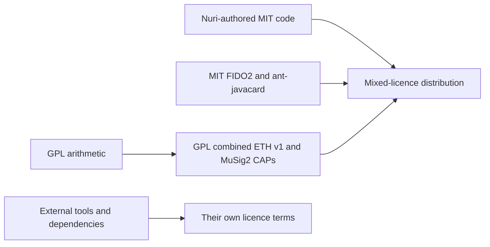

# Third-party notices and repository licensing

This is a mixed-licence repository, not an MIT-only release or a dual-licence
grant for the aggregate. Except for the identified third-party material,
Nuri-authored code is MIT under `LICENSE`; its existing copyright holder,
`Copyright (c) 2026 Emin Grande and contributors`, is unchanged. That grant
does not relicense inherited code, external tools, or assets owned by others.

## Source and binary licence map

| Paths | Licence and scope | Origin / retained notice |
| --- | --- | --- |
| Nuri-authored host, scripts, tests, web, extension and applet contributions, except inherited material below | MIT; independently licensed contributions retain that grant even when included in a GPL combined applet | Root `LICENSE` |
| `third_party/fido2-applet/` retained source, including Java implementation and tests | MIT, not GPL; the wrapper and metadata asset exclusions are listed below | Copyright (c) 2022 Bryan Jacobs; `third_party/fido2-applet/LICENSE` and `UPSTREAM.md` |
| `patches/0001-prf-on-by-default.patch`, `patches/0002-advertise-user-presence.patch` | MIT Nuri modifications to FIDO2 | Root `LICENSE`; original upstream notice retained |
| `third_party/ant-javacard/`, `tools/ant-javacard-proven.jar` | MIT build tool; not a licence for the Java Card SDK | Martin Paljak, tag `18.05.01`; `third_party/ant-javacard/LICENSE` and `UPSTREAM.md` |
| `card/musig2/Biginteger.java`, `card/eth/Biginteger.java` | GPL-2.0-or-later, not MIT | Satochip/Toporin modifications, OV-chip 2.0 / Digital Security group at Radboud Universiteit Nijmegen (2008–2009), and the JCMathLib attribution within the files; original headers preserved |
| `card/musig2/BigIntegerWrapper.java`, `card/eth/BigIntegerWrapper.java` | Satochip-derived wrapper arithmetic used with the GPL implementation; covered as part of the GPL combined applet, not established as an independent MIT-only replacement | Satochip provenance comments retained; independent rights to all wrapper expression are UNVERIFIED |
| `card/musig2/NuriMuSig2v019.java`, `card/eth/NuriEcdsaSigner.java`, and each directory's `BigIntegerMod.java` and `build.xml` | Inputs to the GPL combined applets; Nuri-authored portions retain MIT. Directory membership does not independently make every source file GPL | Root grant for independently authored material; inherited arithmetic remains subject to its original GPL grant |
| `dist/nuri-musig2-v20-keygen.cap`, `dist/nuri-eth-signer.cap` | GPL-2.0-or-later **combined works**, not merely binaries with optional “GPL portions” | Corresponding applet source in `card/musig2/` and `card/eth/`, build instructions in `scripts/build-card-v1-release.sh` |
| `card/eth2/`, `card/totp/`, `card/vault/` | MIT Nuri source, distinct from legacy `card/eth/`; vault HMAC-SHA256 is a clean-room RFC 2104 construction using only MessageDigest | Root `LICENSE`; binary/source provenance must still be checked for distributed CAPs |
| `extension/third_party/ethers.umd.min.js` | ethers 6.17.0, MIT as stated in its adjacent licence; not an Apache-2.0 relicense | Copyright (c) 2016–2025 Richard Moore; preserve `extension/third_party/ethers.LICENSE.md`. Completeness of notices for embedded bundle components is UNVERIFIED |

## GPL distribution requirements

Keep `LICENSES/GPL-2.0-or-later.txt` while GPL source or combined CAPs remain.
When distributing the legacy ETH v1 or current MuSig2 CAPs (including on cards),
provide complete corresponding source, modifications, build instructions and
licence notices under the applicable GPL distribution mechanism. Source must
match the actual binary/release: a newer branch that no longer contains its
implementation is not a substitute. The source trees named above and the
versioned build scripts identify the current build inputs; this notice alone
does not prove that every historical binary was built from the current tree.

No alternate MIT grant has been established for the inherited GPL arithmetic.
Do not relabel the existing GPL CAPs after source replacements. Preserve
historical corresponding-source availability and notices for prior recipients.
Host code communicating with an applet over APDUs is not thereby relicensed GPL.

## Deliberate packaging exclusions

The Apache-2.0 Gradle launchers `third_party/fido2-applet/gradlew` and
`gradlew.bat`, `gradle/wrapper/gradle-wrapper.jar` and its unused properties file
are omitted. No Gradle wrapper is redistributed in that directory; Gradle 8.2
or newer must be installed separately. Gradle and its components retain their
own licences (including Apache-2.0), not the applet MIT grant.

`third_party/fido2-applet/mds.json` is omitted because rights to its metadata,
embedded icon and certificate have not been established separately. This is
not a finding that the FIDO2 applet source is GPL. The omitted file is not a
compilation input.

The following vendor files are excluded from the current source tree; no MIT
redistribution grant was established for them:

- `docs/feitian/Datasheet FTSleeve.pdf`
- `docs/feitian/Datasheet FT_JCOS BioCard E076.pdf`
- `docs/feitian/Manual FP Card 076.pdf`
- `docs/feitian/Manual FT-JCOS BioCARD V1.2EN (2209).pdf`
- `docs/feitian/Gmail - Re_ Inquiry - Fingerprint Card.pdf`

Deletion from the current tree does not erase historical blobs or prove that
old releases/downloads contain none of this material. Historical publication,
asset provenance and any confidentiality obligations require separate review;
this notice makes no blanket claim about them. Existing exclusions for
`vendor/feitian-nda-sdk/` and `docs/feitian/nda/` remain in force.

## External dependency and toolchain boundary

Separately installed npm/mobile/Python dependencies, Gradle plugins, jCardSim,
JUnit, the Java Card SDK and card OS firmware retain their own licence terms.
Lockfiles and install instructions are not grants covering those packages.
For example, root npm dependencies include ISC `bip68`; simulator dependencies
include Apache-2.0 jCardSim and EPL-2.0 JUnit. Do not describe the full installed
stack as MIT-only. Generated test JARs may bundle simulator dependencies and
need their notices if redistributed. Distribution of installed packages,
SDK material, generated binaries or mobile bundles requires a separate
component/notice review; keeping dependencies external during source packaging
does not remove obligations when they are later bundled.
