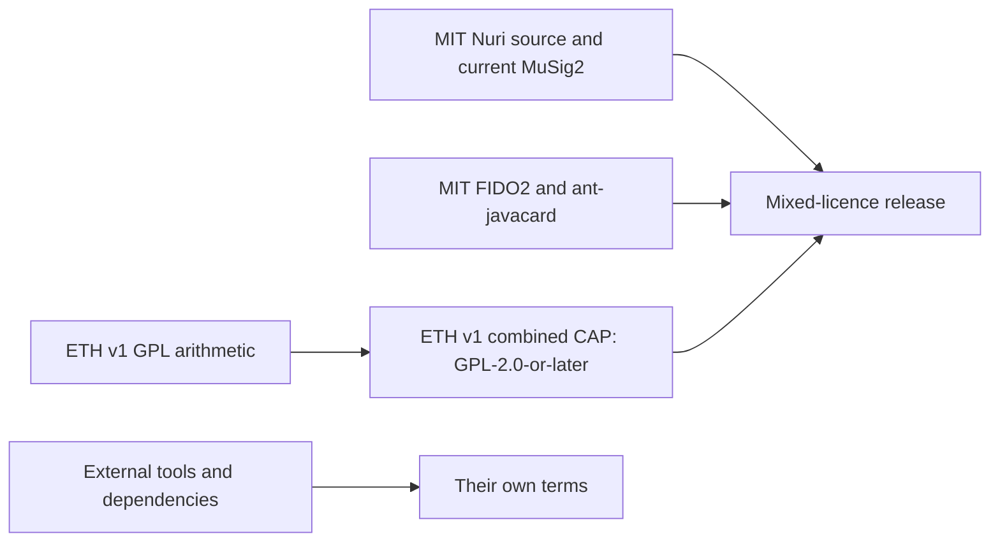

# Third-party notices and repository licensing

Except for identified inherited material, Nuri-authored source is MIT under
[LICENSE](LICENSE), Copyright (c) 2026 Emin Grande and contributors. Existing
third-party notices remain in force. This is a mixed-licence distribution,
**not MIT-only and not a dual-licence choice for the aggregate**.

## Licence map

| Component | Licence / scope |
|---|---|
| Nuri-authored host, CLI, tests, web, extension, ETH2, TOTP, vault and attestation source | MIT, except inherited material explicitly identified below |
| Current MuSig2 applet and `card/musig2/Scalar256.java` | MIT. The independent W16 scalar replacement removed the inherited bignum implementation from this source tree; see [provenance and vectors](docs/scalar256.md). W20 hardening and W25 attestation do not relicense old binaries. |
| `third_party/fido2-applet/` retained source | MIT, Copyright (c) 2022 Bryan Jacobs. Retain [LICENSE](third_party/fido2-applet/LICENSE) and [upstream provenance](third_party/fido2-applet/UPSTREAM.md). |
| `patches/0001-prf-on-by-default.patch`, `patches/0002-advertise-user-presence.patch` | MIT Nuri modifications; preserve upstream attribution. |
| `third_party/ant-javacard/`, `tools/ant-javacard-proven.jar` | MIT, Martin Paljak, tag 18.05.01. Retain [LICENSE](third_party/ant-javacard/LICENSE) and [provenance](third_party/ant-javacard/UPSTREAM.md). This is not a Java Card SDK licence. |
| `card/eth/Biginteger.java` | GPL-2.0-or-later. Satochip/Toporin modifications, OV-chip 2.0 / Digital Security group, Radboud Universiteit Nijmegen (2008–2009), plus JCMathLib attribution in the file. Original headers retained. |
| `card/eth/BigIntegerWrapper.java` and the combined ETH v1 applet | Satochip-derived arithmetic with the GPL implementation. Independently Nuri-authored portions retain MIT; the combined work is GPL-2.0-or-later, not MIT-only. |
| `dist/nuri-eth-signer.cap` | GPL-2.0-or-later combined ETH v1 binary; corresponding source in `card/eth/` and build scripts in this release. |
| `extension/third_party/ethers.umd.min.js` | ethers 6.17.0, MIT, Copyright (c) 2016–2025 Richard Moore. Preserve [adjacent licence](extension/third_party/ethers.LICENSE.md). Completeness of embedded-component notices remains UNVERIFIED. |

## GPL distribution and historical binaries

Retain [GPL text](LICENSES/GPL-2.0-or-later.txt) while ETH v1 source or its CAP is
distributed, including on a card. Supply complete matching corresponding source,
modifications, build instructions and notices through the applicable GPL
mechanism. The source must match the binary; a changed default branch is not a
substitute. No alternate MIT grant for the inherited ETH arithmetic is claimed.

Historical MuSig2 CAPs containing the old GPL arithmetic remain GPL combined
works. A new MIT implementation cannot retroactively relabel those binaries.
Keep historical corresponding source available for prior recipients. The current
MuSig2 CAP must be rebuilt/verified against current MIT source before distribution;
filenames alone do not prove correspondence. [Release verification](docs/release.md).
Communicating with an applet over APDUs does not itself relicense host code GPL.

## Packaging exclusions and external dependencies

Vendor PDFs/private correspondence, unlicensed metadata assets and the Apache-2.0
Gradle wrapper are not distributed in the current source tree. Gradle is installed
separately. A local-path-bearing prebuilt SSH provider is also excluded; build it
on the user's machine. Deletion does not remove past Git blobs or published
archives: historical publication requires separate review.

MIT applies to the retained independently licensed source, not the entire installed
stack. npm/mobile/Python dependencies, Gradle and plugins, jCardSim (Apache-2.0),
JUnit (EPL-2.0), Java Card SDK and card OS firmware retain their own terms. Root
npm dependencies include ISC `bip68`. Lockfiles/install instructions are not grants
covering dependencies. Generated test JARs, native/mobile bundles and bundled tools
need their own notice review. Asset provenance and embedded bundle notices remain
release-review obligations, not a claim resolved by this document.
