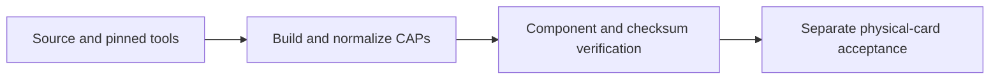

# Release artifacts



Current checksum inventory from [SHA256SUMS](SHA256SUMS); filenames and successful
hashes do not prove the installed card revision or certification. New PIN,
attestation and vault CAPs are simulator only. [Feature status](../README.md#feature-status).

| Artifact | Source | Applet AID | Version / scope | Licence | SHA-256 |
|---|---|---|---|---|---|
| `FIDO2.cap` | `third_party/fido2-applet/ + patch 0001` | `A0000006472F0001` | 0.4, advertises up:false | MIT | `173a6290e7dfb9e55c3c837956345500ca2dcf1b634fabf258e6f51027f7f24d` |
| `FIDO2-up.cap` | `third_party/fido2-applet/ + patches 0001/0002` | `A0000006472F0001` | 0.4, advertises up:true; no physical touch check | MIT | `ec670c69f0f47c09526c1744d314f899681d7d935806278d2fbfbd2019f699d9` |
| `nuri-musig2-v20-keygen.cap` | `card/musig2/` | `4E5552494D554701` | 1.14, package 2.2; PIN/token/attestation | MIT | `eee7a911723c7fcd0541a791362b29375333e66075bb207136587ef6a32a3b53` |
| `nuri-oath-totp.cap` | `card/totp/` | `4E555249544F5450` | 1.0; admin PIN does not gate CALC | MIT | `2f18861cd541e61ecc5af6d0a50a25f7bd2992d85fd205a66bbcb97a2adfb7c0` |
| `nuri-eth-signer.cap` | `card/eth/` | `4E55524945544801` | 1.4 / SIGN; demo, no PIN | GPL-2.0-or-later combined | `0093e7b2b9c15435fd853ac4e6a64180f0779aa5230e56b652b6b8217d1b5217` |
| `nuri-eth2-signer.cap` | `card/eth2/` | `4E5552494554483201` | 2.1.0; mandatory-default PIN and attestation | MIT | `158088eec670eab578fc81d4621087c3752e4001f7afcf288e8ff48b01f9261e` |
| `nuri-vault.cap` | `card/vault/` | `4E555249564C5401` | package 1.1; PIN slots and attestation | MIT | `70ab1835d602fd3aaef346f4da8ef5c1a737d3a189ad0e9e9743aff65665bc33` |
| `pkcs11-nuri.so` | `scripts/pkcs11-nuri.c` | `not an applet` | macOS native module; rebuild for your platform | MIT source | `9d76b0080123e860e4058c6ca9b59e0ad4465ae291fb8d65c4b52b2aba95d165` |

The machine-specific prebuilt SSH provider is omitted. Build it on your own host
using [SSH setup](../docs/ssh-smartcard.md); locally generated absolute paths must
not be redistributed. The PKCS#11 module is a separate native artifact, not a CAP;
its source/platform correspondence is checked separately.

## MuSig2 additive identities

| Identity | Package AID | Applet AID | Artifact / scope |
|---|---|---|---|
| AID2 | `4E5552494D554732` | `4E5552494D55473201` | `nuri-musig2-v20-keygen-aid2.cap`; hash in `SHA256SUMS`, historical PIN2 receipt |
| AID3 | `4E5552494D554733` | `4E5552494D55473301` | `nuri-musig2-v20-keygen-aid3.cap`; candidate built from final integrated source |

AID3 build integration is included in repository version 1.2.0. Before release,
generate the candidate from the final scalar source, add its normalized CAP/hash
to this inventory and `SHA256SUMS`, and run the complete release verifier. No
AID3 real-card times or physical acceptance are claimed here; AID2 evidence does
not transfer to a new CAP. [Scalar boundary](../docs/scalar256.md#v120-aid3-release-boundary).

## Build inputs and reproduction

- FIDO2 fork `4f318197cc08f316ce784a89bdf29dc73cca7fcf`, upstream v2.0.5
  `0194107d9648577379058b59843504924b546514`; packaging deviations in
  [upstream provenance](../third_party/fido2-applet/UPSTREAM.md).
- Java Card SDK checkout `e2df471e04d86f33de69a947f44766fbef1d9d69`;
  FIDO2 converter 3.0.5, custom applets 3.0.4. SDK is external, not MIT-relicensed.
- Azul Zulu OpenJDK `1.8.0_452` for CAP compilation; JDK17 launches Gradle/simulators.
- External Gradle 8.2 through 8.x; no vendored wrapper. Other versions require
  separate reproducibility checks; Gradle 9 is rejected by the current build gate.
- [Pinned ant-javacard](../tools/README.md), SHA-256
  `def557393fd20dbe478a4581c3273222805b9e494836aa8465dfbe0fb9d64cf2`.

```sh
npm run card:release:verify
```

Require `CARD_V1_RELEASE_VERIFIED`, preserve build provenance and run
[physical acceptance](../docs/acceptance.md) separately. The legacy bundle
installer still installs ETH1, not ETH2/vault: it is a blank-card demo installer,
not consumer provisioning. Follow [blank-spare personalization](../docs/attestation.md#blank-card-personalization)
for the new applets; do not overwrite an existing wallet or sole SSH key.
[Notices](../THIRD_PARTY_NOTICES.md) govern licence distribution, including old GPL binaries.
