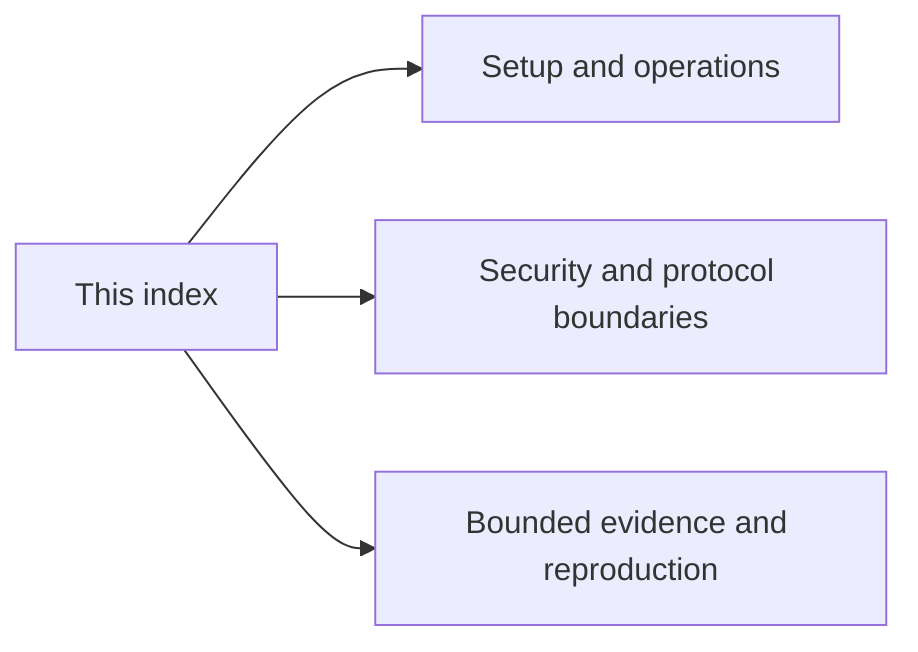

# Documentation index

[Project README and feature status](../README.md) is the release summary.
[SECURITY.md](../SECURITY.md) is the disclosure policy. A simulator result is not
physical-card acceptance; historical evidence does not qualify new CAP revisions.

## Guides and protocols

- [acceptance.md](acceptance.md) — Blank-card and host acceptance procedure; the bundle remains an ETH1 demo installer.
- [arkade-lightning.md](arkade-lightning.md) — Arkade signer interfaces and the boundary between signatures, broadcast and settlement.
- [attestation.md](attestation.md) — CA trust, per-applet identity/key binding, wire format and blank-spare personalization.
- [card-capability-summary.md](card-capability-summary.md) — Interface directory pointing to the canonical feature status and security model.
- [card-lock.md](card-lock.md) — Reversible GP management-key rotation with encrypted owner escrow; simulator only.
- [card-secrets.md](card-secrets.md) — PRF-encrypted disk vault and trusted broker; separate on-card backend and agent limits.
- [card-vault-applet.md](card-vault-applet.md) — PIN-gated on-card HMAC/bearer slots and their different export boundaries.
- [chrome-extension.md](chrome-extension.md) — Chrome wallet installation, immutable approval, PIN/native protocol and demo steps.
- [eth-applet-v2.md](eth-applet-v2.md) — Current ETH2 mandatory-default PIN, commands, attestation and simulator coverage.
- [eth-signing-spec.md](eth-signing-spec.md) — ETH1 demo versus ETH2 digest-signing contract and host verification.
- [fail-closed-signers.md](fail-closed-signers.md) — Audit of every signer entry point: card absent is an error, simulators only with explicit flags, ETH1 behind `NURI_ALLOW_ETH1_DEMO=1`.
- [fido2-prf-baseline.md](fido2-prf-baseline.md) — Pinned FIDO2 build inputs, patches and simulator PRF mapping.
- [fido2-user-presence.md](fido2-user-presence.md) — UP is assumed, not a measured touch; PIN/UV and browser compatibility are separate.
- [gp-macos-troubleshooting.md](gp-macos-troubleshooting.md) — Classify GP/transport/install errors before attempting destructive changes.
- [hardware.md](hardware.md) — Exact CPLC observations, required algorithms and unqualified batch/model limits.
- [helper-servers-security.md](helper-servers-security.md) — Loopback-only HTTP/MCP pairing, scoped bearer files and resource/framing limits.
- [how-it-works.md](how-it-works.md) — Host transaction construction, PRF-derived secrets and card partial signing overview.
- [hsm.md](hsm.md) — secp256k1 PKCS#11/OpenSSL use: real card by default, labelled simulator only on request, ETH2 preferred, ETH1 only with the demo opt-in.
- [musig2-nonce-lifetime-fix.md](musig2-nonce-lifetime-fix.md) — Current 1.14 nonce reset/consumption and session-token boundary.
- [musig2-pin-and-hardening.md](musig2-pin-and-hardening.md) — Current MuSig2 PIN, token, blinding, point validation and one-shot keygen contract.
- [proofs/arkade-card-signer-proof.md](proofs/arkade-card-signer-proof.md) — Bounded source/simulator Arkade signer record, not live settlement.
- [proofs/hsm-openssl-sim.txt](proofs/hsm-openssl-sim.txt) — Path-normalized OpenSSL simulator transcript; not physical-card evidence.
- [proofs/real-card-signet-proof.md](proofs/real-card-signet-proof.md) — Retained historical Signet public values; no fresh chain/hardware attribution.
- [proofs/real-card-87E5470B-eth2-pin.json](proofs/real-card-87E5470B-eth2-pin.json) — 2026-10-22 real-card ETH2 v2.1.0 PIN gate + signing receipt.
- [proofs/real-card-87E5470B-musig2-aid2-cosign.json](proofs/real-card-87E5470B-musig2-aid2-cosign.json) — 2026-10-22 real-card MuSig2 PIN2 AID2 cosign receipt (not broadcast, not funded).
- [reader-compatibility.md](reader-compatibility.md) — Shared PC/SC ladder, error handling and three observed physical reader combinations.
- [feature-status.md](feature-status.md) — Per-feature status with file:line evidence, receipts and open items (2026-10-22 real-card runs).
- [real-card-key-handling.md](real-card-key-handling.md) — Separate GP/FIDO2/applet authorization and destructive identity lifecycle operations.
- [release.md](release.md) — Build/component/hash verification, source/binary correspondence and evaluation receipt.
- [reproducing.md](reproducing.md) — Public-core tests and toolchains; optional mobile dependency is restricted.
- [scalar256.md](scalar256.md) — MIT independent scalar arithmetic, vectors, frozen build history and physical limits.
- [security-advisories.md](security-advisories.md) — Disclosure register, affected revisions, fixes and evidence limits.
- [security-model.md](security-model.md) — Canonical trust, authorization, host-secret and lost-card/recovery boundaries.
- [signing-architecture.md](signing-architecture.md) — Path-specific key locations and host versus card responsibilities.
- [ssh-smartcard.md](ssh-smartcard.md) — FIDO2 sk SSH setup, no fresh-touch/PIN guarantee and independent backup enrollment.
- [tear-safety.md](tear-safety.md) — ETH2 SET/CHANGE/UNBLOCK power-loss consistency: transaction structure, OwnerPIN semantics, simulator limits; hardware tear UNVERIFIED.
- [totp-applet.md](totp-applet.md) — TOTP APDUs and RFC vectors; admin PIN does not gate code calculation.

## MuSig2 release identities

| Identity | Package AID | Applet AID | Scope |
|---|---|---|---|
| Original | `4E5552494D5547` | `4E5552494D554701` | Historical release artifact |
| AID2 | `4E5552494D554732` | `4E5552494D55473201` | Historical PIN2 real-card cosign receipt |
| AID3 | `4E5552494D554733` | `4E5552494D55473301` | v1.2.0 build integration; hardware unverified |

AID3 is additive, not an instruction to delete an installed identity. Hardware
timings and acceptance do not transfer between identities. See the
[scalar release boundary](scalar256.md#v120-aid3-release-boundary).

## Related repository documentation

- [THIRD_PARTY_NOTICES.md](../THIRD_PARTY_NOTICES.md) — MIT source and remaining ETH1 GPL obligations.
- [Artifact inventory](../dist/README.md) — current hashes and toolchain inputs, not installation approval.
- [Mobile source reference](../mobile/expo-nfc-prf-probe/README.md) — restricted UI dependency and NFC test limits.
- [Build tool](../tools/README.md) — pinned ant-javacard binary/source provenance.
- [Changes](../CHANGELOG.md) — historical changes, not fresh acceptance.

[AID3 hardware signature and timing proof](proofs/real-card-87E5470B-musig2-aid3-fast.json).
