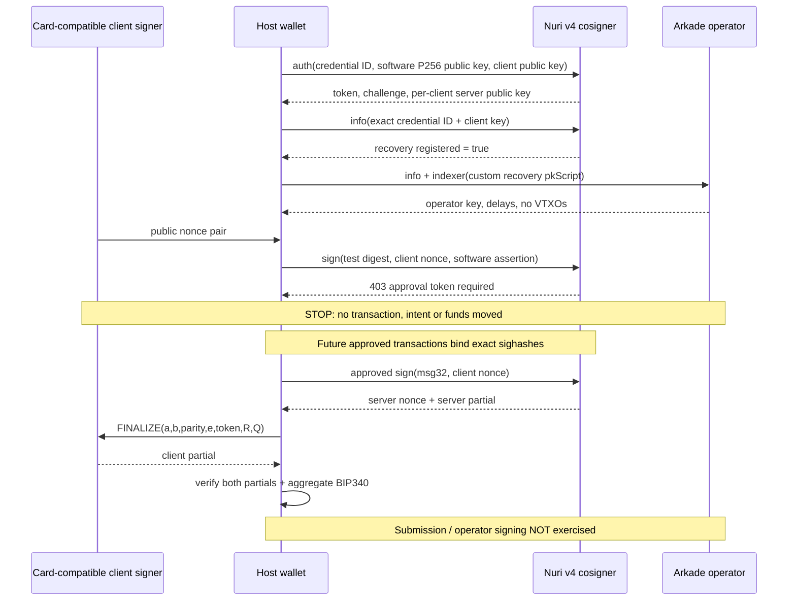

# W35 — Arkade card-compatible signer, bounded zero-funds evidence

## Result

**Live registration, correct contract addresses and zero balances proven. Live cooperative
signature remains blocked by spend-approval policy; no live aggregate signature is claimed.**
The software signer implements the PIN applet's exact 231-byte FINALIZE scalar contract.
Its partial and a software counterparty partial aggregate to a verified BIP340 signature.
The real-card bridge is implemented but was never executed. No PC/SC, phone, NFC, funds,
intent registration, settlement, send or broadcast was used.

[Public machine receipt](proofs/w35-arkade-e2e.json) is the live observation, not a mock.
Local source findings are not a claim of exact deployed source parity.



## Reproduce without hardware

From the repository root:

```sh
npm ci
node --test test/*.test.js
node scripts/arkade-card-e2e.mjs --local
node scripts/arkade-card-e2e.mjs --live --out=docs/proofs/w35-arkade-e2e.json
```

`--live` creates or reuses `.w35-private/state.json` (0600, parent directory 0700),
containing software secp256k1/P256 secrets. It makes a persistent **test account registration**,
then GET reads and three permitted probe POST routes only (auth/sign/tree nonce).
It never registers the existing hardware public key. Tokens/assertions/private keys are not
written to the public receipt. Keep private state recoverable before approving any funding;
this is not a production wallet. Local dependency SDK is `0.4.38` (from npm ci / lockfile); live
server advertises 0.5.0-rc.19. Installed host SDK is not asserted to equal server SDK.

## Live evidence

Deployment 34, `nuri-server-api-v4.2.0-one-server-test`; operator `v0.9.22`.
Software client public key:
`021c6d799543a1d7fd943328667341ecb89c9ed4fdc340f9710c1101025c901e5c`.
Test P256 SPKI registration returned HTTP 200, readback `recovery.registered=true`.
This proves registration accepts a software credential, **not** verification of its assertion:
the tested signing endpoints reject earlier at the missing-spend-approval gate.
RP ID returned `nuri.com`; exact allowed origins are preserved in the receipt.

Software receive:
`ark1qzpq904am6clw3pgqwyh4p02708fy4xs0hcpwt7rwfdttuxsjameehwjd9p2zphnx4hmrwpnl6vaj8fu34kngvks8xk6swh8mcamyrvd03v4sh`.
Software boarding:
`bc1pyehl0cd2ej2uxxga8yjvf49047xu9lnq36eahuw37lhy7lhvyt4s7ykzy9`.

Existing card comparison key:
`02a0d209ad2861d00e527376db77810865a5284879e029ec07f4d29a26e1475e96`.
Correct receive:
`ark1qzpq904am6clw3pgqwyh4p02708fy4xs0hcpwt7rwfdttuxsjameestt87ajw7jzpul22tqrcg455q72ps04qqfgcq35gna6czkpx4wr3l6526`.
Correct boarding:
`bc1pn0cjhhhxpp0vs7sud2qlnuuuxjv495flfzk95jdfxnuhxc8d8ggs9ps2v3`.
This key was NOT registered or contacted on hardware.

SDK RestIndexerProvider queried each correct offchain script with spendableOnly and
returned no VTXOs, page null. Mempool Esplora returned no boarding UTXOs for both addresses.
These are zero queried balances, not a `Wallet.getBalance()` proof or account-history proof.

`POST /v4/arkade/sign`: HTTP 403 `approval token required`.
`POST /v4/arkade/tree/nonce`: HTTP 403 `approval token or challenge_token required`.
No arbitrary-message approval bypass exists in inspected server source. A signed auth token
plus P256 assertion is insufficient; no attempt to forge an approval was made.

## Source map: registration, approvals and persistent keys

Paths below are relative to the sibling Developer checkouts, not files copied into this repo.
`S` = nuri-server-musig2-v4-arkade/src/ArkadeServer.js.
`E` = nuri-expo/services/arkade.
`K` = this repository's node_modules/@arkade-os/sdk/dist/chunk-CCUUO2GR.js.

| Stage | File:line evidence | Key / message |
|---|---|---|
| Registration | S:3136–3180,3203–3214; ArkadeRecoveryStore.js:186–205 | Public binding credential ID + P256 credential key + persistent client secp key. No assertion at auth. Binding changes rejected. |
| Credential assertion | ArkadeWebauthn.js:30–41,87–147 | P256 SPKI/raw65; exact challenge/origin; SHA256 RP ID; UP+UV; ECDSA over authData + SHA256(clientData). Separate from MuSig2. |
| Per-client server key | ArkadeDerive.js:63–90,153–170,195–240; S:2738–2753 | Non-hardened server branch derives from hash of client compressed public key. The live key is per-client, not a global constant. |
| Approval requirement | S:2452–2459,3264–3274,3304–3345 | HMAC server token purpose spend_approval; exact authorized digest/client/tweak request, or signed direct_session scope. |
| Direct cosign | S:2671–2709,2850–2855 | One request carries client public nonce; deterministic Nuri signing returns nonce66 and partial32 together. Not a standalone direct nonce endpoint. |
| Host BIP327 assembly | E/ArkadeRemoteIdentity.ts:2151–2170,2205–2297 | Verify Nuri partial, produce client partial, aggregate and verify BIP340; clear private nonce state. |
| Ark transaction and checkpoints | K:11168–11239; E/ArkadeRemoteIdentity.ts:2526–2545,2549–2683 | Each owned input's Taproot sighash uses persistent aggregate identity; signMultiple optional. Operator submitTx adds its signatures. Checkpoints also need user signatures (before or after submit). |
| Settlement intents | K:10403–10443; E/ArkadeRemoteIdentity.ts:2549–2683 | Registration and deletion ownership proofs route through input signer. They are concrete transaction/proof digests, not arbitrary generic messages. |
| Settlement boarding/forfeits | K:10498–10528 and following finalization code | Owned boarding commitment inputs and forfeits use persistent ownership signer; operator contributes its own signatures. |
| Tree signing session | E/ArkadeRemoteIdentity.ts:2300–2322; E/ArkadeRemoteSignerSession.ts:375–398,854–874 | Fresh session object, but public key is persistent client+Nuri aggregate in Expo remote identity. Secret nonces/session ID are ephemeral; card share still required. |
| Tree endpoints | S:3720–3743,3749–3841; routes S:5996–5997 | Approval or V5 challenge token; session+txid+digest binding; cached per-txid nonces reject changed operation; nonce secrets retained in RAM then consumed. |

**Do not replace signerSession with SDK random software identity without reviewing custody.**
Default SDK sessions can be random keys; Expo's remote override advertises the persistent
aggregate instead. A fresh JS object is not evidence of an ephemeral signing *key*.
A separate, fully implemented software ephemeral tree signer could avoid card tree rounds only
if its advertised key, proof binding, approval policy and complete lifecycle are intentionally
changed and tested. That integration is NOT implemented by this probe.

## Correct contract construction and applet parity

E/internal/recoveryDefaults.ts:199–307 constructs separate offchain and boarding recovery
scripts. E/ArkadeClientRecoveryContract.ts:160–184 and
E/ArkadeServerDecayPolicy.ts:236–262 define these three leaves in order:

1. MuSig2 aggregate AND Ark operator signature;
2. MuSig2 aggregate after Ark CSV;
3. Client alone after Ark CSV **plus** Nuri CSV, same seconds-based BIP68 units.

Use SDK VtxoScript constructor (NUMS internal key and its tree algorithm), not generic
p2tr(aggregate, leaves). Ark delay live 605184 seconds; boarding 7776256 seconds;
Nuri CSV 6674432 seconds. The two address families have different output keys.
The comparison vector regression test matches W34 exactly.

Applet card/musig2/NuriMuSig2v019.java:543–577 computes
s = +/- (k1 + b*k2) + e*a*d mod n, consumes nonce state before parsing, checks token and
uncompressed R/Q points. Host must fold BIP327 aggregate-key parity/gAcc into `a`.
The 231 bytes are a32 || b32 || parity1 || e32 || token4 || R65 || Q65.
No tweaks are used in direct script-leaf signatures; tree/nested-key tweak handling remains
unimplemented by the live probe and must not be inferred from its local direct proof.

## Real-card next commands — prepared, NOT executed

After the other agent releases exclusive hardware ownership, export NURI_CARD_PIN through a
trusted terminal (never argv/chat), set NURI_MUSIG2_AID to the exact installed applet AID, and
use its Python environment with PC/SC dependencies. No KEYGEN is performed.

```sh
export NURI_MUSIG2_AID=4E5552494D55473201
# NURI_CARD_PIN must already be securely exported; do not put its value in shell history.
node --input-type=module -e 'import {PythonCardSigner,localProof} from "./scripts/arkade-card-e2e.mjs"; const s=new PythonCardSigner(); try { console.log(JSON.stringify(await localProof(s),null,2)); } finally {s.close();}'
```

This signs only the fixed, domain-separated nontransaction digest with a software second
signer, not live Nuri. Verify returned card key before doing anything else. Register the real
card only with the owner's actual FIDO credential through the existing approved app flow;
do not bind it to this harness's software test credential.

## Funding + receive + send plan — NOT an executable money path

There is deliberately **no send/settle command** in this harness. The exact next safe sequence
is gated, not implied to work:

1. Run the real-card nontransaction proof above and compare its public key.
2. Implement scoped approval packaging + persistent-card identity transaction signing and
   signerSession lifecycle (tree nonce and partial endpoints), install custom contract in
   Wallet and verify empty balance. This missing work blocks a truthful funded e2e command.
3. User approves at most 1000 sats only after that integration and reviewed fee/change policy.
   Ark-to-Ark receipt avoids initial boarding; send to the freshly rederived correct ark1
   destination, not the raw aggregate Profile address. Or fund bc1p and wait confirmation,
   then approved wallet.settle() consumes boarding UTXO and joins the batch.
4. The future integrated flow would run `await wallet.getBalance()`, then
   `await wallet.settle()` for boarding (not needed for ordinary Ark-to-Ark receipt), then
   `await wallet.send({ address: approvedRecipientArkAddress, amount: 330 })` after approving
   exact recipient, amount, fee and change. These SDK calls are **not wired commands here**.
5. Require Nuri approval on real PSBT/sighashes; verify client/Nuri aggregate per input,
   operator signed checkpoints and resulting indexer outpoints/balance before claiming success.

A command claiming to run those funded steps now would be fabricated: this deliverable stops
at the demonstrated live authorization blocker. No PR merge or production deployment implied.
