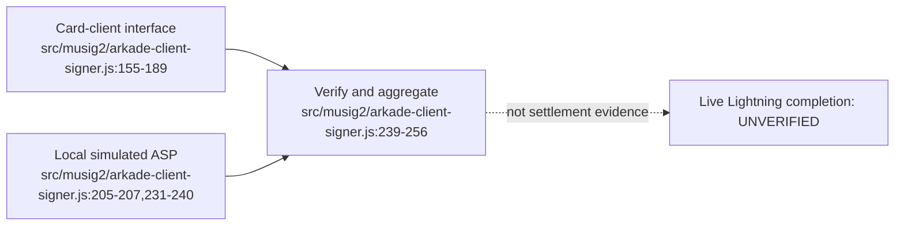

# Arkade and Lightning integration boundaries



## Two different key models

**Card as MuSig2 client signer.** The local proof asks a signer for its public key, public nonce and partial, verifies both parties' partials, then verifies the aggregate BIP340 signature. The default client is a simulator and the ASP secret is local software, not a live remote operator. [src/musig2/arkade-client-signer.js:193-256](../src/musig2/arkade-client-signer.js#L193-L256)

The PC/SC adapter exercises the real-card interface with a local simulated ASP, in untweaked and script-root-tweaked cases. Source support is not a fresh device run. [scripts/real-card-arkade-signer-proof.py:214-246](../scripts/real-card-arkade-signer-proof.py#L214-L246)

**Card as PRF identity root.** The compatibility adapter obtains PRF output, derives a Bitcoin client key in host memory and returns it through `getSigningKey()`. This is not a non-exporting card-client signing path. [scripts/card-arkade-identity.mjs:32-72](../scripts/card-arkade-identity.mjs#L32-L72)

## Offline check

Requires the declared Node dependencies to be installed. [package.json:86-94](../package.json#L86-L94)

```bash
node scripts/arkade-card-signer-proof.mjs --json
```

This command selects local simulated/software signers and exercises both signing cases by default; its output reports partial/final signature verification. It neither sends Lightning nor contacts a live ASP. [scripts/arkade-card-signer-proof.mjs:19-25](../scripts/arkade-card-signer-proof.mjs#L19-L25), [scripts/arkade-card-signer-proof.mjs:58-85](../scripts/arkade-card-signer-proof.mjs#L58-L85), [src/musig2/arkade-client-signer.js:193-256](../src/musig2/arkade-client-signer.js#L193-L256)

## Integration limits

- A FIDO2 credential and the MuSig2 public key are separate inputs. The wallet obtains its client seed through a PRF profile and obtains the independent card public key through its signing helper; one successful FIDO2 operation is not evidence of a remote account mapping. [scripts/nuri-card-wallet.mjs:109-127](../scripts/nuri-card-wallet.mjs#L109-L127), [scripts/read-musig2-card-key.py:15-27](../scripts/read-musig2-card-key.py#L15-L27)
- Current MuSig2 requires its own PIN and session token, not FIDO2 PIN/UV or fresh touch. Earlier demo applets lack the PIN gate; see [current protocol](musig2-pin-and-hardening.md). Host approval policies remain separate. [card/musig2/NuriMuSig2v019.java:178-203](../card/musig2/NuriMuSig2v019.java), [card/musig2/NuriMuSig2v019.java:369-415](../card/musig2/NuriMuSig2v019.java)
- **UNVERIFIED:** live Arkade/ASP policy, Boltz swap completion, merchant settlement, deployed identity mapping and current phone/browser compatibility. A local signature or indexed broadcast is not fresh end-to-end Lightning-payment evidence.

See [signing architecture](signing-architecture.md) for key locations and [historical signer evidence](proofs/arkade-card-signer-proof.md) for bounded records. Do not promote historical Signet spends into a live Lightning-settlement claim.
