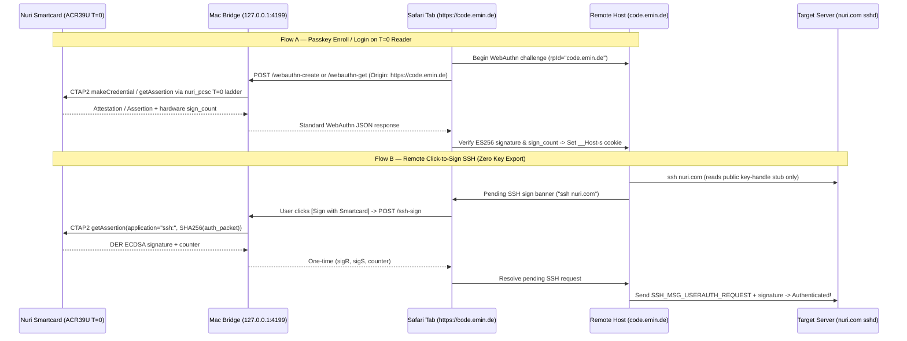

# Unified Browser WebAuthn + Click-to-Sign SSH Smartcard Bridge

Use one physical **Nuri Smartcard** attached to your Mac (including T=0-only contact readers like `ACS ACR39U ICC Reader`) for **both**:

1. **WebAuthn Passkey enrollment & unlock in macOS Safari** (bypassing Safari's T=0 reader blind spot), and
2. **Remote Click-to-Sign OpenSSH (`sk-ecdsa-sha2-nistp256@openssh.com`)** from a browser-hosted remote workspace (`https://code.emin.de`) into other smartcard-protected servers (`nuri.com`, `sign.nuri.com`, etc.) — **without exporting private keys or allowing background SSH**.

Implementation: [`scripts/browser-ssh-smartcard-bridge.py`](../scripts/browser-ssh-smartcard-bridge.py) powered by [`scripts/nuri_pcsc.py`](../scripts/nuri_pcsc.py).

---

## Why "Unified" Bridge? (Two OS/Protocol Walls, One Tiny Loopback Daemon)

When using a physical Nuri card in an `ACS ACR39U ICC Reader` alongside a remote browser coding host (`https://code.emin.de`), two separate browser/OS boundaries block direct smartcard signing:

| Boundary | Root Cause Observed on macOS | How the Unified Bridge (`127.0.0.1:4199`) Solves It |
|---|---|---|
| **1. Safari WebAuthn ignores `ACS ACR39U`** | macOS Safari's native WebAuthn sheet speaks USB-HID and T=1 CCID (`OMNIKEY 5422`), but silently skips T=0 contact smartcard readers (`ACS ACR39U`, `ATR=3b119580`). | Calls `nuri_pcsc.patch_fido2()` (`default -> T0 -> T1` APDU ladder with `61XX` `GET RESPONSE` + `6CXX` `Le` retry) and exposes `/webauthn-create` & `/webauthn-get` with `rpId` pinned strictly to the allowed HTTPS origin (`code.emin.de`). |
| **2. Browser WebAuthn cannot sign `ssh:`** | Browser `navigator.credentials.get()` enforces `rpId = <website domain>` and rejects OpenSSH's `application = "ssh:"` RP ID required by remote `sshd` servers. | Remote OpenSSH `SecurityKeyProvider` posts ONLY the one-time `SSH_MSG_USERAUTH_REQUEST` bytes to the authenticated web UI; clicking **`[Sign with Smartcard]`** calls `http://127.0.0.1:4199/ssh-sign` (`application="ssh:*"`) and returns ONLY the one-time `(sig_r, sig_s, counter)` signature. |

Because both flows need the exact same local primitive — **strictly Origin-locked loopback HTTP -> serialized PC/SC lock -> `nuri_pcsc.patch_fido2()` -> CTAP2 on the physical Nuri card** — unifying them into one ~300-line Python script avoids PC/SC reader contention and keeps zero extra moving parts on the Mac.

---

## Architecture Flow



---

## Security Boundaries & Learnings

1. **Zero private keys leave the card:** The `~/.ssh/id_nuri_pcsc_sk_backup` file placed on the remote host contains **only** the public key and the opaque CTAP2 credential ID (`key_handle`), identical to [`docs/ssh-smartcard.md`](ssh-smartcard.md). Stolen disk state cannot sign anything without the physical card.
2. **Zero silent background SSH:** Unlike `ssh -A` agent forwarding (where a remote process can silently sign whenever the socket is open), the remote OpenSSH `SecurityKeyProvider` blocks until a human with an active Passkey session clicks **`[Sign with Smartcard]`** in the browser. Pairing this with `ControlPersist 15m` on the remote host avoids prompt fatigue while revoking idle access automatically.
3. **Loopback + strict Origin + RP ID pinning:**
   - Bound strictly to `127.0.0.1:4199`.
   - Every `POST` and `OPTIONS` preflight checks `Origin == SWARM_ORIGIN` (default `https://code.emin.de`); any other tab or website receives `403`.
   - `/webauthn-create` and `/webauthn-get` refuse any `rp.id` / `rpId` other than `ALLOWED_RP_ID`, preventing cross-RP phishing even if a caller spoofed options.
   - `/ssh-sign` refuses any `application` string that does not start with `ssh:`.
4. **Multi-reader ordering (`OMNIKEY 5422` + `ACS ACR39U`):**
   - When multiple readers have cards or slots (e.g. `HID Global OMNIKEY 5422 Smartcard Reader 01` at `FIDO2_PCSC_INDEX=0` and `ACS ACR39U ICC Reader` at `FIDO2_PCSC_INDEX=1`), `CtapPcscDevice.list_devices()` order depends on USB enumeration.
   - `browser-ssh-smartcard-bridge.py` sorts preferred readers first (`NURI_READER`, default `ACR39`) and iterates across **all** connected FIDO2 PC/SC devices until the card holding the requested `credential_id` / `key_handle` answers, closing each PC/SC handle cleanly in `finally`.

---

## Running on macOS (`launchd`)

```sh
# Foreground test using the repo's prepared Python venv (pyscard + fido2):
SWARM_ORIGIN="https://code.emin.de" \
  .build/card-v1-python/bin/python3 scripts/browser-ssh-smartcard-bridge.py
```

Health check:

```sh
curl -s http://127.0.0.1:4199/healthz
# {"ok": true, "origin": "https://code.emin.de", "rpId": "code.emin.de", "readers": ["CtapPcscDevice(ACS ACR39U ICC Reader)", ...]}
```

For persistent login startup on macOS, load a user `LaunchAgent` (`~/Library/LaunchAgents/de.emin.code.smartcard-bridge.plist`) pointing `.build/card-v1-python/bin/python3` at `scripts/browser-ssh-smartcard-bridge.py` with `RunAtLoad=true` and `KeepAlive=true`.
