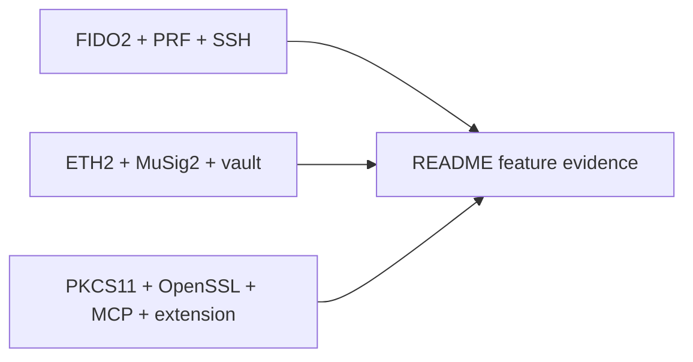

# Card capabilities and limits

The [README feature table](../README.md#feature-status) is the maintained release
status, separating physical-card runs from software/fake/simulator checks.
[Security model](security-model.md) is the maintained authorization/recovery boundary.

| Interface | Protocol / guide |
|---|---|
| FIDO2 / PRF | [Baseline](fido2-prf-baseline.md), [assumed UP, not touch](fido2-user-presence.md) |
| SSH | [OpenSSH FIDO2 sk bridge](ssh-smartcard.md); current bridge does not verify PIN |
| ETH v1 demo / v2 | [Digest contract](eth-signing-spec.md), [mandatory-default v2 PIN](eth-applet-v2.md) |
| MuSig2 | [Current PIN/session-token contract](musig2-pin-and-hardening.md), [nonce lifetime](musig2-nonce-lifetime-fix.md) |
| Vault | [Broker and disk vault](card-secrets.md), [on-card applet](card-vault-applet.md) |
| TOTP | [Applet](totp-applet.md); CALC is not PIN-gated |
| PKCS#11 / OpenSSL | [secp256k1 adapter](hsm.md); ETH1 key, no PIN authentication |
| Chrome wallet / MCP | [Extension](chrome-extension.md), [local helpers](helper-servers-security.md) |
| Attestation / GP management | [CA-backed applet identity](attestation.md), [reversible GP escrow](card-lock.md) |

No screen, no independent transaction-intent check, no external audit and no
product certification. PRF/client secrets and bearer credentials can reach the host.
A lost card can lose access or funds; no general lost-card recovery is shipped.
