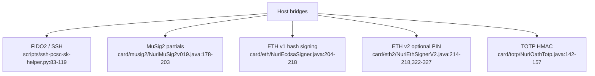

# Card capabilities and limits

## Source capabilities, not hardware qualification

| Component | Implemented interface | Authorization boundary |
| --- | --- | --- |
| FIDO2 / SSH | Bridge creates credentials and obtains assertions over PC/SC. [scripts/ssh-pcsc-sk-helper.py:83-119](../scripts/ssh-pcsc-sk-helper.py#L83-L119) | UP flags do not measure fresh touch; PIN authorization depends on request/options and applet policy. [third_party/fido2-applet/src/main/java/us/q3q/fido2/FIDO2Applet.java:2134-2195](../third_party/fido2-applet/src/main/java/us/q3q/fido2/FIDO2Applet.java#L2134-L2195), [third_party/fido2-applet/src/main/java/us/q3q/fido2/FIDO2Applet.java:2343-2346](../third_party/fido2-applet/src/main/java/us/q3q/fido2/FIDO2Applet.java#L2343-L2346), [third_party/fido2-applet/src/main/java/us/q3q/fido2/FIDO2Applet.java:4648-4654](../third_party/fido2-applet/src/main/java/us/q3q/fido2/FIDO2Applet.java#L4648-L4654) |
| FIDO2 PRF compatibility | Host identity adapter calls PRF derivation, derives HKDF/BIP86 client key and exposes a host signing key. [scripts/card-arkade-identity.mjs:32-72](../scripts/card-arkade-identity.mjs#L32-L72) | PRF-derived spend keys reach host memory; do not call this path non-exporting. [scripts/card-arkade-identity.mjs:55-72](../scripts/card-arkade-identity.mjs#L55-L72) |
| MuSig2 | Random on-card key generation, public nonces and 32-byte partial signatures. [card/musig2/NuriMuSig2v019.java:217-277](../card/musig2/NuriMuSig2v019.java#L217-L277), [card/musig2/NuriMuSig2v019.java:308-392](../card/musig2/NuriMuSig2v019.java#L308-L392), [card/musig2/NuriMuSig2v019.java:479-494](../card/musig2/NuriMuSig2v019.java#L479-L494) | One-shot KEYGEN and nonce-state checks, **no PIN/fresh-UP gate**. Host supplies signing context. [card/musig2/NuriMuSig2v019.java:178-203](../card/musig2/NuriMuSig2v019.java#L178-L203), [card/musig2/NuriMuSig2v019.java:217-222](../card/musig2/NuriMuSig2v019.java#L217-L222), [card/musig2/NuriMuSig2v019.java:369-415](../card/musig2/NuriMuSig2v019.java#L369-L415) |
| ETH v1 | On-card random key generation; signs 32-byte hashes to `r || s || v`. [card/eth/NuriEcdsaSigner.java:174-192](../card/eth/NuriEcdsaSigner.java#L174-L192), [card/eth/NuriEcdsaSigner.java:204-218](../card/eth/NuriEcdsaSigner.java#L204-L218), [card/eth/NuriEcdsaSigner.java:264-276](../card/eth/NuriEcdsaSigner.java#L264-L276) | Key initialization and length checks; **no PIN/fresh-UP gate**. [card/eth/NuriEcdsaSigner.java:151-161](../card/eth/NuriEcdsaSigner.java#L151-L161), [card/eth/NuriEcdsaSigner.java:204-208](../card/eth/NuriEcdsaSigner.java#L204-L208) |
| ETH v2 | Native ECDSA, `r || low-S s || pubkey65`. [card/eth2/NuriEthSignerV2.java:322-343](../card/eth2/NuriEthSignerV2.java#L322-L343) | PIN gate only after configuring its own PIN; validation resets on deselect. [card/eth2/NuriEthSignerV2.java:188-218](../card/eth2/NuriEthSignerV2.java#L188-L218) |
| TOTP | Stores provisioned secret, computes HMAC-SHA1 for host counter. [card/totp/NuriOathTotp.java:142-157](../card/totp/NuriOathTotp.java#L142-L157), [card/totp/NuriOathTotp.java:193-209](../card/totp/NuriOathTotp.java#L193-L209) | Admin PIN protects later PUT; CALC is **not PIN-gated**. [card/totp/NuriOathTotp.java:142-157](../card/totp/NuriOathTotp.java#L142-L157), [card/totp/NuriOathTotp.java:171-209](../card/totp/NuriOathTotp.java#L171-L209) |

## Boundaries that matter

- Separate applet dispatchers mean a FIDO2 PIN is not a universal card lock. Insertion or proximity is not per-signature consent. [third_party/fido2-applet/src/main/java/us/q3q/fido2/FIDO2Applet.java:2343-2346](../third_party/fido2-applet/src/main/java/us/q3q/fido2/FIDO2Applet.java#L2343-L2346), [card/musig2/NuriMuSig2v019.java:178-203](../card/musig2/NuriMuSig2v019.java#L178-L203), [card/eth/NuriEcdsaSigner.java:151-161](../card/eth/NuriEcdsaSigner.java#L151-L161), [card/totp/NuriOathTotp.java:130-169](../card/totp/NuriOathTotp.java#L130-L169)
- MuSig2 receives a reduced signing transcript; ETH receives a hash. Neither interface establishes an on-card amount/recipient display or independent transaction approval. [card/musig2/NuriMuSig2v019.java:389-415](../card/musig2/NuriMuSig2v019.java#L389-L415), [card/eth/NuriEcdsaSigner.java:204-212](../card/eth/NuriEcdsaSigner.java#L204-L212), [card/eth2/NuriEthSignerV2.java:322-331](../card/eth2/NuriEthSignerV2.java#L322-L331)
- KEYGEN is one-shot in current MuSig2 and ETH v1 source, not a promise about old installed versions. Reset/reinstallation has a separate destructive lifecycle; review [key handling](real-card-key-handling.md). [card/musig2/NuriMuSig2v019.java:217-222](../card/musig2/NuriMuSig2v019.java#L217-L222), [card/eth/NuriEcdsaSigner.java:174-176](../card/eth/NuriEcdsaSigner.java#L174-L176)
- **UNVERIFIED:** card model/OS compatibility, fingerprint integration, device certification, independent security audit, current browser/phone support and fresh hardware acceptance. Source code and simulator results do not establish these properties.

## Evidence and next steps

[Historical Signet evidence](proofs/real-card-signet-proof.md) and [historical Arkade signer evidence](proofs/arkade-card-signer-proof.md) are not fresh test results. For interfaces and offline tests, use [MuSig2](musig2-card-extension.md), [FIDO2 baseline](fido2-prf-baseline.md) and [signing architecture](signing-architecture.md). Do not infer a live Lightning payment from a valid local signature.
