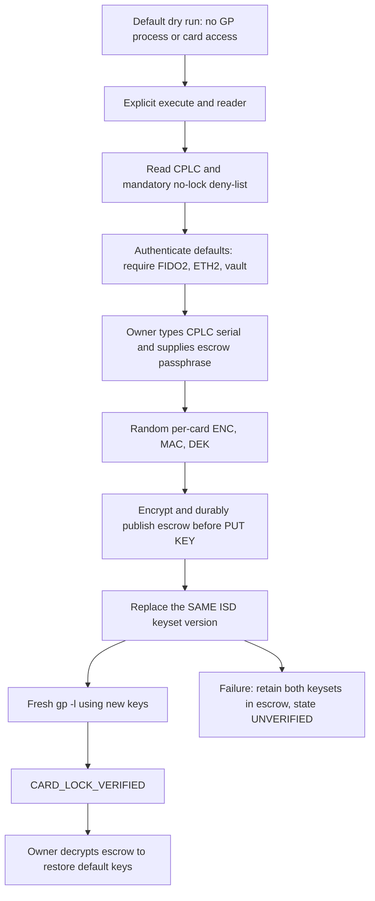

# Reversible card sealing with encrypted GP-key escrow



## What this lock means

`scripts/lock-card.sh` rotates the GlobalPlatform Issuer Security Domain (ISD)
management keys away from the publicly known default
`404142434445464748494A4B4C4D4E4F`. Each card gets three independent, random
128-bit AES ENC/MAC/DEK keys. They are **not discarded**: their encrypted escrow
makes the operation reversible for the owner. The script never changes card
lifecycle state, sends SET STATUS, enters CARD_LOCKED, or terminates the card.

On a qualified card with no other management keysets, this prevents someone who
only knows the default keys from deleting or replacing the installed applets,
installing malicious replacements, or rolling back to the unprotected legacy ETH
v1 applet. It is **not** monotonic, hardware-enforced anti-rollback: the escrow
holder can deliberately restore defaults and install older software.

It does **not** prevent physical attacks, faults, side channels, compromised
firmware, use of already-installed signing interfaces, compromise of the owner’s
host/passphrase/escrow, or blind-signing mistakes. It does not add a secure channel
between host applications and the applets, verify PIN configuration, or attest the
silicon. Applet presence in the registry is not a provisioning acceptance test.
Run acceptance and configure owner PINs before sealing. See
[the security policy](../SECURITY.md).

Losing the escrow **or its passphrase means no more applet upgrades or
reprovisioning through this management keyset**. The escrow contains GP management
keys, not FIDO credentials, ETH keys, MuSig2 keys, or a wallet recovery seed.
Keep independent wallet/identity recovery arrangements and an offline copy of the
encrypted escrow before relying on the card. Updating/reinstalling applets can
still destroy their keys; unlocking does not make that operation key-preserving.

## Supported GP profile: deliberately narrow

The helper pins **GlobalPlatformPro 24.10.15**, upstream release commit
`f2af9efe428f709cb4667324ae15985de881029a`. The official jar embeds `f2af9ef` in its
version banner; the exact release-tag banners `24.10.15` and `v24.10.15` are also
accepted. Development/dirty suffixes and other versions are refused. The existing
installer wrappers did not pin a GP version; this helper introduces its own gate.

The preflight requires exactly one existing ISD keyset: IDs 1, 2, 3; AES; 16 bytes;
version `01..0F` or `30..7F`. Versions `00`/`FF` are refused because upstream may
**add** a new keyset rather than replace the factory keys. Versions `10..2F` are
refused because upstream forces SCP01/SCP02 new-key handling for those ranges.
Extra/unknown keysets and 3DES cards are refused rather than guessed at. Qualify
those profiles separately; do not bypass the checks or automatically retry
unknown credentials (card-specific authentication retry policy is UNVERIFIED).

The exact command construction is:

```text
gp --reader READER --key-ver 0xVV \
  --key-enc CURRENT_ENC --key-mac CURRENT_MAC --key-dek CURRENT_DEK \
  --new-keyver 0xVV \
  --lock-enc TARGET_ENC --lock-mac TARGET_MAC --lock-dek TARGET_DEK

gp --reader READER --key-ver 0xVV \
  --key-enc TARGET_ENC --key-mac TARGET_MAC --key-dek TARGET_DEK -l
```

`VV` is read from the existing key template; it is **the same in both version
arguments**, never a new version. All three keys are replaced in one GP PUT KEY
operation, not three separate rotations. Upstream evidence:
[option definitions](https://github.com/martinpaljak/GlobalPlatformPro/blob/v24.10.15/tool/src/main/java/pro/javacard/gptool/GPCommandLineInterface.java#L92-L111),
[replacement/addition and key-type logic](https://github.com/martinpaljak/GlobalPlatformPro/blob/v24.10.15/tool/src/main/java/pro/javacard/gptool/GPTool.java#L789-L844),
[info/CPLC/key-template output](https://github.com/martinpaljak/GlobalPlatformPro/blob/v24.10.15/library/src/main/java/pro/javacard/gp/GPData.java#L325-L370).

**Local process boundary:** this GP CLI requires target key bytes in command-line
arguments. The wrapper never prints GP output/errors or generated key values, but
the OS can expose arguments to privileged or same-user process inspection. Use a
trusted, dedicated administration machine; do not run under shell tracing,
process-argument recorders, or an untrusted `GP_BIN`. Inherited `GP_*`/`SCP*`
configuration is stripped from GP subprocesses so it cannot enable tracing,
diversification, or another target. `GP_BIN` itself is a trusted executable path.

## Owner procedure — never the demo/SSH card

1. Remove any existing wallet or sole SSH-key card and use a disposable or customer-qualified card.
   The owner must create `~/.nuri-card` with mode **0700** and
   `~/.nuri-card/no-lock-cplc.txt` with mode **0600**. The deny-list is mandatory,
   cannot be overridden from the CLI, and accepts one exact eight-hex-digit CPLC
   serial or full 84-hex-digit CPLC per line; blank lines and `#` comments are
   accepted. Put the demo card’s value there first. Malformed entries, insecure
   permissions, symlinks, or a missing file cause refusal, not permission to seal.
   Both lock and unlock enforce it. Private card identifiers stay outside Git.
2. Use Python 3 with the helper’s dependency installed in your chosen environment:

   ```sh
   python3 -m pip install -r scripts/requirements-card-lock.txt
   ```

   The only added dependency is PyCryptodome, providing the requested scrypt and
   AES-256-GCM implementation (the repository already uses the `Crypto` API).
   Select your environment through `PYTHON_BIN`; the wrappers do not install
   packages automatically.
3. Exercise the no-card preview first (the default):

   ```sh
   npm run card:lock -- --reader 'EXACT READER NAME'
   npm run card:unlock -- --escrow "$HOME/.nuri-card/escrow/CPLC.json"
   ```

   Neither command invokes **any GP process**, reads a reader/card, prompts for a
   passphrase, or writes a file without `--execute`.
4. Run the acceptance checks separately and provision PINs. FIDO2
   `A0000006472F0001`, ETH2 `4E5552494554483201`, and vault `4E555249564C5401`
   **APP instances** must all be present. Package AIDs alone do not count.
   Then, on the qualified non-demo card only:

   ```sh
   PYTHON_BIN=/path/to/owner/venv/bin/python npm run card:lock -- \
     --execute --reader 'EXACT READER NAME'
   ```

   The helper reads complete CPLC, checks the deny-list/key template, authenticates
   the default keyset with `gp -l`, and asks you to **type the displayed CPLC serial
   exactly**. It prompts twice for an escrow passphrase (minimum 16 UTF-8 bytes;
   use a high-entropy passphrase). `--passphrase-fd N` supports a private inherited
   descriptor for controlled automation; never put the passphrase in argv, an
   environment variable, shell history, or a public log. Noninteractive execution
   without that descriptor is refused.
5. By default, encrypted escrow is written to
   `~/.nuri-card/escrow/<FULL-CPLC>.json`. `--escrow /private/path/card.json` selects
   another **new** path in a 0700 directory. Existing files are never overwritten.
   Only `CARD_LOCK_VERIFIED` means the post-rotation authenticated listing and
   CPLC recheck passed. Keep the encrypted file and passphrase separately.

**No call above was executed on a real card for this change.** Real-card support,
OS-level PUT KEY atomicity, card-specific retry policy, and durability under
actual host power failure remain **UNVERIFIED**. CPLC is not authenticated
attestation. The helper rechecks it immediately before/after rotation, but separate
GP subprocesses cannot prevent a physical card swap in the intervening race.
Keep one card seated in one trusted reader throughout.

## Escrow, ordering, and failure recovery

The plaintext escrow payload contains the complete CPLC, serial, GP release,
keyset version, and **both old and new** management keysets. It is encrypted with
AES-256-GCM (random 12-byte nonce, 16-byte tag, authenticated format label), using a
32-byte key derived by scrypt (`N=131072`, `r=8`, `p=1`, random 32-byte salt).
No plaintext key material is written to disk by the helper.

Private paths are walked with directory FDs and `O_NOFOLLOW`; group/world-writable
ancestors, symlinks, wrong owners/types and non-private final directories are
refused. A random 0600 `O_EXCL|O_NOFOLLOW` temporary file is written and fsynced,
then hard-linked atomically into its final name without overwrite; the temporary
name is removed and its directory fsynced. Newly created directories have their
containing directories fsynced too. The published file is read back and GCM-
authenticated before the helper sends PUT KEY. Filesystems must support these
operations; an error before PUT KEY aborts with existing card keys unchanged.

A failed rotation or verification **never** triggers automatic rollback or a
second attempt. The helper reports **state UNVERIFIED**, exits nonzero, and keeps
the escrow. A failed command can mean either the card rejected the operation
(old keys remain) **or** accepted it but lost the response (new keys active).
Preserving both keysets is essential. Do not assume an error means default keys
still work, and do not delete the escrow. An expert owner must resolve which
keyset is active using the card’s management/retry policy. The fake tests exercise
both outcomes; they cannot prove physical transaction behavior.

## Restore defaults for reprovisioning

```sh
PYTHON_BIN=/path/to/owner/venv/bin/python npm run card:unlock -- \
  --execute --reader 'EXACT READER NAME' \
  --escrow "$HOME/.nuri-card/escrow/<FULL-CPLC>.json"
```

Unlock authenticates/decrypts the escrow **before any GP call**, checks its CPLC
and key version against the card and deny-list, authenticates the escrow’s new
keys, and requires serial confirmation again. It replaces the same version with
the recorded defaults, then requires a fresh default-key `gp -l` before reporting
`CARD_DEFAULT_KEYS_RESTORED_VERIFIED`. The encrypted escrow is retained unchanged.
Wrong passphrases, tampering, the wrong card, and failed verification never report
success. Unlock does not install/delete any applet and will not guess/fall back to
default keys after a failed authentication. Once defaults are restored, management
is public again: keep custody of the card, reprovision safely, and reseal with a
**new escrow filename** and fresh random keys.

## Fake-only regression checks

```sh
PYTHON_BIN=/path/to/venv/bin/python npm run card:lock:test
npm test
/path/to/venv/bin/python -m unittest discover -s test -p 'test_*.py' -v
```

[`test/test_card_lock.py`](../test/test_card_lock.py) puts a fake `gp` on PATH; it
records argv and models old/new-key authentication, escrow-before-rotation,
rejected and accepted-but-response-lost rotations, mandatory verification,
unlock, passphrase/tamper failures, deny-lists, required applets, file/symlink
safety, version gates, and directory-publication fsync ordering. The tests never
import PC/SC or run the real GP executable. Implementation:
[`scripts/card_lock.py`](../scripts/card_lock.py),
[`scripts/lock-card.sh`](../scripts/lock-card.sh),
[`scripts/unlock-card.sh`](../scripts/unlock-card.sh).
