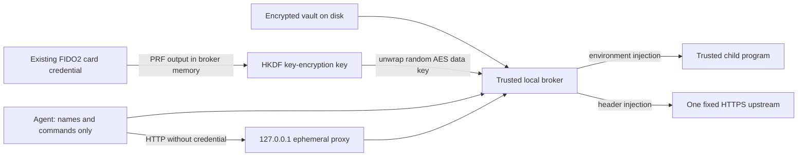
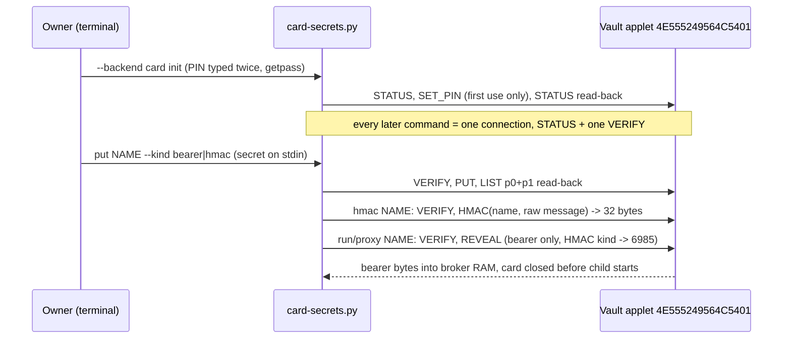
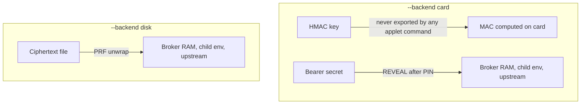

# Card-backed credential vault

Two backends share one CLI. `--backend disk` (the default, unchanged) keeps an
encrypted vault file whose key is derived from the card's FIDO2 PRF.
`--backend card` keeps the secrets inside the Nuri vault applet on the card.



## Disk backend (default)

`scripts/card-secrets.py` stores `~/.nuri-card/vault.json` as an owned regular
0600 file (new parent directory 0700). Every secret has a fresh random 32-byte
AES-256-GCM data key, a random 12-byte data nonce, and a separately random
12-byte wrapping nonce. The data key is wrapped with another AES-256-GCM key:
HKDF-SHA256 of the card's 32-byte PRF output, a random 32-byte vault salt,
and info `nuri-card-secrets-v1/kek`. The PRF input is the UTF-8 bytes
`nuri-card-secrets-v1`, separate from the backup utility's default input.

The JSON contains version, test/card mode, salt, and per-secret name, UTC
creation time, tags, ciphertexts and nonces. Names/times/tags are **public
metadata**, authenticated as GCM associated data when unwrapping. No PRF output,
wrapping key, data key, or plaintext secret is written to the vault. Writes use
an advisory lock and atomic replacement; transient output files are also 0600.
Implementation: `scripts/card-secrets.py:274` (PRF), `:302` (AES-GCM), `:312`
(HKDF), `:320` (authenticated unwrap), `:328` (permissions), `:354` (atomic save).
Deleting an entry is not secure erasure of filesystem snapshots or backups.

The broker calls the existing `card-prf-backup.py` `read_profile` / `derive_once`
functions **in-process**, with user verification required and PIN prompting
available. It does not invoke `derive --raw` or print PRF output. It reuses the
existing `.nuri-card-prf/nuri-offline-backup.json` credential; it never enrolls,
replaces, resets or creates credentials. Run from the repository root, or supply
`--profile-path /path/to/nuri-offline-backup.json` before the subcommand.
`--transport pcsc|hid` and `--device-index N` are optional global selectors.
Only put/run/proxy need the card; list/rm work without it. Missing or wrong
card/profile, modified metadata/ciphertexts and bad file permissions fail closed.
Keep the existing credential profile plus encrypted vault backed up. Losing the
card credential means losing access; neither the JSON nor the profile restores it.

## Commands

Use the existing Python dependency wrapper (cryptography is already pinned in
`requirements-card-v1.txt`; no new dependency):

```sh
# Owner-provisioned secret arrives through stdin, not argv. Newlines are preserved.
trusted-secret-source | scripts/run-card-python.sh scripts/card-secrets.py put API --tag service
scripts/run-card-python.sh scripts/card-secrets.py list

# Exact NAME is appended to NURI_SECRET_; no uppercase/normalization is applied.
scripts/run-card-python.sh scripts/card-secrets.py run API -- trusted-api-client

# First stdout line is the ephemeral local URL. Stop with Ctrl-C.
scripts/run-card-python.sh scripts/card-secrets.py proxy API --upstream https://api.example.com/v1
scripts/run-card-python.sh scripts/card-secrets.py proxy API --upstream https://api.example.com/v1 --header X-API-Key

scripts/run-card-python.sh scripts/card-secrets.py rm API
npm run card:secrets:selftest
```

Names must match `[A-Za-z_][A-Za-z0-9_]*`; duplicates are refused until explicitly
removed. `put` consumes at most 8 MiB, refuses terminal stdin, and never takes a
secret argument. Do not let an agent run a secret-revealing provisioning command.
`--vault PATH` (before the subcommand) selects an alternate vault.

`run` directly spawns the chosen child without a shell and supplies only that
secret as `NURI_SECRET_<NAME>`. Inherited `NURI_SECRET_*`, `FIDO2_*`, and the fake
PRF test override are removed from the child's environment. UTF-8, NUL-free
secrets are required for environment injection. The child exit code is propagated;
signals map to exit status `128 + signal`. Its normal stdout/stderr are not captured or redacted. The trusted child must
not print credentials or persist its environment. Never use `env`, `printenv`,
a shell snippet that echoes the variable, or untrusted agent-generated code.

The proxy listens only on `127.0.0.1:0`, never on a LAN interface. A client sends
requests to its announced local URL; `/models` becomes `/v1/models` for the
example upstream above. It sends `Authorization: Bearer <secret>` by default,
or the raw secret in `X-API-Key` with that header option. Header secrets must be
nonempty visible ASCII without whitespace or control characters. It forwards
GET/HEAD/POST/PUT/PATCH/DELETE, request bodies (8 MiB maximum), Content-Type and
Accept. Incoming authorization and other headers are not forwarded. Responses
forward status/body (8 MiB maximum) and Content-Type only; redirects are **not
followed**, and Location/Set-Cookie/other response headers are not forwarded.
Upstream network operations have a 30-second timeout. HTTPS uses the standard
verified TLS context. HTTP upstreams are allowed only for loopback fixtures.

Absolute-form URLs, alternate Host headers, browser Origin / Sec-Fetch-Site
headers and ambiguous/chunked request framing are rejected. The upstream
scheme/authority cannot be selected by a request. Logs contain only method,
JSON-escaped path (no query string), and status; no headers/bodies or exception
tracebacks. Do not put credentials in request paths. The proxy is single-process,
single-request-at-a-time and intended as a small local broker, not a general HTTP
proxy. Loopback callers are trusted: there is no per-agent authorization layer.

## Card backend (`--backend card`)



The applet contract (CLA `80`, P2 `00` everywhere) as the CLI uses it,
`scripts/card-secrets.py:34-59`:

| INS | Command | Data | Answer |
|---|---|---|---|
| `01` | STATUS (no PIN) | none | `version=1, pinSet, tries (5), maxSlots (16)` |
| `10` | SET_PIN | raw PIN, 4..16 bytes | `9000`, does **not** authenticate; already set `6985` |
| `20` | VERIFY | raw PIN | `9000` / `63C4..63C1` / `6983` blocked |
| `30` | PUT | `class (1 HMAC, 2 bearer), nameLen, name 1..16, secret 1..64` | duplicate `6985`, full `6A84` |
| `31` | LIST, P1 page 0 or 1 | none | up to 8 × `class, nameLen, name`; empty is valid |
| `40` | HMAC | `nameLen, name, raw message 0..(254-nameLen)` | 32-byte HMAC-SHA256; bearer kind `6985` |
| `41` | REVEAL (broker only, no CLI) | `nameLen, name` | bearer bytes; HMAC kind `6985` |
| `50` | DELETE | `nameLen, name` | `9000` |

Other words: missing `6A88`, bad shape `6700`, invalid class `6A80`, P1/P2
`6A86`, CLA `6E00`, INS `6D00`, not verified `6982`, not initialized `6985`.
The applet itself accepts arbitrary raw-byte names; the CLI only creates
environment-safe identifiers of at most 16 ASCII bytes, and `list` shows any
other on-card name as `name_hex`. An entry's class is fixed until DELETE.

```sh
# Owner, once, at a terminal: sets the first vault PIN (typed twice, never argv/env).
scripts/run-card-python.sh scripts/card-secrets.py --backend card init

# Bearer (default kind): readable only by run/proxy, through the broker.
trusted-secret-source | scripts/run-card-python.sh scripts/card-secrets.py --backend card put API
# HMAC key: used on the card, never read back by any command.
trusted-key-source | scripts/run-card-python.sh scripts/card-secrets.py --backend card put SIGNER --kind hmac

scripts/run-card-python.sh scripts/card-secrets.py --backend card list
scripts/run-card-python.sh scripts/card-secrets.py --backend card hmac SIGNER --data-file message.bin
scripts/run-card-python.sh scripts/card-secrets.py --backend card run API -- trusted-api-client
scripts/run-card-python.sh scripts/card-secrets.py --backend card proxy API --upstream https://api.example.com/v1
scripts/run-card-python.sh scripts/card-secrets.py --backend card rm API
```

Rules the CLI enforces:

- **PIN**: only `getpass` from the controlling terminal. There is no PIN
  option or environment variable; if no terminal is available (getpass would
  fall back to stdin) the command fails before VERIFY. Every command except
  `init` asks once, sends exactly one VERIFY on its own connection and
  **never retries** a wrong PIN; it prints the remaining tries and stops.
  STATUS is read first so an uninitialized or blocked card never costs a try.
- **init** is explicit and first-use only. `put` never initializes a card.
- **list** needs the PIN (names are not public on the card).
- **put** reads the secret from piped stdin (1..64 bytes), defaults to
  `--kind bearer`, refuses `--tag` (the card stores only class and name), and
  refuses duplicates. After PUT and after DELETE it reads both LIST pages and
  only reports success if exactly that name (and class) is present / absent.
- **hmac NAME --data-file F** sends the file's raw bytes (no prehash, one short
  APDU, at most `254 - len(NAME)` bytes) and prints the 32-byte MAC as hex.
- **run/proxy** use REVEAL, which the applet answers only for bearer entries;
  an HMAC entry fails before any child or listener starts. The card connection
  is closed before the child/proxy starts. On top of the disk backend's
  scrubbing (`NURI_SECRET_*`, `FIDO2_*`, fake PRF), every environment variable
  with a `PIN` word component (`NURI_CARD_PIN`, `CARD_PIN`, `NURI_TOTP_PIN`, ...)
  is removed from the child.
- There is **no reveal/get/show command**. The card backend never reads or
  writes the disk vault file and needs no FIDO2 profile.
- `nuri_pcsc` (reader/protocol ladder, `NURI_READER`, `NURI_PCSC_PROTOCOL`) is
  imported lazily only for `--backend card`; the disk backend never loads it.

### Card vs disk: what each protects



| Property | disk | card |
|---|---|---|
| Ciphertext copyable off the machine | yes (useless without card PRF) | no file |
| Unlock factor | FIDO2 PRF with user verification | vault PIN, 5 tries, then blocked |
| Capacity | 8 MiB per secret, unlimited count | 64 bytes per secret, 16 slots |
| HMAC key exported to host | n/a | **never** (no applet command returns it) |
| Bearer secret seen by host | yes, broker RAM | yes, broker RAM (necessary to use it) |
| Tags / creation time | yes | no |
| Backup | file + profile | none: losing or blocking the card loses the secrets |

Honest boundaries: every secret is visible to the owner at provisioning time
(it is piped in from the host). A bearer string is only protected *at rest*
by the card; once revealed it is as exposed as in the disk backend (broker,
child, OS, upstream, root). Only HMAC-kind keys are non-exportable, and only
as far as the applet guarantees it (UNVERIFIED on hardware by this change).
The PIN crosses the host in plaintext APDUs (no secure channel), so a
compromised host or reader can capture it. A blocked PIN has no reset path
in this CLI.

## Agent / MCP boundary and honest limits

An MCP tool should call `run NAME -- <allowlisted trusted client>` or start
`proxy NAME --upstream <allowlisted URL>` and return only its local endpoint to
the agent. The agent calls run/proxy, **never reads** the secret, PRF output,
child environment or card derivation CLI. Provisioning belongs to the owner.
No MCP server or sandbox is installed by this change.

MCP hint for the card backend: expose `list`, `hmac NAME --data-file F` (return
the hex MAC) and `run`/`proxy` with allowlisted children/upstreams; never expose
`init`, `put` or `rm`. Each call prompts for the vault PIN on the owner's
terminal, so an MCP server must run attached to a terminal the owner types
into; it must never pass, cache or store the PIN itself. The agent sees names,
kinds, MACs and proxy URLs only.

Bearer credentials are kept out of the agent process's normal inputs/outputs by
this workflow, **not protected from root on the machine**. This is not hardware
non-exportability for bearer strings: the broker, trusted child, OS, and upstream
necessarily see plaintext. The PRF output and derived wrapping key also exist in
broker RAM. Same-user process inspection/debugging can expose them on some OSes;
Python cannot promise reliable memory zeroization. An unrestricted agent that
can choose arbitrary children, inspect processes or modify this script can
exfiltrate credentials. Enforce process isolation and tool/child/upstream
allowlists outside this CLI if the agent is adversarial. Upstreams must also be
trusted not to echo credentials in responses. Removing the card does not revoke
an already-running child or proxy; stop the broker/child to end that session.

The test-only `NURI_CARD_SECRETS_FAKE_PRF` accepts exactly 64 hex characters and
bypasses all card imports/access. It is not a recovery key or production feature.
Fake vaults are explicitly marked `mode: fake`; real and fake modes cannot
unwrap each other's vaults. Never set this override for real credentials.
The unittest suite uses only this override, synthetic secrets, temporary HOME,
and loopback HTTP servers. **Real-card behavior is UNVERIFIED by these tests.**

`test/test_card_secrets_card.py` covers the card backend with an in-memory
fake of the applet contract: only `nuri_pcsc.open_applet` and `getpass.getpass`
are patched, there is no test mode in the script, and no reader or pyscard is
needed. It checks exact APDUs, explicit init, no silent init, PIN-gated list,
read-back after PUT/DELETE, one-VERIFY-no-retry, no PIN from argv/env/stdin,
on-card HMAC without REVEAL, run/proxy refusing HMAC entries, child PIN
scrubbing, and that the default disk backend never opens PC/SC and keeps the
v1 vault format. Run both suites with
`python3 -m unittest discover -s test -p 'test_card_secrets*.py' -v`
(needs `cryptography`). **Applet behavior on the physical card is UNVERIFIED.**

## Parent-only real-card acceptance (not run by builder)

With the existing profile and owner-authorized reader, from the repo root and
with `NURI_CARD_SECRETS_FAKE_PRF` unset, use a disposable vault and non-secret
sentinel. Do not enroll, reset, or force any credential:

```sh
printf %s card-secrets-smoke | scripts/run-card-python.sh scripts/card-secrets.py --vault "$HOME/.nuri-card/smoke-vault.json" put SMOKE
scripts/run-card-python.sh scripts/card-secrets.py --vault "$HOME/.nuri-card/smoke-vault.json" run SMOKE -- python3 -c 'import os; assert os.environ["NURI_SECRET_SMOKE"] == "card-secrets-smoke"; print("CARD_SECRETS_RUN_OK")'
scripts/run-card-python.sh scripts/card-secrets.py --vault "$HOME/.nuri-card/smoke-vault.json" list
# Remove card, repeat run: expect failure and no child execution. Reinsert, retry.
scripts/run-card-python.sh scripts/card-secrets.py --vault "$HOME/.nuri-card/smoke-vault.json" rm SMOKE
```

Card backend, after the parent installs the vault applet (each command prompts
for the vault PIN; type a wrong PIN once to see `4 tries left (not retried)`):

```sh
S="scripts/run-card-python.sh scripts/card-secrets.py --backend card"
$S init                                   # once; PIN typed twice
printf %s card-vault-smoke | $S put SMOKE
printf %s synthetic-hmac-key | $S put MAC --kind hmac
$S list                                   # [{"kind":"bearer","name":"SMOKE"},{"kind":"hmac","name":"MAC"}]
printf abc > /tmp/m.bin && $S hmac MAC --data-file /tmp/m.bin
python3 -c 'import hmac,hashlib; print(hmac.new(b"synthetic-hmac-key", b"abc", hashlib.sha256).hexdigest())'  # must match
$S run SMOKE -- python3 -c 'import os; assert os.environ["NURI_SECRET_SMOKE"] == "card-vault-smoke"; print("CARD_VAULT_RUN_OK")'
$S run MAC -- true                        # expect failure: HMAC-kind secrets never leave the card
$S rm SMOKE && $S rm MAC && $S list       # []
```
