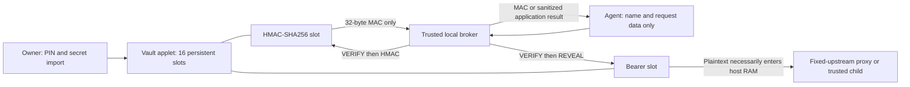

# On-card credential vault applet



## Contract and custody boundary

Package AID **`4E555249564C54`**, applet AID **`4E555249564C5401`**, package
version 1.0, Java Card 3.0.4. Source: [NuriVault.java](../card/vault/NuriVault.java)
and [build.xml](../card/vault/build.xml). This is a separate applet; it does not
replace the FIDO2, ETH, MuSig2 or TOTP applets, or reuse their PINs.

The applet has **16 slots**, each with a **1–16-byte name**, **1–64-byte secret**,
and an immutable kind chosen at PUT. Duplicate PUT is refused; explicitly DELETE
before provisioning that name again, even to change kind. Names are arbitrary
bytes in the applet; the host CLI additionally requires environment-safe ASCII
identifiers. There are no tags/timestamps or disk vault files in the card backend.

| Boundary | HMAC-SHA256 key | Bearer credential |
|---|---|---|
| Provisioning | Owner imports plaintext through host and reader; origin is not on-card generation | Same |
| Persistent location after PUT | Card applet EEPROM; no host vault copy made | Card applet EEPROM; no host vault copy made |
| Read API | **None**. REVEAL returns `6985`, even after correct VERIFY | REVEAL only in a PIN-verified session |
| Use | Applet computes RFC 2104 HMAC-SHA256; MAC leaves, stored key does not | Broker must read plaintext to send it to an upstream or trusted child |
| Agent sees in the intended workflow | Name, message, MAC/application response | Name, loopback URL/application response, not the injected token |
| Host RAM while used | Message/MAC and PIN, not stored HMAC key; import still sees the key | Plaintext token in broker, OS and trusted child where applicable |
| Strong claim justified | **Non-exportable through this applet's command API after import** | **Not non-exportable**; hardware-backed at-rest storage only |
| Not established by simulation | Physical tamper resistance, side-channel resistance, EEPROM remanence, power-loss behavior | Same; Python cannot promise reliable memory zeroization |

Only SET_PIN, VERIFY and STATUS are usable before authentication. The owner must
set a **4–16-byte PIN** once (`init`); no secret operation works without it.
SET_PIN does **not** log in. VERIFY establishes applet-session authorization.
Selection/reselection, deselection and card reset clear authorization. A failed
VERIFY also clears authorization. Correct VERIFY restores five tries; wrong PINs
return `63C4`, `63C3`, `63C2`, `63C1`, then **`6983` on the fifth**. Blocking
persists after reset and disables HMAC, REVEAL, PUT, LIST and DELETE. There is no
PIN-change, unblock, factory-reset, key-export or debug command. Protect the PIN:
losing it or blocking the vault loses access; this install-only script cannot
recover it. This is not a per-operation touch/biometric approval mechanism.

PINs, imported secrets and revealed bearer values cross **unencrypted APDUs**.
There is no secure messaging in this protocol. Reader access, a malicious host
and a same-user debugger are outside the protection boundary. HMAC authorization
lasts for the selected session, not one MAC. A raw APDU caller with the PIN can
REVEAL bearer entries; the CLI is not a security boundary against such callers.
An agent must not get unrestricted terminal execution, reader access, a mutable
broker or arbitrary child/upstream choices. Enforce those restrictions externally.
An upstream or child can echo its credential; neither this applet nor the proxy
can prevent that. Removing the card does not revoke a bearer already in RAM.

## HMAC engine and uses

[NuriVault.hmac](../card/vault/NuriVault.java) implements RFC 2104 directly using
`MessageDigest.ALG_SHA_256`, a 64-byte transient pad and a 32-byte transient inner
digest. It **always uses the software construction**, so it neither constructs
`TYPE_HMAC` nor depends on native HMAC availability (the JCOP4 limitation).
No Satochip, Keycard or third-party implementation was copied. No new dependency:
jCardSim and ant-javacard are the existing pinned simulator/build tools.

The stored key is at most SHA256's 64-byte block, so long-key prehashing is
unnecessary. Message bytes are **not prehashed** by the CLI. Keys, names and
metadata publish together inside a Java Card transaction; DELETE atomically
zeros its 64-byte secret/name region and frees the slot. PIN/PUT input and
transient MAC/reply scratch clear on every completed/error command in `finally`;
transient arrays also clear on deselection. The **final JCRE response APDU buffer
must remain untouched until transmission completes**, so a revealed bearer
copy remains there until the runtime recycles/clears it. The applet does not
promise immediate erasure of that runtime-owned buffer. Platform-level physical
erasure and fault resistance remain **UNVERIFIED**.

Generic HMAC signing supports webhook verification/signing, HS256 JWTs,
SHA256-based HOTP/TOTP-style constructions (host supplies counter/truncation),
and HMAC-SHA256 request-authentication schemes. AWS SigV4/Binance/Coinbase-style
protocols require their own canonicalization and, for SigV4, derived-key handling;
**this change does not implement vendor adapters**. Derived HMAC outputs may be
sensitive signing material: only return the MACs a constrained adapter needs.
Stripe's usual API key is a **bearer** credential; its webhook signature secret
is an HMAC use. SHA1/SHA512-based service schemes are not SHA256 and are not
supported by this applet.

**Message limit:** one short APDU, `254 - nameLength` bytes (238 bytes for a
16-byte name, 253 for a one-byte name). No command chaining or streaming HMAC is
implemented. Large webhooks, JWTs and canonical requests must be refused, not
silently prehashed/truncated; a future streaming protocol is needed for those.

## APDU protocol

All commands use **CLA `80`**, **P2 `00`**, P1 `00` except LIST. Other CLA values,
including logical-channel/chaining bits, return `6E00`; bad P1/P2 returns `6A86`.
Only short APDUs are supported. The applet loops until all incoming bytes are
received; it does not assume the reader provides the whole command in one chunk.

| INS | Input | Response |
|---|---|---|
| `01` STATUS | No data | `[01][PIN set 0/1][tries remaining][10 = 16 slots]` |
| `10` SET_PIN | Raw PIN, 4–16 bytes; first use only | `9000`; not authenticated afterwards |
| `20` VERIFY | Raw PIN, 4–16 bytes | `9000` or `63Cx`/`6983` |
| `30` PUT | `[kind 01=HMAC / 02=bearer][nameLen][name][secret]` | `9000`; duplicates `6985`, store full `6A84` |
| `31` LIST | No data, P1 `00` or `01` | Up to eight `[kind][nameLen][name]` records for that slot page; no count prefix; empty page valid |
| `40` HMAC | `[nameLen][name][message, possibly empty]` | 32-byte HMAC-SHA256; bearer kind `6985` |
| `41` REVEAL | `[nameLen][name]` | 1–64 bearer bytes; HMAC kind always `6985` |
| `50` DELETE | `[nameLen][name]` | `9000`; zeroes slot and permits explicit reuse |

All PUT/LIST/HMAC/REVEAL/DELETE commands require VERIFY **on the same connection**.
Uninitialized = `6985`; initialized but unverified = `6982`; blocked = `6983`.
Missing entry = `6A88`; bad lengths/trailing data = `6700`; unknown kind = `6A80`;
unknown INS = `6D00`. STATUS is intentionally public but does not expose names.
The CLI uses [nuri_pcsc.py](../scripts/nuri_pcsc.py) for reader selection,
default/T0/T1 fallback and `61XX`/`6CXX` procedure handling; it never retries a
wrong VERIFY.

## Host and MCP use

Default remains the existing PRF-wrapped disk vault. `--backend card` is explicit;
there is no disk/card migration, automatic initialization, or fallback to disk.
PIN entry uses `getpass`'s controlling terminal, never argv, env or piped stdin.

```sh
# Parent/owner only, on an authorized reader, AFTER install and review.
scripts/run-card-python.sh scripts/card-secrets.py --backend card init
trusted-hmac-key-source | scripts/run-card-python.sh scripts/card-secrets.py --backend card put SIGN --kind hmac
trusted-token-source | scripts/run-card-python.sh scripts/card-secrets.py --backend card put TOKEN --kind bearer
scripts/run-card-python.sh scripts/card-secrets.py --backend card list
scripts/run-card-python.sh scripts/card-secrets.py --backend card hmac SIGN --data-file request.bin
scripts/run-card-python.sh scripts/card-secrets.py --backend card proxy TOKEN --upstream https://api.example.com/v1
scripts/run-card-python.sh scripts/card-secrets.py --backend card run TOKEN -- trusted-api-client
```

There is no CLI `reveal`/`get`/`show`. Only run/proxy call REVEAL internally; they
cannot use HMAC entries. The card connection closes before the child/proxy starts. After any attempted
VERIFY, the broker explicitly re-SELECTs the exact vault AID to log out before
closing; disconnect disposition defaults are not relied upon. Failed logout
prevents child/proxy startup. This is not a PC/SC-exclusive transaction: another
local reader client could share authorization **while the session is active**.
Reader access and concurrent clients therefore must remain trusted/isolated.
PUT/DELETE read LIST back before returning success. A child gets
`NURI_SECRET_<NAME>`; the agent must not control the child executable or inspect
its environment/output. See [card-secrets.md](card-secrets.md) for proxy framing,
fixed-origin and response/header limits inherited unchanged from the disk path.

**MCP hint:** expose a constrained `hmac(name, data-file)` signing tool and
allowlisted `proxy`/`run` invocations, not a general APDU or terminal tool. Return
only a MAC, loopback endpoint or sanitized application response. Keep
`init`/`put`/`rm` owner-only. This is integration guidance, **not an installed MCP
server, PIN service, sandbox, or vendor signing adapter**. Interactive owner PIN
entry is still required; unattended PIN provisioning is not added.

## Build and reader-free checks

```sh
# In an authorized cloud/disposable runner, JDK17 for simulator, pinned JDK8 for CAP.
bash scripts/test-vault-sim.sh
python3 -m unittest discover -s test -p 'test_card_secrets*.py' -v
python3 -m unittest discover -s test -p 'test_vault*.py' -v
JAVA8_HOME=/path/to/jdk8 bash scripts/build-vault-cap.sh
python3 test/vault/negative_controls.py
```

[Cloud workflow](../.github/workflows/vault.yml) runs three complete simulator +
broker/installer passes, two independent normalized CAP builds and negative
controls. [NuriVaultSimTest](../test/vault/NuriVaultSimTest.java) covers PUT/LIST,
RFC 4231 cases 1–5, key/name/message boundaries, PIN-gated reveal, wrong PIN
statuses, blocking/reset persistence, no HMAC export, DELETE, slot reuse and full
store. RFC cases 6/7 use disallowed 131-byte keys, which are explicitly rejected.
[Bridge test](../test/test_vault_bridge.py) sends the real Python backend's APDUs
to the actual Java applet under jCardSim. Host contract tests use injected fake
transports. At maximum Lc=255, pinned jCardSim's 260-byte APDU buffer
cannot hold a legal 261-byte case-4 command (it copies Le into that buffer).
The Java boundary test uses case 3 with identical incoming bytes only for that
one length; production Python retains proper case 4 and fake tests assert its
exact bytes. This is a simulator limitation, **not a proven real-reader maximum**.
Installer tests always set GP_BIN to an owned fake and assert no
DELETE/force calls, FIDO2 preservation and exact registry readback. Negative
controls remove guards individually, require the intended assertion to fail,
restore exact source bytes, and require green again.

## Parent-only real-card acceptance — builder never runs these

All physical-card behavior is **UNVERIFIED by the builder**. Review the source,
CAP checksum and card memory before install. The installer is install-only,
asserts FIDO2 **`A0000006472F0001`** before/after and preserves every existing AID.
It refuses arbitrary GP flags, script arguments and replacement. Do not delete,
reinstall, reset or brute-force the owner's card to test blocking.

```sh
# Set GP_READER to the exact owner-approved reader; this runs gp, so parent only.
GP_READER='EXACT OWNER APPROVED READER' bash scripts/install-vault-card.sh
scripts/run-card-python.sh scripts/card-secrets.py --backend card init
# Non-secret sentinel. CLI prompts for owner PIN once per command.
printf %s 'disposable-vault-sentinel' | scripts/run-card-python.sh scripts/card-secrets.py --backend card put W19_BEARER
printf %s 'disposable-hmac-key' | scripts/run-card-python.sh scripts/card-secrets.py --backend card put W19_HMAC --kind hmac
scripts/run-card-python.sh scripts/card-secrets.py --backend card list
printf %s 'w19-message' > "$HOME/w19-public-message.bin"
scripts/run-card-python.sh scripts/card-secrets.py --backend card hmac W19_HMAC --data-file "$HOME/w19-public-message.bin"
scripts/run-card-python.sh scripts/card-secrets.py --backend card run W19_BEARER -- python3 -c 'import os; assert os.environ["NURI_SECRET_W19_BEARER"] == "disposable-vault-sentinel"; print("W19_BEARER_OK")'
# Must fail before child runs (HMAC is not a bearer).
scripts/run-card-python.sh scripts/card-secrets.py --backend card run W19_HMAC -- python3 -c 'raise SystemExit("MUST_NOT_RUN")'
scripts/run-card-python.sh scripts/card-secrets.py --backend card rm W19_BEARER
scripts/run-card-python.sh scripts/card-secrets.py --backend card rm W19_HMAC
```

For the sentinel key/message above, compare the returned MAC with a separate
standard HMAC implementation; never perform that comparison with production key
material. Exercise destructive five-try blocking only in simulation or on a
separate disposable applet/card, not the owner's only SSH authenticator.
