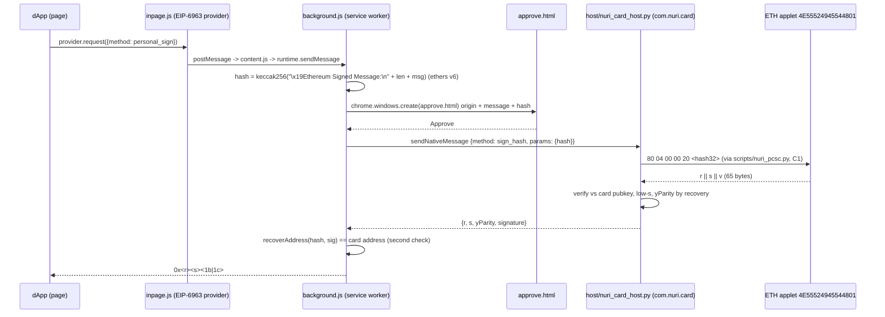

# Nuri Card Chrome extension (MVP)

An EIP-1193 wallet provider for Chrome whose only key is the secp256k1 key inside the
Nuri Card's ETH applet. The browser hashes (keccak / RLP / EIP-712), the user approves
in a popup, a native messaging host sends the 32-byte hash to the card, the card signs.
The private key never exists outside the card (`card/eth/NuriEcdsaSigner.java:15-20`).



## Files

| Path | Role |
|---|---|
| `extension/manifest.json` | MV3. Fixed `key` -> extension ID `hlljlndpkgephgelnfgcpnneecmklnmf`. Permissions: `nativeMessaging`, `storage`; host permissions only for the two RPC endpoints. |
| `extension/inpage.js` | Runs in the page (MAIN world). EIP-1193 `request/on/removeListener`; announces itself via EIP-6963 as name `Nuri Card`, rdns `com.nuri.card`. Sets `window.ethereum` only if nothing else did. |
| `extension/content.js` | Isolated-world relay page <-> service worker. |
| `extension/background.js` | Method handlers, approval windows, native host bridge, public RPC (`https://mainnet.base.org`, `https://cloudflare-eth.com`). |
| `extension/lib/hashing.js` | All hashing/encoding via ethers v6 (`hashMessage`, `TypedDataEncoder.hash`, `Transaction.unsignedHash`, `Signature`, `recoverAddress`). |
| `extension/third_party/ethers.umd.min.js` | ethers 6.17.0 UMD, unmodified. sha256 `532950515fd29ae9f7a21ceb2b68100815024d7944c3d5a92246d5b900bd703b`. MIT (`extension/third_party/ethers.LICENSE.md`). |
| `extension/approve.html/.js` | Approval window: origin, kind, decoded message / typed data / tx summary, the exact hash sent to the card. |
| `extension/popup.html/.js` | Toolbar popup: card address, pubkey, applet, reader, mode, connected sites, disconnect-all. |
| `extension/test-dapp.html` | Local dApp: Connect, switch chain, Sign message, Sign typed data, Sign tx (no send); recovers the signer with ethers and prints `matches`. |
| `host/nuri_card_host.py` | Native messaging host, contract C2 (`_launch/CONTRACTS.md`). |
| `host/install-macos.sh` | Creates `~/.nuri-card-host-venv`, launcher `~/.nuri-card-host/run.sh`, and `~/Library/Application Support/Google/Chrome/NativeMessagingHosts/com.nuri.card.json`. |
| `host/test_host.py` | Framing + sim signing + fake-`nuri_pcsc` card-mode tests. |
| `extension/test/hashing.test.js` | Known-vector tests (EIP-191 `hello`, EIP-712 spec `Mail` example incl. the spec's r/s/v, EIP-1559 round trip). |
| `extension/test/background.test.js` | Drives `background.js` under a mocked `chrome.*` against the real Python host in sim mode. |

Dependency justification: ethers v6 UMD (one file, no bundler, audited keccak/RLP/EIP-712
and signature recovery) instead of hand-rolled code; the repo's `@noble/*` deps are not
installed in this checkout and would need a bundler step. Host: `python-ecdsa` (verify,
recovery; already used by `scripts/pkcs11-helper.py:24`) and `pycryptodome` (keccak256 for
EIP-55; already used by `scripts/card-dashboard-server.py:39`).

## Supported methods

`eth_requestAccounts`, `eth_accounts`, `eth_chainId`, `net_version`,
`wallet_switchEthereumChain` (Base `0x2105` default, Ethereum `0x1`), `personal_sign`,
`eth_signTypedData_v4`, `eth_signTransaction` (returns the raw EIP-1559 tx, never sends),
`eth_sendTransaction` (fills nonce/gas/fees from the chain RPC, signs after approval, then
`eth_sendRawTransaction`), `wallet_getPermissions/requestPermissions/revokePermissions`, and
read-only passthrough (`eth_call`, `eth_getBalance`, `eth_estimateGas`, ...).
Refused: `eth_sign`, `eth_signTypedData` v1/v3, `wallet_addEthereumChain`.

Every signing method opens an approval window first; closing the window = reject (error
4001). The extension checks `from`/address against the card address and re-recovers each
signature with ethers before returning it (`extension/background.js`, `signHashOnCard`).

## Native host protocol (C2)

4-byte little-endian length + UTF-8 JSON, one request -> one response, looped until stdin closes.

- `{"id":1,"method":"info"}` -> `{"id":1,"ok":true,"result":{"applet":"eth1"|"eth2","applet_version":"1.3.1","pubkey":"0x<33B>","address":"0x<EIP-55>","reader":"...","mode":"card"|"sim"}}`
- `{"id":2,"method":"sign_hash","params":{"hash":"0x<64 hex>"}}` -> `{"id":2,"ok":true,"result":{"r":"0x..","s":"0x..","yParity":0|1,"signature":"0x<r><s><1b|1c>"}}`
- Errors: `{"id":n,"ok":false,"error":{"code":"NO_READER|NO_CARD|NO_APPLET|PIN_REQUIRED|CARD_ERROR|BAD_REQUEST|VERIFY_FAILED","message":"..."}}`

Card mode imports `scripts/nuri_pcsc.py` (W1, contract C1) lazily and calls
`open_applet("4E5552494554483201")` (ETH v2, C4) first, then `open_applet("4E55524945544801")`
(ETH v1). Each `sign_hash` opens, signs and closes the applet, so the reader is held only
for the duration of one APDU exchange. The card-reported `v` byte is ignored; yParity is
recomputed by recovery against the card pubkey. ETH v2 DER signatures are parsed with
python-ecdsa. SW `6982` maps to `PIN_REQUIRED`.
Sim mode (`NURI_CARD_SIM=1` or `--sim`): key `d = int(sha256(b"nuri-card-sim-v1")) mod n`,
pubkey `0x03bcd83232b6276e8856605cfd877f7795536a5099555684422fe82f2b6adb95e2`,
address `0x2FF532be32FF8D4fbb721c8f8617A7531b0CF5dd`.

## Install and manual test

```bash
# 1. host (sim first; drop --sim for the real card once scripts/nuri_pcsc.py is merged)
host/install-macos.sh --sim
# prints: host smoke test: {"id":1,"ok":true,"result":{...,"mode":"sim"}}

# 2. extension: chrome://extensions -> Developer mode -> Load unpacked -> <repo>/extension
#    The ID must read hlljlndpkgephgelnfgcpnneecmklnmf (fixed by manifest "key").
#    For the file:// test page enable "Allow access to file URLs" on the extension, or serve it:
cd extension && python3 -m http.server 8787   # then open http://localhost:8787/test-dapp.html

# 3. test dApp: Connect -> approve -> Sign message / Sign typed data / Sign tx (no send);
#    each line ends with "✅ matches" (recovered signer == card address).

# 4. real card (parent only; sim never touches PC/SC):
host/install-macos.sh                 # NURI_CARD_SIM=0
#    reload the extension, click the toolbar popup -> "Re-read card":
#    expected address 0x77bab29aa61949f03f233118ebc0a263f61cc385 (EIP-55: 0x77BAb29Aa61949F03f233118EbC0A263F61cc385),
#    pubkey 0x031f0f76cf2da4d2c679130f1accfb1e3b149c20ea15291a49b643e350cc63c4b1, applet eth1 v1.3.1.
```

Logs: `~/.nuri-card-host/host.log` (method + ok flag, never params). Uninstall:
`host/install-macos.sh --uninstall`.

## Tests

```bash
VENV=~/.nuri-card-host-venv   # or any venv with ecdsa + pycryptodome
NURI_CARD_SIM=1 $VENV/bin/python host/test_host.py
NURI_HOST_PYTHON=$VENV/bin/python node --test extension/test/
```

## Known limits (MVP)

- Chrome only (macOS manifest path); Brave/Chromium need their own NativeMessagingHosts dir.
- No PIN prompt UI yet: ETH v1 has no PIN; for ETH v2 with a PIN set the host returns
  `PIN_REQUIRED` and the extension surfaces the error.
- Approval window shows raw calldata, no ABI decoding.
- The card signs any 32-byte hash any local process sends (`_launch/BRIEF-COMMON.md`, verified
  facts): the approval popup protects against web pages, not against local malware.
- Real-card path is UNVERIFIED in this branch (no `scripts/nuri_pcsc.py` here; tested against
  a fake C1 module only).
