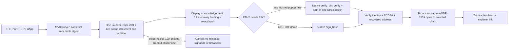

# Chrome extension: daily-wallet and stage flow

Version: Chrome extension 0.2.0; repository 1.2.0.
Updated 2026-10-20 by Hermes Agent; UI changes tracked in PR #28.



## Clean Chrome folder (prototype 0.2.0)

Updated 2026-10-20 by Hermes Agent; repository 1.0.2 unreleased;
packaging `3639a7c`, side-panel UI and native-IPC fix `ab6a413`.

```sh
python3 scripts/package-chrome.py "$HOME/Downloads/Nuri Card"
```

Select **Downloads/Nuri Card** in Chrome's **Load unpacked** picker.
`manifest.json` is at that folder's root. Selecting the source repository instead
causes **Manifest file is missing or unreadable**. The adjacent ZIP is the same
package; extract it before loading. Export refuses to overwrite existing paths.
Only runtime assets, licence, minimal host files and installation instructions
are included, not applets, private data, developer worktrees or dependencies.

The macOS `Install Host.command` requires Homebrew Python 3.13, installs host
Python dependencies and registers `com.nuri.card`. Run only when host setup is
needed. Legacy demo cards need the explicit `--eth1-demo` terminal argument;
the default remains fail-closed. No installer provisions/resets a card.

`extension/test/browser_e2e.py` loads that package in a fresh Chromium profile,
uses an isolated native-host registration and real Python framing in explicit
software-simulator mode. It checks discovery, connect approval, rejection and
recovery of message, typed-data and non-broadcast transaction signatures.
The CI job repeats three times and uploads structured evidence and screenshots.
These checks do not qualify a real card, ETH2 PIN, readers, recovery or transfers.
The existing installed host and working browser profile are not modified.

## Side panel, branding and OKX

The toolbar action opens Chrome's native side panel (`manifest.json:12`,
`background.js:9`). Chrome owns left/right placement; choose **Right** in
Chrome **Settings → Appearance → Side panel** if it was moved to the left.
The wallet and approval views share 17px body text and a 30px title in `ui.css`.
Technical card information and attestation status live in collapsed details;
real-card mode has no permanent warning banner. Explicit simulator mode remains
labelled because it uses a publicly known test key.

Icons are exports from the actual Nuri Expo production app icon
(`assets/app-variants/production/icon.png`); the 32px icon is the exact
`public/favicon-32.png` file. The EIP-6963 discovery icon embeds those same bytes.

Nuri leaves an existing OKX `window.ethereum` provider unchanged and announces
itself separately using EIP-6963 (`inpage.js:94`). The provider fixture test proves
coexistence, not end-to-end OKX integration. Using the Nuri Card **as a hardware
signer inside OKX Wallet is not implemented**. This UI change adds no Ledger or
Trezor protocol emulation and imports/exports no card key.

PIN on/off is deferred. ETH2's `pinRequired` is selected during applet
personalization (`card/eth2/NuriEthSignerV2.java:189-219`); its runtime command
dispatch has PIN setup/change/unblock but no enable/disable command (`:266-275`).
No card applet, firmware, PIN policy, installed host or SSH key was changed.

## Supported flow and boundary

Chrome 116+ is required for Chrome-authenticated `documentId`/context binding.
Base (`8453`, `0x2105`) is the default. Ethereum (`1`, `0x1`) and Base Sepolia
(`84532`, `0x14a34`) support `wallet_switchEthereumChain` for connected sites.
Endpoints are fixed in [extension/lib/hashing.js](../extension/lib/hashing.js#L14-L18);
custom chain URLs are not accepted. `file:`/opaque origins are rejected: serve the
test dApp over HTTP instead ([extension/background.js](../extension/background.js)).

Methods include `eth_requestAccounts`, `eth_accounts`, `personal_sign`,
`eth_signTypedData_v4`, `eth_signTransaction` (returns raw bytes, does not broadcast),
and `eth_sendTransaction` (broadcasts). `eth_sign` remains disabled. The worker
builds type-2 transactions, fills missing pending nonce/gas/base fee/priority fee
from the selected chain's RPC, rejects chain mismatches and invalid fee caps, and
signs the same hash shown in the approval. Base uses `https://mainnet.base.org`.
The popup shows recipient, ETH value, chain, nonce, data/access list, fee caps and
maximum **execution** fee. Base's additional L1 data fee is explicitly not included
in that cap; this is not an all-in quote ([extension/background.js](../extension/background.js),
[extension/lib/hashing.js](../extension/lib/hashing.js#L64-L117)).

After broadcast the toolbar and stage page show the full transaction hash with a
`https://basescan.org/tx/HASH` link for Base. The toolbar reads live ETH balance.
A broadcast hash is **not** a mined receipt or a confirmation. Other chains use
their own explorer ([extension/popup.js](../extension/popup.js),
[extension/test-dapp.html](../extension/test-dapp.html)).

## PIN and native protocol

The extension uses a persistent `chrome.runtime.connectNative("com.nuri.card")`
connection, not independent `sendNativeMessage` processes. Host framing remains
four-byte little-endian JSON length followed by UTF-8 JSON. An `info` request must
succeed on the **same host process** before any sign operation. `info` returns
`mode`, `address`, `pubkey`, `applet`, `applet_version`, `reader`, `pin_set` and
`pin_tries_left` ([host/nuri_card_host.py](../host/nuri_card_host.py#L399-L518)).

- No-PIN path: `sign_hash` with `params: {hash}`. ETH1 remains supported for the
  existing demo card only when the launcher exports `NURI_ALLOW_ETH1_DEMO=1`
  (install with `--eth1-demo`); ETH2 is preferred and fallback to ETH1 happens only
  after every reader with a card confirms ETH2 absence (`6A82`), never on PIN or
  engine errors. Without the opt-in an ETH1-only card returns `ETH1_DEMO_DISABLED`.
- Protected path: `verify_pin` with `params: {pin, hash, address}`. `address` is the
  EIP-55 identity previously read; `hash` is exactly `0x` plus 64 hex characters.
  This method **verifies and signs atomically on the same selected applet
  connection**, then closes it. It is not a persistent PIN-unlock method.
- The native host re-reads identity before either signing path. Card/applet
  substitution yields `CARD_CHANGED`, not a signature from an unseen key.
- SW `6982` → `PIN_REQUIRED`; `63Cx` → `PIN_WRONG` with integer `tries_left`;
  `6983` → `PIN_BLOCKED` with zero attempts. Zero attempts disables signing.
- The trusted extension popup shows the field only when `info.pin_set` or a
  `PIN_REQUIRED` response says it is needed. A wrong PIN displays attempts left;
  retries require another explicit click and retain the same displayed hash.
  The dApp/page bridge has no PIN method. PINs are never included in site replies,
  storage, approval state, logs or error text.
- The input is cleared before native messaging and on page hide; message objects
  drop the field after serialization, references are released in `finally`, and
  mutable host PIN/APDU buffers are zeroed. JavaScript/Python immutable strings
  and browser/PCSC IPC copies cannot be reliably overwritten: this is best-effort
  lifetime minimization, **not** a claim of forensic memory erasure.

Implementation: [extension/approve.js](../extension/approve.js),
[extension/background.js](../extension/background.js#L24-L196),
[host/nuri_card_host.py](../host/nuri_card_host.py#L229-L396).
PIN configuration/KEYGEN/PUK recovery are not extension features. No card is
provisioned, reset or upgraded by this wallet.

## Approval integrity (W13 R7)

Approvals live only in worker memory, use `crypto.randomUUID()`, and are bound to:
request ID, extension sender ID, exact approval URL, Chrome document ID, live
popup window/tab, full displayed payload digest and exact signing hash. The popup
must acknowledge display before approval; wrong-window, stale, reused,
unacknowledged and changed requests are rejected. The summary is cloned before
display. Duplicate clicks cannot start a second signing operation. Startup removes
legacy session records and closes orphan approval contexts. Closing, rejecting,
120-second expiry or native disconnect cancels; a late card result after
cancellation is discarded and cannot trigger broadcast. An already accepted
broadcast cannot be undone ([extension/background.js](../extension/background.js#L95-L196)).

Approval is browser-side consent, **not** an on-card transaction display, physical
touch check, secure channel or protection against a compromised host. ETH1 has no
PIN. ETH2 is mandatory-PIN by default in current source; explicit public-demo
installation is the exception. Physical-card acceptance of the new flow remains open.

## Simulator is explicit (W13 R8)

Only exact `NURI_CARD_SIM=1` authorizes the public deterministic software signer.
`--sim` alone does not. Signing additionally requires a successful `info` reporting
`mode=sim` on the same process. Unknown modes/configurations and missing cards
fail closed; there is no automatic simulator fallback. A normal installer launcher
explicitly unsets `NURI_CARD_SIM`; only `host/install-macos.sh` with `--sim` exports it.
Sim mode is marked by a red **SIM** toolbar badge plus red warnings in connection,
signing and toolbar popups. **Never fund the sim address**: its private key is
public ([host/nuri_card_host.py](../host/nuri_card_host.py#L399-L438),
[host/install-macos.sh](../host/install-macos.sh#L49-L66),
[extension/approve.html](../extension/approve.html), [extension/popup.js](../extension/popup.js)).

## Parent-only reload and stage demo (real reader/card)

These actions were **not executed by W21**. Use the integrated checkout path
from the repository root. The launcher embeds the checkout
path, so do not delete/move it afterward.

```sh
ROOT="$PWD"
# NO --sim. Installs the physical host and performs an info-only reader smoke check.
# Add --eth1-demo only for the public ETH1 demo card (PIN-less legacy applet).
bash "$ROOT/host/install-macos.sh" --python "${PYTHON_BIN:-python3}"
# Keep this terminal running; serves the dApp, not a signing HTTP backend.
"${PYTHON_BIN:-python3}" -m http.server 8787 --bind 127.0.0.1 --directory "$ROOT/extension"
```

1. In Chrome open `chrome://extensions`, enable Developer mode, **Load unpacked**
   the `ROOT/extension` directory (or click **Reload** on the existing Nuri Card
   entry). Fixed extension ID: `hlljlndpkgephgelnfgcpnneecmklnmf`. If Chrome reports
   another ID, rerun the installer with `--extension-id` and that actual ID.
2. Open `http://127.0.0.1:8787/test-dapp.html` and reload it after extension reload.
   Pin Nuri Card in the toolbar. Click its icon: require `mode=card`, the live card
   address, Base `0x2105`, a balance and **no SIM badge**. The current demo ETH1
   address supplied by the parent is `0xd65B99cCc958E7b73899E9882762602F2664A34f`;
   stop if the read identity differs unexpectedly. Do not use a hard-coded address
   in place of the live read.
3. Click **Connect**, approve the genuine extension popup. Click **Sign message**,
   inspect the message and hash, approve, and require `matches` in the dApp.
   ETH1 asks for no PIN. A separately provisioned ETH2 card asks for PIN only in
   the extension popup; never enter it in the dApp, shell, chat or logs.
4. The real card needs sufficient **Base ETH for gas**. W21 sent no funds. Click
   **Send 0 ETH to self** (it switches to Base), inspect self-recipient, `0 ETH`,
   chain, fee cap and hash in the popup, then approve. This is a real mainnet
   transaction and spends gas even though its value is zero.
5. Require a returned transaction hash and open its BaseScan link. Confirm the
   recipient/value/receipt there. Reopen the toolbar for balance and the last
   broadcast link. No receipt/settlement claim is made until independently read.
6. Negative stage check before the real send: reject or close one signing popup;
   the dApp must receive `4001`. No signing/broadcast should follow that request.

## Fake-only checks

```sh
ROOT="$PWD"
PY="${PYTHON_BIN:-python3}"
# Run from ROOT; no real reader/card/RPC is touched.
NURI_HOST_PYTHON="$PY" node --test "$ROOT/extension/test"
"$PY" "$ROOT/host/test_host.py"
bash -n "$ROOT/host/install-macos.sh"
```

The Node suite mocks Chrome/fetch, executes the actual popup scripts against a
minimal DOM fixture, and exercises a real framed Python host using its explicit
public simulator. Host tests use fake PC/SC sessions and verify PIN status mapping,
identity changes, session closure, log omission, buffers and simulator refusal.
**Outside these checks:** physical ETH2 PIN signing, physical-reader behavior,
live Base RPC/broadcast/receipt and stage UX. The separate Chromium acceptance
above exercises real extension popup lifecycle and native IPC with the explicit
software simulator, not a physical card.
No real reader/card was touched; ETH2 was not installed on the owner's demo card.
