# Chrome extension

```mermaid
flowchart LR
  P["Page provider<br/>extension/inpage.js:37-45"] --> R["Content relay<br/>extension/content.js:6-18"]
  R --> B["Signing handlers<br/>extension/background.js:191-242"]
  B --> A["Approval window<br/>extension/background.js:73-101"]
  A --> H["Native sign_hash<br/>host/nuri_card_host.py:341-348"]
  H --> C["ETH applet SIGN<br/>host/nuri_card_host.py:282-293"]
  C --> V["Verify and recover<br/>host/nuri_card_host.py:103-144"]
  V --> E["Check expected address<br/>extension/background.js:57-64"]
```



## Scope

The Manifest V3 extension exposes a page provider with EIP-6963 discovery and an
EIP-1193-style `request` interface; the isolated content script relays requests to
the service worker. Sources: [extension/manifest.json:2-22](../extension/manifest.json#L2-L22),
[extension/inpage.js:32-45,84-100](../extension/inpage.js#L32-L100),
[extension/content.js:6-18](../extension/content.js#L6-L18).

| Capability | Implementation |
|---|---|
| Connect, accounts, chain selection and permissions | Base is the default; Base and Ethereum are built in. [extension/background.js:6,160-189,249-255](../extension/background.js#L160-L255), [extension/lib/hashing.js:14-17](../extension/lib/hashing.js#L14-L17). |
| `personal_sign`, `eth_signTypedData_v4` | Require a connected origin and approval before signing. [extension/background.js:191-221](../extension/background.js#L191-L221). |
| `eth_signTransaction` | Approves and returns a signed EIP-1559 transaction without broadcasting it. [extension/background.js:224-232](../extension/background.js#L224-L232), [extension/lib/hashing.js:62-85](../extension/lib/hashing.js#L62-L85). |
| `eth_sendTransaction` | Fills missing nonce/gas/fees, approves, signs and calls `eth_sendRawTransaction`. [extension/background.js:141-157,234-242](../extension/background.js#L141-L242). |
| Other RPC methods | An explicit passthrough list includes reads **and `eth_sendRawTransaction`**; passthrough does not call the approval or connection checks. [extension/background.js:258-269](../extension/background.js#L258-L269). |
| Unsupported methods | `eth_sign`, typed-data v1/v3 and adding chains are rejected. [extension/background.js:245-248](../extension/background.js#L245-L248). |

## Native host and trust boundary

- The host accepts `info` and `sign_hash`; framing is a four-byte little-endian
  length followed by JSON. Signing accepts exactly 32 bytes and returns verified,
  low-S `r`, `s`, `yParity` and a serialized signature. Sources:
  [host/nuri_card_host.py:103-144,313-361](../host/nuri_card_host.py#L313-L361),
  [host/nuri_card_host.py:368-387](../host/nuri_card_host.py#L368-L387).
- Card mode prefers ETH v2 and falls back to ETH v1 **only on `NO_APPLET`**.
  Each signing exchange opens and closes its applet connection. Sources:
  [host/nuri_card_host.py:229-250,282-293](../host/nuri_card_host.py#L229-L293).
- ETH v2 returns `r || s || pubkey` (129 bytes); the host also accepts DER and
  checks an echoed public key when present. Sources:
  [card/eth2/NuriEthSignerV2.java:322-343](../card/eth2/NuriEthSignerV2.java#L322-L343),
  [host/nuri_card_host.py:152-170](../host/nuri_card_host.py#L152-L170).
- Approval is browser-side, not a card touch or user-presence check. ETH v1's
  signing handler has no PIN gate. ETH v2's gate is optional until a PIN is set;
  the native host implements no PIN-verification method and reports `PIN_REQUIRED`
  for status `6982`. Sources: [extension/background.js:191-242](../extension/background.js#L191-L242),
  [card/eth/NuriEcdsaSigner.java:204-218](../card/eth/NuriEcdsaSigner.java#L204-L218),
  [card/eth2/NuriEthSignerV2.java:214-217,322-327](../card/eth2/NuriEthSignerV2.java#L214-L327),
  [host/nuri_card_host.py:244-250,325-349](../host/nuri_card_host.py#L325-L349).
- The host signs supplied hashes, not decoded transactions; browser approval is
  not protection against a local caller of the host. Its simulator uses a
  deterministic software key and is unsuitable for funds. Sources:
  [host/nuri_card_host.py:183-193,341-348](../host/nuri_card_host.py#L183-L348).

## Try the simulator

From the repository root, install the macOS Chrome native host in simulator mode:

```sh
host/install-macos.sh --sim --python "$(command -v python3)"
```

The installer checks the Python executable, creates its own environment, installs
Python dependencies and registers the extension origin. Source:
[host/install-macos.sh:26-76](../host/install-macos.sh#L26-L76).

Load `extension/` with Chrome's **Load unpacked** action, then open
`extension/test-dapp.html`; for a file URL, the manifest declares a file content-script
match. Registration and match sources:
[host/install-macos.sh:55-67](../host/install-macos.sh#L55-L67),
[extension/manifest.json:11-22](../extension/manifest.json#L11-L22).

## Software checks

With `PYTHON` set to a Python executable with `ecdsa` and `pycryptodome` installed:

```sh
NURI_CARD_SIM=1 "$PYTHON" host/test_host.py
NURI_HOST_PYTHON="$PYTHON" node --test extension/test/*.test.js
```

The host tests use software signing and fake PC/SC applets; background tests mock
Chrome and disable network requests. Sources:
[host/test_host.py:19-23,141-195,299-310](../host/test_host.py#L141-L310),
[extension/test/background.test.js:15-66](../extension/test/background.test.js#L15-L66).
**UNVERIFIED:** real Chrome interaction and physical-card behavior are not established
by these software checks.
