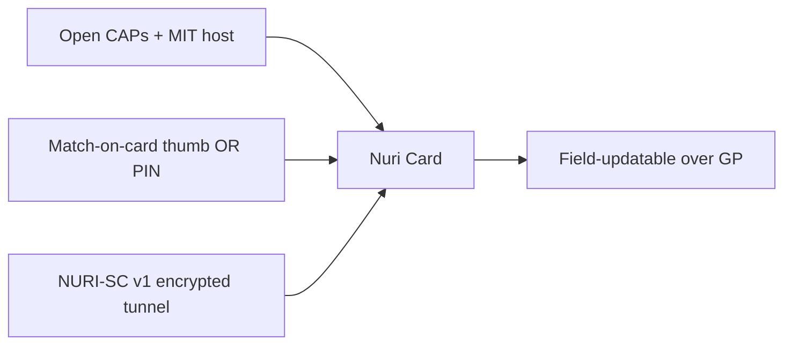

# How the Nuri Card compares, with sources

Facts below are public and linked. Check them before quoting; vendors change firmware,
prices and licences. Last verified **2026-11-17**. This page states capabilities and
documented attacks, not a security ranking, and it makes no claim about a vendor's
customers or intentions.

## One table

| | Nuri Card | Tangem | Keycard 4.0.1 | Satochip v0.16 | TAPSIGNER | Bitkey |
|---|---|---|---|---|---|---|
| Chip | 3 tested card types: Feitian/Infineon (`87E5470B`), IDEX TrustedBio (`B2183751`, Javelin-OS), €9.99 NXP JCOP v2.4.1 (`57274221`); [hardware](hardware.md) | Samsung secure element, EAL6+ ([Tangem](https://tangem.com/en/security/audits/)) | JCOP4 P71, EAL6+ | JCOP4 J3R180, EAL6+ | vendor SE, closed | Silicon Labs EFR32MG24 MCU, not a CC EAL6+ element |
| Firmware / applet open | Yes, MIT host + published applets | No, closed and not updatable | Apache-2.0 | AGPL/LGPL/GPL | protocol only | App and firmware published; no bounty |
| SDK for third parties | MIT host, no agreement needed | Proprietary, commercial agreement required ([LICENSE](https://github.com/tangem/tangem-sdk-ios)) | Apache-2.0 | LGPL libs | MIT + Commons Clause | — |
| PIN on signing | Yes, mandatory by default (ETH2, MuSig2) | Access code, 1 s delay after 6 tries | PIN/PUK, 3–10 tries | PIN/PUK, 1–16 tries | CVC + delay | No PIN in production |
| Fingerprint on card | Yes, thumb OR PIN ([fingerprint](fingerprint.md)) | No | No | No | No | Fingerprint only, no PIN |
| Secure channel to the applet | Yes, NURI-SC v1 proven on card (`4E55524953433031`, [secure-channel](secure-channel.md)); standalone ETH2/MuSig2 v1/v2 still accept plaintext until migrated | Proprietary | Secure Channel v2 | Yes | Per-command ECDH | App-to-device link, sealed |
| Attestation | CA-signed applet identity, offline verifiable | Online + offline, rejects self-built apps | CA-signed identity | authentikey + PKI | Cert chain | SiLabs PKI bound to key |
| Price | $19.99, free with €2,000 swap volume | $59.90 / 2 cards ([pricing](https://tangem.com/en/pricing)) | €29 | €25 | $19.99–39.99 | no card |

## Documented attacks you should know about

- **Tangem, laser fault injection** (Ledger Donjon, disclosed 2026-02-10): the access
  code can be replaced without knowing it, on cards in circulation. Tangem's firmware
  is factory-installed and immutable, so the finding cannot be patched in the field.
  [Donjon write-up](https://donjon.ledger.com/blog/bypassing-tangem-card-security-with-laser-attack/),
  [Tangem response](https://tangem.com/en/blog/post/lfi-response/).
- **Tangem, access-code brute force and genuine-check bypass** (Donjon):
  [brute force](https://www.ledger.com/blog/brute-force-attack-tangem),
  [Android genuine-check bypass](https://www.ledger.com/tangem-genuine-check-bypass-on-android-application).
- **Nuri, current limits.** No display, so signing is blind; standalone v1/v2
  signing applets still accept plaintext APDUs until wired to the now-proven
  [NURI-SC v1 secure channel](secure-channel.md) ([receipt](proofs/real-card-87E5470B-secure-channel.json));
  no third-party audit; no chip certification; the fingerprint sample's vendor try
  limit is not personalised. These are in the [security model](security-model.md).

## What that means for a buyer

A closed chip is not automatically safer than an open one. Closure blocks patching;
openness allows review and updates but only helps if someone actually reviews it. The
Nuri Card is research-grade today: the honest comparison is capability breadth and
openness, not a claim of stronger physical security than an audited vendor.

## Related

- [Security model](security-model.md) · [Hardening targets](secure-channel.md) ·
  [Fingerprint](fingerprint.md) · [Reader compatibility](reader-compatibility.md)
- Licensing detail: [THIRD_PARTY_NOTICES.md](../THIRD_PARTY_NOTICES.md)
