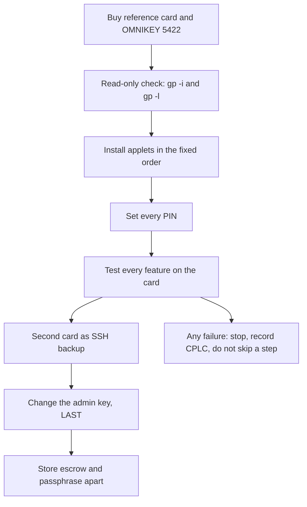

# Build your own Nuri card from a blank smartcard

This is the at-home guide. Buy the same card as the reference card, check it, install
every applet, use every feature, and seal the card with your own admin key.

It is written for one person at one desk with one reader. It is **not** a
manufacturing procedure and not a certified product: the whole stack is
research-grade, [not externally audited](security-model.md) and **not a certified
hardware wallet**.

Read the labels. Every capability below carries one:

| Label | Meaning |
|---|---|
| **real card** | Ran on a physical card, with a receipt in this repository |
| **simulator** | Ran in jCardSim or with fake transports only, never on silicon |
| **UNVERIFIED** | Claimed by nobody yet, or claimed but not reproduced |

Two rules hold for the whole page:

1. Never put a PIN on a command line. Type it at the prompt.
2. Never fund a key before you have tested recovery.

## Shopping list

Everything you need. Read section 3 before you pay anything.

| Item | Where | Price |
|---|---|---|
| Blank card, NXP JCOP profile, "Full card size" (not sim size) | https://xmrstreet.store/product/smartcard-j3r180/ | EUR 9.99 plus about EUR 10 shipping to the EU plus VAT (EUR 24.19 to Berlin); the shop takes Bitcoin Lightning and Monero only |
| Contact smartcard reader | HID Global OMNIKEY 5422 (proven), or a cheap T=0 reader: ACS ACR39U, Realtek `0bda:0165` (both proven, see [reader compatibility](reader-compatibility.md)) | price: check the shop |
| Mac (or Linux, **UNVERIFIED** there) | your desk | - |
| Java 11 or newer, Python 3.9 or newer (what the script checks) | https://adoptium.net, https://www.python.org | free |

The listing says J3R180. The card that arrived in the reference order is NXP JCOP 2.4.1.
The script handles both; check the chip output in step 2 before you install.

Then one command does the rest:

```sh
git clone https://github.com/nuri-com/nuri-passkey-prf-smartcard.git && cd nuri-passkey-prf-smartcard && bash scripts/card-setup.sh
```

## 1. The path



Order matters. Installing before testing means a broken applet looks like a broken
card. Changing the admin key before installing means you must undo the lock to
install.

## 2. What you get

One 85.6 x 54 mm dual-interface card, one applet set, one PIN per applet.

| Capability | Where it runs | Layer | Evidence |
|---|---|---|---|
| FIDO2 passkey with PRF extension | Card, CTAP2 over PC/SC | real card | [PRF proof](proofs/real-card-57274221-eth1-cofactor.json) |
| SSH key (`ecdsa-sk`) through a PC/SC provider | Card plus host provider | real card | [reader runs](reader-compatibility.md#hardware-runs-parent-physical-card) |
| Bitcoin MuSig2 2-of-2 cosigner, three instances AID1, AID2, AID3 | Card, with a host cosigner | real card | cofactor receipt above, cosign rows per AID |
| Ethereum signer ETH2, PIN gated, address `0x12de0f6cfee64568b20554f84e589e20487e9663` | Card | real card | cofactor receipt, `ETH2_REAL_CARD_TEST_OK` |
| Ethereum signer ETH1, no PIN, demo only, address `0xe08bDE52Fa83C6a7b96cbd8dE1437aF1036cC500` | Card | real card | cofactor receipt, two verified signatures |
| OATH TOTP, one secret slot | Card | real card | cofactor receipt, 6/6 RFC 6238 vectors |
| PIN-gated secret vault, 16 slots | Card | real card | cofactor receipt, HMAC and bearer match |
| PKCS#11 module for OpenSSL and `pkcs11-tool` | Host module over the card | real card on ETH1 | [HSM guide](hsm.md), [limits](hsm.md#limits) |
| Chrome wallet extension | ETH signing; Bitcoin account (balance, 3 addresses) via native host | real card (Bitcoin read-only, 2026-10-30) | [extension guide](chrome-extension.md) |
| Attestation, per-applet P-256 identity | Card plus CA | simulator | [attestation](attestation.md) |

Three MuSig2 applet instances exist because each hardware acceptance needs its own
key space and its own timing record. All three are additive. Installing one does
not replace another.

Not in this release: OpenPGP/PIV, fingerprint gating, nginx TLS with the card, and
any settlement claim from a signature alone. No private key is ever exportable:
there is no export INS, and `getS` is only used inside a signing operation.

## 3. Buy the card

### 3.1 The reference card

Buy this exact profile. It is the only profile with proofs in this repository.

| Field | Value |
|---|---|
| Chip and OS | NXP JCOP v2.4.1, dual interface |
| CPLC ICFabricator | `4790` |
| CPLC ICType | `D321` |
| CPLC OperatingSystemID | `4700` |
| Contact ATR | `3BF81300008131FE454A434F5076323431B7` |
| Contactless ATR | `3B8880014A434F50763234315E` |
| GlobalPlatform | SCP02 `i=55` |
| Keyset | one DES3 keyset, version `01`, three 16-byte keys |
| Default key | `404142434445464748494A4B4C4D4E4F`, ENC = MAC = DEK |
| Reference serial | `57274221` |

`57274221` is **only** the card that produced the receipts. Your card has its own
serial in the CPLC. Write your serial down before you start and compare it at every
prompt.

`JCOP v2.4.1` here is read from the ATR historical bytes and the CPLC, not from a
reseller label.

Where card `57274221` came from: [xmrstreet.store, "Smartcard J3R180"](https://xmrstreet.store/product/smartcard-j3r180/),
order of 2026-10-14. Option "Full card size" (the sim size has no antenna), black.

| Item | EUR |
|---|---|
| Card | 9.99 |
| Tracked shipping UPS/FedEx/DHL, Belgium to Berlin | 10.00 |
| VAT | 4.20 |
| Total to the door | 24.19 |

Paid with Bitcoin Lightning through BTCPay (the shop takes BTC/Lightning and Monero only).
Shipped 2026-10-18, delivered by UPS 2026-10-21.

The shop lists the card as J3R180 (JCOP4). The card that arrived reports NXP JCOP v2.4.1
(ATR historical bytes `JCOPv241`, CPLC table above, SCP02 with DES3 default keys). So the
chip you receive can differ from the listing: run the read-only check in section 4 on
arrival, before you install anything. The scripts handle both SCP02/DES3 and SCP03/AES.
The [translucent variant](https://xmrstreet.store/product/translucent-j3r180-smartcard/)
(EUR 14.99) is untested here.

### 3.2 Candidate sellers for the same or a near chip

These are leads, not a qualified supplier list. Prices and stock move, so re-check
before paying. Every one of them needs the same five questions answered in writing
first:

1. Is the card dual interface, with both a contact module and an antenna?
2. Are the GlobalPlatform ISD keys the public default `404142434445464748494A4B4C4D4E4F`?
3. Is the lifecycle state OP_READY or SECURED, unfused or fused?
4. Which SCP is configured, SCP02 or SCP03?
5. Will you send me the output of a read-only `gp -i` and `gp -l` on the card you ship?

| Chip | Shop | Price | Note |
|---|---|---|---|
| JCOP4 J3R180, dual, SCP03, "GP default keys" | United Access GmbH, Tulln AT | EUR 120 net per 10 | explicit key statement, best bulk buy |
| JCOP4 J3R180, dual | MoTechno, Berlin | about EUR 20 net per card | Berlin pickup, seller initializes with default keys, lets you run `gp -i` on pickup |
| JCOP4 J3R180 | dangerousthings.com | about USD 20 | factory default master key |
| JCOP4 J3R180 | satochip.io | about EUR 25 | unlocked, default keys, EU |
| JCOP4 J3R180, dual | xmrstreet.store, BE | about EUR 9.99 net | unlocked, but EUR 9-10 shipping plus 21 percent VAT, about 5 working days |
| JCOP3 J3H145, dual | xmrstreet.store, BE | about EUR 7.50 net | often out of stock, order queue |
| J3R180, 3-pack | Amazon.de | about EUR 31 | delivery 2 to 3 weeks, one reviewer reports a bricked card |

Three traps:

- **Contactless-only J3R180.** No contact module. It cannot go in a contact reader.
- **Sim-card form factor.** No antenna. It cannot do NFC.
- **No ECC or NoECC SKUs.** Without ECDSA and `PLAIN_XY` nothing here works. Always
  specify SECID for JCOP4.

J3H145, J3R180 and J3R200 are **UNVERIFIED candidates**. The one card with a full
proof is the JCOP 2.4.1 profile in 3.1. On anything else, expect to debug.

### 3.3 Buy the reader

| Reader | Status | Note |
|---|---|---|
| HID Global OMNIKEY 5422 | proven, contact slot | the reference reader. Dual slot: contact is `HID Global OMNIKEY 5422 Smartcard Reader`, contactless twin is the same name plus ` 01` |
| ACS ACR39U ICC Reader | proven, T=0 fallback | cheaper, worked for every applet path in the run table |
| Generic Realtek `0bda:0165` | proven, T=0 fallback | the cheapest class that worked |
| anything else | UNVERIFIED | a working card can fail on an untested reader |

The contactless slot of the OMNIKEY is a trap: gp matches the reader name as a
case-insensitive substring, so a card in the contact slot also matches the
contactless name. gp then prints `Specify reader with -r/$GP_READER; available
readers:` and exits 1. Fix it once at the top of your shell:

```sh
export GP_READER_IGNORE="HID Global OMNIKEY 5422 Smartcard Reader 01"
```

Both `GP_READER` and `GP_READER_IGNORE` are read by the pinned gp build. Keep only
one card in the reader at all times.

## 4. Check the card before you install anything

Read-only. Nothing below writes to the card. Run it and keep the output.

```sh
gp --reader
gp --reader "EXACT READER NAME" -i
gp --reader "EXACT READER NAME" -l
```

`-i` prints the card info block. Check every line against 3.1:

- `ICFabricator=4790` and `ICType=D321` and `OperatingSystemID=4700`. Different
  values mean a different chip. Stop and re-read section 3.
- `ICSerialNumber`. This is your serial. Write it down.
- `ICFabricationDate`. A plausible recent date. `0000` is possible and harmless.
- The ATR appears in the gp output. It must equal the contact ATR in 3.1.

`-l` prints the registry. On a blank card you expect a short list: the ISD
`A000000151000000`, plus whatever the vendor preinstalled (`A0000001515350`,
`A000000151535041`, sometimes an NXP or MIFARE package). If you see any applet AID
from section 5.3, the card is not blank for this procedure, and
`provision-card-v1.sh` will refuse it.

What the CPLC fields mean: `ICFabricator` is the silicon maker, `4790` is NXP.
`ICType` identifies the chip, `D321` is the JCOP 2.4.1 family. `OperatingSystemID`
is the card OS, `4700`. The whole 84-hex CPLC is unique per card because it carries
the serial and the fabrication date. CPLC is **not** authenticated attestation: it
is a data structure the card reports, so it identifies a card, it does not prove
silicon.

Record the following before continuing, and stop if anything differs:

```text
serial: ____  ATR: ____  fabricator: ____  ICType: ____  OS ID: ____
```

## 5. Install the applets

### 5.1 One command

From the repository root, card in the reader:

```sh
bash scripts/card-setup.sh
```

It prints eight numbered steps, reads the card, shows the chip and the serial, and
stops before the first write until you type the serial back. Expected output,
trimmed (the real run is longer and the paths are yours):

```text
[1/8] Check the machine and install the tools
[2/8] Find the card and read it (no write)
Chip: NXP JCOP 2.4.1
Serial: 57274221   OS date: 5134
[3/8] Check that the public default admin key opens the card
[4/8] Check that the card is blank
Blank card, none of the eight applets present.
[5/8] Confirm the plan
Type the card serial 57274221 to install:
[6/8] Install the applets (log: ~/.nuri-card/logs/setup-57274221-....log)
...
[7/8] Verify the result (read-only)
All eight applets are listed.
Every applet answered SELECT (9000, or 61xx on T=0-only readers).
CARD_SETUP_VERIFIED 57274221
```

About 10 minutes, most of it waiting for the CAPs to load. The script never
deletes anything, so a broken run costs time, not the card.

| Flag | Effect |
|---|---|
| `--reader NAME` | use this exact reader, skip the picker |
| `--serial 8HEX` | expect this serial and skip the typed confirmation (agents) |
| `--dry-run` | run every read-only step and print the plan, write nothing |
| `--resume` | install only the missing applets, still never delete |

Known limits: it stops when the serial is on `~/.nuri-card/no-lock-cplc.txt`, when
the card is not blank (unless `--resume`), and when the public default admin key
does not open the card. It sets no PIN and generates no key: that is section 6.

### 5.2 What the script does

The rest of this section is the same five steps by hand, in the same order.

### 5.3 The applets and the order

Five install steps in this exact order. The order is not cosmetic: `install-eth2-card.sh`
and `install-vault-card.sh` refuse unless FIDO2 is already there, because they only
ever add.

| # | Applet | Package AID | Applet AID | Script |
|---|---|---|---|---|
| 1 | FIDO2, `FIDO2-up.cap` | `A000000647` | `A0000006472F0001` | `scripts/provision-card-v1.sh` |
| 1 | MuSig2 AID1, `nuri-musig2-v20-keygen.cap` | `4E5552494D5547` | `4E5552494D554701` | same bundle |
| 1 | TOTP, `nuri-oath-totp.cap` | `4E555249544F50` | `4E555249544F5450` | same bundle |
| 1 | ETH1, `nuri-eth-signer.cap` 1.5 | `4E555249455448` | `4E55524945544801` | same bundle |
| 2 | ETH2, `nuri-eth2-signer.cap` | `4E55524945544832` | `4E5552494554483201` | `scripts/install-eth2-card.sh` |
| 3 | MuSig2 AID2 | `4E5552494D554732` | `4E5552494D55473201` | `scripts/install-musig2-card.sh` |
| 4 | MuSig2 AID3 | `4E5552494D554733` | `4E5552494D55473301` | `scripts/install-musig2-card.sh` |
| 5 | Vault, `nuri-vault.cap` | `4E555249564C54` | `4E555249564C5401` | `scripts/install-vault-card.sh` |

**ETH1 must be version 1.5 or newer.** Versions up to 1.4 never set the secp256k1
EC cofactor, and this chip answers `6F00` to KEYGEN with them. Installing 1.4 is not
a soft failure: it burns one step and you must delete and reinstall. The
`dist/nuri-eth-signer.cap` in this checkout is 1.5, sha256
`627649805d0fd7042ebefe08f5f2e50da8556bd109752904116ec1f86e07e470`. Confirm that
hash before installing.

Set the environment once:

```sh
git clone https://github.com/nuri-com/nuri-passkey-prf-smartcard.git
cd nuri-passkey-prf-smartcard
npm ci
export GP_READER_INDEX=0        # index of the contact slot from `gp --reader`
export GP_READER="HID Global OMNIKEY 5422 Smartcard Reader"
export GP_READER_IGNORE="HID Global OMNIKEY 5422 Smartcard Reader 01"
export GP_KEY=404142434445464748494A4B4C4D4E4F
```

`GP_KEY` is the public default key. Nothing secret is exposed on the command line
here.

Verify the artifacts before the first write:

```sh
npm run card:release:verify
```

### 5.4 Install the bundle

```sh
CARD_PROVISION_CONFIRM=YES scripts/provision-card-v1.sh
```

It checks `dist/SHA256SUMS` first, refuses if `A0000006472F0001`,
`4E5552494D554701`, `4E555249544F5450` or `4E55524945544801` is already present,
then installs the four CAPs and ends with a registry listing plus
`CARD_V1_APPLETS_INSTALLED`. It does **not** install ETH2 or the vault, does not
set PINs, does not personalize attestation and does not rotate keys.

Real output from the reference card, 2026-10-29, paths shortened to `~`:

```text
FIDO2.cap: OK
FIDO2-up.cap: OK
nuri-musig2-v20-keygen.cap: OK
nuri-oath-totp.cap: OK
nuri-eth-signer.cap: OK
...
Installing FIDO2-up.cap
~/.worktrees/release-v1.2.0/dist/FIDO2-up.cap loaded: us.q3q.fido2 A000000647
Installing nuri-musig2-v20-keygen.cap
~/.worktrees/release-v1.2.0/dist/nuri-musig2-v20-keygen.cap loaded: nuri.musig2 4E5552494D5547
Installing nuri-oath-totp.cap
~/.worktrees/release-v1.2.0/dist/nuri-oath-totp.cap loaded: com.nuri.oath 4E555249544F50
Installing nuri-eth-signer.cap
~/.worktrees/release-v1.2.0/dist/nuri-eth-signer.cap loaded: com.nuri.eth 4E555249455448
...
CARD_V1_APPLETS_INSTALLED
```

Four `APP: <aid> (SELECTABLE)` lines follow. The Java `WARNING: A restricted method`
block from JNA is normal and can be ignored.

### 5.5 Check ETH1 is 1.5 before going on

```sh
NURI_ALLOW_ETH1_DEMO=1 NURI_READER="$GP_READER" scripts/run-card-python.sh scripts/card-eth-test.py
```

It prints the reader, selects ETH1, prints the version, generates the key once,
signs, and verifies with `python-ecdsa`. Expected: version `1.5` and both
signatures verifying. This test refuses once ETH2 is installed, so run it now.
Reference-card note: ETH1 1.4 returned `6F00` at KEYGEN and the instance had to be
deleted and reinstalled at 1.5.

### 5.6 Install ETH2

```sh
scripts/install-eth2-card.sh
```

Install-only. It never sends a delete or force flag, prints the registry before and
after, asserts FIDO2 is present before and after, asserts no existing AID vanished
and refuses when ETH2 is already there. Success line:

```text
ETH2_INSTALLED_ALONGSIDE_V1 package=4E55524945544832 applet=4E5552494554483201 fido2=A0000006472F0001
```

### 5.7 Install MuSig2 AID2, then AID3

`install-musig2-card.sh` takes the AIDs from the environment and only accepts a
reader name, so pass `GP_READER` explicitly.

```sh
MUSIG2_CAP=dist/nuri-musig2-v20-keygen-aid2.cap \
MUSIG2_PACKAGE_AID=4E5552494D554732 \
MUSIG2_APPLET_AID=4E5552494D55473201 \
GP_READER="HID Global OMNIKEY 5422 Smartcard Reader" scripts/install-musig2-card.sh

MUSIG2_CAP=dist/nuri-musig2-v20-keygen-aid3.cap \
MUSIG2_PACKAGE_AID=4E5552494D554733 \
MUSIG2_APPLET_AID=4E5552494D55473301 \
GP_READER="HID Global OMNIKEY 5422 Smartcard Reader" scripts/install-musig2-card.sh
```

Both scripts load the CAP, create the instance and re-list the registry. They are
not install-only: with `MUSIG2_REINSTALL=YES` they delete first, which destroys that
instance's key. Without it they exit when the AID exists.

### 5.8 Install the vault

```sh
scripts/install-vault-card.sh
```

No arguments accepted, install-only, checksum-gated against `dist/SHA256SUMS`,
refuses arbitrary GP flags, asserts FIDO2 before and after, asserts every existing
AID survives. Success line:

```text
VAULT_INSTALLED_ALONGSIDE_FIDO2 package=4E555249564C54 applet=4E555249564C5401 fido2=A0000006472F0001
```

### 5.9 Confirm the final registry

```sh
gp --reader "$GP_READER" -l
```

You need all eight applet instances selectable, exactly as in this real
`gp -l` output from the reference card (packages trimmed):

```text
APP: A0000006472F0001 (SELECTABLE)
APP: 4E5552494D554701 (SELECTABLE)
APP: 4E555249544F5450 (SELECTABLE)
APP: 4E5552494554483201 (SELECTABLE)
APP: 4E5552494D55473201 (SELECTABLE)
APP: 4E5552494D55473301 (SELECTABLE)
APP: 4E555249564C5401 (SELECTABLE)
APP: 4E55524945544801 (SELECTABLE)
```

An applet missing here is not a cosmetic problem. Reinstall that one step before
setting PINs.

## 6. Set every PIN

Four PINs, all typed at a prompt, none on a command line, none in this document.
Use a different value per applet. A password manager is the right place.

| Applet | Tries | Recovery | Command |
|---|---|---|---|
| FIDO2 | 8 | reset the applet, loses credentials | `npm run card:pin:set` |
| ETH2 | 5 | PUK, optional 16 bytes, 3 tries | `scripts/attest-card.py init-key` |
| MuSig2, each AID | 5 | none | `scripts/attest-card.py init-key` |
| Vault | 5 | none, blocking is permanent | `scripts/attest-card.py init-key` |
| TOTP | 5 | none, admin PIN only guards replacement | `scripts/card-totp.py put` |

FIDO2:

```sh
npm run card:pin:set
npm run card:pin:status
npm run card:pin:verify
```

ETH2, MuSig2 and vault share one helper, one AID per run. It refuses an already
configured applet, prompts for the PIN twice, does SET_PIN, VERIFY and the one-shot
KEYGEN, then reads the public key back:

```sh
python3 scripts/attest-card.py init-key --aid 4E5552494554483201 --execute   # ETH2, add --with-puk to set the PUK
python3 scripts/attest-card.py init-key --aid 4E5552494D554701 --execute
python3 scripts/attest-card.py init-key --aid 4E5552494D55473201 --execute
python3 scripts/attest-card.py init-key --aid 4E5552494D55473301 --execute
python3 scripts/attest-card.py init-key --aid 4E555249564C5401 --execute
```

KEYGEN is one-shot. Once a key exists there is no repeat without deleting the
applet, so the first PIN is the PIN. Write it down before you press Enter.

ETH1 and TOTP are the two exceptions. ETH1 has **no PIN at all** and takes its key
at first use, which `card-eth-test.py` already did for you. TOTP sets its admin PIN
on the first `put`:

```sh
python3 scripts/card-totp.py put 'BASE32SECRET'
```

Never re-run `init-key` "just to check". Never send KEYGEN to ETH1 as a diagnostic.

## 7. Use it

### 7.1 SSH

Install the provider, enroll a credential, then authorize the generated public key
on a server. The installer writes a managed `~/.ssh/config` block named
`nuri-card-host`; set its host and account, and give the block
`SecurityKeyProvider` and `IdentitiesOnly`.

```sh
bash scripts/install-ssh-card-host.sh
ssh-keygen -t ecdsa-sk -w "$PWD/dist/nuri-pcsc-sk-provider.so" \
  -f "$HOME/.ssh/id_nuri_pcsc_sk" -C nuri-card
# append ~/.ssh/id_nuri_pcsc_sk.pub to the target authorized_keys
ssh nuri-card-host
```

Details, and the recovery procedure, are in [SSH with the card](ssh-smartcard.md).

Two limits that matter in daily use:

- The provider discards OpenSSH's PIN. There is no PIN check on this path. The card
  being powered is the whole authorization.
- `sk_load_resident_keys` returns an empty list. Keep the `.pub` and the credential
  files; discovery will not rebuild them.

Linux installation of that installer script is UNVERIFIED, its compiler invocation
is macOS `-dynamiclib`.

### 7.2 Passkey login in Safari

On macOS use **Safari**. Chrome on macOS only probes USB HID, phone and iCloud, so
it waits forever at "Insert your security key" and never sees a PC/SC card.

1. Insert the card, confirm `npm run card:pin:status` shows a set PIN.
2. Open the site's security-key page.
3. Choose "add a security key", approve with Touch ID if the system asks, then type
   the FIDO2 PIN into the card prompt.
4. The site records the credential. The credential secret never leaves the chip.

For authenticity testing of your own page, serve the PRF page and use Safari:

```sh
PORT=8765 node scripts/serve-prf-test.mjs
open -a Safari http://localhost:8765/prf-test.html
```

If the page prints `prf:null`, PRF is not available in this browser build and
`app.nuri.com` will not work there. Chrome, Edge and Firefox on Windows are
UNVERIFIED for this path and were reported working for PRF elsewhere.

### 7.3 PRF

The FIDO2 PRF extension returns a stable 32-byte secret per credential and per
salt. It needs the card **and** the PIN every time, because the relying party must
request user verification.

```sh
npm run card:prf:info
```

`card-prf-backup.sh` can enroll a credential and derive a value. The derive output
is the raw PRF secret: treat it as the key material it is.

### 7.4 Ethereum

ETH2 is the signer you use. It signs a 32-byte digest only after VERIFY and returns
`r || low-s || pubkey65`; the host checks the echoed public key and recovers the
address. ETH1 is a demo signer: no PIN, no user presence, first process with reader
access wins.

For a quick ETH2 check:

```sh
python3 -m unittest discover -s host -p 'test_host.py' -v
```

For the browser wallet, build the clean extension folder and load it unpacked:

```sh
python3 scripts/package-chrome.py "$HOME/Downloads/Nuri Card"
```

Then `chrome://extensions`, Developer mode, **Load unpacked**, select
`Downloads/Nuri Card`. `manifest.json` is at that folder's root; selecting the
repository root gives "Manifest file is missing or unreadable". Install the native
host separately, because exporting alone installs nothing:

```sh
bash host/install-macos.sh --python "${PYTHON_BIN:-python3}"
```

The extension binds one immutable digest to one popup and one request id, verifies
the recovered address, then broadcasts. Closing the popup, rejecting, a 120 second
timeout or a disconnect cancels without a signature. ETH1 cards additionally need
`--eth1-demo`. Full flow and test scope: [extension guide](chrome-extension.md).

### 7.5 Bitcoin MuSig2 and Arkade

The card is one cosigner of a 2-of-2 MuSig2 aggregate. It produces partial
signatures over nonces the host supplies; the host, not the card, builds and
broadcasts the transaction.

```sh
NURI_CARD_PIN='...' scripts/run-card-python.sh scripts/real-card-cosign-proof.py --message 'my cosign test'
scripts/run-card-python.sh scripts/card-cosign-tweaked.py
```

`real-card-cosign-proof.py` proves both partials and the final BIP340 signature.
`card-cosign-tweaked.py` adds the Taproot tweak. Both need the MuSig2 PIN; the
servers pass it through the environment, never argv.

Each of the three AIDs has its own key and its own PIN. A partial signature is not
a settled payment.

```sh
npm run musig2:demo
npm run card:arkade:signer:sim
```

Those two need no hardware and prove host plumbing only. The wallet side of the
stack, PRF identity plus MuSig2, shares one card, so it is **not** independent
two-device custody.

#### See and use your Bitcoin wallet in Chrome

The Chrome extension shows the card's Nuri Bitcoin account next to Ethereum: one
total, then Arkade, boarding and onchain with full addresses. About 5 minutes.

1. Install the host and its pinned dependencies:

   ```sh
   npm ci
   bash host/install-macos.sh --python /opt/homebrew/bin/python3.13
   ```

2. Copy the settings file and fill in four public values (signer URL, MuSig2 AID,
   your card's FIDO2 credential id, exact reader name). Never put a PIN in it.

   ```sh
   cp host/bitcoin.env.example ~/.nuri-card-host/bitcoin.env
   chmod 600 ~/.nuri-card-host/bitcoin.env
   ```

3. Chrome: `chrome://extensions`, Developer mode, **Load unpacked** the
   `extension/` folder. Open the side panel.

Real result, 2026-10-30, demo card `87E5470B`: total 10,465 sats = Arkade 4,458 +
boarding 0 + onchain 6,007, the same three addresses as the README money table.
Read-only check and the three bugs that run found:
[extension guide, Bitcoin section](chrome-extension.md#bitcoin-on-the-real-card-setup-and-proof).

Sending from the panel is switched off (fails closed) until it uses the proven
send path. To send today use `scripts/send/cli.mjs` ([send README](../scripts/send/README.md)).

### 7.6 TOTP

One secret slot, one account. The card computes HMAC-SHA1 over a host-supplied
counter; the host supplies time and truncates.

```sh
python3 scripts/card-totp.py --selfcheck
python3 scripts/card-totp.py status
python3 scripts/card-totp.py code
```

CALC is **not** PIN gated and not PIN gated even when the admin PIN is blocked.
Any process with reader access can ask for codes. The admin PIN only guards
replacing the secret.

The Base32 secret is a positional argument, so it lands in your shell history. That
is host exposure during provisioning, not a card weakness.

Full APDU contract: [TOTP applet](totp-applet.md).

### 7.7 Secret vault

16 slots. Two kinds, and the kind is fixed at write time:

- `hmac`: the card computes HMAC-SHA256 and only the MAC leaves. There is no read
  command, `REVEAL` answers `6985` forever.
- `bearer`: a token you must hand to an upstream. The broker reads it out after
  VERIFY, so plaintext necessarily reaches host RAM.

Provision, then use:

```sh
scripts/run-card-python.sh scripts/card-secrets.py --backend card init
trusted-hmac-key-source | scripts/run-card-python.sh scripts/card-secrets.py --backend card put SIGN --kind hmac
trusted-token-source    | scripts/run-card-python.sh scripts/card-secrets.py --backend card put TOKEN
scripts/run-card-python.sh scripts/card-secrets.py --backend card list
scripts/run-card-python.sh scripts/card-secrets.py --backend card hmac SIGN --data-file request.bin
scripts/run-card-python.sh scripts/card-secrets.py --backend card run TOKEN -- trusted-api-client
scripts/run-card-python.sh scripts/card-secrets.py --backend card rm TOKEN
```

Limits to respect: one short APDU per message, `254 - nameLength` bytes, so 238 bytes
for a 16-byte name. There is no chaining and no streaming. A large webhook or JWT
must be refused, not silently cut. Five wrong PINs block the applet permanently,
with no unblock command.

Full contract, including the broker boundaries: [vault applet](card-vault-applet.md)
and [card-backed vault](card-secrets.md). The disk backend of the same CLI is
different: it encrypts a file with a PRF-derived key, unlimited records.

### 7.8 PKCS#11

`pkcs11-nuri.so` exposes one secp256k1 key to OpenSSL and `pkcs11-tool`.

```sh
export NURI_PKCS11_PYTHON=/path/to/venv/bin/python
bash scripts/build-pkcs11.sh
bash scripts/build-pkcs11.sh --check
```

With hardware and ETH2 present, discovery prefers ETH2 and fails closed when the
pairing is ambiguous. The card session is module-global: one active session, no
long-lived daemon, and concurrent consumers are UNVERIFIED. Only secp256k1, no RSA
or P-256, so ordinary nginx TLS is not established.

```sh
NURI_PKCS11_MODE=card pkcs11-tool --module "$PWD/dist/pkcs11-nuri.so" -L
```

Mode matrix, 24 credential combinations and limits: [HSM guide](hsm.md#limits).

## 8. How much fits

| Store | Capacity | Source |
|---|---|---|
| Vault applet | 16 slots, name 1 to 16 bytes, secret 1 to 64 bytes | `card/vault/NuriVault.java:67-69` |
| FIDO2 resident passkeys | 52 free at provisioning time on the reference card, measured 2026-10-30 from `getInfo` | live `remainingDiscoverableCredentials` |
| FIDO2 non-resident credentials | effectively unlimited, the key is wrapped into the credential id | applet design |
| TOTP | one secret only | `card/totp/NuriOathTotp.java:71` |
| Card-secrets disk backend, Nostr vault | unlimited records, the card only supplies the PRF key | [card-secrets](card-secrets.md) |

Resident passkey storage grows in batches of ten slots
(`third_party/fido2-applet/src/main/java/us/q3q/fido2/FIDO2Applet.java:93`) at an
approximate 400 bytes per resident key (`:176`). A resident slot is used when the
site asks for `residentKey:"required"`, which `app.nuri.com` does. Plain passkey
logins without that requirement do not consume slots.

Vault slots are named at write time and the name is immutable; delete before
reusing a name, even to change the kind.

## 9. Worked example: a Nostr vault the card protects

Outside this repository there is a proof of concept,
`~/Developer/nostr-prf-vault-poc`. It stores an encrypted document as a Nostr event.
It is described here, the code is not copied.

The flow, with line anchors from `~/Developer/nostr-prf-vault-poc/vault.js`:

1. A passkey on the **card** is created with two PRF salts. The second PRF output
   never leaves host memory (`passkeyKey`, line 69).
2. That output goes through HKDF-SHA256 into a passkey wrapping key. HKDF is line 36.
3. A random 32-byte master key is generated, and the document is sealed with
   AES-256-GCM under a payload key derived from that master (`seal`, line 43;
   `payloadKey`).
4. The master key itself is sealed a second time under the passkey wrapping key
   (`newVault`, line 91). That box is the only copy of the master.
5. The sealed document is published as a Nostr kind `30078` event, addressable, so
   it can be replaced in place (`publish`, line 120).
6. Reading fetches the newest valid event for that author and `d` tag from the
   relays (`fetchLatest`, lines 192 to 199), then opens the passkey box after a
   card PRF (`open`, line 49).

The AAD binds the format version, the relying party and the credential id, so a
ciphertext cannot be moved to another site or another credential. Relays only ever
see ciphertext plus public routing tags. A recovery code can also wrap the master,
as a second, offline wrap.

Receipts: three runs on 2026-10-28 against a real card, `prf_stable: true` in all
three, identical payload sha256
`7535fa0233b44c7ad208bfb415746375f72b0ca383e1a70fe13b2e68ae466dc9`
(`~/Developer/nostr-prf-vault-poc/hardpass-card-prf-proof.json` and the `-run2` and
`-run3` siblings).

Be precise about what exists today: **the hosted vault at
vault.paymentrequired.com keys its records from a wallet `personal_sign`, not from
the card.** The card-protected hosting variant, called HardPass, is not built yet.
A stable PRF proves the crypto works, not that a hosted service uses it.

## 10. Change the admin key, last

Do this after every install, every PIN and every test, because installing or
deleting an applet needs the admin key.

```sh
bash scripts/diy-key.sh
```

One command. It generates a per-card random key, writes an encrypted escrow, reads
the escrow back, and only then replaces the ISD key. The passphrase never leaves the
terminal. Success is the exact token:

```text
CARD_LOCK_VERIFIED
```

Undo restores the public default key:

```sh
bash scripts/diy-key.sh unlock
```

```text
CARD_DEFAULT_KEYS_RESTORED_VERIFIED
```

Proven twice in full lock and undo cycles on the reference card on 2026-10-30, and
an independent default-key `gp -l` afterwards listed the ISD and all eight applets
again ([receipt](proofs/real-card-57274221-gp-lock.json)).

Keep the escrow file **and** the passphrase, in two separate places. Losing either
one ends applet updates through this keyset. The escrow holds management keys only,
never passkeys, wallet keys or a recovery seed.

Full prompt list, refusal cases, manual gp form and the design of the escrow:
[change your card's admin key](diy-key.md) and [card lock](card-lock.md).

## 11. Lost card: what a finder can and cannot do

The private keys cannot be taken. There is no export command for any applet, so a
finder holds hardware with the keys still inside it. The realistic risks are use in
place and deletion, not extraction.

| Situation | Result |
|---|---|
| Private key extraction | **no**. No export INS exists, `getS` is used only inside a signing operation |
| Applet deletion, registry damage | **yes** while the admin key is still the public default. That destroys keys, it does not steal them |
| Signing with ETH1 | **yes immediately**. No PIN, no user presence |
| Signing with ETH2 | needs the PIN, 5 tries, then the PUK has 3 |
| Cosigning with MuSig2 | needs the MuSig2 PIN, 5 tries, plus the server half of the 2-of-2 |
| Reading vault HMAC output and bearer tokens | needs the vault PIN, 5 tries, blocking is permanent |
| Generating TOTP codes | **yes immediately**. CALC is not PIN gated |
| Using the passkey | needs the FIDO2 PIN (8 tries) for UV-required sites |

So change the admin key. It is the difference between "a finder can wipe my card"
and "a finder can only use what a PIN still allows".

**Never claim a tap is required.** User presence is hard-coded true by the applet.
A card left in a reader can be driven by any local process with reader access.
Removing the card is the real control.

Change every PIN you can after a loss if the card comes back, and treat a card held
by someone else as compromised for ETH1 and TOTP.

## 12. Second card as backup SSH key

SSH has no server-side fallback in the card. Enroll a separate credential on a
second card with a different output filename, authorize it independently, and test
it before you need it.

```sh
ssh-keygen -t ecdsa-sk -w "$PWD/dist/nuri-pcsc-sk-provider.so" \
  -f "$HOME/.ssh/id_nuri_pcsc_sk2" -C nuri-card-backup
# authorize the new .pub on every server
ssh -o IdentityFile="$HOME/.ssh/id_nuri_pcsc_sk2" nuri-card-host
```

Give the second card its own FIDO2 PIN. Do not reuse the first.

Real run, 2026-10-30: card `57274221` was enrolled as a second key
(`ssh-keygen -t ecdsa-sk`, fingerprint `SHA256:9fucc9So7nEWxG0Qr7ygblh1OHcnHSu/dFZl87rq0ZI`)
while the first card stayed in a second reader. Its public key was appended to
`/root/.ssh/authorized_keys` on 8 servers, authenticated with the first card, with a
timestamped backup of the file on each server and no other line changed. Then a fresh
login with only the new card succeeded on all 8 (`LOGIN_OK <hostname> root`).

Two things that bit:

- With two cards plugged in, the provider picks the device by index
  (`FIDO2_PCSC_INDEX`, order as `CtapPcscDevice.list_devices()` lists the readers).
  The OMNIKEY shows up twice (contact and contactless). Pick the index of the reader that
  holds the card you mean, or the login fails with `Permission denied (publickey)`.
- One server failed once with `signing failed ... invalid format`. A stale
  `ssh-pcsc-sk-helper` process held the reader. `pkill -f ssh-pcsc-sk-helper`, wait a
  few seconds, retry: it passed.

List both stubs in `~/.ssh/config` for each host, so either card logs you in:

```text
Host my-server
  IdentityFile ~/.ssh/id_nuri_pcsc_sk
  IdentityFile ~/.ssh/id_nuri_pcsc_sk2
  SecurityKeyProvider /path/to/nuri-passkey-prf-smartcard/dist/nuri-pcsc-sk-provider.so
  IdentitiesOnly yes
```

## 13. Add the card as a Google security key

Google attaches a hold to a newly added security key. Approve it immediately with an
existing passkey or 2FA method, or the key stays unusable for the waiting period.

1. In Safari, open Google Account, Security, 2-Step Verification, Security keys.
2. Add a security key, choose the external key option, insert the card.
3. Confirm with the existing factor when Google asks.
4. Type the FIDO2 PIN when the card prompt appears.
5. Approve the new key in the "you added a key" mail and on the account page.

Status: these steps follow Google's documented flow and the Safari PC/SC behaviour
recorded in this repo (Safari sees the card, Chrome on macOS does not). The Google
enrollment of the reference card itself is **not run yet** (UNVERIFIED); this
section gets the real result after that test.

Keep a second, non-card passkey enrolled. Google is the wrong place to discover that
your only authenticator is one card.

## 14. Troubleshooting

| Symptom | Cause | Action |
|---|---|---|
| `Specify reader with -r/$GP_READER; available readers:` and exit 1 | both slots match the name, or two cards inserted | export `GP_READER_IGNORE` for the twin slot, leave one card only |
| `No reader found` | unplugged, no card, or `pcscd` down | reseat, Linux: `sudo systemctl enable --now pcscd` |
| `Refusing to provision a non-blank target` | an applet from 5.1 exists | run the specific installers instead of the bundle, or use a blank card |
| `6F00` at ETH1 KEYGEN | ETH1 1.4 | delete the ETH1 instance and package, install 1.5 |
| `6982` on SIGN | not verified in this session | VERIFY again; reselect logs you out |
| `63C4` then `6983` | wrong PIN five times | ETH2: UNBLOCK with the PUK. MuSig2 and vault: no unblock, delete and reinstall |
| Applet missing from `gp -l` | the step failed | reinstall that one applet, then re-list |
| Card no longer answers gp at all | wrong admin key, or a half-finished rotation | unlock from the escrow, read [card lock](card-lock.md#escrow-ordering-and-failure-recovery) |
| Chrome never sees the key | Chrome on macOS has no PC/SC transport | use Safari |
| Passkey site says "key full" | resident slots exhausted | delete unused resident credentials, 52 were available at provisioning |
| `put` refused with `6A84` | the store is full, or the name is reused | `rm` the old name first |
| Vault answers `6983` | PIN blocked, permanent | delete and reinstall the vault applet, the stored secrets are lost |
| `REVEAL` returns `6985` on a name | the slot is an HMAC slot | HMAC slots never reveal, that is by design |

`REFUSED: <reason>` from the key wizard means nothing was sent. After a started
rotation it adds `Rotation attempted; state is UNVERIFIED`: keep the escrow and do
not retry blindly.

## 15. For LLM agents

Runbook with STOP conditions. Each numbered step ends at a gate.

1. Confirm with the human: which reader, and that exactly one blank card is in it.
   STOP if either is unnamed.
2. Dry run first, no write: `bash scripts/card-setup.sh --dry-run --reader "NAME"`.
   Read the printed chip, ATR and serial back to the human. Record them. STOP if the
   fabricator is not `4790` or `4090`, or if the human did not buy the card.
   A `not blank` result here means the human bought a used card; ask before
   continuing, `--resume` installs only what is missing.
3. Run `bash scripts/card-setup.sh --reader "NAME" --serial <SERIAL>`. It is the
   whole install, the registry diff and the SELECT check.
4. Accept success only on `CARD_SETUP_VERIFIED <SERIAL>`. STOP at the first
   non-zero exit and report the failing line verbatim plus the log path.
   Never re-run with a guessed key: the card locks after a few wrong tries.
5. Hand the terminal to the human for every PIN (section 6). Four applets, four
   different PINs. STOP if the human wants to reuse a PIN across applets.
6. Run the feature checks. Report each result separately. A pass on one path is not
   a pass on another.
7. Only now run `bash scripts/diy-key.sh` and accept success only on
   `CARD_LOCK_VERIFIED`.
8. Report the escrow path, tell the human to copy it now and to store the
   passphrase separately. Then re-run `gp -l` with the new key to confirm.

If the script cannot be used (no Mac, exotic reader), the by-hand steps are
sections 5.3 to 5.9: same order, same gates.

Rules:

- Never put a PIN or the escrow passphrase in chat, argv, environment or a log.
  `--passphrase-fd N` with a 0600 file is the only automation form.
- Never retry an authentication with a guessed key. Card retry policy is
  UNVERIFIED.
- Never bypass a `Refusing:` line from an install script. Each one encodes a real
  precondition.
- Never set `MUSIG2_REINSTALL=YES`; it deletes the instance and its key.
- Never delete an applet to "start clean" without saying that its key dies with it.
- Never claim a touch happened. Report `UP assumed true`.
- Never fund an address before the human has tested recovery.
- Report a partial run as partial. State UNVERIFIED beats a claimed success.

## 16. Links

- [Acceptance](acceptance.md), [feature status](feature-status.md) and
  [security model](security-model.md): what is actually proven, path by path.
- [Hardware](hardware.md) and [reader compatibility](reader-compatibility.md):
  chip and reader qualification.
- [Attestation](attestation.md): per-applet identity and blank-spare
  personalization.
- [Key handling](real-card-key-handling.md): which credential authorizes what.
- [Release](release.md): artifact hashes and source to binary correspondence.
- [GP on macOS troubleshooting](gp-macos-troubleshooting.md): classify transport
  errors before changing anything.
