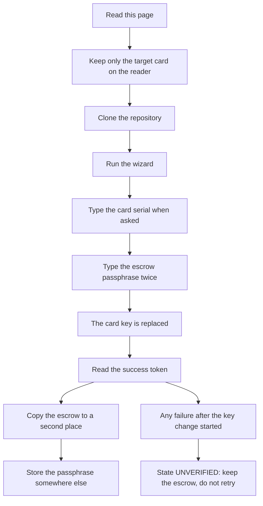

# Change your card's admin key: the exact how-to

## 1. The flow



## 2. What the admin key is

The admin key is the GlobalPlatform ISD management key of the card.
The card ships with a public default key that every GlobalPlatform user knows.
With that key, anyone holding the card can delete or replace applets or install old ones.
Changing the key to your own secret seals the card against that.
It is reversible: the encrypted escrow file brings the default key back.
It does not change passkeys, wallet keys or PINs.

## 3. Exactly this card

The parent verified these values on hardware, read-only, on 2026-10-30.

| Field | Value |
|---|---|
| Chip and OS | NXP JCOP v2.4.1 (ATR historical bytes are ASCII `JCOPv241`) |
| ATR | `3BF81300008131FE454A434F5076323431B7` |
| CPLC | ICFabricator `4790`, ICType `D321`, OperatingSystemID `4700`, ICFabricationDate `5021` (2025-01-21), ICSerialNumber `57274221`, ICBatchIdentifier `2092` |
| GlobalPlatform | SCP02 `i=55`, ONE ISD keyset, version `01`, three 16-byte DES3 keys (ENC, MAC, DEK) |
| ISD AID | `A000000151000000` |
| Default admin key | `404142434445464748494A4B4C4D4E4F` (the public GlobalPlatform test key this card ships with) |
| Reader | HID Global OMNIKEY 5422, two slots: contact `HID Global OMNIKEY 5422 Smartcard Reader`, contactless `HID Global OMNIKEY 5422 Smartcard Reader 01` |
| gp | GlobalPlatformPro 24.10.15, `gp.jar` 14668599 bytes, sha256 `a68eca9ab9be84a0560b2d312ca6a18cd2dbcd223bb7b30525e0e0f85a372696`, banner `f2af9ef` |

`ICSerialNumber` is unique per card. `57274221` is only the reference card used for this repo's proofs. Your card has its own serial, and the script reads it from your card and prints it at the prompt.

The script refuses unknown key profiles instead of guessing. Never bypass that refusal.

## 4. What you need

- The card and a PC/SC smartcard reader.
- macOS or Linux. Windows is not supported by the wizard yet.
- Java 11 or newer, Python 3.9 or newer, git.
- Internet on the first run, to download the pinned `gp.jar`.

On macOS the wizard prints: Install Java 21 from https://adoptium.net and Python 3 from https://www.python.org. Or:

```sh
brew install --cask temurin
brew install python
```

On Debian or Ubuntu:

```sh
sudo apt install default-jre-headless python3-venv pcscd
```

## 5. Before you start

1. Keep every SSH or wallet card you depend on away from the reader.
2. Leave only the target card on the reader. gp matches the reader name as a case-insensitive substring, and with cards in both slots `-r "HID Global OMNIKEY 5422 Smartcard Reader"` matches both. gp then prints `Specify reader with -r/$GP_READER; available readers:` and exits 1.
3. Know the deny-list: `~/.nuri-card/no-lock-cplc.txt`. Cards listed there are never touched.

## 6. Change the admin key

```sh
git clone https://github.com/nuri-com/nuri-passkey-prf-smartcard.git
cd nuri-passkey-prf-smartcard
bash scripts/diy-key.sh
```

Answer the prompts in this order. The first one only appears when the deny-list file does not exist yet.

| # | Prompt | What to type |
|---|---|---|
| 1 | `Serial of a card that must NEVER be changed (8 hex), Enter = none:` | Enter for no deny-list entry, or the 8 hex serial of a card to protect. Re-asked up to three times if malformed. |
| 2 | A numbered list of readers | The number of the reader holding your card. One reader is still confirmed. |
| 3 | A short summary, then `Continue? [y/N]` | `y` |
| 4 | `Target CPLC serial: 57274221; key version: 0x01; key type: DES3`, then `Type the card CPLC serial 57274221 to lock: ` | Your own serial, exactly as printed in that line. |
| 5 | `Escrow passphrase: ` | A passphrase of at least 16 bytes. |
| 6 | `Repeat escrow passphrase: ` | The same passphrase again. |

The wizard writes the encrypted escrow, reads it back, and only then sends the key change. It prints `Encrypted escrow durably published: <path>`. Because of that order, a passphrase problem stops the run before the card is touched.

## 7. What success looks like

The last line of the run is this token:

```text
CARD_LOCK_VERIFIED
```

The escrow path is printed one step earlier. The default path is `~/.nuri-card/escrow/<FULL-CPLC>.json`.

The whole run on this card profile is UNVERIFIED (pending the real-card run).

<!-- REAL-CARD-OUTPUT:lock -->

## 8. Keep the escrow

1. Copy the escrow file to a USB stick or a second place right now.
2. Store the passphrase somewhere else, for example a password manager.

Losing either one means no more applet updates through this keyset. If you used `--passphrase-fd`, move the passphrase into your password manager and delete the passphrase file.

## 9. Undo: restore the default key

```sh
bash scripts/diy-key.sh unlock
```

Without `--escrow`, the wizard lists the escrow files in `~/.nuri-card/escrow/` numbered and you pick one. Then the engine asks for `Escrow passphrase: ` once, before it touches the card, and for `Type the card CPLC serial 57274221 to unlock: ` afterwards. Success ends with:

```text
CARD_DEFAULT_KEYS_RESTORED_VERIFIED
```

The escrow file is kept. Management is public again after this, so reseal with a new escrow and a fresh key when you are done updating applets.

The undo run on this card profile is UNVERIFIED (pending the real-card run).

<!-- REAL-CARD-OUTPUT:unlock -->

## 10. Manual path for experts

No wizard, no escrow, not recommended. `K` is the default key above and `READER` is the exact reader name.

List with the default key:

```sh
gp -r "READER" --key-ver 0x01 --key-enc K --key-mac K --key-dek K -l
```

Change the key, same key version, new key as one 32 hex value:

```sh
gp -r "READER" --key-ver 0x01 --key-enc K --key-mac K --key-dek K --new-keyver 0x01 --lock NEWKEY
```

Only `--lock` works with gp 24.10.15. `--lock-enc`, `--lock-mac` and `--lock-dek` crash with a NullPointerException ([GPTool.java line 801](https://github.com/martinpaljak/GlobalPlatformPro/blob/v24.10.15/tool/src/main/java/pro/javacard/gptool/GPTool.java#L801)).

The wizard is safer: it writes and reads back the escrow before the PUT KEY, verifies with a fresh authenticated listing and CPLC recheck, and enforces the deny-list. The manual path leaves you with a bare key and no backup.

## 11. If something goes wrong

| Symptom | Action |
|---|---|
| No reader found | Plug in the reader, insert the card, run again. Linux: check that `pcscd` is running. |
| Several readers or cards | Leave only the target card on the reader, or pass `--reader` with the exact name. A dual-interface card in the contact slot can also answer on the contactless slot. |
| Java missing | Install Java 11 or newer, see section 4. |
| Linux `pcscd` not running | `sudo systemctl enable --now pcscd` |
| Wrong passphrase | Unlock decrypts before any GP call, so the card is untouched. Check the passphrase and run again. |
| Card profile refused | The card is not the profile in section 3. Do not bypass the check. |
| Any failure after the key change started | State UNVERIFIED: keep the escrow, do not retry, read `../SECURITY.md`. |

When a run fails, the engine prints `REFUSED: <reason>`. After a started rotation it adds `Rotation attempted; state is UNVERIFIED` and exits 1.

## 12. For LLM agents

Exact runbook. Each step ends with a STOP condition.

1. Ask the human which card and which reader. Act only on that card and that reader. STOP if the human did not name both.
2. Run the read-only check:

   ```sh
   bash scripts/diy-key.sh --help
   ```

   STOP on a non-zero exit or if `--help` is missing.
3. Tell the human to leave only the target card on the reader. STOP if a second card is on the reader.
4. Start the wizard:

   ```sh
   bash scripts/diy-key.sh
   ```

   STOP at the first error line; report it verbatim.
5. Let the human type the passphrase. Never put it in chat, argv, environment or logs. Use `--passphrase-fd N` only with a 0600 file the human controls.
6. Read the prompts to the human and relay the answers. The engine prints the target serial; the human confirms it by typing it again.
7. Accept success only on the exact token `CARD_LOCK_VERIFIED`. Anything else: STOP, report state UNVERIFIED, keep every file.
8. On success, tell the human the escrow path and to copy it now, and to store the passphrase separately.

Rules:

- Never retry authentication with a guessed key. Card retry limits are UNVERIFIED (pending the real-card run).
- Never edit or empty the deny-list.
- Never use the manual gp path from section 10.
- Never touch a card the human did not name.

## 13. Links

- [card-lock.md](card-lock.md): design, escrow format and failure semantics.
- [../SECURITY.md](../SECURITY.md): disclosure policy and security boundaries.
