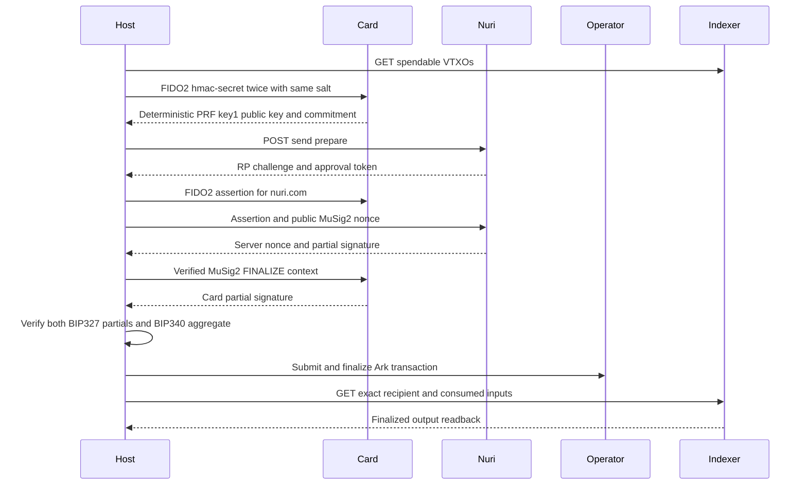

# End-to-end proof

Generated: 2026-10-28T10:09:27.524Z. Mode: **dry-run**.

This is an evidence report, not a claim that unexecuted hardware steps passed. The PRF-derived public key is distinct from the non-exportable MuSig2 applet key.

| Step | Status | Evidence |
| --- | --- | --- |
| PASSKEY + PRF | not run | Hardware required, no card opened |
| AUTH | not run | Public registration GET only, username arkade |
| COSIGN | not run | Physical MuSig2 AID3 and authenticated server required |
| ARKADE | not run | fund ark1qzpq904am6clw3pgqwyh4p02708fy4xs0hcpwt7rwfdttuxsjameepfv6ed2mgaw4k2tdts49m4wkk3zqyrjv44sr2gcgxrm47gy7sqnlyjr3x >=546 sats |

## Run

See [send tool](../scripts/send/README.md) for installation and exact guarded commands. The default is GET-only, no card. Hardware runs require funding and operator authorization.

## Derivation

The bridge evaluates CTAP2 hmac-secret twice with WebAuthn PRF salt SHA-256(UTF-8("WebAuthn PRF") || 0x00 || UTF-8("nuri-prf-salt-v1")). It requires equal outputs and derives Nuri key1 using the existing wallet HKDF-SHA256 and BIP86 derivation in [card-arkade-key](../scripts/card-arkade-key.mjs). Only the compressed public key and SHA-256 commitment of the PRF output are recorded, never raw PRF, private keys, PIN, assertion or approval tokens. This local determinism check is not remote PRF attestation. FIDO and MuSig2 use the same exact reader name but separate selections, so this transcript alone does not cryptographically attest cross-applet identity or rule out a physical card swap.

## Sequence



## Public receipt

```json
{
  "schema": "nuri-card-e2e-proof/v1",
  "generated_at": "2026-10-28T10:09:27.524Z",
  "mode": "dry-run",
  "steps": [
    {
      "name": "PASSKEY + PRF",
      "status": "not run",
      "evidence": "Hardware required, no card opened"
    },
    {
      "name": "AUTH",
      "status": "not run",
      "evidence": "Public registration GET only, username arkade"
    },
    {
      "name": "COSIGN",
      "status": "not run",
      "evidence": "Physical MuSig2 AID3 and authenticated server required"
    },
    {
      "name": "ARKADE",
      "status": "not run",
      "evidence": "fund ark1qzpq904am6clw3pgqwyh4p02708fy4xs0hcpwt7rwfdttuxsjameepfv6ed2mgaw4k2tdts49m4wkk3zqyrjv44sr2gcgxrm47gy7sqnlyjr3x >=546 sats"
    }
  ],
  "send": {
    "source": "ark1qzpq904am6clw3pgqwyh4p02708fy4xs0hcpwt7rwfdttuxsjameepfv6ed2mgaw4k2tdts49m4wkk3zqyrjv44sr2gcgxrm47gy7sqnlyjr3x",
    "recipient": "ark1qzpq904am6clw3pgqwyh4p02708fy4xs0hcpwt7rwfdttuxsjameepfv6ed2mgaw4k2tdts49m4wkk3zqyrjv44sr2gcgxrm47gy7sqnlyjr3x",
    "inputs": [],
    "input_sats": 0,
    "recipient_sats": 546,
    "fee_sats": 0,
    "change_sats": 0,
    "floor_sats": 330,
    "amount": "546",
    "type": "ark_offchain",
    "status": "needs_funding",
    "minimum_funding_sats": 546,
    "message": "fund ark1qzpq904am6clw3pgqwyh4p02708fy4xs0hcpwt7rwfdttuxsjameepfv6ed2mgaw4k2tdts49m4wkk3zqyrjv44sr2gcgxrm47gy7sqnlyjr3x >=546 sats",
    "registration": {
      "username": "arkade",
      "registered": true,
      "server_pubkey": "031dbb179bb996bcd6dc9c9cfccd73c649f987c10c6016650b53789056ae641e29"
    },
    "to": "ark1qzpq904am6clw3pgqwyh4p02708fy4xs0hcpwt7rwfdttuxsjameepfv6ed2mgaw4k2tdts49m4wkk3zqyrjv44sr2gcgxrm47gy7sqnlyjr3x",
    "mode": "dry-run",
    "receipt_file": "/home/runner/work/nuri-passkey-prf-smartcard/nuri-passkey-prf-smartcard/_launch/out/send/receipt.json",
    "log_file": "/home/runner/work/nuri-passkey-prf-smartcard/nuri-passkey-prf-smartcard/_launch/out/send/send-1793182167525.jsonl"
  },
  "complete": false
}
```
