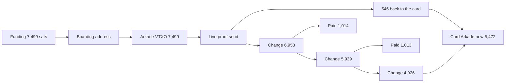
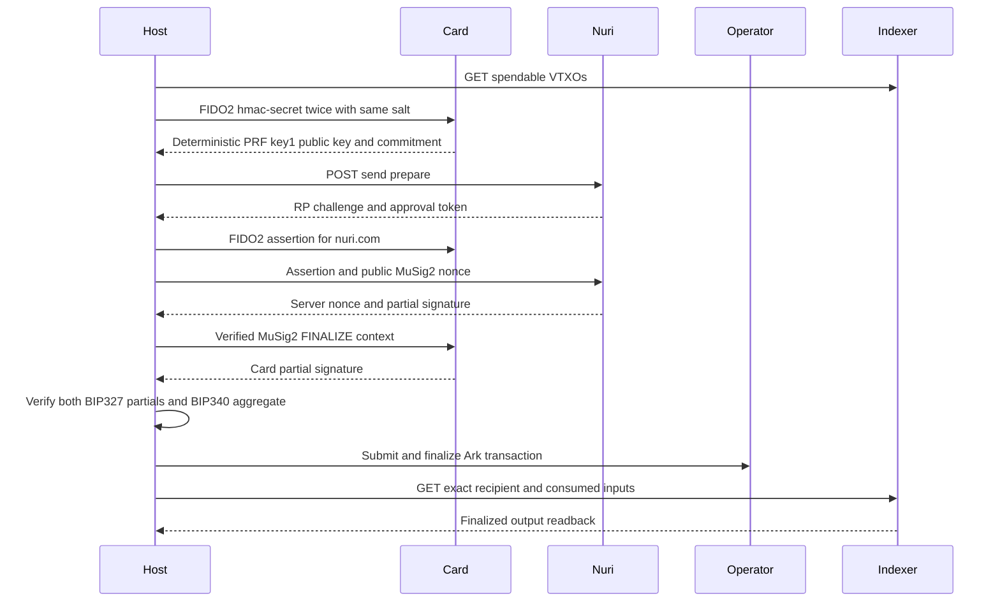

# End-to-end proof

Generated: 2026-10-28T19:12:58.846Z. Mode: **execute**.

This is an evidence report, not a claim that unexecuted hardware steps passed. The PRF-derived public key is distinct from the non-exportable MuSig2 applet key.

| Step | Status | Evidence |
| --- | --- | --- |
| PASSKEY + PRF | verified | Same salt evaluated twice, public key1 and commitment recorded |
| AUTH | verified | Nuri accepted assertion and returned a verified server partial |
| COSIGN | verified | 2 card/server partials and BIP340 aggregates verified |
| ARKADE | verified | Operator finalized 13eba05423df9915bea4d13b1d6b488c9de7cf1ee24ac3defa24c23687b9a8a8, exact indexer output and spent inputs verified |

### Where the sats are now

Checked live 2026-10-29 00:07 UTC against the Arkade indexer and mempool.space (block 973,614).

| Rail | Address | Sats | Status |
| --- | --- | ---: | --- |
| Arkade | [ark1qzpq904am6clw3pgqwyh4p02708fy4xs0hcpwt7rwfdttuxsjameepfv6ed2mgaw4k2tdts49m4wkk3zqyrjv44sr2gcgxrm47gy7sqnlyjr3x](https://arkade.space/address/ark1qzpq904am6clw3pgqwyh4p02708fy4xs0hcpwt7rwfdttuxsjameepfv6ed2mgaw4k2tdts49m4wkk3zqyrjv44sr2gcgxrm47gy7sqnlyjr3x) | 5,472 | Spendable: 4,926 + 546. Expires 2026-11-27 14:41 UTC. |
| Bitcoin, card + Nuri MuSig2 | [bc1pxa43e00wl6a2qqfd7wu8xgmuz8vczauvmn0nt45zff2kuq9u4klsfrz0f5](https://mempool.space/address/bc1pxa43e00wl6a2qqfd7wu8xgmuz8vczauvmn0nt45zff2kuq9u4klsfrz0f5) | 6,007 | Confirmed. CSV exit opens 2027-01-07. No spend tool yet. |
| Bitcoin boarding | [bc1p48tcgtk50havqnyq7pswx7hux8szpfjrrv3477z7r6sl4s0vyaxspfzzwu](https://mempool.space/address/bc1p48tcgtk50havqnyq7pswx7hux8szpfjrrv3477z7r6sl4s0vyaxspfzzwu) | 0 | [Funded 7,499](https://mempool.space/tx/fdbd415e6f1048fced5c2ddd79d22ded6cd261f8cc68f07772fd62b6e55bb1d8), [moved into Arkade](https://mempool.space/tx/617076f14362d8c27bcd2bef9b33a321ca01250cdd9d8d49723578f2e45da557). |
| **Total** | | **11,479** | |

Sent from the card:

| UTC | To | Sats | Transaction |
| --- | --- | ---: | --- |
| 2026-10-28 06:51 | @emino [ark1qzpq904am6clw3pgqwyh4p02708fy4xs0hcpwt7rwfdttuxsjameewtudvcndvek083e5ln2z7pdu5huts6gnu628pe5ezc3kce4qt7svqgg50](https://arkade.space/address/ark1qzpq904am6clw3pgqwyh4p02708fy4xs0hcpwt7rwfdttuxsjameewtudvcndvek083e5ln2z7pdu5huts6gnu628pe5ezc3kce4qt7svqgg50) | 7,118 | [903081350544f125a8e56b66782d8f14d35d1834effdd931b1086faa69eff8ca](https://arkade.space/tx/903081350544f125a8e56b66782d8f14d35d1834effdd931b1086faa69eff8ca) |
| 2026-10-28 19:13 | the card itself (live proof) | 546 | [13eba05423df9915bea4d13b1d6b488c9de7cf1ee24ac3defa24c23687b9a8a8](https://arkade.space/tx/13eba05423df9915bea4d13b1d6b488c9de7cf1ee24ac3defa24c23687b9a8a8) |
| 2026-10-28 20:13 | later payment | 1,014 | [a80114bef692a2c8b3db34df71bcfdb67caecc9683ab80bb1a99bd7bd08a7aeb](https://arkade.space/tx/a80114bef692a2c8b3db34df71bcfdb67caecc9683ab80bb1a99bd7bd08a7aeb) |
| 2026-10-28 20:35 | later payment | 1,013 | [7d762a0ac6e8f537df44f48708d34bc66b41970803e2e6d706ef962cf2af3fd1](https://arkade.space/tx/7d762a0ac6e8f537df44f48708d34bc66b41970803e2e6d706ef962cf2af3fd1) |



## Run

See [send tool](../scripts/send/README.md) for installation and exact guarded commands. The default is GET-only, no card. Hardware runs require funding and operator authorization.

## Derivation

The bridge evaluates CTAP2 hmac-secret twice with WebAuthn PRF salt SHA-256(UTF-8("WebAuthn PRF") || 0x00 || UTF-8("nuri-prf-salt-v1")). It requires equal outputs and derives Nuri key1 using the existing wallet HKDF-SHA256 and BIP86 derivation in [card-arkade-key](../scripts/card-arkade-key.mjs). Only the compressed public key and SHA-256 commitment of the PRF output are recorded, never raw PRF, private keys, PIN, assertion or approval tokens. This local determinism check is not remote PRF attestation. FIDO and MuSig2 use the same exact reader name but separate selections, so this transcript alone does not cryptographically attest cross-applet identity or rule out a physical card swap.

## Sequence



## Public receipt

```json
{
  "schema": "nuri-card-e2e-proof/v1",
  "generated_at": "2026-10-28T19:12:58.846Z",
  "mode": "execute",
  "steps": [
    {
      "name": "PASSKEY + PRF",
      "status": "verified",
      "evidence": "Same salt evaluated twice, public key1 and commitment recorded"
    },
    {
      "name": "AUTH",
      "status": "verified",
      "evidence": "Nuri accepted assertion and returned a verified server partial"
    },
    {
      "name": "COSIGN",
      "status": "verified",
      "evidence": "2 card/server partials and BIP340 aggregates verified"
    },
    {
      "name": "ARKADE",
      "status": "verified",
      "evidence": "Operator finalized 13eba05423df9915bea4d13b1d6b488c9de7cf1ee24ac3defa24c23687b9a8a8, exact indexer output and spent inputs verified"
    }
  ],
  "send": {
    "source": "ark1qzpq904am6clw3pgqwyh4p02708fy4xs0hcpwt7rwfdttuxsjameepfv6ed2mgaw4k2tdts49m4wkk3zqyrjv44sr2gcgxrm47gy7sqnlyjr3x",
    "recipient": "ark1qzpq904am6clw3pgqwyh4p02708fy4xs0hcpwt7rwfdttuxsjameepfv6ed2mgaw4k2tdts49m4wkk3zqyrjv44sr2gcgxrm47gy7sqnlyjr3x",
    "inputs": [
      [
        "a20b32f23b786590df92c5c823718fd1b86395cfb5c53e60ae7eae57499ff334",
        0,
        7499
      ]
    ],
    "input_sats": 7499,
    "recipient_sats": 546,
    "fee_sats": 0,
    "change_sats": 6953,
    "floor_sats": 330,
    "amount": "546",
    "type": "ark_offchain",
    "status": "completed",
    "registration": {
      "username": "arkade",
      "registered": true,
      "server_pubkey": "031dbb179bb996bcd6dc9c9cfccd73c649f987c10c6016650b53789056ae641e29"
    },
    "to": "ark1qzpq904am6clw3pgqwyh4p02708fy4xs0hcpwt7rwfdttuxsjameepfv6ed2mgaw4k2tdts49m4wkk3zqyrjv44sr2gcgxrm47gy7sqnlyjr3x",
    "mode": "execute",
    "receipt_file": "_launch/out/send/receipt.json",
    "log_file": "_launch/out/send/send-1793214778847.jsonl",
    "unsigned_ark_txid": "13eba05423df9915bea4d13b1d6b488c9de7cf1ee24ac3defa24c23687b9a8a8",
    "checkpoint_txids": [
      "21c4aa019c8c04e6f2435208705603ebe429136cd7724448fe84d59a5f9ff885"
    ],
    "proofs": [
      {
        "transaction_id": "13eba05423df9915bea4d13b1d6b488c9de7cf1ee24ac3defa24c23687b9a8a8",
        "input_index": 0,
        "msg32": "59444695fbeb82e2046a5090d1d3f041528e968572ef82ff3545cd73df19c567",
        "client_key": "02b935bfc0d6d379243205d5c110732400cc8ae82e2fe94d6384963c7c9a62cae6",
        "server_key": "031dbb179bb996bcd6dc9c9cfccd73c649f987c10c6016650b53789056ae641e29",
        "aggregate_key": "5e3aa279d1ab538d64f8715b6ba3d3ce4c8620d376b94b1157878a637da7f79f",
        "client_public_nonce": "024030a1880a724366e7b5cb0efd0e3e117a83050ac8d53b1607d56694610bee810265169e619021abb20069b9067c3a39b9ebbde523b50394fb2a01afbad3ef7943",
        "server_public_nonce": "02064d8837d95ee93ba73d17138226155391589d3476e00993a70b36f6cf3ba362035251240acb5648ddd7d176feb80971beaede531834e8befdbc946e7c93971722",
        "card_partial": "39d1162f3cf22d23665cc7915974bd1a0a952df88652f08aa4ab8823ab731f2f",
        "server_partial": "6917da6adff05447d4443f014b47652e6a198be37dfc299d0307bea35b5ab24b",
        "aggregate_signature": "6846b0402f58716fc15f9013d4086c4503825d134b86c96bf116d6a0f5e1488fa2e8f09a1ce2816b3aa10692a4bc224874aeb9dc044f1a27a7b346c706cdd17a",
        "card_partial_verified": true,
        "server_partial_verified": true,
        "bip340_verified": true
      },
      {
        "transaction_id": "21c4aa019c8c04e6f2435208705603ebe429136cd7724448fe84d59a5f9ff885",
        "input_index": 0,
        "msg32": "64694476ec10c90830b514ccfd65d3b292159f73af9086cdeb2fe20384ec129a",
        "client_key": "02b935bfc0d6d379243205d5c110732400cc8ae82e2fe94d6384963c7c9a62cae6",
        "server_key": "031dbb179bb996bcd6dc9c9cfccd73c649f987c10c6016650b53789056ae641e29",
        "aggregate_key": "5e3aa279d1ab538d64f8715b6ba3d3ce4c8620d376b94b1157878a637da7f79f",
        "client_public_nonce": "0353d01fd7bd9acc43282b1ef1cb50dbc3b5ac02d20043da8ef9b965349ebe017503990c69c2af7284670cd4ffbef6cd89fa4b10d0c4f05769905d645d51787bcf2e",
        "server_public_nonce": "037f90c750c5c384944cc73a9e188a7825184e4d76a89112714f3266115d5f5e94024d5a4a70696771fbe72113716bf0b1e122517b8524638bd982c6f75a16c0f017",
        "card_partial": "7a30870f18ef86e37969d61578549b56148048bb05ddcd6e36285f1d29d4b7f8",
        "server_partial": "4aa7b96b5a9288a40598808f20d74e535c428f654f081bf4e7e147cfed87a322",
        "aggregate_signature": "d6d0d86875cd4715cb16709eb326932dda48ee6bec09ae429c9cf81581880404c4d8407a73820f877f0256a4992be9a970c2d82054e5e9631e09a6ed175c5b1a",
        "card_partial_verified": true,
        "server_partial_verified": true,
        "bip340_verified": true
      }
    ],
    "auth_accepted": {
      "accepted": true,
      "evidence": "send/cosign returned verified server partial",
      "rp_id": "nuri.com",
      "origin": "https://arkade.nuri.com",
      "client_key": "02b935bfc0d6d379243205d5c110732400cc8ae82e2fe94d6384963c7c9a62cae6",
      "server_key": "031dbb179bb996bcd6dc9c9cfccd73c649f987c10c6016650b53789056ae641e29"
    },
    "indexer_verified": true,
    "retry_allowed": false,
    "intent_id": "si_d79c9fce8e6f252de55574e94d7823f7",
    "txid": "13eba05423df9915bea4d13b1d6b488c9de7cf1ee24ac3defa24c23687b9a8a8"
  },
  "prf": {
    "deterministic": true,
    "client_pk33": "0221594b9553114d5cf66219deebeb9fbe956bef524563aacba074c2c064cae234",
    "prf_commitment_sha256": "a17b5b5e1fcdf941d1342da8569ca908ba9ce8b97cd18e697c13b1b27fb6dc8b"
  },
  "complete": true
}
```
