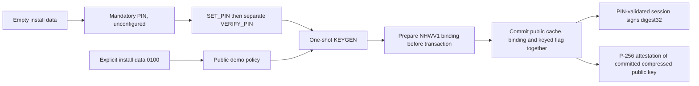

# Ethereum signer v2



## Identity and boundary

App version **2.1.0**, package version **2.1**. Package AID `4E55524945544832`, canonical applet AID `4E5552494554483201`, CAP `dist/nuri-eth2-signer.cap` ([build definition](../card/eth2/build.xml)). The applet registers the canonical instance AID and rejects a different nonempty instance AID in GP install parameters ([`install` and `personalize`](../card/eth2/NuriEthSignerV2.java)). Attestation identifies this applet instance, **not** a manufacturer chip serial.

The secp256k1 signing key is generated on-card, one-shot (`6989` once keyed). Native `genKeyPair` is tried first; the fallback rejection-samples a scalar, calls `setS`, and derives the public point with XY ECDH. The fallback temporarily holds the scalar in transient scratch. No key-import or private-key-export command is dispatched. Public-key export, signatures and attestation use the committed public cache, never a candidate key ([`keygen`, `process`, `getPublicKey`, `sign`](../card/eth2/NuriEthSignerV2.java)).

Signing uses native `Signature.ALG_ECDSA_SHA_256` with `signPreComputedHash`: it signs a supplied digest, not a displayed transaction description. The response is `r32 || low-s32 || pubkey65`; the host must verify the signature and recover the parity ([`sign`](../card/eth2/NuriEthSignerV2.java)). This is not a v1 key migration: v1 funds still require the v1 key.

## Mandatory PIN and explicit demo installation

PIN is mandatory by default, including an install with no parameters or an empty GP application-data field. Before PIN initialization **and** verification, SIGN and unkeyed KEYGEN return `6982`. SET_PIN only provisions the PIN: a separate VERIFY_PIN is required. Configuring a PIN on a demo install also gates signing and key generation. There is no APDU that disables a configured PIN or changes the install policy ([`personalize`, `requirePin`, `setPin`](../card/eth2/NuriEthSignerV2.java)).

Nonempty install parameters must have the exact GP layout `Li || instanceAID || Lc || control || La || applicationData`; lengths are unsigned and trailing/truncated bytes are rejected with `6A80`. A zero-length instance-AID field is accepted; a nonempty one must equal the canonical AID. Application data is one of:

| Application data | Policy |
|---|---|
| Empty | Mandatory PIN, unconfigured |
| `00 || pinLength || PIN` | Mandatory PIN, provisioned but not validated; PIN 4–16 bytes |
| `01 00` | Explicit public demo; unconfigured signing is allowed |

These are application-data values, **not** a raw alternative to the GP envelope. For example, a full GP envelope for the demo is `09 4E5552494554483201 00 02 0100`. Unknown modes, `0000`, demo data carrying a PIN, mismatched lengths and alternate AIDs are rejected ([`personalize`](../card/eth2/NuriEthSignerV2.java)).

The PIN has five attempts; the optional 16-byte PUK has three. Validation is session-wide, not per-signature approval. Reselection, deselection and reset clear authorization. CHANGE_PIN checks the old PIN inline and validates the replacement; UNBLOCK_PIN resets the PIN without validating it. A blocked SIGN returns `6982`; VERIFY of a blocked PIN returns `6983` ([`select`, `deselect`, `verifyPin`, `changePin`, `unblockPin`](../card/eth2/NuriEthSignerV2.java)). There is no touch, biometric or trusted transaction-display check.

## Command contract

CLA is exactly `80` (basic channel). Other CLAs return `6E00`. P1/P2 must be `0000`, except PUBKEY permits P1=`01` for compressed output and GET_ATTESTATION permits P1=`01` for its signed-tail page; invalid parameters return `6A86` before helper dispatch. Unknown INS returns `6D00` ([`process`](../card/eth2/NuriEthSignerV2.java)).

| INS | Data / result |
|---|---|
| `01` VERSION | `02 01 00 45 54 48 32 state tries`; state bits 0 keyed, 1 PIN configured, 2 mandatory policy |
| `05` CAPS | Bits 0 native ECDSA, 1 successful native keygen path, 2 XY ECDH available, 3 PIN configured, 4 keyed, 5 PUK configured, 6 mandatory policy |
| `02` PUBKEY | P1=`00`: uncompressed65; P1=`01`: compressed33; unkeyed `6986` |
| `03` KEYGEN | Returns pubkey65; one-shot `6989` even without PIN validation once keyed; PIN gate `6982`; unsupported generation path `6A81` |
| `04` SIGN | Digest32 → `r32 || low-s32 || pubkey65` (129 bytes); PIN gate `6982`; unkeyed after passing PIN gate `6986`; bad digest length `6700` |
| `20` VERIFY_PIN | PIN bytes; wrong `63Cx`, exhausted `6983`, unset `6985` |
| `21` SET_PIN | `pinLength || PIN [|| pukLength || PUK]`; one-time configuration, **not** authorization |
| `22` CHANGE_PIN | `oldLength || OLD || newLength || NEW`; checks old PIN, validates replacement |
| `23` UNBLOCK_PIN | `PUK16 || newLength || NEW`; does not validate replacement |
| `70` GET_ATTESTATION_INFO | Empty → INFO below |
| `71` STORE_ATTESTATION_CERT | CA signature DER, 8–72 bytes; write-once, refused once stored or sealed |
| `72` GET_ATTESTATION | Challenge32; P1=0 → INFO, P1=1 → signing key, PIN state, response signature and binding; concatenate pages |
| `73` SEAL_ATTESTATION | Empty; requires a stored certificate; irreversible |
| `74` GET_KEY_BINDING | Empty → stored NHWV1 DER signature; requires a committed signing key |

Signing and PIN handlers are in [`NuriEthSignerV2.java`](../card/eth2/NuriEthSignerV2.java); attestation operations use the parent-generated [`NuriAttestation.java`](../card/eth2/NuriAttestation.java), from the shared [helper contract](../test/attestation-contract.txt).

## Attestation wire format and trust boundary

Each install creates a random `cardId16` and a native non-exportable NIST P-256 attestation key. The attestation public key is SEC1 uncompressed65; signatures are DER ECDSA with standard SHA-256 over each **full message**, not the prehash signing API. Length fields below are one unsigned byte:

- `INFO = 01 || cardId16 || aidLength || AID || attestationPub65 || sealed || certLength || certDER`.
- `GET_ATTESTATION = INFO || signingPubLength || signingPub || pinState || responseSigLength || responseSigDER || bindingSigLength || bindingSigDER`.
- `signingPub` is the committed compressed secp256k1 public key (33 bytes), or empty before key generation. Before key generation the binding is also empty.
- PIN-state bits are 0 mandatory policy, 1 configured, 2 validated, 3 blocked. This bitfield differs from VERSION state.
- CA certificate message: ASCII `NURI-ATT-V1 || cardId16 || AID || attestationPub65`.
- Challenge-response message: ASCII `NURI-ATT-RESP-V1 || challenge32 || signingPub || pinState`.
- Key-binding message: ASCII `NHWV1 || AID || signingPub`.

The applet prepares the candidate NHWV1 signature **before** the key-publication transaction and commits it in the same transaction as the public cache and keyed flag. GET_KEY_BINDING returns that same signature across reset, rather than making a new signature. Failed uncommitted KEYGEN candidates are cleared; once the keyed flag is committed no later KEYGEN can rotate the key, even if response transport fails. Applet and helper scratch are cleared on command success and exception exits ([`process`, `keygen`, `clearScratch`](../card/eth2/NuriEthSignerV2.java)).

A self-signed challenge alone is **not manufacturer authentication**. The host must authenticate the stored certificate against a separately trusted P-256 Nuri CA public key and verify the exact AID, signing key, challenge and PIN state. A missing/untrusted CA is unverified, never verified by default. The applet's write-once certificate and seal are personalization controls, not independent proof that the card was manufactured by a particular vendor. Logical evidence exceeds 256 bytes, but GET_ATTESTATION is collected over two short-APDU pages as specified in [attestation.md](attestation.md#wire-protocol); each wire response fits in 256 bytes. The seal flag itself is not covered by the specified signatures, so remote verification cannot prove irreversible sealing.

## Installation and verification boundary

The installer loads v2 separately; installation does not imply key generation or PIN verification. The existing installer's dry-run still reads the physical card registry, so it is **not** an offline test ([`scripts/install-eth2-card.sh`](../scripts/install-eth2-card.sh)). Do not use it for simulator validation.

```sh
bash scripts/test-eth2-sim.sh
```

The simulator driver covers default mandatory policy, empty GP application data, personalized installs with nonzero buffer offsets, explicit demo mode, malformed GP frames, CLA/P1/P2 rejection, SET_PIN requiring separate VERIFY, retry exhaustion, PUK recovery, reset/reselection locking, immutable public key/binding, certificate sealing, independent Java P-256 verification of challenge/binding signatures, and v1 coexistence ([`test/eth2/Eth2SimTest.java`](../test/eth2/Eth2SimTest.java)). The Python verifier checks collected secp256k1 signatures, low-S and parity recovery ([`verify_eth2_sigs.py`](../test/eth2/verify_eth2_sigs.py)).

Simulator coverage is not physical tear, side-channel, native key-provider rollback, reader-transport, real-card or on-chain proof. These remain **UNVERIFIED** by this simulator suite. Parent-owned final gates compile the generated helper and rebuild/verify CAP artifacts; no hardware is accessed by these tests.
