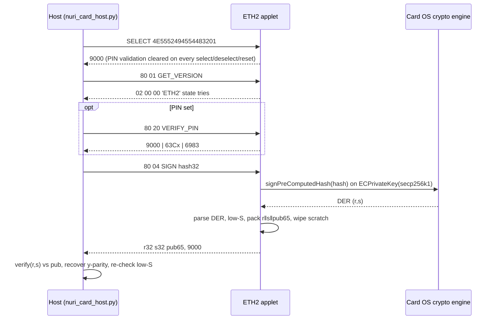
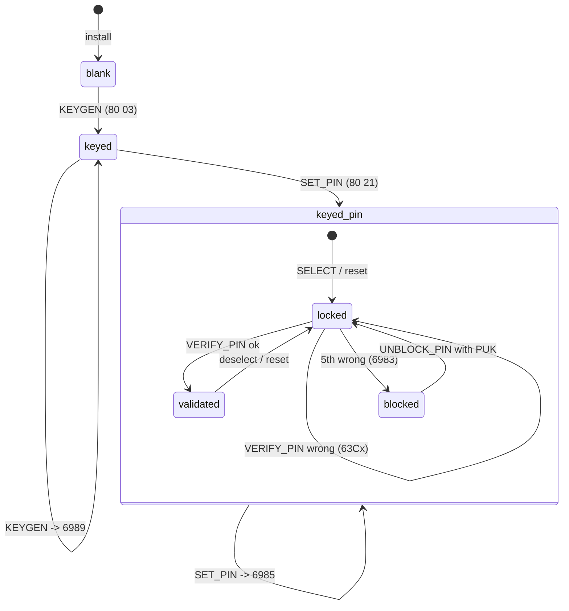
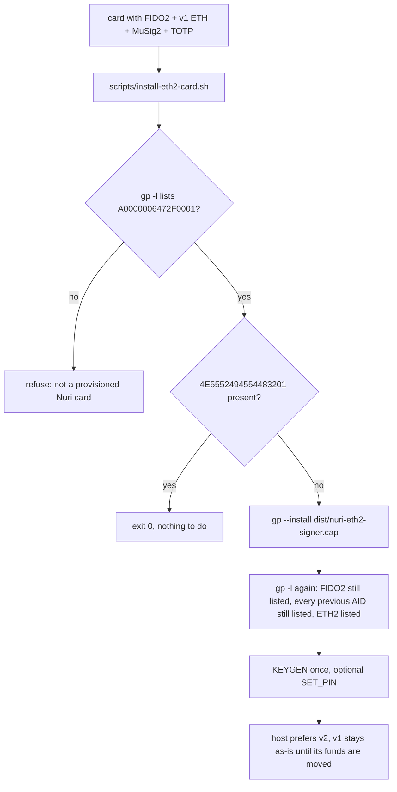

# ETH signer applet v2 (`card/eth2/`)

Second-generation Ethereum signer for the Nuri card. It replaces the v1
software-bignum ECDSA (`card/eth/`, audit finding A4) with the card OS native
engine and adds an optional owner PIN (audit A5). It is a **separate Java Card
package** so it is installed next to v1; nothing on the card is deleted.

| | v1 `card/eth/` | v2 `card/eth2/` |
| --- | --- | --- |
| Package AID | `4E555249455448` (`NURIETH`) | `4E55524945544832` (`NURIETH2`) |
| Applet AID | `4E55524945544801` | `4E5552494554483201` |
| CAP | `dist/nuri-eth-signer.cap` | `dist/nuri-eth2-signer.cap` |
| ECDSA | Satochip bignum, branchy `modInverse` in Java | `Signature.ALG_ECDSA_SHA_256` + `signPreComputedHash`, secp256k1 params on the `ECPrivateKey` |
| Low-S | host | on card (compare `s` to `n/2`, replace with `n-s`); host re-checks |
| Access control | none | optional `OwnerPIN` (5 tries, 4–16 bytes) + optional 16-byte PUK (3 tries) |
| Sign output | `r‖s` (64) | `r‖s‖pubkey65` (129) — host derives `v` by recovery against the echoed key |
| Key import | none | none (one-shot on-card `KEYGEN`, `6989` afterwards) |
| JC API | 3.0.4 | 3.0.4 (`signPreComputedHash` needs ≥3.0.4) |
| License | GPL-2.0-or-later portions | MIT (no third-party code) |

## Flow





`SET_PIN` can also be sent before `KEYGEN`; then `KEYGEN` itself requires a
validated PIN.

## APDU table

CLA `80`. All SW from `ISO7816` unless noted. Lc must match exactly.

| INS | Name | P1 | Data | Response | SW |
| --- | --- | --- | --- | --- | --- |
| `01` | GET_VERSION | 00 | – | `02 00 00 'E' 'T' 'H' '2' state tries` — state b0 keyed, b1 PIN set; tries = PIN tries left (5 while unset) | 9000 |
| `05` | GET_CAPS | 00 | – | 1 byte: b0 native ECDSA, b1 `genKeyPair` worked, b2 `ALG_EC_SVDP_DH_PLAIN_XY` available, b3 PIN set, b4 keyed, b5 PUK set | 9000 |
| `02` | GET_PUBKEY | 00 / 01 | – | 65 B uncompressed / 33 B compressed | 9000, 6986 not keyed, 6A86 bad P1 |
| `03` | KEYGEN | 00 | – | 65 B pubkey | 9000, 6989 already keyed, 6982 PIN set but not verified, 6A81 engine cannot generate |
| `04` | SIGN | 00 | 32 B hash | `r32 ‖ s32 ‖ pub65` (129 B), s low | 9000, 6700 Lc≠32, 6986 not keyed, 6982 PIN set but not verified, 6988 engine/DER failure |
| `20` | VERIFY_PIN | 00 | PIN (4..16) | – | 9000, 63Cx (x tries left), 6983 blocked, 6985 no PIN set, 6700 bad length |
| `21` | SET_PIN | 00 | `Lp PIN [Lk PUK16]` | – | 9000 (session becomes validated), 6985 PIN already set, 6A80 PUK not 16 B, 6700 |
| `22` | CHANGE_PIN | 00 | `Lo OLD Ln NEW` | – | 9000 (validated), 63Cx/6983 on wrong old, 6985 no PIN set |
| `23` | UNBLOCK_PIN | 00 | `PUK16 Ln NEW` | – | 9000 (resets PIN tries, **not** validated), 63Cx/6983 on wrong PUK (3 tries), 6985 no PUK |
| any | – | – | – | – | 6E00 CLA≠80, 6D00 unknown INS |

The hash is signed as-is (`signPreComputedHash`): the host passes the
`keccak256` of the RLP transaction or the EIP-191/712 digest; the card never
hashes again. `KEYGEN` uses `KeyPair.genKeyPair()`; on a card OS that refuses
custom domain parameters in `genKeyPair`, it falls back to 32 RNG bytes
(rejected when 0 or ≥ n), `setS`, and `d·G` via `ALG_EC_SVDP_DH_PLAIN_XY`. Which
path was taken is visible in `GET_CAPS` b1. The private key never leaves the
`ECPrivateKey` object; no bignum arithmetic and no export path exist.

## Host

`host/nuri_card_host.py` selects `4E5552494554483201` first (falls back to v1),
reads the 9-byte version block (`pin_set`, `pin_tries_left`), and parses `SIGN`
responses with `parse_eth2_signature`: 129-byte `r‖s‖pub65` (pub must equal the
card identity reported by `GET_PUBKEY`, else `VERIFY_FAILED`), or a DER
`SEQUENCE` as a fallback. Every signature is verified with python-ecdsa,
normalised to low-S and recovered to `yParity`/`v` before it is returned.

## Tests (simulator only)

```
scripts/test-eth2-sim.sh
```

1. compiles `card/eth2`, `card/eth` and `test/eth2/Eth2SimTest.java` against
   jCardSim 3.0.5.11 (jar sha256 pinned in the script);
2. installs v2 **and** v1 in one simulator and walks every row of the APDU table:
   keygen once → `6989`; 20 random hashes signed while no PIN is set; `SET_PIN`
   → sign without `VERIFY` after re-select = `6982`; wrong PIN `63C4 … 63C1`
   then `6983`; correct PIN while blocked = `6983`; `UNBLOCK` with PUK;
   `CHANGE_PIN`; deselect and `reset()` both clear validation; v1 still answers
   `ETH1` and v2 state survives the round-trip (166 SW assertions);
3. `test/eth2/verify_eth2_sigs.py` checks every collected signature with
   python-ecdsa against the echoed pubkey, asserts `s ≤ n/2`, recovers exactly
   one y-parity, and runs the same bytes through `nuri_card_host.verify_and_recover`;
4. runs `host/test_host.py` (fake v2 transport in both DER and `r‖s‖pub` form).

jCardSim performs the signature with BouncyCastle on the secp256k1 parameters
that the applet sets on the key, so the whole `ALG_ECDSA_SHA_256` +
`signPreComputedHash` path is exercised. What the simulator cannot prove is the
J3R180/SecID engine itself; JCAlgTest reports `ALG_ECDSA_SHA_256` and
`ALG_EC_SVDP_DH_PLAIN_XY` as supported there. First real-card run: `GET_CAPS`,
`KEYGEN`, then sign a known hash and verify on the host — the host already
refuses any signature that does not verify.

## Build

```
ant -f card/eth2/build.xml -Djckit.path=$JC304 -Dcap.output=.build/eth2/raw.cap build
python3 scripts/normalize-cap.py .build/eth2/raw.cap dist/nuri-eth2-signer.cap
```

`scripts/build-card-v1-release.sh` and `scripts/verify-card-v1-release.sh`
include the artifact; its hash is in `dist/SHA256SUMS`. Two independent builds
from the same source produce the same normalized CAP.

## Migration — never touches FIDO2



`scripts/install-eth2-card.sh`:

- loads/creates the v2 package only (`--install`, or `--create` if the package
  is already loaded);
- contains no `--delete`, `--uninstall`, `-f`/`--force`, and refuses to run if
  `GP_EXTRA_ARGS` carries one;
- prints `gp -l` before and after, requires the FIDO2 AID before, and asserts
  after the install that FIDO2 and every AID that was present before are still
  listed;
- verifies `dist/nuri-eth2-signer.cap` against `dist/SHA256SUMS` before touching
  the card;
- `ETH2_DRY_RUN=1` prints the command without sending it.

v2 generates a **new** key: it cannot import the v1 key (neither applet exports
private material). Funds on the v1 address are moved by signing with v1 as
before; once that is done v1 may be left installed (it is inert) or removed in
a separate, explicit step that is deliberately not part of this script.
