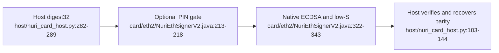

# Ethereum signer v2



## Identity and boundary

- Package AID `4E55524945544832`, applet AID `4E5552494554483201`, CAP `dist/nuri-eth2-signer.cap`: [card/eth2/build.xml:9-15](../card/eth2/build.xml#L9-L15).
- The applet sets secp256k1 parameters and uses `Signature.ALG_ECDSA_SHA_256` with `signPreComputedHash`; it signs the supplied digest, not a transaction description: [card/eth2/NuriEthSignerV2.java:150-181](../card/eth2/NuriEthSignerV2.java#L150-L181), [322-343](../card/eth2/NuriEthSignerV2.java#L322-L343).
- Key generation is one-shot (`6989` once keyed). It tries `genKeyPair`, then rejection-sampled randomness plus `setS`/ECDH; that fallback temporarily holds the scalar in applet scratch before clearing it. No key-import/export command is dispatched: [card/eth2/NuriEthSignerV2.java:193-208](../card/eth2/NuriEthSignerV2.java#L193-L208), [277-316](../card/eth2/NuriEthSignerV2.java#L277-L316).

## Command contract

CLA `80`; use P1/P2 `00` unless noted. Dispatch rejects another CLA with `6E00` and unknown INS with `6D00`: [card/eth2/NuriEthSignerV2.java:193-208](../card/eth2/NuriEthSignerV2.java#L193-L208).

| INS | Data / result | Source |
|---|---|---|
| `01` VERSION | Nine bytes: `02 00 00 45 54 48 32 state tries`; state bit 0 keyed, bit 1 PIN configured | [card/eth2/NuriEthSignerV2.java:227-236](../card/eth2/NuriEthSignerV2.java#L227-L236) |
| `05` CAPS | One byte: bits 0 native ECDSA, 1 successful genKeyPair path, 2 XY ECDH available, 3 PIN set, 4 keyed, 5 PUK set | [card/eth2/NuriEthSignerV2.java:73-79](../card/eth2/NuriEthSignerV2.java#L73-L79), [239-248](../card/eth2/NuriEthSignerV2.java#L239-L248) |
| `02` PUBKEY | P1 `00`: uncompressed 65 bytes; P1 `01`: compressed 33 bytes; otherwise `6A86`; unkeyed `6986` | [card/eth2/NuriEthSignerV2.java:220-265](../card/eth2/NuriEthSignerV2.java#L220-L265) |
| `03` KEYGEN | No data; returns pubkey65; already keyed `6989`; configured but unvalidated PIN `6982`; unavailable generation path `6A81` | [card/eth2/NuriEthSignerV2.java:277-316](../card/eth2/NuriEthSignerV2.java#L277-L316) |
| `04` SIGN | Exactly digest32, no slot byte; returns `r32 || low-s32 || pubkey65` (129 bytes); unkeyed `6986`, PIN required `6982`, bad length `6700` | [card/eth2/NuriEthSignerV2.java:322-343](../card/eth2/NuriEthSignerV2.java#L322-L343) |
| `20` VERIFY_PIN | PIN bytes; wrong PIN `63Cx`, exhausted `6983`, unset `6985` | [card/eth2/NuriEthSignerV2.java:415-425](../card/eth2/NuriEthSignerV2.java#L415-L425) |
| `21` SET_PIN | `pinLen || PIN [|| pukLen || PUK]`; optional PUK is 16 bytes; one-time configuration; validates session | [card/eth2/NuriEthSignerV2.java:432-458](../card/eth2/NuriEthSignerV2.java#L432-L458) |
| `22` CHANGE_PIN | `oldLen || OLD || newLen || NEW`; checks old PIN inline, then validates new PIN | [card/eth2/NuriEthSignerV2.java:462-482](../card/eth2/NuriEthSignerV2.java#L462-L482) |
| `23` UNBLOCK_PIN | `PUK16 || newLen || NEW`; resets PIN without validating it | [card/eth2/NuriEthSignerV2.java:486-503](../card/eth2/NuriEthSignerV2.java#L486-L503) |

## PIN is not per-signature approval

PIN length is 4–16 bytes with five attempts; optional PUK has three attempts. With no PIN configured, SIGN is open. Validation persists for the session; `deselect()` resets it. SIGN has no touch, biometric or transaction-display check: [card/eth2/NuriEthSignerV2.java:62-66](../card/eth2/NuriEthSignerV2.java#L62-L66), [188-218](../card/eth2/NuriEthSignerV2.java#L188-L218), [322-343](../card/eth2/NuriEthSignerV2.java#L322-L343). Physical security, side-channel resistance and hardware compatibility are **UNVERIFIED** here.

The native messaging host prefers v2 and falls back to v1 only on `NO_APPLET`. A successful `info` on the same native connection precedes signing. `verify_pin` accepts `{pin, hash, address}`, verifies the PIN and signs that approved digest on the same selected applet session, then closes it; `sign_hash` on a protected v2 returns `PIN_REQUIRED`. The host re-reads identity before signing, maps `63Cx` to `PIN_WRONG` with attempts left and `6983` to `PIN_BLOCKED`, and never falls back to v1 after a PIN error. See [the extension PIN protocol and parent stage checklist](chrome-extension.md#pin-and-native-protocol), [host/nuri_card_host.py:229-396](../host/nuri_card_host.py#L229-L396). A blank v2 still requires separate provisioning; the wallet does not configure or generate keys. Physical ETH2 PIN/native-messaging behavior remains **UNVERIFIED** here.

## Installation boundary

The installer loads/creates only v2 and checks registry AIDs before/after. It does not generate the key or configure a PIN. **Its dry-run still reads the card registry**; it is not an offline check: [scripts/install-eth2-card.sh:56-95](../scripts/install-eth2-card.sh#L56-L95). It compares the CAP with the checksum entry when that entry is available: [scripts/install-eth2-card.sh:23-30](../scripts/install-eth2-card.sh#L23-L30).

V2 has a separate key-generation path, not a v1 key migration. Existing v1 funds require the v1 key; neither dispatcher exposes key import/export: [card/eth/NuriEcdsaSigner.java:151-192](../card/eth/NuriEcdsaSigner.java#L151-L192), [card/eth2/NuriEthSignerV2.java:193-208](../card/eth2/NuriEthSignerV2.java#L193-L208), [277-316](../card/eth2/NuriEthSignerV2.java#L277-L316).

## Offline verification

```sh
bash scripts/test-eth2-sim.sh
```

The runner compiles both applets in jCardSim, verifies generated signatures and runs host tests: [scripts/test-eth2-sim.sh:54-68](../scripts/test-eth2-sim.sh#L54-L68). PIN/reset/coexistence assertions are in [test/eth2/Eth2SimTest.java:118-198](../test/eth2/Eth2SimTest.java#L118-L198); cryptographic/low-S checks are in [test/eth2/verify_eth2_sigs.py:37-67](../test/eth2/verify_eth2_sigs.py#L37-L67). Simulator success does not establish real-card or on-chain operation; those remain **UNVERIFIED** here.
