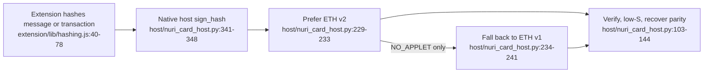

# Ethereum signing contract



This is the implemented digest-signing interface, not a proposed slot-based protocol. The applets accept a 32-byte digest without a slot byte and do not parse Ethereum transaction fields: [card/eth/NuriEcdsaSigner.java:204-218](../card/eth/NuriEcdsaSigner.java#L204-L218), [card/eth2/NuriEthSignerV2.java:322-343](../card/eth2/NuriEthSignerV2.java#L322-L343).

## Applet comparison

| | ETH v1 source | ETH v2 source |
|---|---|---|
| Applet AID | `4E55524945544801` — [card-eth-test.py:19](../scripts/card-eth-test.py#L19) | `4E5552494554483201` — [build.xml:13-14](../card/eth2/build.xml#L13-L14) |
| Version response | `01 04 01 45 54 48 31` (seven bytes) — [NuriEcdsaSigner.java:33](../card/eth/NuriEcdsaSigner.java#L33), [163-171](../card/eth/NuriEcdsaSigner.java#L163-L171) | `02 00 00 45 54 48 32 state tries` (nine bytes) — [NuriEthSignerV2.java:227-236](../card/eth2/NuriEthSignerV2.java#L227-L236) |
| Public key (`02`) | Compressed 33 bytes — [NuriEcdsaSigner.java:195-201](../card/eth/NuriEcdsaSigner.java#L195-L201) | P1 `00`: 65 bytes; `01`: 33 bytes — [NuriEthSignerV2.java:252-265](../card/eth2/NuriEthSignerV2.java#L252-L265) |
| KEYGEN (`03`) | Random scalar, one-shot guard `6989` — [NuriEcdsaSigner.java:174-192](../card/eth/NuriEcdsaSigner.java#L174-L192) | Native keygen with RNG/ECDH fallback, one-shot guard `6989` — [NuriEthSignerV2.java:277-316](../card/eth2/NuriEthSignerV2.java#L277-L316) |
| SIGN (`04`) | Software scalar arithmetic; returns `r32 || s32 || parity1` (65 bytes) — [NuriEcdsaSigner.java:204-276](../card/eth/NuriEcdsaSigner.java#L204-L276) | Native precomputed-hash ECDSA; returns `r32 || low-s32 || pubkey65` (129 bytes) — [NuriEthSignerV2.java:322-343](../card/eth2/NuriEthSignerV2.java#L322-L343) |
| Access | No PIN/touch gate in dispatch or SIGN — [NuriEcdsaSigner.java:151-161](../card/eth/NuriEcdsaSigner.java#L151-L161), [204-218](../card/eth/NuriEcdsaSigner.java#L204-L218) | Optional session PIN; open until configured — [NuriEthSignerV2.java:188-218](../card/eth2/NuriEthSignerV2.java#L188-L218) |

The host emits CLA `80`. V2 enforces it; v1 currently dispatches only on INS. For SIGN use `80 04 00 00 20` followed by digest32. A slot-prefixed 33-byte payload is rejected with `6700`: [host/nuri_card_host.py:45-47](../host/nuri_card_host.py#L45-L47), [card/eth/NuriEcdsaSigner.java:151-161](../card/eth/NuriEcdsaSigner.java#L151-L161), [204-208](../card/eth/NuriEcdsaSigner.java#L204-L208), [card/eth2/NuriEthSignerV2.java:193-208](../card/eth2/NuriEthSignerV2.java#L193-L208), [322-327](../card/eth2/NuriEthSignerV2.java#L322-L327).

V1 implements only INS `01`–`04`; v2 INS `05` is CAPS, not address derivation. Address derivation is host-side Keccak of the uncompressed public key: [card/eth/NuriEcdsaSigner.java:151-160](../card/eth/NuriEcdsaSigner.java#L151-L160), [card/eth2/NuriEthSignerV2.java:197-207](../card/eth2/NuriEthSignerV2.java#L197-L207), [host/nuri_card_host.py:75-88](../host/nuri_card_host.py#L75-L88).

## Host integration

Native messaging methods are `info` and `sign_hash`; messages use four-byte little-endian length-prefixed JSON: [host/nuri_card_host.py:325-361](../host/nuri_card_host.py#L325-L361), [368-387](../host/nuri_card_host.py#L368-L387).

```json
{"id":1,"method":"sign_hash","params":{"hash":"<64_HEX_DIGITS>"}}
```

The example contains a placeholder, not a valid request digest. Input must decode to exactly 32 bytes. Success contains `r`, `s`, `yParity` and a 65-byte hexadecimal signature with final byte `27 + yParity`; errors contain a code/message: [host/nuri_card_host.py:313-322](../host/nuri_card_host.py#L313-L322), [138-144](../host/nuri_card_host.py#L138-L144), [341-361](../host/nuri_card_host.py#L341-L361).

The host ignores v1's parity byte, validates r/s, normalizes low-S, verifies against the loaded identity and recovers parity itself. V2's echoed key must match that identity; DER is an additional host-parser fallback, not the applet's native response format: [host/nuri_card_host.py:103-170](../host/nuri_card_host.py#L103-L170), [282-293](../host/nuri_card_host.py#L282-L293).

The extension computes personal-message, typed-data and EIP-1559 transaction hashes and assembles signatures outside the card: [extension/lib/hashing.js:23-85](../extension/lib/hashing.js#L23-L85). See [chrome-extension.md](chrome-extension.md) and [eth-applet-v2.md](eth-applet-v2.md) for the client and v2 command table.

## Operational limits

- No per-signature touch/UP or trusted-display approval is enforced by either SIGN handler. PIN-configured v2 requires session validation, not a new PIN per signature: [card/eth/NuriEcdsaSigner.java:204-276](../card/eth/NuriEcdsaSigner.java#L204-L276), [card/eth2/NuriEthSignerV2.java:213-218](../card/eth2/NuriEthSignerV2.java#L213-L218), [322-343](../card/eth2/NuriEthSignerV2.java#L322-L343).
- The native host cannot verify a PIN; `6982` becomes `PIN_REQUIRED`. It falls back only on missing v2 applet, not on locked or uninitialized v2: [host/nuri_card_host.py:229-249](../host/nuri_card_host.py#L229-L249), [261-289](../host/nuri_card_host.py#L261-L289), [325-353](../host/nuri_card_host.py#L325-L353).
- Do not probe KEYGEN on older v1 deployments. The acceptance script only probes the one-shot guard for version ≥1.4; the explicit `--regenerate` path sends KEYGEN: [scripts/card-eth-test.py:104-124](../scripts/card-eth-test.py#L104-L124). Hardware key retention, firmware identity and on-chain settlement are **UNVERIFIED** here.

## Offline checks

```sh
bash scripts/test-eth2-sim.sh
```

This runs simulator protocol checks, independent signature verification and fake/sim host tests, not hardware acceptance: [scripts/test-eth2-sim.sh:54-68](../scripts/test-eth2-sim.sh#L54-L68). V1 real-card acceptance is a separate, state-changing operation: its script signs a test digest and regenerates MuSig2 public nonces in its health check; it is not a read-only inventory command: [scripts/card-eth-test.py:41-68](../scripts/card-eth-test.py#L41-L68), [157-246](../scripts/card-eth-test.py#L157-L246).
