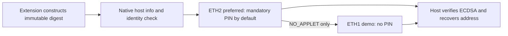

# Ethereum digest signing contract



Both applets accept exactly a 32-byte digest, not a slot-prefixed payload, and do
not decode transaction fields or show recipient/amount. No screen; blind signing.

| Interface | ETH v1 demo | ETH v2 current |
|---|---|---|
| AID | `4E55524945544801` | `4E5552494554483201` |
| Version | Current source 1.4 / SIGN; demo hardware reported 1.3.1 | 2.1.0 source; physical installation UNVERIFIED |
| SIGN | `r32 || s32 || parity1`, software arithmetic | Native ECDSA, `r32 || low-s32 || pubkey65` |
| Access | No PIN/touch gate | Mandatory PIN by default; explicit install-time public-demo exception |
| KEYGEN | One-shot in current source; unsafe on old deployed versions | One-shot, PIN-gated by default |

Sources: [ETH1 source](../card/eth/NuriEcdsaSigner.java),
[ETH2 contract](eth-applet-v2.md), [native host](../host/nuri_card_host.py).
Never send KEYGEN as a diagnostic to ETH1 below 1.4; it can rotate the existing key.
Installing ETH2 creates a separate key, not migration/recovery of the ETH1 key.

The native host uses four-byte little-endian JSON framing. Read `info` first on
the same persistent host process. `sign_hash` signs where the applet permits it;
`verify_pin` takes `{pin, hash, address}` and verifies plus signs on one selected
card connection. It rechecks identity and rejects card substitution. Wrong PINs
consume tries; no automatic retry. The extension's trusted popup, not the dApp,
collects the PIN. [Protocol and installation](chrome-extension.md).

Host-side verification normalizes low-S and recovers parity against the loaded
public key; it does not trust ETH1's recovery byte. ETH2's echoed public key must
match the known identity. The extension hashes personal messages, typed data and
EIP-1559 transactions outside the card. Session PIN validation is not physical
touch or independent transaction review. FIDO2 PIN is unrelated.

```sh
npm run card:eth2:test:sim
```

This checks simulator protocol/signatures and fake-host behavior, not hardware.
ETH1 signing and native-host info/sign_hash have [physical reader evidence](reader-compatibility.md#hardware-runs-parent-physical-card).
The new ETH2/PIN/attestation revision and full Chrome wallet flow remain
simulator only. A transaction hash alone is not a mined receipt or settlement.
