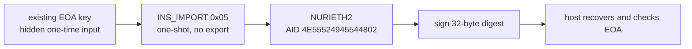

# NURIETH2 import-capable Ethereum signer

NURIETH2 is a separate, optional signer for importing an existing secp256k1 EOA. It does not replace NURIETH1 or FIDO2 during installation.



## Build and install

The CAP is `dist/nuri-eth-import-signer.cap`; source is `card/eth-import/`. Package AID `4E55524945544849` and applet AID `4E55524945544802` differ from NURIETH1, so installation needs no deletion. Never install over an existing NURIETH2 instance: its key is one-shot.

```bash
SDK_DIR="$(scripts/prepare-card-build-toolchain.sh)"
export JAVA_HOME=/Library/Java/JavaVirtualMachines/zulu-8.jdk/Contents/Home
export PATH="$JAVA_HOME/bin:$PATH"
ant -f card/eth-import/build.xml -Djckit.path="$SDK_DIR/jc304_kit" \
  -Dcap.output="$PWD/dist/nuri-eth-import-signer.cap" build
mkdir -p .build/gp-t0
python3 scripts/make-gp-t0.py "$HOME/bin/gp.jar" .build/gp-t0/gp-t0.jar
java -jar .build/gp-t0/gp-t0.jar -r ACR39U --install dist/nuri-eth-import-signer.cap
```

GlobalPlatformPro v26.06.4's automatic protocol fails on this ACR39U/card combination even though Nuri T=0 works. The local T=0 build changes only the default reader protocol; secure-channel code remains GlobalPlatformPro. Do not hand-roll SCP authentication.

## CLI

```bash
NURI_READER=ACR39U NURI_PCSC_PROTOCOL=T0 \
PYTHON_BIN="$(command -v python3.13)" \
  scripts/run-card-python.sh scripts/nurisc-eth.py import

NURI_READER=ACR39U NURI_PCSC_PROTOCOL=T0 \
  scripts/run-card-python.sh scripts/nurisc-eth.py pubkey

NURI_READER=ACR39U NURI_PCSC_PROTOCOL=T0 \
  scripts/run-card-python.sh scripts/nurisc-eth.py sign <32-byte-hex-digest>
```

Import uses hidden input and prints only status/public key. Importing an existing key does not erase other copies. A chat- or log-exposed key remains exposed; card storage cannot undo that. Prefer a fresh key whenever possible. Signing is not PIN-gated by this applet: possession plus host access authorizes signatures.

The host must recover every signature to the expected EOA and reject any mismatch. The applet flips recovery parity when it applies low-s normalization. A host may also try both recovery IDs as a defensive compatibility measure, but must accept only the expected address.

## Real-card proof — 2026-11-15

- ACS ACR39U, forced T=0; NURIETH1 and FIDO2 still selectable after NURIETH2 installation.
- Import returned `9000`; public key `02e83e2052547f1c2f06d64825ec75f8e714a05445d3c386b8e4c9698904b26707` derives `0xd353663587c3eFbeF566cbA5527D755D624E0205`.
- Independent `ethers.recoverAddress` matched the expected EOA.
- NURIETH2 signed a direct Base ERC-4337 request and final withdrawal without Wirex BaaS, hosted bundler or paymaster. Request `0x011486b3f015ee2ab375a673280b154aed4a1f6fc1bb1b8978b0bb2a03363ce4`; final `0x7fe369adec5536a2507d23544624c99bc39d5724ca7295d4d434d5ef6ffb0dcc`, block `57768244`; `0.01` EURC transfer verified in the receipt.

This proves the tested EOA/import/sign path on this card. It is not a general security audit, PIN gate, or secrets-vault feature.
