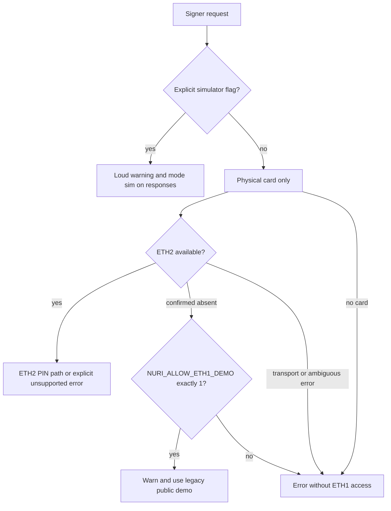

# W28 — fail-closed signer defaults



## Audited boundaries

- `scripts/pkcs11-nuri.c:528` and `scripts/pkcs11-helper.py:139`: unset mode means
  physical card. Only exact `NURI_PKCS11_MODE=sim` enables software simulation;
  unknown/empty/conflicting configuration errors. The simulator token and both
  public/private object labels contain `SIMULATOR`. The rebuilt module is pinned
  in `dist/SHA256SUMS` and reproduces with `scripts/build-pkcs11.sh --check`.
- `scripts/card-mcp-server.mjs`, `scripts/nuri-card-wallet.mjs`: physical helpers
  only, with subprocess failure/malformed-output/non-card-result rejection.
  They do not support `--sim`; rejection is intentional, not a reason to fall back.
- `scripts/local-card-cosign-server.mjs`: physical card by default; first signing
  request uses an existing key, never implicit KEYGEN. `--sim` or
  `--backend=simulated` explicitly enables simulation, with stderr warning,
  `mode: sim` on JSON responses (including auth/framing/errors), an HTTP mode
  header and an HTML warning banner. Live-card/wallet routes refuse in sim mode.
- `src/signer-policy.js:4`: guards Node subprocess mode and explicit ETH1 helper
  overrides. `src/musig2/cosign-flow.js:58` and
  `src/musig2/arkade-client-signer.js:194` require an explicit signer/card and
  counterparty key rather than constructing a fallback signer.
- `src/musig2/card-sim-cli.js`, `scripts/arkade-card-signer-proof.mjs` and
  `scripts/server-cosigner-smoke.mjs`: demonstration-only tools now require an
  explicit `--sim` or `--backend=...`. They warn and identify simulator output.
  NPM demo commands pass the corresponding explicit flag.
- `scripts/card-dashboard-server.py:223`: prefers ETH2 and refuses its signing
  path with `ETH2_PIN_UNSUPPORTED` because this dashboard has no trusted PIN flow.
  A positive ETH2 absence response is needed before the explicitly opted-in ETH1
  demo. The cached transport never inserts SELECT between policy and operation;
  failed operations are not replayed on a new connection.
- `scripts/card-eth-test.py:96`: ETH1-only legacy diagnostic; refuses before card
  I/O without the exact demo flag, and refuses if ETH2 is installed. W30: a
  mismatched, malformed or unrecoverable ECDSA signature now closes the connection
  and exits non-zero before `REAL_CARD_ETH_SIGN_FLOW_OK`, so
  `scripts/accept-card-v1.sh:22` cannot print `REAL_CARD_V1_ACCEPTANCE_OK`
  after a bad signature (fake-reader regressions: `CardEthFailClosedTests` in
  `test/test_nuri_pcsc.py`).
- `host/nuri_card_host.py:325`: ETH2-first selection, with explicit demo gate and
  independent all-reader confirmation of ETH2 absence before any ETH1 fallback.
  ETH2 PIN/status/transport failures never downgrade. `NURI_ETH2_AID` cannot alias
  ETH1. The existing native-host explicit simulator authorization remains; startup
  warns and every response, including framing errors, carries mode.
- `scripts/nuri_eth_policy.py:66`: `NO_APPLET` alone is **not** absence evidence;
  the shared reader layer can use it for SELECT exceptions. Only positive `6A82`
  responses authorize a legacy downgrade. PKCS#11 and installed native-host
  snapshots enforce the equivalent policy independently.

## Executed offline evidence

All tests used fake readers or jCardSim, not a physical card. The required suite
commands are `npm test`, Python discovery after `scripts/test-vault-sim.sh`,
`host/test_host.py`, `node --test extension/test`, and `scripts/test-eth2-sim.sh`.
Dedicated tests are `test/node-signer-fail-closed.test.js`,
`test/demo-cli-optin.test.js`, `test/test_w28_integration.py`,
`scripts/test-pkcs11-failclosed.py`, plus expanded existing host/reader/dashboard
regressions. Explicit-sim PKCS#11 OpenSC and OpenSSL selftests passed. Final results:

| Check | Observed output |
| --- | --- |
| `npm test` | 75 passed, 0 failed |
| Python discovery after vault simulator | 230 tests, OK |
| Native host | 84 tests, OK; 1 expected missing-module test skipped because module is present |
| Extension | 33 passed, 0 failed |
| Vault simulator | `VAULT_JCARDSIM_OK checks=291 RFC4231_vectors=5` |
| ETH2 simulator | `ETH2_SIM_SW_OK checks=2181 signatures=25`; all 25 independently verified, low-S |
| PKCS#11 policy | 18 tests, OK |
| Native rebuild | `PKCS11_BUILD_MATCHES_SHA256SUMS` |
| OpenSSL integration | `HSM_OPENSSL_SELFTEST_OK mode=sim` |
| Dist manifest | All nine files OK |

Negative controls that removed the host AID-alias guard or restored destructive cached
SELECT behavior failed the intended assertions and were restored.

## Parent-only physical-card checks

Hardware behavior remains **UNVERIFIED by W28**. From the merged checkout:

```sh
export NURI_PKCS11_PYTHON=/path/to/venv/bin/python
unset NURI_PKCS11_HELPER NURI_CARD_SIM NURI_ALLOW_ETH1_DEMO

# Current demo card is ETH1-only: expect initialization failure without the flag.
NURI_PKCS11_MODE=card pkcs11-tool --module "$PWD/dist/pkcs11-nuri.so" -L

# Explicit qualification on the existing public demo, without regeneration.
NURI_ALLOW_ETH1_DEMO=1 NURI_PKCS11_MODE=card \
  "$NURI_PKCS11_PYTHON" scripts/test-pkcs11-e2e.py

NURI_OPENSSL=/opt/homebrew/bin/openssl NURI_ALLOW_ETH1_DEMO=1 \
NURI_PKCS11_MODE=card \
NURI_PKCS11_EXPECTED_PUBKEY=0239a28d96002c4950a3052a9288da801085aba4a9d4907ab6d93d6b97c29006e0 \
  bash scripts/hsm-openssl-selftest.sh --card

# Only on a separately provisioned PIN-protected ETH2 card: expect refusal,
# not an ETH1/software signature, until persistent PKCS#11 PIN sessions exist.
NURI_PKCS11_MODE=card "$NURI_PKCS11_PYTHON" \
  scripts/test-pkcs11-e2e.py --expect-pin-required
```

This fixes signer-selection defaults, not applet upgrades, a trusted transaction
screen, physical fault resistance, or complete ETH2/OpenSSL PIN-session support.
The public legacy demo flag does not add a PIN to ETH1. No hardware provisioning,
reset, regeneration or install command is part of these checks.
