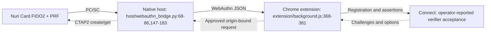

# Feature status: evidence and open items

Status is path-specific. A real-card result does not qualify every applet revision, client, reader or transaction flow. The 2026-10-22 observations below were supplied by the operator for card CPLC serial `87E5470B` on an HID Global OMNIKEY 5422 via PC/SC. Earlier observations are retained as dated operator reports.

The diagram shows the response flow and reverse requests. Native-host/card results and Connect verifier acceptance are real-card observations. Source implements the extension methods and approval path; a complete interactive Chrome session is not independently established by those native-host results alone.

1. **FIDO2 WebAuthn create/get with PRF. Layer: real card.** On 2026-10-22, origin `https://connect.nuri.com`, RP `nuri.com`, registration and two assertions succeeded through native-host `webauthn_create`/`webauthn_get`. PRF outputs matched, Connect verifiers accepted the registration/assertions, and `backupEligible=false`. Source: `host/webauthn_bridge.py:23-24,53-65,128-144,147-196`; reproducer: `test/card_webauthn_proof.py:41-79`. Extension exposes `nuri_webauthnCreate`/`nuri_webauthnGet`: `extension/background.js:368-381`. Open: interactive browser end-to-end on live `connect.nuri.com` is not done because the Connect code is not deployed. Verifier acceptance is not a deployed live-browser proof; do not infer all-browser compatibility.
2. **FIDO2 SSH bridge. Layer: real card.** Operator reports SSH still working after the October 22 additive ETH2 install; earlier reader runs are in `docs/reader-compatibility.md:68-70`. Bridge: `scripts/ssh-pcsc-sk-helper.py:83-111`. Open: the SSH bridge does not verify a PIN (`scripts/ssh-pcsc-sk-provider.c:248-262,289-296`); card presence is not fresh touch.
3. **ETH1 digest signing without PIN. Layer: real card, historical operator report.** October 17/18 report: `docs/reader-compatibility.md:68-70`. PIN-less implementation: `card/eth/NuriEcdsaSigner.java:151-160,204-212`. Open: demo-only; this does not prove a current ETH2 or Chrome transfer.
4. **ETH2 v2.1.0 PIN-gated digest signer. Layer: real card.** October 22 operator reports additive install beside ETH1, preservation of prior AIDs, SET_PIN, VERIFY, one-shot KEYGEN, independently verified 32-byte digest signing, and `6982` on SIGN without VERIFY in a new session. Package `4E55524945544832`, applet `4E5552494554483201`. Source: `card/eth2/NuriEthSignerV2.java:42,231-241,312-316,377-379,429-438`; installer: `scripts/install-eth2-card.sh:56-94`. Native host now reports `eth2` version `2.1.0`, `pin_set=true`; PIN-less `sign_hash` returns `PIN_REQUIRED`, and `verify_pin` plus signing succeeds. Receipt: `docs/proofs/real-card-87E5470B-eth2-pin.json`. Open: CA attestation remains `verified=false`; fault/tear/side-channel qualification, Chrome transactions and on-chain sends were not proved by this run.
5. **PKCS#11/OpenSSL signing through ETH1. Layer: real card, historical operator report.** October 18 report: `docs/hsm.md:88-96`; adapter: `scripts/pkcs11-nuri.c:811,884`. Open: ETH1 demo opt-in is required; ETH2 PKCS#11 signing remains unavailable without implemented PIN-session support (`scripts/pkcs11-nuri.c:685,802`; `scripts/pkcs11-helper.py:54`).
6. **PKCS#11 fail-closed defaults and ETH2 discovery preference. Layer: simulator.** Software/fake-helper coverage is reported in `docs/hsm.md:51,75-81`; enforcement: `scripts/pkcs11-nuri.c:623,685,802`. Open: discovery is not ETH2 signing acceptance.
7. **PRF-encrypted disk credential vault put/run/rm. Layer: real card, historical operator report.** October 18 report: `docs/card-secrets.md:19-26`; PRF/HKDF host path: `scripts/card-secrets.py:294-327`. Open: host memory contains PRF-derived material; this is distinct from the on-card vault applet.
8. **MuSig2 v1.15 PIN2, protocol pin-1.14, additive AID2 cosigning. Layer: real card.** October 22 operator reports install beside v1.10 under package `4E5552494D554732`, applet `4E5552494D55473201`; select with `NURI_MUSIG2_AID=4E5552494D55473201`. SET_PIN and on-card one-shot KEYGEN succeeded. `scripts/real-card-cosign-proof.py` returned `REAL_CARD_COSIGN_FLOW_OK` with `card_pin_verified=true`; both partials and final BIP340 signature verified. KEYGEN and GET_NONCES without VERIFY returned `6982`. Receipt: `docs/proofs/real-card-87E5470B-musig2-aid2-cosign.json`. Snapshot gates/session checks: `card/musig2/NuriMuSig2v019.java:277-285,319-321,554-585`; AID2 builder `scripts/build-musig2-aid2.sh`, CAP `dist/nuri-musig2-v20-keygen-aid2.cap` (sha256 in `dist/SHA256SUMS`). Open: no on-chain spend from the new key; proof was not broadcast or funded. No independent physical fault/side-channel qualification. A matching session token is not authenticated process identity.
**MuSig2 AID3 v1.16. Layer: real card.** Package `4E5552494D554733`, applet `4E5552494D55473301`; select with `NURI_MUSIG2_AID=4E5552494D55473301`. MIT RSA-square multiply, provider self-test at installation, transient arithmetic scratch. Five independently verified BIP340 signatures on card `87E5470B`: FINALIZE min/median/max 5164.75/5194.75/5195.32 ms; GET_NONCES approximately 290 ms. The <3 s target remains unmet. Blinding and double computation retained. One wrong PIN returned 63C4; correct PIN restored five tries. Additive install only; all existing AIDs and SSH retained. [Proof](proofs/real-card-87E5470B-musig2-aid3-fast.json). Open: further profiling, physical fault/side-channel qualification; no funding or broadcast.

9. **On-card credential vault PIN/HMAC/bearer storage. Layer: simulator.** Source: `card/vault/NuriVault.java:194-231,303-310,336-352`; software scope: `docs/card-vault-applet.md:185-213`. Open: hardware acceptance, remanence and power-loss behavior. HMAC credential slots cannot be revealed, but their values were imported from the host.
10. **TOTP calculation and software-HMAC fallback. Layer: simulator.** Software scope: `docs/totp-applet.md:30`; CALC/replacement boundaries: `card/totp/NuriOathTotp.java:142-156,183-190`. Open: real-card fallback qualification. PIN protects replacement, not calculation.
11. **Chrome Ethereum wallet approval binding, PIN flow and Base send. Layer: simulator.** Source: `extension/background.js:149-165,331-345`; browser harness: `extension/test/browser_e2e.py:32-38,79-116`. Open: interactive real-card ETH2 transaction and confirmed on-chain transfer. The separate WebAuthn proof does not establish this flow.
12. **MCP tools and paired loopback helper authorization. Layer: simulator, reported software scope.** Test scope: `docs/helper-servers-security.md:100-108`. Open: independent live helper/client acceptance and current deployment verification; no public exposure implied.
13. **CA-backed applet attestation and signing-key binding. Layer: simulator.** Host verification: `host/nuri_card_host.py:458-481`; declared limits: `docs/attestation.md:30-37`. Open: real-card CA personalization and challenge/binding verification. ETH2 digest signing does not establish attestation.
14. **GP management-key rotation with encrypted owner escrow. Layer: simulator.** Rotation/unlock: `scripts/card_lock.py:283-325`; fake-GP coverage: `docs/card-lock.md:203-206`. Open: reversible real-card lock/unlock acceptance. This is not lifecycle sealing, key backup or independent wallet recovery.
15. **OMNIKEY 5422 connection and additive ETH2 installation. Layer: real card.** October 22 operator reports `~/bin/gp` worked without `-r`, whereas Homebrew `gp` failed with `Specify reader`. Select a compatible executable with `GP_BIN="$HOME/bin/gp"`; installer interface: `scripts/install-eth2-card.sh:18,42-54`. Open: other GP versions and readers require separate qualification; PC/SC protocol fallback is a different layer.
16. **Fingerprint authorization and application secure messaging. Layer: planned.** No acceptance is claimed. Open: implementation and protocol-specific qualification. Existing FIDO2 PIN/PRF protection and GP management channels are not a general encrypted channel for application commands.
17. **Independent lost-card recovery. Layer: planned.** No universal recovery result is claimed. Open: enroll/test independent access and path-specific backups; same-card components do not establish independent recovery.
