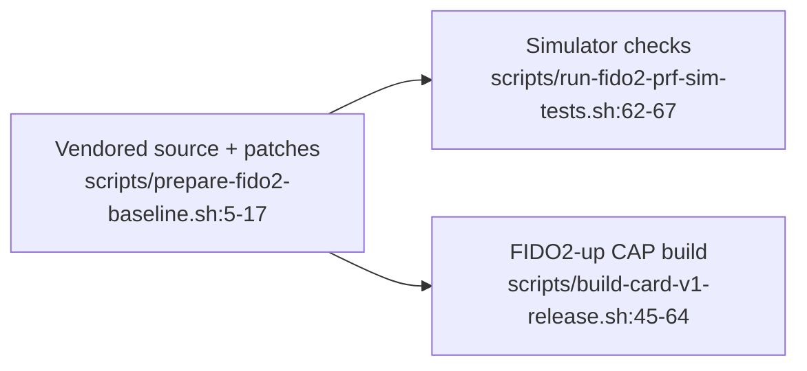

# FIDO2 PRF baseline



## Source and patch boundary

The preparation script copies `third_party/fido2-applet/` into `.build/fido2-applet/` by default, then applies every `patches/*.patch`; `FIDO2_SOURCE` and `FIDO2_DEST` override those locations. It uses `rsync --delete`, so the destination is a disposable build tree. [scripts/prepare-fido2-baseline.sh:4-18](../scripts/prepare-fido2-baseline.sh#L4-L18)

- Patch 0001 changes the initial `hmacSecretEnabled` value from false to true; an explicit extension value can still override it. [patches/0001-prf-on-by-default.patch:9-12](../patches/0001-prf-on-by-default.patch#L9-L12), [third_party/fido2-applet/src/main/java/us/q3q/fido2/FIDO2Applet.java:700](../third_party/fido2-applet/src/main/java/us/q3q/fido2/FIDO2Applet.java#L700)
- Patch 0002 changes the advertised `up` option to true, not the assertion logic. See [user presence](fido2-user-presence.md). [patches/0002-advertise-user-presence.patch:1-17](../patches/0002-advertise-user-presence.patch#L1-L17)
- The release script builds `FIDO2.cap` with patch 0001 only and `FIDO2-up.cap` with both patches; the FIDO2 installer defaults to `dist/FIDO2-up.cap`. The two variants are not interchangeable descriptions of UP advertising. [scripts/build-card-v1-release.sh:61-64](../scripts/build-card-v1-release.sh#L61-L64), [scripts/install-fido2-card.sh:4-5](../scripts/install-fido2-card.sh#L4-L5)

## Simulator workflow

These are the preparation and simulator entry points, not hardware acceptance commands. [scripts/prepare-fido2-baseline.sh:5-18](../scripts/prepare-fido2-baseline.sh#L5-L18), [scripts/run-fido2-prf-sim-tests.sh:62-67](../scripts/run-fido2-prf-sim-tests.sh#L62-L67)

```bash
scripts/prepare-fido2-baseline.sh
scripts/run-fido2-prf-sim-tests.sh
```

The runner prepares the baseline only if its directory is absent: rerun preparation after source or patch changes. It selects a Java Card SDK, manages a Python environment and may install dependencies; do not treat this as a guaranteed offline command. [scripts/run-fido2-prf-sim-tests.sh:9-19](../scripts/run-fido2-prf-sim-tests.sh#L9-L19), [scripts/run-fido2-prf-sim-tests.sh:39-60](../scripts/run-fido2-prf-sim-tests.sh#L39-L60)

The runner builds `jar`, `testJar` and Java tests, runs the vendored `HMACSecretTestCase`, then this repository's mapping test; only after those commands succeed does it print `FIDO2_JCARDSIM_PRF_OK`. [scripts/run-fido2-prf-sim-tests.sh:62-67](../scripts/run-fido2-prf-sim-tests.sh#L62-L67)

## PRF evidence boundary

The applet advertises CTAP `hmac-secret`. The mapping test hashes inputs as `SHA-256("WebAuthn PRF\0" || input)`, supplies them through `hmacGetSecret`, verifies the assertion signature, and checks 32-byte, repeatable, input-dependent outputs. It is not a real browser interoperability test. [third_party/fido2-applet/src/main/java/us/q3q/fido2/CannedCBOR.java:63-77](../third_party/fido2-applet/src/main/java/us/q3q/fido2/CannedCBOR.java#L63-L77), [test/fido2_prf_e2e.py:23-24](../test/fido2_prf_e2e.py#L23-L24), [test/fido2_prf_e2e.py:74-123](../test/fido2_prf_e2e.py#L74-L123)

**UNVERIFIED:** fresh hardware results, supported card models, OS/browser PRF compatibility and certification. This page makes no new hardware-verification claim.
