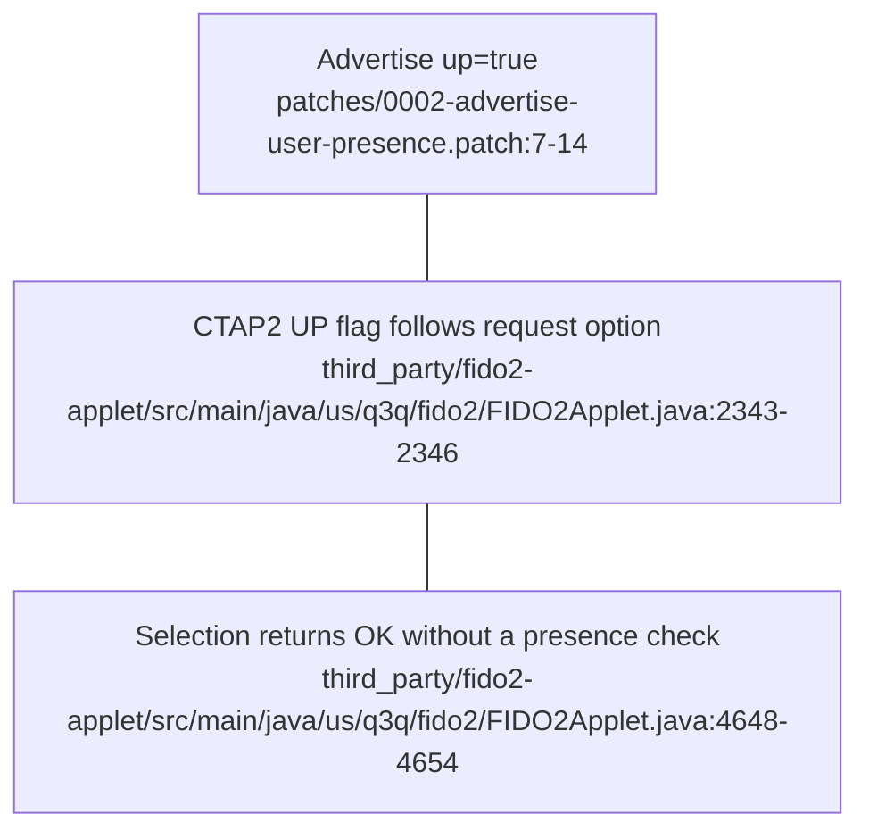

# FIDO2 user presence

## Advertising is not a consent gate

The vendored GetInfo bytes encode `up:false`; patch 0002 changes that byte to `up:true`. GetInfo copies those bytes into its response. The patch changes capability advertising, not a physical-touch check. [third_party/fido2-applet/src/main/java/us/q3q/fido2/CannedCBOR.java:82-94](../third_party/fido2-applet/src/main/java/us/q3q/fido2/CannedCBOR.java#L82-L94), [patches/0002-advertise-user-presence.patch:1-17](../patches/0002-advertise-user-presence.patch#L1-L17), [third_party/fido2-applet/src/main/java/us/q3q/fido2/FIDO2Applet.java:5586-5587](../third_party/fido2-applet/src/main/java/us/q3q/fido2/FIDO2Applet.java#L5586-L5587)

CTAP2 defaults the UP request option to true. MakeCredential and GetAssertion set the UP response bit from that option, rather than measuring a fresh tap; authenticatorSelection returns success directly. Thus “every response always has UP=1” is also too broad: the CTAP2 flag is conditional on the option. [third_party/fido2-applet/src/main/java/us/q3q/fido2/TransientStorage.java:242-261](../third_party/fido2-applet/src/main/java/us/q3q/fido2/TransientStorage.java#L242-L261), [third_party/fido2-applet/src/main/java/us/q3q/fido2/FIDO2Applet.java:1146-1152](../third_party/fido2-applet/src/main/java/us/q3q/fido2/FIDO2Applet.java#L1146-L1152), [third_party/fido2-applet/src/main/java/us/q3q/fido2/FIDO2Applet.java:2343-2346](../third_party/fido2-applet/src/main/java/us/q3q/fido2/FIDO2Applet.java#L2343-L2346), [third_party/fido2-applet/src/main/java/us/q3q/fido2/FIDO2Applet.java:4648-4654](../third_party/fido2-applet/src/main/java/us/q3q/fido2/FIDO2Applet.java#L4648-L4654)

For comparison, the U2F authentication path writes a fixed UP flag of `0x01` into its signed response. This does not establish per-operation consent either. [third_party/fido2-applet/src/main/java/us/q3q/fido2/FIDO2Applet.java:4083-4117](../third_party/fido2-applet/src/main/java/us/q3q/fido2/FIDO2Applet.java#L4083-L4117)

## PIN verification is separate

MakeCredential verifies supplied PIN authorization and permission, with additional PIN requirements depending on authenticator and credential options. GetAssertion checks supplied PIN authorization, permission and RP binding; `alwaysUv` requires PIN authorization. These are not physical-presence checks or a promise that every request prompts for a PIN. [third_party/fido2-applet/src/main/java/us/q3q/fido2/FIDO2Applet.java:812-849](../third_party/fido2-applet/src/main/java/us/q3q/fido2/FIDO2Applet.java#L812-L849), [third_party/fido2-applet/src/main/java/us/q3q/fido2/FIDO2Applet.java:2134-2195](../third_party/fido2-applet/src/main/java/us/q3q/fido2/FIDO2Applet.java#L2134-L2195)

Do not describe insertion, NFC proximity or `up:true` as an enforced fresh approval for each signature: the CTAP2 flag and selection handler above do not enforce that boundary. [third_party/fido2-applet/src/main/java/us/q3q/fido2/FIDO2Applet.java:2343-2346](../third_party/fido2-applet/src/main/java/us/q3q/fido2/FIDO2Applet.java#L2343-L2346), [third_party/fido2-applet/src/main/java/us/q3q/fido2/FIDO2Applet.java:4648-4654](../third_party/fido2-applet/src/main/java/us/q3q/fido2/FIDO2Applet.java#L4648-L4654)

## Build and installation boundary

`FIDO2-up.cap` receives both patches and is the FIDO2 install/reinstall default. Reinstallation is a deletion-and-install path guarded by `FIDO2_REINSTALL_CONFIRM=YES`, not a non-destructive capability toggle. [scripts/build-card-v1-release.sh:61-64](../scripts/build-card-v1-release.sh#L61-L64), [scripts/install-fido2-card.sh:4-5](../scripts/install-fido2-card.sh#L4-L5), [scripts/reinstall-fido2-card.sh:4-13](../scripts/reinstall-fido2-card.sh#L4-L13), [scripts/reinstall-fido2-card.sh:48-67](../scripts/reinstall-fido2-card.sh#L48-L67)

**UNVERIFIED:** whether a particular installed card has this CAP, whether a platform accepts it, and browser PRF behavior. Advertising UP alone is not evidence of browser compatibility or fresh hardware verification.
