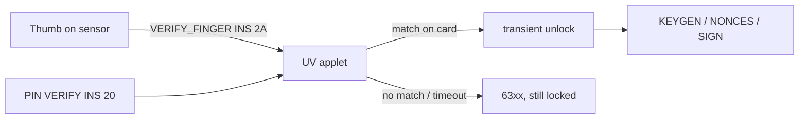

# Fingerprint instead of a PIN (IDEX TrustedBio)

Status 2026-11-03: **working on a real IDEX TrustedBio card** (B2183751,
Javelin-OS 1.0, Infineon SLC38BML800). The finger OR the PIN authorizes
MuSig2 keygen/signing and the ETH signer. Verified with the owner's own thumb:
3 of 4 rounds MATCH in 0.8-1.4 s, each match unlocked the applet; no finger and
no PIN leaves it locked.

## Why the code is not in this repo

The on-card fingerprint sensor is driven through the card vendor's biometric
applet. That API is under NDA, so the UV applets, the enroll script and the CAP
files live in the private repo `eminogrande/nuri-card-private-backup`
(`idex/nuri-uv`). This page documents only our own interface and the results.
Nothing here requires the vendor documentation.

## Our applet interface (vendor independent)

The UV variants of MuSig2 and ETH2 add one instruction and change the auth rule.
Everything else, including key formats and signature formats, is unchanged.

| Item | MuSig2-UV | ETH2-UV |
|---|---|---|
| AID | `4E5552494D55473501` | `4E5552494554483301` |
| VERIFY_FINGER | CLA `00` INS `2A` | CLA `80` INS `2A` |
| PIN | unchanged, INS `20` | unchanged, INS `20` |
| KEYGEN / NONCES / SIGN | allowed after PIN **or** finger | allowed after PIN **or** finger |

- A successful VERIFY_FINGER sets a transient, volatile flag. It is cleared by
  applet deselect, card reset and any error, exactly like the PIN flag.
- VERIFY_FINGER before an owner PIN is set: `6985`. With a blocked PIN: `6985`.
- Fingerprint backend missing on the card: `6A88`.
- Backend result is passed through as `63xx`: no match, timeout (no finger on
  the sensor), no enrolled template, or try limit.
- A wrong finger does **not** decrement the PIN retry counter. Only a wrong PIN
  does.
- No fingerprint image or template ever leaves the card. Matching happens on
  the card, the host only sees a yes/no status word.

## What this is good for

A card on a reader at home can be unlocked by touch instead of typing a PIN, and
the PIN stays as the fallback when the finger does not read (wet, cold, cut).
For an unattended cosigner use the PIN in an environment variable, see
`docs/home-cosigner.md`; a fingerprint cannot sign while you are away.

## Honest limits

- The vendor's try limit on this sample card is not personalized (BTC `7F`), so
  a stolen card can retry the finger. Treat the fingerprint as convenience, not
  as a stronger secret than the PIN.
- The UV build of MuSig2 has no attestation module: the vendor biometric applet
  takes card memory, and attestation was the part we could drop. Plain MuSig2
  with attestation and UV MuSig2 without it are separate applets.
- Only the IDEX card has been tested. A FEITIAN fingerprint card uses a
  different biometric API and needs its own build.
