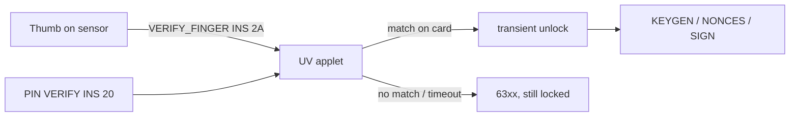

# Fingerprint on the card (IDEX TrustedBio + Feitian BioCARD)

Status 2026-11-03: **working on a real IDEX TrustedBio card** (B2183751,
Javelin-OS 1.0, Infineon SLC38BML800). The finger OR the PIN authorizes
MuSig2 keygen/signing and the ETH signer. Verified with the owner's own thumb:
3 of 4 rounds MATCH in 0.8-1.4 s, each match unlocked the applet; no finger and
no PIN leaves it locked.



## Why the code is not in this repo

The on-card fingerprint sensor is driven through the card vendor's biometric
applet (`IBA` `A00000090501000101`). That API is under NDA, so the UV applets,
the enroll script and the CAP files live in the private org repo
[`nuri-com/nuri-card-private-smartcard`](https://github.com/nuri-com/nuri-card-private-smartcard)
(`idex/`; see [private access](private-access.md)). This page documents only our
own interface and the live-card results. Nothing here requires the vendor
documentation.

### Coexistence with FIDO2 on card `B2183751`

Physical card `B2183751` (`Javelin-OS 1.0`, Infineon `SLC38BML800`, CPLC
fabricator `4090`) runs **six** active applets side by side:
`IBA` (`A00000090501000101`), `FIDO2-up` (`A0000006472F0001`),
`MuSig2-UV` (`4E5552494D55473501`), `ETH2-UV` (`4E5552494554483301`),
`Vault` (`4E555249564C54`), and `TOTP` (`A000000527210101`).
`MuSig2-UV` and `ETH2-UV` invoke the on-card biometric Shareable Interface directly
(thumb touch **or** PIN fallback). `FIDO2-up` coexists on the same card using
CTAP2 `clientPin` verification alongside the enrolled biometric sensor.

## Our applet interface (vendor independent)

The UV variants of MuSig2 and ETH2 add one instruction and change the auth rule.
Everything else, including key formats and signature formats, is unchanged.

| Item | MuSig2-UV | ETH2-UV |
|---|---|---|
| AID | `4E5552494D55473501` | `4E5552494554483301` |
| VERIFY_FINGER | CLA `00` INS `2A` | CLA `80` INS `2A` |
| PIN | unchanged, INS `20` | unchanged, INS `20` |
| KEYGEN / NONCES / SIGN | allowed after PIN **or** finger | allowed after PIN **or** finger |

- A successful VERIFY_FINGER sets a transient, volatile flag. It is cleared by
  applet deselect, card reset and any error, exactly like the PIN flag.
- VERIFY_FINGER before an owner PIN is set: `6985`. With a blocked PIN: `6985`.
- Fingerprint backend missing on the card: `6A88`.
- Backend result is passed through as `63xx`: no match, timeout (no finger on
  the sensor), no enrolled template, or try limit.
- A wrong finger does **not** decrement the PIN retry counter. Only a wrong PIN
  does.
- No fingerprint image or template ever leaves the card. Matching happens on
  the card, the host only sees a yes/no status word.

## What this is good for

A card on a reader at home can be unlocked by touch instead of typing a PIN, and
the PIN stays as the fallback when the finger does not read (wet, cold, cut).
For an unattended cosigner use the PIN in an environment variable, see
`docs/home-cosigner.md`; a fingerprint cannot sign while you are away.

## Honest limits

- The vendor's try limit on this sample card is not personalized (BTC `7F`), so
  a stolen card can retry the finger. Treat the fingerprint as convenience, not
  as a stronger secret than the PIN.
- The UV build of MuSig2 has no attestation module: the vendor biometric applet
  takes card memory, and attestation was the part we could drop. Plain MuSig2
  with attestation and UV MuSig2 without it are separate applets.
- Only the IDEX card has been tested. A FEITIAN fingerprint card uses a
  different biometric API and needs its own build.

## Feitian BioCARD sensor management (2026-11-20)

Card `87E5470B` also carries Feitian's preinstalled `FPSVCApplet`
(`46505356434170706C6574`). The public host helper
`scripts/card_fingerprint.py` talks to that applet over PC/SC; no biometric
image or template leaves the card. It deliberately has **no delete command**.

```sh
scripts/run-card-python.sh scripts/card_fingerprint.py --reader 'ACS ACR39U ICC Reader' --list
scripts/run-card-python.sh scripts/card_fingerprint.py --reader 'ACS ACR39U ICC Reader' --match
scripts/run-card-python.sh scripts/card_fingerprint.py --reader 'ACS ACR39U ICC Reader' --enroll
```

`Nuri Card Setup.app` exposes the same three actions for Feitian cards and
reports each of the 12 enrollment touches. Enrollment is additive and preserves
existing fingers, applets and credentials. The vendor CAP/SDK remains private;
the public repository contains only the small APDU host client. The app also
lists every PC/SC-detected physical card and gates actions per capability; IDEX
cards are shown with their sensor present, but the IDEX vendor API is not yet
wired into the app, so those controls stay disabled.

**Live boundary:** SELECT and LIST passed over ACS ACR39U `T=0`; the card reports
two existing templates ([receipt](proofs/real-card-87E5470B-feitian-fingerprint.json)).
A no-touch MATCH returned the expected timeout. A successful live MATCH and a
new 12-touch enrollment are not claimed yet. These controls test/manage the
sensor only: they do **not** authorize PIV, FIDO2, macOS login or wallet signing.
Secure PIN-OR-fingerprint authorization must be enforced by an on-card signer,
not by a host application that could skip the MATCH command.

## Recorded runs

| Date | Reader | What was observed |
|---|---|---|
| 2026-11-03 | HID Global OMNIKEY 5422, contact slot | Owner's thumb: 3 of 4 rounds MATCH in 0.8–1.4 s; each match unlocked the applet; no finger and no PIN left it locked |
| 2026-11-17 | same reader, same card (`Javelin-OS 1.0`, ATR `3B9F96C0F031FE45754A6176656C696E2D4F5320312E30AB`) | Read-only inventory: MuSig2-UV `4E5552494D55473501` and ETH2-UV `4E5552494554483301` both select with `9000`; the non-UV ETH2 `4E55524945544832` and non-UV MuSig2 `4E5552494D534732` are absent (`6E00`); vault `4E555249564C54` selects with `9000`, `80 01` STATUS `01 01 05 10`. No PIN, no finger, no signature and no state change in this run |
| 2026-11-18 | HID Global OMNIKEY 5422 (`Reader 01`) & ACS ACR39U (`T=0`) | `scripts/card-readers.py` verified CPLC serial `B2183751` (offset `12..16`) and full 6-applet inventory (`FIDO2`, `MuSig2-UV`, `ETH2-UV`, `Vault`, `TOTP`, `IBA`) |

The 2026-11-17 row proves the UV applet set and the vault coexist on one physical
card. It does **not** re-prove match-on-card authorization; the 2026-11-03 row is
still the functional evidence for that, and [reader
compatibility](reader-compatibility.md#hardware-runs-parent-physical-card) carries
the transport context.

Do not read the ATR as a chip attestation. `Javelin-OS 1.0` in the ATR is a card OS
label reported by the card, not a manufacturer certificate or a CPLC qualification.
