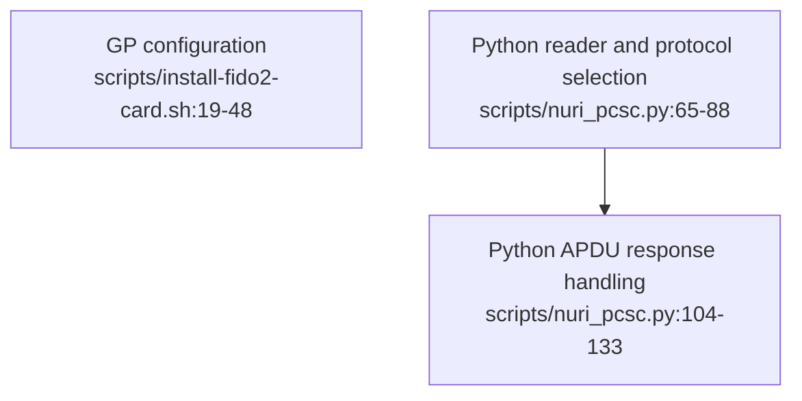

# GlobalPlatform and macOS troubleshooting

## Identify the failing layer

GlobalPlatform installation shells out to `GP_BIN` (default `gp`). Python applet access instead uses `nuri_pcsc`; changing a Python protocol setting does not configure the separate GP command. [scripts/install-fido2-card.sh:4-6](../scripts/install-fido2-card.sh#L4-L6), [scripts/install-fido2-card.sh:19-48](../scripts/install-fido2-card.sh#L19-L48), [scripts/nuri_pcsc.py:213-238](../scripts/nuri_pcsc.py#L213-L238)

| Layer | What the code supports |
| --- | --- |
| GP reader selection | FIDO2 install/reinstall prioritize `GP_READER_INDEX` over `GP_READER`; neither is required by these two wrappers. [scripts/install-fido2-card.sh:19-24](../scripts/install-fido2-card.sh#L19-L24), [scripts/reinstall-fido2-card.sh:26-31](../scripts/reinstall-fido2-card.sh#L26-L31) |
| Python applet selection | `NURI_READER` filters names by substring; the protocol ladder is default → T0 → T1, or pinned with `NURI_PCSC_PROTOCOL=default`, `T0` or `T1`. [scripts/nuri_pcsc.py:32-33](../scripts/nuri_pcsc.py#L32-L33), [scripts/nuri_pcsc.py:65-88](../scripts/nuri_pcsc.py#L65-L88) |
| Python FIDO2 selection | The PIN tool patches the FIDO2 connection method to use the ladder, then selects among discovered FIDO2 devices using `FIDO2_PCSC_INDEX`; multiple devices without an index are rejected. This index is not a GP reader index. [scripts/manage-fido2-pin.py:13-17](../scripts/manage-fido2-pin.py#L13-L17), [scripts/manage-fido2-pin.py:27-58](../scripts/manage-fido2-pin.py#L27-L58), [scripts/nuri_pcsc.py:255-271](../scripts/nuri_pcsc.py#L255-L271) |
| APDU responses | `transmit_raw` retries `6Cxx` with corrected Le and fetches `61xx` with GET RESPONSE, bounded to 64 iterations per loop; it returns the status word rather than throwing on every non-`9000` result. [scripts/nuri_pcsc.py:38](../scripts/nuri_pcsc.py#L38), [scripts/nuri_pcsc.py:104-133](../scripts/nuri_pcsc.py#L104-L133) |

## Interpret failures before changing a card

The Python helper distinguishes `NO_READER`, `NO_CARD`, `NO_APPLET` and `TRANSPORT`. A connected card whose SELECT probe fails can produce `NO_APPLET`; an unsuccessful protocol ladder can produce `TRANSPORT`. These categories narrow the software failure but do not identify a card model or certify hardware health. [scripts/nuri_pcsc.py:175-210](../scripts/nuri_pcsc.py#L175-L210), [scripts/nuri_pcsc.py:213-240](../scripts/nuri_pcsc.py#L213-L240)

Inspect the chosen wrapper before retrying: the FIDO2 installer checks for its CAP and GP executable, but then performs an install without a confirmation variable. Reinstall is guarded and can delete packages. A diagnostic retry must not silently become reinstallation. [scripts/install-fido2-card.sh:8-17](../scripts/install-fido2-card.sh#L8-L17), [scripts/install-fido2-card.sh:44-48](../scripts/install-fido2-card.sh#L44-L48), [scripts/reinstall-fido2-card.sh:8-13](../scripts/reinstall-fido2-card.sh#L8-L13), [scripts/reinstall-fido2-card.sh:48-67](../scripts/reinstall-fido2-card.sh#L48-L67)

The ETH2 installer’s `ETH2_DRY_RUN=1` is not hardware-free: it reads the GP registry before the dry-run branch. [scripts/install-eth2-card.sh:53-71](../scripts/install-eth2-card.sh#L53-L71)

**UNVERIFIED:** GP release-specific bugs, SCP authentication retry/lockout policy, reader-model protocol requirements, macOS daemon recovery commands and any fresh hardware results. Do not infer these from this source-level guide; obtain card-specific management policy before attempting authentication or recovery.
