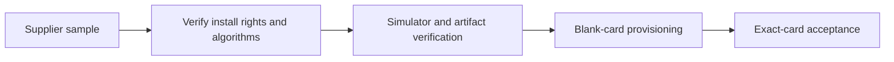

# Hardware qualification

The repository's applet builds are not evidence that an arbitrary Java Card model
supports them. **UNVERIFIED:** current model availability, price, vendor security
certification, silicon identity and support for a new batch.

## Required interfaces

The provisioning script requires GlobalPlatform transport keys and an explicitly
selected reader, rejects targets already containing its applets and installs
FIDO2, MuSig2, TOTP and ETH v1 (ETH v1 not with `PROVISION_SKIP_ETH1=YES`). Source:
[scripts/provision-card-v1.sh:7–23](../scripts/provision-card-v1.sh#L7-L23),
[48–71](../scripts/provision-card-v1.sh#L48-L71).
ETH v2 is a separate applet; see [its guide](eth-applet-v2.md).

Ask the supplier for:

- Custom CAP install/delete rights and transport-key documentation.
- Java Card Classic / GlobalPlatform versions and exact COS/OS identifiers.
- Contact ISO7816 and contactless ISO-DEP interfaces if both are required.
- P-256 FIDO2 operations and secp256k1 custom-domain support.
- `KeyAgreement.ALG_EC_SVDP_DH_PLAIN_XY`, required by the MuSig2 implementation:
  [card/musig2/NuriMuSig2v019.java:145–153](../card/musig2/NuriMuSig2v019.java#L145-L153).
- Algorithm-test output, user NVM/RAM capacity, sample cards and an exact-batch test.

No memory figure or product-family label substitutes for installing and testing
the complete selected applet set.

## Three physical card types tested

Every hardware receipt in this repository comes from one of three distinct
physical Java Card types:

| Card type | Sample serial | Silicon / OS (CPLC / ATR) | Fingerprint sensor | Proven applets & receipts |
|---|---|---|---|---|
| **1. Feitian BioCARD sample** | `87E5470B` | Infineon (`4090`), OS ID `86AA`, OS date `5134` | Hardware sensor on card (Feitian `FPSVCApplet` SDK under NDA; not wired into public signers) | `FIDO2`, `MuSig2` (AID1/AID2/AID3 mainnet send), `ETH1`, `ETH2`, `Vault`, `TOTP`, **`NURI-SC` (`4E55524953433031`)** — [ETH2](proofs/real-card-87E5470B-eth2-pin.json), [AID3](proofs/real-card-87E5470B-musig2-aid3-fast.json), [NURI-SC v1](proofs/real-card-87E5470B-secure-channel.json) |
| **2. IDEX TrustedBio fingerprint card** | `B2183751` | Infineon `SLC38BML800` (`4090`), `Javelin-OS 1.0`, OS ID `4A4E` | **Active match-on-card** (`IBA` `A00000090501000101` Shareable Interface; thumb **or** PIN) | **`MuSig2-UV`** (`4E5552494D55473501`), **`ETH2-UV`** (`4E5552494554483301`), `FIDO2-up` (CTAP2 PIN), `Vault`, `TOTP`, `IBA` — [fingerprint](fingerprint.md) |
| **3. €9.99 blank DIY card** ([xmrstreet.store J3R180](https://xmrstreet.store/product/smartcard-j3r180/)) | `57274221` | NXP (`4790`), IC type `D321`, OS ID `4700`, ATR `JCOPv241` | None (PIN-gated) | Full `v1.2.0` DIY applet stack (`FIDO2`, `MuSig2`, `ETH1` 1.5, `ETH2`, `Vault`, `TOTP`) + DIY GP admin-key lock/unlock — [ETH1 cofactor](proofs/real-card-57274221-eth1-cofactor.json), [GP lock](proofs/real-card-57274221-gp-lock.json), [DIY guide](diy-card.md) |

Each row qualifies only the tested sample card, not arbitrary future batches or
supplier substitutions. ETH1 1.4 failed on NXP card `57274221` with `6F00`
until ETH1 1.5 set the secp256k1 cofactor (`1`). Vendor biometric SDKs (IDEX and
Feitian) remain in the private org repository
[`nuri-com/nuri-card-private-smartcard`](https://github.com/nuri-com/nuri-card-private-smartcard)
([private access](private-access.md)).

Use [reader compatibility](reader-compatibility.md), [acceptance](acceptance.md),
[release verification](release.md) and [GlobalPlatform troubleshooting](gp-macos-troubleshooting.md).
