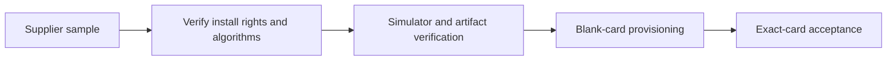

# Hardware qualification

The repository's applet builds are not evidence that an arbitrary Java Card model
supports them. **UNVERIFIED:** current model availability, price, vendor security
certification, silicon identity and support for a new batch.

## Required interfaces

The provisioning script requires GlobalPlatform transport keys and an explicitly
selected reader, rejects targets already containing its applets and installs
FIDO2, MuSig2, TOTP and ETH v1. Source:
[scripts/provision-card-v1.sh:7–23](../scripts/provision-card-v1.sh#L7-L23),
[48–67](../scripts/provision-card-v1.sh#L48-L67).
ETH v2 is a separate applet; see [its guide](eth-applet-v2.md).

Ask the supplier for:

- Custom CAP install/delete rights and transport-key documentation.
- Java Card Classic / GlobalPlatform versions and exact COS/OS identifiers.
- Contact ISO7816 and contactless ISO-DEP interfaces if both are required.
- P-256 FIDO2 operations and secp256k1 custom-domain support.
- `KeyAgreement.ALG_EC_SVDP_DH_PLAIN_XY`, required by the MuSig2 implementation:
  [card/musig2/NuriMuSig2v019.java:145–153](../card/musig2/NuriMuSig2v019.java#L145-L153).
- Algorithm-test output, user NVM/RAM capacity, sample cards and an exact-batch test.

No memory figure or product-family label substitutes for installing and testing
the complete selected applet set.

## Prior observations versus new qualification

The operator-read demonstration-card CPLC reports fabricator `4090` (Infineon),
OS ID `86aa`, OS date `5134` (2025-05-14). Feitian supplier/model attribution is
likely but **UNVERIFIED**; this is not a chip or product certification. Do not
infer NXP/JCOP silicon solely from a reseller label or ATR.
[Physical reader runs](reader-compatibility.md#hardware-runs-parent-physical-card).
J3H145, J3R180 and J3R200 remain **UNVERIFIED candidates**, not recommended or
qualified substitutes.

Vendor biometric PDFs and email correspondence are intentionally not distributed.
Fingerprint hardware does not establish fingerprint gating in the public applets.

Use [reader compatibility](reader-compatibility.md), [acceptance](acceptance.md),
[release verification](release.md) and [GlobalPlatform troubleshooting](gp-macos-troubleshooting.md).
