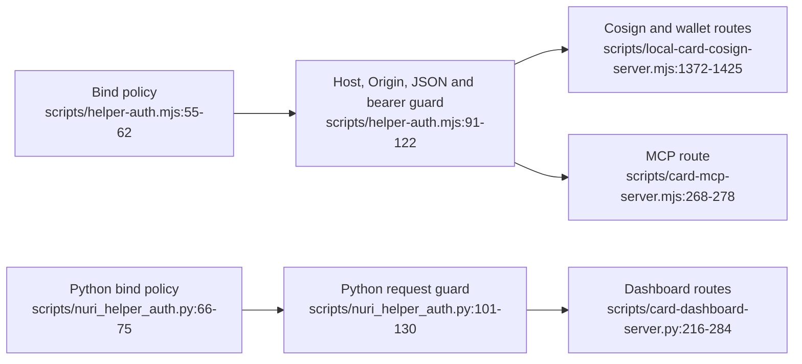

# Helper servers: access control



## Entry points

| Helper | Default bind / port | Guard call site |
|---|---|---|
| Cosign demo and wallet | Loopback / 8787; simulated backend by default | [scripts/local-card-cosign-server.mjs:248-254,1372-1373,1448-1451](../scripts/local-card-cosign-server.mjs#L1372-L1451). |
| Dashboard | Loopback / 8788 | [scripts/card-dashboard-server.py:184-192,379-392](../scripts/card-dashboard-server.py#L379-L392). |
| MCP | Loopback / 8799; `POST /mcp`, `GET /healthz` | [scripts/card-mcp-server.mjs:263-278,305-307](../scripts/card-mcp-server.mjs#L263-L307). |

## Request policy

The Node guard checks the following in order; the Python guard applies the same
checks but protects `/api/` rather than `/mcp` as well. Sources:
[scripts/helper-auth.mjs:85-122](../scripts/helper-auth.mjs#L85-L122),
[scripts/nuri_helper_auth.py:97-130](../scripts/nuri_helper_auth.py#L97-L130).

| Check | Rejection |
|---|---|
| `OPTIONS` requests | 403 |
| `Host` outside the allowed host-and-port set | 403 |
| Supplied `Origin` outside the allowed HTTP(S) host-and-port set | 403 |
| Protected-route `POST` without `Content-Type: application/json` | 415 |
| Protected route without a matching `Authorization: Bearer` token | 401 |

An absent `Origin` is accepted; the origin check is a host-and-port allow-list,
not an exact-origin comparison. Unprotected pages and health routes need no bearer
token but still pass Host/Origin checks. Sources:
[scripts/helper-auth.mjs:65-75,91-122](../scripts/helper-auth.mjs#L65-L122),
[scripts/nuri_helper_auth.py:78-130](../scripts/nuri_helper_auth.py#L78-L130).

## Token and exposure boundary

- `NURI_CARD_TOKEN` supplies a token of at least 16 characters; otherwise a token
  file is read or generated from 32 random bytes. `NURI_CARD_TOKEN_FILE` overrides
  its location. Newly generated files are mode `0600`; generated tokens are
  printed at startup. Sources: [scripts/helper-auth.mjs:26-51](../scripts/helper-auth.mjs#L26-L51),
  [scripts/nuri_helper_auth.py:34-63](../scripts/nuri_helper_auth.py#L34-L63).
- Non-loopback binding requires **both** `NURI_ALLOW_REMOTE=1` and a token from
  `NURI_CARD_TOKEN`, not an automatically loaded file. `NURI_ALLOWED_HOSTS` extends
  the host allow-list in remote mode. Sources:
  [scripts/helper-auth.mjs:55-75](../scripts/helper-auth.mjs#L55-L75),
  [scripts/nuri_helper_auth.py:66-87](../scripts/nuri_helper_auth.py#L66-L87).
- Served HTML receives the bearer token in a fetch shim; matching relative
  `/api` and `/mcp` requests gain the authorization header. The pages themselves
  are therefore inside the token trust boundary, **not** authenticated user
  sessions. Sources: [scripts/helper-auth.mjs:125-147](../scripts/helper-auth.mjs#L125-L147),
  [scripts/local-card-cosign-server.mjs:299-307](../scripts/local-card-cosign-server.mjs#L299-L307),
  [scripts/card-dashboard-server.py:366-374](../scripts/card-dashboard-server.py#L366-L374).
- These guards authorize HTTP requests, not physical touch, on-card user presence
  or PIN verification. MuSig2 dispatch/finalization has no such check; the legacy
  ETH signing handler checks key initialization and hash length. Sources:
  [card/musig2/NuriMuSig2v019.java:178-203,369-391](../card/musig2/NuriMuSig2v019.java#L369-L391),
  [card/eth/NuriEcdsaSigner.java:204-218](../card/eth/NuriEcdsaSigner.java#L204-L218).

## Operation-specific gates

- Dashboard key generation requires `NURI_ALLOW_KEYGEN=1` and a reported ETH
  version of at least 1.4. With the environment gate closed, that route returns
  before selecting the applet. Source:
  [scripts/card-dashboard-server.py:273-284](../scripts/card-dashboard-server.py#L273-L284).
- MCP wallet **mainnet broadcast** requires `NURI_ALLOW_MAINNET=1`; a dry-run still
  builds and signs. This is a gate in that MCP handler, not a repository-wide
  spending policy. Source: [scripts/card-mcp-server.mjs:193-207](../scripts/card-mcp-server.mjs#L193-L207).
- The tweaked-cosign MCP wrapper forwards only message/hash arguments, not a
  client secret. Source: [scripts/card-mcp-server.mjs:52-57,160-162](../scripts/card-mcp-server.mjs#L52-L57).

## Software checks

```sh
node --test test/helper-auth.test.js
PYTHONDONTWRITEBYTECODE=1 python3 -m unittest discover -s test -p test_helper_auth.py -v
```

The Node tests start loopback servers with a simulated cosigner and exercise an
MCP mainnet refusal before signing. The Python tests replace PC/SC access with
fake applets. Sources: [test/helper-auth.test.js:114-149,184-211](../test/helper-auth.test.js#L114-L211),
[test/test_helper_auth.py:142-153,203-218](../test/test_helper_auth.py#L142-L218).
**UNVERIFIED:** these tests do not establish hardware behavior or safe public deployment.
