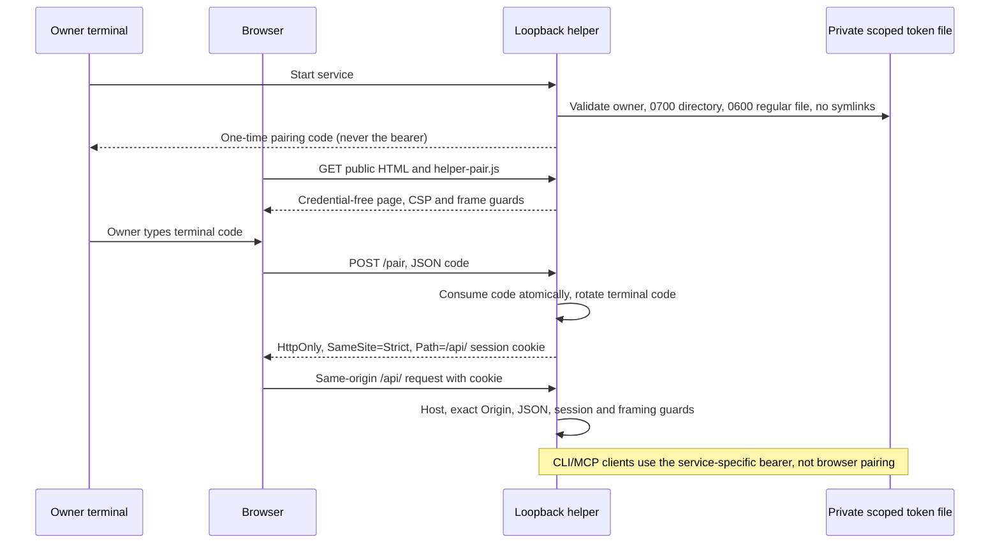

# Helper servers: local authorization and resource limits



## Entry points and binding

| Helper | Default address | Scope |
|---|---|---|
| Cosign demo and wallet | `127.0.0.1:8787` | `cosign` |
| Dashboard | `127.0.0.1:8788` | `dashboard` |
| MCP | `127.0.0.1:8799` (`POST /mcp`, public `GET /healthz`) | `mcp` |

All helpers reject non-loopback bind addresses. There is **no remote override**, including with the obsolete `NURI_ALLOW_REMOTE` or `NURI_ALLOWED_HOSTS` variables. `--backend` accepts only `simulated` or `real-card`; it does not accept a remote card URL. The MCP and dashboard use local PC/SC helpers, not a remotely configurable card host. Do not publish or tunnel these ports. Binding, guards and server limits live in [helper-auth.mjs](../scripts/helper-auth.mjs) and [nuri_helper_auth.py](../scripts/nuri_helper_auth.py); call sites are [cosign](../scripts/local-card-cosign-server.mjs), [MCP](../scripts/card-mcp-server.mjs) and [dashboard](../scripts/card-dashboard-server.py).

## Browser pairing: no token bootstrap

1. Start the helper, then open its loopback page.
2. Enter the **current terminal pairing code** in the pairing dialog. No card action happens during pairing. Neither HTML, JavaScript, health checks nor an unauthenticated API response supplies the code, a session, or the bearer token.
3. `POST /pair` accepts a JSON code, consumes it before returning, and sets a random session cookie. Concurrent exchanges of one code have exactly one winner. Wrong guesses never create sessions; ten failures burn and replace the code. Codes expire after five minutes; an expired-code attempt prints a replacement in the terminal. Each successful pairing also prints the next single-use code.
4. Session identifiers are independent of the bearer, stored only as hashes in process memory, and expire twelve hours after creation without sliding renewal. At most 32 sessions are retained. Restarting the helper revokes all sessions and pairing codes.

Cookies are host-only, named per service (`nuri_cosign_session`, `nuri_dashboard_session`), and set with **`HttpOnly; SameSite=Strict; Path=/api/`**. They never authorize `/mcp`. Cookies cannot be `Secure` on the current plain-HTTP loopback transport; cookie paths and names are not OS-user or TCP-port isolation. Same-origin JavaScript can use a cookie-authorized API even though it cannot read the cookie. A compromised helper page or local account remains outside this protection boundary.

The shared [helper-pair.js](../web/helper-pair.js) waits for pairing before releasing page API fetches. An existing valid session skips the dialog. No bearer is stored in a global, localStorage, sessionStorage or a script shim. The old token-in-HTML injection functions have been removed.

## Request authorization

| Check | Result on rejection |
|---|---|
| `OPTIONS` | 403; no CORS headers |
| Host outside `127.0.0.1:<port>`, `localhost:<port>`, `[::1]:<port>` | 403 |
| Supplied Origin not equal to the actual helper's `http://<Host>` | 403; other loopback names, ports and HTTPS do not qualify |
| Supplied `Sec-Fetch-Site` not `same-origin` on API/pairing | 403 |
| Protected/pairing POST without `application/json` | 415 |
| API without correct scoped bearer or valid browser session | 401 |
| Cookie session without exact Origin or `Sec-Fetch-Site: same-origin` | Rejected (401 Node, 403 Python) |
| Pairing without a correct unused code | 401 |

A CLI bearer request may omit Origin. Host/Origin checks alone are not authentication against raw HTTP clients. Public pages still pass Host/Origin checks; downloading one does not authorize an API request. The browser code is not an MCP bootstrap: MCP requires its own bearer.

Every served page and normal API/error response includes `Cache-Control: no-store`, `Referrer-Policy: no-referrer`, `X-Frame-Options: DENY`, `X-Content-Type-Options: nosniff`, and CSP containing **`default-src 'self'; frame-ancestors 'none'`**, `object-src 'none'`, `base-uri 'none'` and `form-action 'self'`. Existing inline page scripts/styles/onclick handlers require the explicit `script-src 'self' 'unsafe-inline'` / style exception. This is a frame/bootstrap defense, not a claim that arbitrary page XSS is prevented. Low-level HTTP parser failures close the connection before any page is served.

## Service-specific bearer files and migration

| Service | Environment token | Explicit file override | Default file |
|---|---|---|---|
| Cosign | `NURI_COSIGN_TOKEN` | `NURI_COSIGN_TOKEN_FILE` | `~/.nuri-card/cosign.token` |
| Dashboard | `NURI_DASHBOARD_TOKEN` | `NURI_DASHBOARD_TOKEN_FILE` | `~/.nuri-card/dashboard.token` |
| MCP | `NURI_MCP_TOKEN` | `NURI_MCP_TOKEN_FILE` | `~/.nuri-card/mcp.token` |

The shared `NURI_CARD_TOKEN` is no longer accepted as a credential; startup explains migration unless the service-specific environment token is supplied. Unset it to generate separate service files, or generate independent values with `openssl rand -hex 32`. Never intentionally configure the same token/file for multiple services. The legacy `NURI_CARD_TOKEN_FILE` is only a **base filename**: helpers append `.cosign`, `.dashboard`, or `.mcp`; the unsuffixed legacy token is not loaded.

On every file load, the helper requires current-user ownership, a regular **0600 file** in an owner-only **0700 directory**, and rejects symlink files/directories using `O_NOFOLLOW`. Invalid modes, foreign owners, malformed contents and nonregular files cause startup failure; they are not silently repaired or overwritten. Tokens are 32 CSPRNG bytes encoded as 64 lowercase hex characters; configured tokens must have that syntax and pass a repetition sanity check (not proof of entropy).

Creation writes a fresh exclusive 0600 temporary file, flushes it, then publishes via an atomic no-replace hard link. Concurrent first starts read the complete winning file. Python anchors file access with a directory descriptor; Node canonicalizes and checks ancestors, rejects writable/foreign-owned ancestors, opens the final directory without following links and checks its inode after access. Normal startup logs identify the file but **never print its bearer value**. Pairing codes are deliberately terminal-visible; keep terminal logs private.

Example MCP client after default startup:

```sh
curl --fail http://127.0.0.1:8799/mcp \
  -H "Authorization: Bearer $(cat "$HOME/.nuri-card/mcp.token")" \
  -H 'Content-Type: application/json' \
  --data '{"jsonrpc":"2.0","id":1,"method":"tools/list"}'
```

## Body, connection and native-message limits

- HTTP bodies are capped at **1 MiB** before authentication; an oversized declared length returns **413** without waiting for its body. Negative, duplicate or malformed Content-Length is rejected. Transfer-Encoding is unsupported and rejected (400 Node, 501 Python). Node POSTs require Content-Length (411 if absent); Python treats an absent length as zero bytes. Pairing on the dashboard has an additional 1 KiB body limit.
- Request lines, headers and bodies have an **absolute 10-second read deadline**, not an idle timeout that trickled bytes renew. Deadline failures return 408 and close. Node `NURI_HELPER_REQUEST_TIMEOUT_MS` may only shorten that limit for tests. Node closes after each response; Python uses one-request HTTP/1.0 connections. Rejections never synchronously drain an attacker-controlled body.
- At most 16 connections are handled concurrently. The dashboard uses bounded worker threads and a card-operation lock, so one slow client does not block all requests. These limits bound resource retention; a hostile local process can still deny service by repeatedly occupying every slot.
- The [native host](../host/nuri_card_host.py) caps incoming frames at **1 MiB**, requires a nonzero length, and exits with code 1 after **any framing error**: oversized/truncated frame, invalid UTF-8/JSON, excessive nesting, or frame-read deadline. It emits one BAD_REQUEST reply and never interprets trailing bytes as another frame. Well-framed non-object JSON gets a request error without crashing the logger. Hashes require exactly 64 hex characters decoding to 32 bytes; whitespace is not hex.
- Native Unix pipe reads have a **five-second absolute deadline from the first byte**. An idle host waiting between messages is not timed out. `NURI_CARD_HOST_FRAME_TIMEOUT` can shorten this deadline; invalid, infinite or larger values fall back to five seconds. Windows pipes and in-memory test streams do not currently have the Unix `select` deadline; Windows availability hardening remains **UNVERIFIED**.

## Operation gates and remaining scope

Dashboard key generation still requires `NURI_ALLOW_KEYGEN=1` and an ETH applet version of at least 1.4; refusal occurs before KEYGEN. MCP mainnet **broadcast** requires `NURI_ALLOW_MAINNET=1`; dry-run still signs. HTTP pairing is not physical touch, on-card PIN verification, transaction review, or a guarantee against an already-compromised local account. This change closes the helper bootstrap/filesystem/framing findings (W13 gates 3 and 9); it does not close W13 R12's separate **applet tear-atomicity** findings or the other applet/extension launch gates.

## Reproducible software checks (no card/reader)

```sh
node --test test/helper-auth.test.js test/helper-auth-hardening.test.js
python3 -m unittest discover -s test -p test_helper_auth.py -v
NURI_CARD_SIM=1 python3 host/test_host.py
npm test
NURI_HOST_PYTHON=/path/to/venv/bin/python node --test extension/test/*.test.js
# Optional real-browser check: disposable profile, simulated helper only.
node test/helper-pair-browser.mjs
```

Use the repository's Python environment with its existing crypto dependencies. Tests start real loopback HTTP servers with simulated/fake card backends and use private disposable token directories. They cover public-page leakage, concurrent/single-use pairing, session scope/expiry, 0644 and symlink refusal, atomic creation races, body caps, trickled-header/body deadlines and fail-closed native frames. They do **not** establish physical-card, Chrome native-extension or safe public-deployment behavior.

Parent-only manual hardware acceptance (not executed by this worker): start `node scripts/local-card-cosign-server.mjs --backend=real-card` or `scripts/run-card-python.sh` with `scripts/card-dashboard-server.py`, enter the terminal code, confirm status, then use the parent's separately approved non-destructive signing procedure. Never use KEYGEN, provisioning, reset or card-install commands as helper smoke tests.
