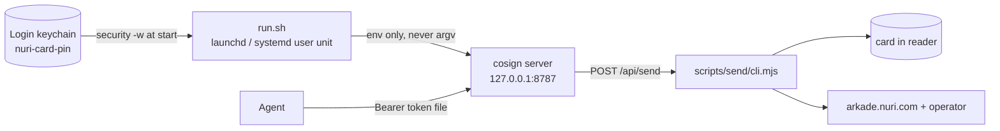

# Home cosigner: the card as a permanent local signing service

A LaunchAgent (macOS) or `systemd --user` unit (Linux) keeps
`scripts/local-card-cosign-server.mjs` running on `127.0.0.1:8787` for as long as
the machine is up. The card stays in the reader; the PIN comes from the OS
keystore and reaches the server through the environment only. An agent calls one
loopback POST to move sats.

This is the "card is the key, the machine is the signer" setup for a single-user
box. It is not a hosted service and not an HSM appliance.



## What the service does and does not enforce

| Property | Here | Owner |
|---|---|---|
| Spends per day, allowlist, per-recipient caps | none | the calling agent |
| Execution boundary against a stale page/plan | `NURI_SEND_CONFIRM` derived from the request | this server ([local-card-cosign-server.mjs](../scripts/local-card-cosign-server.mjs)) |
| Loopback only, bearer token file 0600 in a 0700 dir | enforced | [helper-auth.mjs](../scripts/helper-auth.mjs) |
| Card partial + server partial + aggregate BIP340 verification | enforced | [scripts/send/cli.mjs](../scripts/send/cli.mjs) |
| Duplicate-send protection | one unique receipt per request; failure stages say `DO NOT RESEND` | this server + the CLI receipt journal |

There is deliberately no limit and no allowlist. A machine that runs this can
spend the card wallet until the balance is gone, so limits belong where the
policy lives: in the agent.

## Install (macOS)

The service runs from this checkout, so install the dependencies once first
(`npm ci`); the wrapper refuses to start without them.

```sh
scripts/home-cosigner/install-macos.sh            # or: npm run cosigner:install
```

Then store the card PIN once. `-w` with no value prompts, so it never lands in
shell history, and the installer never asks for or prints it:

```sh
security add-generic-password -s nuri-card-pin -a "$USER" -w
launchctl kickstart -k gui/$UID/com.nuri.home-cosigner
```

The installer writes `~/Library/LaunchAgents/com.nuri.home-cosigner.plist`
(`RunAtLoad`, `KeepAlive` on unsuccessful exit, `ThrottleInterval` 30) and logs
to `~/.nuri-card/logs/home-cosigner.log` (0600 in a 0700 directory). It also
creates the log file private before launchd can create it 0644. Options:
`--port`, `--python <3.10+>`, `--node <22+>`, `--no-load`, `--uninstall`.

`NURI_READER` is taken from `~/.nuri-card-host/bitcoin.env` when that file
exists, so the reader picker matches the rest of the host tooling. Only that one
key is read; nothing else in the file overrides the service.

## Health check

```sh
T="$(cat ~/.nuri-card/cosign.token)"
curl -s -H "Authorization: Bearer $T" http://127.0.0.1:8787/api/cosign/info | jq -r .status
# NURI_CARD_COSIGN_SERVER_READY
tail -n 20 ~/.nuri-card/logs/home-cosigner.log
```

The token file is created by the helper at first start (64 hex characters, 0600,
`~/.nuri-card` is 0700). If `~/.nuri-card/cosign.token` already exists from an
older run, it is reused; pairing a browser also still works.

## Agent one-liner

Dry run first — public reads only, no card, no PIN, no receipt:

```sh
T="$(cat ~/.nuri-card/cosign.token)"
curl --fail --silent -X POST http://127.0.0.1:8787/api/send \
  -H "Authorization: Bearer $T" -H 'Content-Type: application/json' \
  -d '{"to":"@emino","amount":1000}' | jq '{status,recipient_sats,change_sats,floor_sats}'
```

Execute the same body with `"execute":true`. `to` is an `ark1…` address or
`@username` (ENS `com.nuri.arkade`); `amount` is integer sats or `"all"`. Both are
required — the server does not invent a default, because the agent owns limits.
The response is the CLI summary or receipt, unchanged.

```sh
curl --fail --silent -X POST http://127.0.0.1:8787/api/send \
  -H "Authorization: Bearer $T" -H 'Content-Type: application/json' \
  -d '{"to":"@emino","amount":1000,"execute":true}' | jq '{status,txid,indexer_verified}'
```

Status codes: `400` bad address/amount, `503` no PIN in the service environment,
`502` card or network failure (the PIN is shown as `[PIN]` in the text), `401`
missing/wrong token. Receipts and JSONL logs go to `~/.nuri-card/send/`
(`NURI_CARD_SEND_OUT_DIR`). A failed run's receipt says whether the outcome is
unknown; an unknown outcome is reconciled, never retried blindly.

`POST /api/send` runs `scripts/send/cli.mjs`, which also checks the recipient is
on the operator's network, the card credential is registered, and that the
snapshot did not change between plan, authorization and submission.

## Linux (UNVERIFIED on hardware)

Same wrapper, different supervisor. Written against the macOS twin; no Linux box
has run it yet.

```sh
scripts/home-cosigner/install-linux.sh            # or: npm run cosigner:install:linux
mkdir -p ~/.nuri-card && chmod 700 ~/.nuri-card
( umask 077; read -rs -p 'card PIN: ' p; printf '%s\n' "$p" > ~/.nuri-card/pin )
systemctl --user restart nuri-home-cosigner
```

The wrapper re-checks that `~/.nuri-card/pin` is mode 600 at every start and
refuses otherwise. The unit is `~/.config/systemd/user/nuri-home-cosigner.service`.
`loginctl enable-linger "$USER"` is attempted so it survives logout. `pcscd` must
be running.

## Run without a supervisor

```sh
NURI_CARD_PIN=1234 scripts/home-cosigner/run.sh        # foreground
scripts/home-cosigner/run.sh                           # PIN from the keychain
NURI_HOME_COSIGNER_PIN_SOURCE=file scripts/home-cosigner/run.sh
NURI_HOME_COSIGNER_PRINT_CMD=1 scripts/home-cosigner/run.sh   # show the resolved command
```

## Uninstall

```sh
scripts/home-cosigner/install-macos.sh --uninstall    # or npm run cosigner:uninstall
scripts/home-cosigner/install-linux.sh --uninstall
security delete-generic-password -s nuri-card-pin     # optional, PIN item
```

State, logs, receipts and the token stay in `~/.nuri-card/`.

## Troubleshooting

| Symptom | Cause | Fix |
|---|---|---|
| Log shows `no card PIN in the login keychain`, exit 78 | PIN item missing | `security add-generic-password -s nuri-card-pin -a "$USER" -w`, then kickstart |
| Log shows `no Python found` / `older than 3.10` | launchd has no shell profile | pass `--python /opt/homebrew/bin/python3.13` to the installer |
| Log shows `dependencies missing` | fresh clone, no `npm ci` | `( cd <repo> && npm ci )`, then kickstart |
| `502 send failed: … card operation failed` | card removed, wrong reader, or PC/SC busy | reseat the card on the configured reader; check nothing else holds the reader |
| `503 no card PIN …` | service started without the PIN | see the first row; the wrapper exports `NURI_CARD_PIN`/`NURI_FIDO_PIN` |
| `401` | wrong or missing token | `cat ~/.nuri-card/cosign.token`; it is 0600 |
| `409 endpoint unavailable in simulation mode` | service started with `--sim` | keep `--backend=real-card` (the installers do) |
| `receipt exists; DO NOT RESEND` | a request reused a receipt path | only happens if `NURI_CARD_SEND_OUT_DIR` names an existing file |

## Limits of the setup, stated plainly

- Any process running as your user can read the keychain item with `security
  find-generic-password -w`, so the PIN is exactly as strong as the logged-in
  session. That is the trade for unattended signing.
- The MuSig2 applet has no user presence: a card sitting in the reader signs for
  whatever reaches the reader. Physical possession of the card alone is not a
  second factor while the service runs.
- The service binds loopback only. A remote agent needs an SSH tunnel or the same
  box; there is no remote bind and no CORS.
- One reader, one card: the Chrome native host, the SSH provider and this service
  contend for the same PC/SC reader. Stop the service for long interactive card
  work rather than fighting for the device.
- Uninstalling does not revoke anything on the card; rotate the PIN if the
  machine is lost while the Keychain item is on it.
