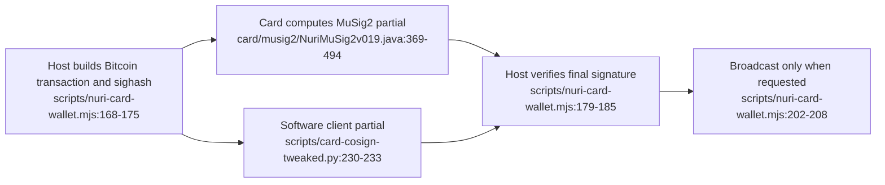

# How the card signing paths work

## Card, host and network have different jobs

The MuSig2 applet creates a secp256k1 key using card randomness and returns its public key. It later supplies public nonces and a partial signature, rather than constructing a Bitcoin transaction. [card/musig2/NuriMuSig2v019.java:217-277](../card/musig2/NuriMuSig2v019.java), [card/musig2/NuriMuSig2v019.java:308-415](../card/musig2/NuriMuSig2v019.java)

In the standalone wallet, the host builds the transaction, computes its sighash, obtains the client secret from FIDO2 PRF (or an explicit seed) and calls the card signing helper. The host rejects key mismatches and verifies the final Schnorr signature before finalization. Broadcasting is a separate requested step. [scripts/nuri-card-wallet.mjs:168-208](../scripts/nuri-card-wallet.mjs#L168-L208)

This means **some secrets do reach host memory**: the PRF-derived client key is not the same secret as the separate MuSig2 card key. The Arkade PRF identity adapter explicitly exposes a host signing key too. [scripts/nuri-card-wallet.mjs:173-175](../scripts/nuri-card-wallet.mjs#L173-L175), [scripts/card-arkade-identity.mjs:55-72](../scripts/card-arkade-identity.mjs#L55-L72)

## Other uses

| Function | Source-level behavior | Reference |
| --- | --- | --- |
| Passkeys / SSH | OpenSSH bridge calls FIDO2 MakeCredential and GetAssertion over PC/SC | [scripts/ssh-pcsc-sk-helper.py:83-119](../scripts/ssh-pcsc-sk-helper.py#L83-L119) |
| ETH v1 | Signs a 32-byte hash, returns 65-byte `r || s || v` | [card/eth/NuriEcdsaSigner.java:209-223](../card/eth/NuriEcdsaSigner.java), [card/eth/NuriEcdsaSigner.java:269-281](../card/eth/NuriEcdsaSigner.java) |
| ETH v2 | Separate signer with mandatory-default applet-specific PIN; 129-byte signature/public-key response | [card/eth2/NuriEthSignerV2.java:214-218](../card/eth2/NuriEthSignerV2.java), [card/eth2/NuriEthSignerV2.java:322-343](../card/eth2/NuriEthSignerV2.java) |
| TOTP | Card returns HMAC-SHA1 for an 8-byte counter; CALC does not require PIN validation | [card/totp/NuriOathTotp.java:142-157](../card/totp/NuriOathTotp.java) |

## What insertion or NFC proximity does not prove

FIDO2 UP signaling is not a fresh-touch check: CTAP2 sets the flag from request options and selection succeeds directly. Current MuSig2 has its own mandatory-default PIN and nonce-session token; old demo revisions and ETH v1 have no PIN gate. FIDO2 PIN verification does not authorize those separate applets. See [current MuSig2 policy](musig2-pin-and-hardening.md). [third_party/fido2-applet/src/main/java/us/q3q/fido2/FIDO2Applet.java:2343-2346](../third_party/fido2-applet/src/main/java/us/q3q/fido2/FIDO2Applet.java#L2343-L2346), [third_party/fido2-applet/src/main/java/us/q3q/fido2/FIDO2Applet.java:4648-4654](../third_party/fido2-applet/src/main/java/us/q3q/fido2/FIDO2Applet.java#L4648-L4654), [card/musig2/NuriMuSig2v019.java:178-203](../card/musig2/NuriMuSig2v019.java), [card/eth/NuriEcdsaSigner.java:156-166](../card/eth/NuriEcdsaSigner.java), [card/eth/NuriEcdsaSigner.java:209-213](../card/eth/NuriEcdsaSigner.java)

The MuSig2 applet receives coefficients, parity and a challenge, not an amount or recipient. Treat host transaction review and applet authorization as separate concerns; a partial signature is not on-card human-readable payment approval. [card/musig2/NuriMuSig2v019.java:389-415](../card/musig2/NuriMuSig2v019.java)

## Evidence, not a payment promise

The [Signet records](proofs/real-card-signet-proof.md) preserve historical transaction evidence. The [Arkade proof](proofs/arkade-card-signer-proof.md) separates local signing checks from live services. **UNVERIFIED:** current hardware installation, remote-service policy, NFC/browser compatibility and fresh Lightning settlement. No new hardware or network verification is implied by this guide.

Next: [capabilities](card-capability-summary.md), [key locations](signing-architecture.md), [key handling](real-card-key-handling.md).
