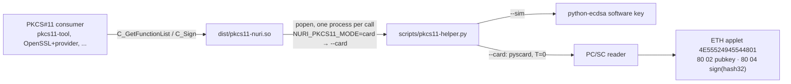
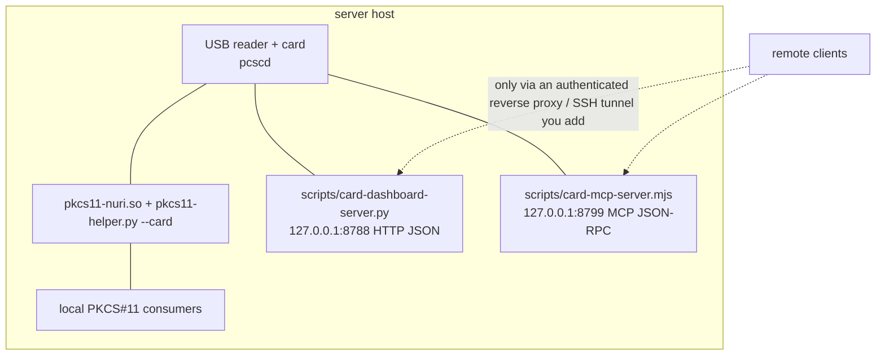

# The Nuri card as a PKCS#11 HSM

What `dist/pkcs11-nuri.so` does, what was actually run, and how to put the card
in a server. Everything marked **sim** was run on this machine against the
software simulation (`scripts/pkcs11-helper.py --sim`). Nothing in this file was
run against a card by the author of this file; the real-card commands are at
the end for whoever holds the reader.



## What the module is

- `scripts/pkcs11-nuri.c` (PKCS#11 v2.40 subset, no external headers) builds to
  `dist/pkcs11-nuri.so` with `scripts/build-pkcs11.sh` (one `clang` command;
  the Linux line is in the script header, **UNVERIFIED**).
- One slot, one token `Nuri Smartcard`, two objects with `CKA_ID=01` /
  `CKA_LABEL="Nuri ETH Key"`: `CKO_PRIVATE_KEY` (sign) and `CKO_PUBLIC_KEY`
  (verify). `CKA_EC_PARAMS` is the DER OID of secp256k1
  (`06052b8104000a` = 1.3.132.0.10); `CKA_EC_POINT` is a DER OCTET STRING of the
  uncompressed point `04||X||Y` (67 bytes). The card returns a 33-byte
  compressed point (`scripts/pkcs11-helper.py:80-85`); the module decompresses
  it in C (`secp256k1_decompress` in `scripts/pkcs11-nuri.c`), checked against
  python-ecdsa for 30 random keys of both parities and for the real card's
  published pubkey `031f0f76cf2da4d2c679130f1accfb1e3b149c20ea15291a49b643e350cc63c4b1`
  → `041f0f76cf2da4d2c679130f1accfb1e3b149c20ea15291a49b643e350cc63c4b190b4d112c9af7c473dede8c32767ecaa58a2df8bed963b68055992392a272845`
  (fed through a fake helper, no card touched).
- Mechanism: `CKM_ECDSA` only, 256-bit, flagged `CKF_HW | CKF_SIGN | CKF_EC_F_P`.
  `C_Sign` takes exactly one 32-byte digest (the applet throws
  `SW_WRONG_LENGTH` otherwise, `card/eth/NuriEcdsaSigner.java:208`) and returns
  raw `r||s` (64 bytes). Anything else returns `CKR_DATA_LEN_RANGE`.
  `C_SignUpdate`/`C_SignFinal` exist but return `CKR_FUNCTION_NOT_SUPPORTED`
  (pkcs11-tool dereferences them without checking; a NULL there segfaulted).
- Hashing is the caller's job. PKCS#11 `CKM_ECDSA` signs a digest; OpenSSL-style
  `CKM_ECDSA_SHA256` is not offered.

## Login / PIN: there is none

The ETH applet has no PIN and no user-presence check: any process that can
reach the reader can sign (`_launch/CONTRACTS.md` C3; verified by the parent on
the real card). The module reflects that honestly:

- `CK_TOKEN_INFO.flags = CKF_TOKEN_INITIALIZED | CKF_WRITE_PROTECTED`,
  **no `CKF_LOGIN_REQUIRED`**, `ulMinPinLen = ulMaxPinLen = 0`.
- `C_Login` accepts any user type and any PIN (including empty) and just flips
  the session state to `CKS_RO_USER_FUNCTIONS`; `C_Logout` flips it back. Both
  exist only so consumers that always log in (`pkcs11-tool -l`, p11-kit, some
  OpenSSL provider configs) do not fail with `CKR_FUNCTION_NOT_SUPPORTED`.
- `CKA_ALWAYS_AUTHENTICATE = false`.

A PIN-protected signer is the ETH v2 applet design
(`_launch/CONTRACTS.md` C4), not this module.

## What was run (sim, macOS 15.5 arm64, OpenSC 0.26.1 pkcs11-tool)

Environment for every command below:

```bash
export NURI_PKCS11_PYTHON=/path/to/python-with-ecdsa     # e.g. a venv; pyscard too for card mode
# NURI_PKCS11_HELPER is optional: the .so finds <its dir>/../scripts/pkcs11-helper.py by itself
# NURI_PKCS11_MODE unset = sim
```

`pkcs11-tool --module dist/pkcs11-nuri.so -L`

```
Available slots:
Slot 0 (0x1): Nuri Smartcard (PC/SC)
  token label        : Nuri Smartcard
  token manufacturer : Nuri.com
  token model        : ETH v1.3
  token flags        : token initialized, readonly
  hardware version   : 1.0
  firmware version   : 1.3
  serial num         : 0000000000000000
  pin min/max        : 0/0
```

`pkcs11-tool --module dist/pkcs11-nuri.so -M`

```
Supported mechanisms:
  ECDSA, keySize={256,256}, hw, sign, EC F_P, EC uncompressed, EC compressed
```

`pkcs11-tool --module dist/pkcs11-nuri.so -O` (sim key is deterministic,
`sha256("nuri-card-sim-v1") mod n`, so this output is stable)

```
Private Key Object; EC
  label:      Nuri ETH Key
  ID:         01
  Usage:      sign
  Access:     sensitive, always sensitive, never extractable, local
Public Key Object; EC  EC_POINT 256 bits
  EC_POINT:   044104bcd83232b6276e8856605cfd877f7795536a5099555684422fe82f2b6adb95e26f907cbe90e7b35d9a811c9e34472defcc0655a1562ac7e873fb948978cd9d3d
  EC_PARAMS:  06052b8104000a (OID 1.3.132.0.10)
  label:      Nuri ETH Key
  ID:         01
  Usage:      verify
  Access:     local
```

Sign a 32-byte digest and verify it with python-ecdsa against the public key
the module itself exported:

```bash
head -c 32 /dev/urandom > h32.bin
pkcs11-tool --module dist/pkcs11-nuri.so --sign -m ECDSA -i h32.bin -o sig.bin
pkcs11-tool --module dist/pkcs11-nuri.so --read-object --type pubkey --id 01 -o pub.der
python3 -c "
from ecdsa import VerifyingKey; from ecdsa.util import sigdecode_string
vk=VerifyingKey.from_der(open('pub.der','rb').read())
print(vk.verify_digest(open('sig.bin','rb').read(), open('h32.bin','rb').read(), sigdecode=sigdecode_string))"
```

Output observed:

```
hash d7c2164ea785712b1a36e3e988d05127b3876780ca92ec2e7be6727859981990
sig r||s 27f943557bc1ff0b84d547f890d8406c10f7d45a833addff309d7b7ab833cce2859ff583de1e4acd1e26601e9d40458a75930fd3adc6ba248360eec8245615de
python-ecdsa verify: True
```

`pkcs11-tool ... -l --pin 0000 --sign ...` also signs (login is a no-op). A
31-byte input exits non-zero with
`error: PKCS11 function C_SignUpdate failed: rv = CKR_FUNCTION_NOT_SUPPORTED`
and writes no file.

All of the above is wrapped in `scripts/test-pkcs11-e2e.py` (14 checks, drives
the real `.so` via pkcs11-tool; the previous version of that file never loaded
the module). Run: `python3 scripts/test-pkcs11-e2e.py` → `ALL TESTS PASSED`.

Reproducible build: `bash scripts/build-pkcs11.sh --check` rebuilds to a temp
file and compares with `dist/SHA256SUMS` → `PKCS11_BUILD_MATCHES_SHA256SUMS`
(two consecutive builds with Apple clang gave identical SHA-256; other clang
versions will differ).

### What does NOT work (tested)

- `README.md:710` says `openssl dgst -sha256 -sign dist/pkcs11-nuri.so ...`.
  That command treats the `.so` as a PEM/DER key file. Observed:
  - LibreSSL 3.3.6 (`/usr/bin/openssl`): `unable to load key file ... Expecting: ANY PRIVATE KEY`
  - OpenSSL 3.6.5 (`/opt/homebrew/opt/openssl@3`): `Could not find private key from dist/pkcs11-nuri.so`
  OpenSSL needs a PKCS#11 provider (`pkcs11-provider`, not in Homebrew core) or
  the legacy `libp11` engine, plus a `pkcs11:` URI such as
  `pkcs11:token=Nuri%20Smartcard;object=Nuri%20ETH%20Key;type=private`, and it
  will pass a digest to `CKM_ECDSA` which this module now answers. Neither
  provider nor engine was installed here, so OpenSSL-through-PKCS#11 is
  **UNVERIFIED**. The README line should be replaced by the pkcs11-tool commands
  above (README is not owned by this change).
- Streaming/multi-part signing, key generation, RSA, any curve but secp256k1,
  certificates: not implemented. Key generation is a one-shot applet INS
  (`card/eth/NuriEcdsaSigner.java:31`, SW `6989` afterwards) and deliberately
  not exposed via PKCS#11.

## Running the card in a server



Three helpers already serve the card; pick one per use:

| Helper | Serves | Binds | Signs with | Notes |
|---|---|---|---|---|
| `dist/pkcs11-nuri.so` + `scripts/pkcs11-helper.py --card` | PKCS#11 (`C_Sign` of a 32-byte digest) | n/a, in-process | ETH applet | `NURI_PKCS11_MODE=card`. Spawns one helper per PKCS#11 call, each opens PC/SC, SELECTs, signs, disconnects. Fine for a few signs/s, not for high throughput. |
| `scripts/card-dashboard-server.py` | HTTP JSON: `/api/eth/sign {hash}` → `{r,s,v,pubkey,verified}`, `/api/btc/sign`, `/api/eth/keygen`, status | `127.0.0.1:8788` (hardcoded, `scripts/card-dashboard-server.py:320-324`) | ETH applet | Verifies every signature with python-ecdsa before returning it. **Exposes `/api/eth/keygen`**: on a fresh applet that call burns the one-shot KEYGEN. |
| `scripts/card-mcp-server.mjs` | MCP tools `nuri_card_info`, `nuri_card_cosign`, `nuri_card_wallet_*` | `HOST`/`PORT` env, default `127.0.0.1:8799` (`scripts/card-mcp-server.mjs:284-286`) | MuSig2 applet | Serializes card access (`:29`). Its banner suggests `ngrok http 8799`; see below before doing that. |

Prerequisites on the server: `pcscd` running, the reader on the USB bus,
Python with `pyscard` + `ecdsa` (`NURI_PKCS11_PYTHON` must point at it), and for
cheap readers T=0 (the helper forces T=0, `scripts/pkcs11-helper.py:94`).

### Trust boundary (read this before exposing anything)

- **No PIN, no user presence → any local process that can open the reader can
  sign.** The secure element only guarantees the key cannot be *extracted*; it
  does not decide *who* may use it. On a server the OS is the whole access
  control.
- Bind every helper to `127.0.0.1` (the two servers already do by default; the
  MCP server honours `HOST=0.0.0.0`, do not set it). Do not `ngrok` them
  without an auth layer in front; `card-mcp-server.mjs` has no auth of its own.
- Gate with the OS: run the helper as a dedicated user, give only that user
  access to `pcscd` (polkit rule / `pcscd` group), and put the PKCS#11 consumer
  in the same user. Anything remote goes through an SSH tunnel or an
  authenticated reverse proxy, with per-request logging on the proxy, because
  the card itself logs nothing.
- Keep `/api/eth/keygen` off the network entirely; a stray call wastes the
  one-shot keygen slot (SW `6989` afterwards, no second chance without
  reinstalling the applet = new key).
- PC/SC is exclusive: only one process may talk to the card at a time.
  `card-mcp-server.mjs` serializes internally; the PKCS#11 module does not, so
  do not run two PKCS#11 consumers in parallel against one reader. The FIDO2
  applet on the same card also goes through the same reader; a server card
  should not be the admin's SSH key.
- Signing input is an opaque 32-byte digest. Nothing on the card shows what it
  is signing; the host builds the hash. A compromised host can get the card to
  sign anything, but still cannot take the key with it. That is the only
  guarantee this HSM makes.

## Real-card commands (for the person with the reader; not run here)

```bash
cd nuri-passkey-prf-smartcard
export NURI_PKCS11_PYTHON=/path/to/python-with-pyscard-and-ecdsa
export NURI_PKCS11_MODE=card

NURI_PKCS11_MODE=card pkcs11-tool --module dist/pkcs11-nuri.so -L
NURI_PKCS11_MODE=card pkcs11-tool --module dist/pkcs11-nuri.so -O
# expected: same shape as sim, but EC_POINT =
#   0441041f0f76cf2da4d2c679130f1accfb1e3b149c20ea15291a49b643e350cc63c4b190b4d112c9af7c473dede8c32767ecaa58a2df8bed963b68055992392a272845
#   (Emin's card, pubkey 031f0f...c4b1, address 0x77bab29aa61949f03f233118ebc0a263f61cc385)

head -c 32 /dev/urandom > h32.bin
NURI_PKCS11_MODE=card pkcs11-tool --module dist/pkcs11-nuri.so --sign -m ECDSA -i h32.bin -o sig.bin
NURI_PKCS11_MODE=card pkcs11-tool --module dist/pkcs11-nuri.so --read-object --type pubkey --id 01 -o pub.der
"$NURI_PKCS11_PYTHON" -c "
from ecdsa import VerifyingKey; from ecdsa.util import sigdecode_string
vk=VerifyingKey.from_der(open('pub.der','rb').read()); sig=open('sig.bin','rb').read()
print('verify', vk.verify_digest(sig, open('h32.bin','rb').read(), sigdecode=sigdecode_string))
print('low-s', int.from_bytes(sig[32:],'big') <= vk.curve.order//2)"
# expected: verify True ; low-s True (applet enforces EIP-2, card/eth/NuriEcdsaSigner.java:254)

NURI_PKCS11_MODE=card "$NURI_PKCS11_PYTHON" scripts/test-pkcs11-e2e.py
# expected: ALL TESTS PASSED, mode=card, 3 signatures, low-s True
```

Each pkcs11-tool invocation spawns the helper twice (`C_Initialize` and
`C_Sign`): expect two reader connections per command. If `-O` shows no objects,
the helper did not find the ETH applet (`No card with ETH applet found` in the
helper's stderr); T=0 notes for the OMNIKEY 5422 / Realtek readers are in
`docs/logbook.md:234` and `README.md:445`.
